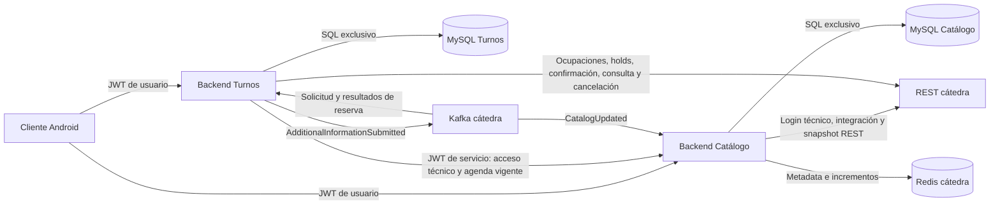
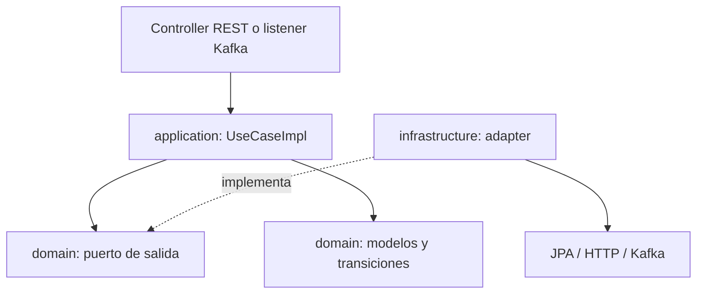
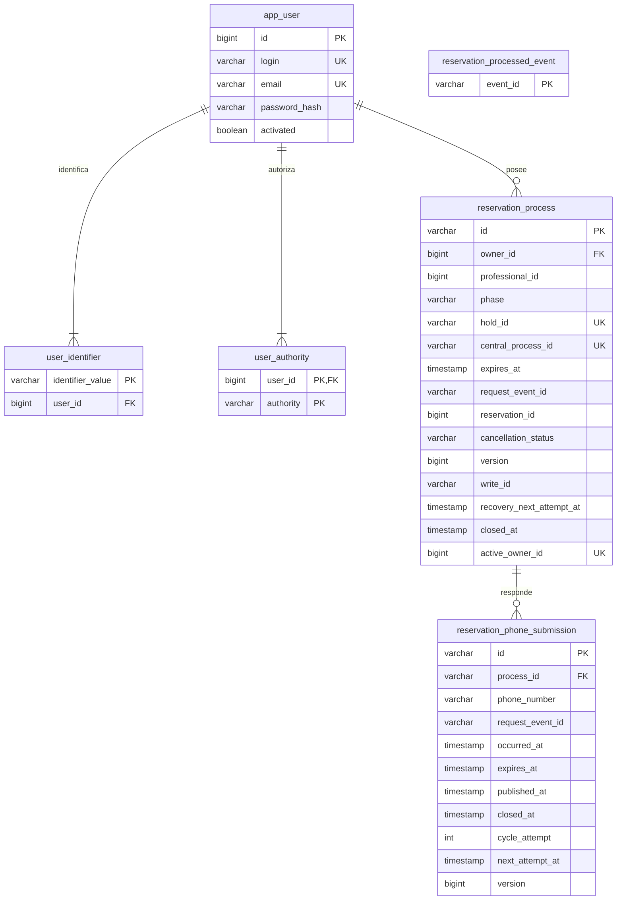

# Arquitectura y modelo vigentes

Turnos administra usuarios, disponibilidad y procesos de reserva propios. Catálogo
es dueño de la única copia local vigente de profesionales y agendas. Cátedra es
la autoridad de holds y reservas centrales. No se comparten tablas ni credenciales
de bases entre servicios. Android se representa como consumidor externo; este
repositorio no lo despliega y no forma parte de la entrega intermedia de backends.

## Contexto y límites de datos

Docker Compose despliega Turnos y su MySQL. La red externa `prog2-services` une
los backends; cada base queda en su red privada y volumen propio. Cátedra no se
despliega localmente. La sincronización completa/incremental pertenece a Catálogo:
snapshot REST, incrementos por Redis y notificaciones Kafka. Turnos consume su
lectura protegida vigente, sin otra réplica ni acceso a Redis.

## Puertos y adaptadores

| Paquete bajo `com.prog2.appointment` | Responsabilidad |
| --- | --- |
| `user` | Registro, contraseña, emisión de JWT y perfil mínimo para reservas. |
| `integration` | Acceso técnico adquirido al arranque mediante Catálogo y configuración central. |
| `availability` | Combinar agenda vigente con ocupaciones centrales y reloj de atención. |
| `reservation` | Inicio, teléfono, lectura propia, cancelación y recuperación. |
| `infrastructure/config` y `infrastructure/security` raíz | Configuración compartida, claves, filtros y credencial de servicio. |

Dominio no depende de Spring, JPA, HTTP ni Kafka. Aplicación coordina por puertos;
los adaptadores componen las lecturas públicas entre slices. DTO REST, Entity JPA
y dominio están separados por mappers. `@Component` e inyección por constructor
resuelven colaboradores triviales. `@Configuration` conserva clientes, relojes y
objetos que necesitan parámetros. `TransactionalReservationStore` es una frontera
`@Transactional` separada: no mantiene una transacción SQL abierta durante HTTP.

## Modelo de datos de Turnos

El diagrama resume claves y progreso, no todas las columnas. `reservation_process`
conserva selección, nombres del paciente e históricos opcionales del profesional.
Su `professional_id` es una referencia externa, sin FK a Catálogo. El paciente
central se deriva como `user-<ownerId>`. `active_owner_id`, generado a partir de
`closed_at`, impone un único proceso pendiente por usuario. Otra restricción generada
permite solo un envío telefónico activo por proceso. `reservation_processed_event`
contiene únicamente `event_id`, sin payload ni FK a un proceso.

Flyway es el único autor del esquema; Hibernate valida. Se conservan V2 a V12:
usuarios, procesos, outbox, nombres históricos, cancelación y recuperación, seguidos
de las simplificaciones. V1 es una sonda **solo de tests**, no una migración productiva.
V11 conserva todos los IDs históricos antes de retirar el inbox anterior. No editar
migraciones aplicadas. Las pruebas conservan escenarios sobre esquemas anteriores.

## Flujo y FSM actuales

Seleccionar horario → validar cuenta, agenda, ocupación y canal Kafka → persistir
intención → crear hold → persistir IDs y checkpoint → confirmar por REST → esperar
solicitud de teléfono → guardar respuesta y outbox atómicamente → publicar → recibir
resultado. Cada paso consulta el estado durable; una aceptación REST o ACK Kafka
no equivale a confirmación funcional.

| Fase | Significado durable |
| --- | --- |
| `HOLD_PENDING` | Intención de creación sin IDs reconocidos; recovery no repite el POST. |
| `HELD` | Hold conocido, sin checkpoint de confirmación inicial. |
| `CONFIRMATION_PENDING` | Checkpoint previo al POST; sin aceptación reconocida, requiere reconciliar. |
| `WAITING_FOR_REQUEST` | Aceptación inicial conocida, falta la solicitud Kafka de teléfono. |
| `WAITING_FOR_PHONE` | Solicitud correlacionada; permite responder dentro del plazo. |
| `PHONE_QUEUED` | Respuesta conservada en outbox, sin ACK de publicación reconocido. |
| `WAITING_FOR_RESULT` | ACK conocido, falta resultado funcional. |
| `RECONCILIATION_REQUIRED` | Evidencia incompatible o cierre de ventana sin resultado acreditado. |
| `FAILED` | Fallo central/definitivo o archivo local de creación sin IDs; este último no libera un hold central. |
| `EXPIRED` | Expiración acreditada, o hold conocido vencido que consta no confirmado inicialmente. |
| `CONFIRMED` | Reserva confirmada; libera el pendiente local y permite cancelación propia. |
| `CANCELLED` | Cancelación central acreditada. |

Un rechazo de teléfono vuelve a `WAITING_FOR_PHONE` con solicitud y vencimiento
originales. Resultados tardíos no reabren cierres; `CONFIRMED → CANCELLED` es la
cancelación autorizada, no una reapertura. No existe abandono funcional ni compensación
automática al salir de la pantalla.

## Atomicidad, concurrencia e idempotencia

- `@Version`, transiciones SQL condicionales, unicidad y `writeId` protegen progreso
  y permisos de ejecución. El guard por UUID evita solapamientos en esta instancia;
  no se promete un lock distribuido. Un resultado tardío no puede terminar el intento ajeno.
- Un error al confirmar el checkpoint JDBC impide disparar el nuevo efecto externo.
  No se rescata como éxito: recovery relee lo que realmente quedó persistido y
  reconcilia cuando el checkpoint no permite saber si hubo POST. Un fallo al guardar
  el resultado tampoco deshace el POST ya enviado; exige reconciliarlo. No se asume rollback.
- Kafka es at-least-once: registrar `eventId` y modificar proceso/outbox confirma o
  revierte en la misma transacción. El ACK del offset ocurre después de persistir.
  Crash antes del commit: redelivery aplica. Crash después del commit y antes del
  ACK: redelivery deduplica. Reutilizar un ID con otro contenido conserva el primer efecto.
- Los IDs del hold/proceso ya están persistidos antes de confirmar por REST. Por eso
  una solicitud Kafka adelantada a esa respuesta puede aplicarse sin diferirla.
  Un evento válido para proceso desconocido se ignora y deduplica definitivamente;
  no importa reservas ni conserva payload para replay. Mensajes inválidos no cambian estado.
- El outbox guarda UUID del envío como `eventId`, contenido, destino lógico y plazo.
  Republicar conserva esos valores. El ACK solo registra publicación; el rechazo
  permite otra respuesta con UUID nuevo. Evento final y cierre de outbox son atómicos.
  Su publicador procesa hasta diez envíos, con tres intentos por ciclo y pausa antes
  del siguiente; conserva contador/fecha tras reiniciar y no publica después de `expiresAt`.

## Recovery, cancelación y límites operativos

Recovery periódico procesa lotes de hasta diez y conserva la próxima revisión SQL.
Puede confirmar un `HELD` vigente solo con permiso durable y sin intento anterior.
Los checkpoints inciertos se consultan por REST antes de repetir efectos. Un plazo
vencido no resuelve por sí solo una confirmación incierta; las lecturas continúan
espaciadas hasta evidencia central, sin nuevos teléfonos ni confirmaciones.

Si se perdió la creación sin IDs, el intento puede archivarse localmente. Una nueva
creación exige consultar ocupaciones: HELD obliga esperar su `expiresAt` y reconsultar,
CONFIRMED bloquea, ausencia permite otro intento limitado sujeto a 409. No se asume
propiedad del hold observado ni se cuentan diez minutos desde el timeout.

Cancelar exige propietario y reserva confirmada. Se persiste intención `PENDING`,
se consulta evidencia y se permiten hasta tres POST por ejecución. Tras timeout se
reconcilia antes de repetir. `RETRY_REQUIRED` detiene POST automáticos y permite retry
explícito por el mismo endpoint; recovery todavía puede detectar `CANCELLED`.
**No hay presupuesto durable exacto entre reinicios**: una intención recuperada puede
disponer de hasta tres intentos nuevos, siempre con consulta previa. La idempotencia
central de cancelar una ya cancelada no autoriza a repetir a ciegas.

`find` consulta por paciente propio sin filtros de fecha, con hasta **tres páginas
de 100** y plazo total compartido. Devuelve una coincidencia exacta desde una página
válida; no certifica el historial posterior. Si no encuentra dentro del límite,
el resultado es **inconcluso**, no prueba inexistencia o liberación. Esto limita la
recuperación automática de reservas fuera de ese recorrido.

Registro/login y GET/List propios funcionan sin proveedores remotos, con MySQL y
configuración local válidos. Nuevas reservas exigen Catálogo vigente y Kafka preparado.
Un acceso técnico ya adquirido puede usarse durante una caída de Catálogo. Si falla
definitivamente su adquisición inicial, vence o recibe 401, **requiere reiniciar Turnos**;
no hay renovación asíncrona. Health `UP` no garantiza disponibilidad funcional.

La adquisición inicial realiza hasta tres intentos consecutivos: obtiene el JWT
desde Catálogo y valida la configuración de cátedra. Solo fallos recuperables permiten
otro intento; no espera ni programa ciclos nuevos. Cada GET tiene 5 s de límite de
conexión/lectura y 10 s totales. El acceso completo queda en memoria; leerlo comprueba
vigencia sin HTTP, y un rechazo 401 invalida solo el token usado.

Los [contratos](CONTRATOS.md) detallan credenciales y mensajes. Las pruebas con
proveedores ficticios verifican comportamiento controlado; no sustituyen un ensayo
real REST + Kafka contra cátedra ni acreditan por sí solas su disponibilidad.
