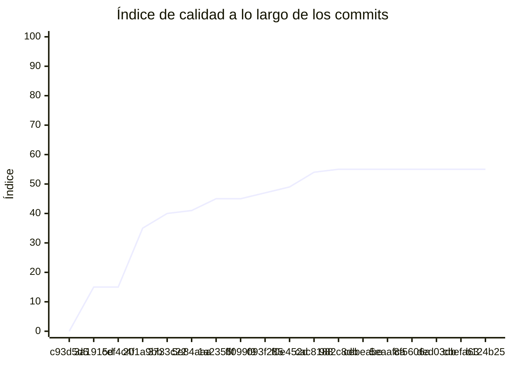

<!-- evaluacion:inicio -->
# Evaluación — prog2-perassiferrara/backend-turnos

> Documento **generado automáticamente** por la cátedra de Programación II (UM): RepoSense + análisis de calidad de **7 dimensiones**. **No editar a mano**: se regenera en cada evaluación.
> Rama evaluada: `main`. Análisis **heurístico** (regex + métricas) + build: es una criba para orientar la revisión, **no una nota**. La **documentación** del repositorio no se evalúa.
> Generado: 2026-11-11.

## 1. Veredicto

| Aspecto | Resultado |
|---|---|
| Índice de calidad | **66/100** |
| Tipo de repositorio | `backend` |
| Build (`mvnw verify` / `gradlew check`) | OK |
| Código (LOC) | 17,968 |
| Archivos de código | 217 |
| Clases | 260 |
| Código dentro de clases (%POO) | 86% |
| Funciones fuera de clases | 0 |
| Duplicación (puerta) | 2.7% |
| Duplicación lógica | 2.8% |
| Duplicación de boilerplate | 2.5% |
| Cobertura | 95% |

> Este informe **describe** lo que el análisis midió con los criterios ya establecidos de la materia. No es una nota.

## 2. Semáforo de aprobación

Criterios de la cátedra (`CRITERIOS-CALIDAD.md`): **Aprobar** se juega con el perfil `estandar`; **destacar**, con el `exigente` (meta de excelencia).

| Semáforo | Resultado |
|---|---|
| Aprobar (`estandar`) | **no cumple** — 5/11 |
| Destacar (`exigente`) | **no cumple** — 4/11 |

**Para aprobar, falta cumplir:** SOLID; SEC; SQL

**Para destacar, falta cumplir:** SOLID; Duplicación; SEC; SQL

## 3. Autoría (RepoSense)

| Autor | Commits | Código (LOC) | Tests (LOC) | Docs (LOC) | Días activos | % del código |
|---|---:|---:|---:|---:|---:|---:|
| Valentino Perassi Ferrara | 46 | 7,921 | 11,498 | 7,852 | 19 | 100% |

> _El LOC de autoría lo calcula RepoSense sobre el historial y puede diferir del LOC de código del análisis (que mira el estado de `main`)._

## 4. Dimensiones evaluadas

Cada dimensión indica **qué mide**, **por qué importa** y **tu resultado**. Cuando el puntaje queda por debajo de la referencia, se agregan preguntas para **investigar la causa** (no hay recetas).

| Dimensión | Peso | Puntaje |
|:--|--:|--:|
| **D1** Diseño OO, SOLID y patrones (20%) | 20% | 1 |
| **D2** Arquitectura hexagonal — backend (15%) | 15% | 100 |
| **D3** Frontend KMP: MVVM y buenas prácticas (10%) | 10% | N/A |
| **D4** Integración y contrato (10%) | 10% | 90 |
| **D5** Seguridad y robustez (10%) | 10% | 0 |
| **D6** Pruebas y cobertura (20%) | 20% | 100 |
| **D7** Proceso y entrega (15%) | 15% | 100 |

### D1. Diseño OO, SOLID y patrones (20%)

- **Qué mide:** Métricas orientadas a objetos (clases, métodos, campos, cohesión, acoplamiento, herencia) y proxies de SOLID, más patrones de diseño.
- **Por qué importa:** El eje de la materia es el buen uso de la POO y su arquitectura: un diseño con clases claras y poco acopladas es más fácil de entender, probar y cambiar.
- **Tu resultado:** **1/100**
- **Para investigar la causa:**
    - ¿Se pensó el modelo de clases antes de codificar o se agrupó después?
    - ¿Qué clases concentran muchas responsabilidades a la vez?
    - ¿Los colaboradores llegan como parámetros o se crean por dentro?

### D2. Arquitectura hexagonal — backend (15%)

- **Qué mide:** Separación en capas (dominio, puertos de entrada/salida, adaptadores) y dirección de las dependencias del backend.
- **Por qué importa:** Aislar el dominio de la infraestructura permite cambiar la base de datos, el framework o el transporte sin tocar las reglas de negocio.
- **Tu resultado:** **100/100**

### D4. Integración y contrato (10%)

- **Qué mide:** Cumplimiento del contrato de integración de la cátedra (formato de errores, paginación, autenticación, endpoints esperados).
- **Por qué importa:** Los servicios deben poder integrarse entre sí y con la app sin sorpresas; el contrato es lo que hacen cumplir las pruebas de integración.
- **Tu resultado:** **90/100**

### D5. Seguridad y robustez (10%)

- **Qué mide:** Credenciales embebidas, consultas SQL por concatenación, y presencia de config de entorno; aislamiento de secretos.
- **Por qué importa:** Un secreto en el repositorio o una consulta construida por concatenación son riesgos concretos, no hipotéticos.
- **Tu resultado:** **0/100**
- **Para investigar la causa:**
    - ¿De dónde salen las credenciales que usa el sistema?
    - ¿Qué consultas se arman con texto en vez de parámetros?
    - ¿Qué pasa si falta una variable de entorno al arrancar?

### D6. Pruebas y cobertura (20%)

- **Qué mide:** Cantidad y resultado de pruebas y cobertura de línea (JaCoCo/Kover, Surefire/Failsafe) cuando hay build.
- **Por qué importa:** Las pruebas son la red de seguridad para refactorizar e integrar; la cobertura acota las zonas sin verificar.
- **Tu resultado:** **100/100**

### D7. Proceso y entrega (15%)

- **Qué mide:** Artefactos verificables de proceso/entrega: `compose`, `.env.example`, CI (`.github/workflows/`), `CODEOWNERS` y wrapper de build (`mvnw`/`gradlew`). **No** puntúa documentación.
- **Por qué importa:** Un proyecto que compila, se levanta y se valida solo es más fácil de revisar y de integrar en equipo.
- **Tu resultado:** **100/100**

## 5. Señales detectadas

El análisis encontró las siguientes señales (archivo, sin número de línea a propósito):

**DIP/concretos** (202)
- clase 'ReservationRecoveryDispatcher' muy acoplada (CBO=9) — `src/main/java/com/prog2/appointment/reservation/infrastructure/scheduling/ReservationRecoveryDispatcher.java`
- clase 'JpaPhoneSubmissionRepository' muy acoplada (CBO=11) — `src/main/java/com/prog2/appointment/reservation/infrastructure/persistence/repository/JpaPhoneSubmissionRepository.java`
- clase 'JpaReservationProcessRepository' muy acoplada (CBO=19) — `src/main/java/com/prog2/appointment/reservation/infrastructure/persistence/repository/JpaReservationProcessRepository.java`
- clase 'TransactionalReservationStore' muy acoplada (CBO=58) — `src/main/java/com/prog2/appointment/reservation/infrastructure/persistence/service/TransactionalReservationStore.java`
- clase 'TransactionalReservationStore' instancia 12 concretos (CBO=58) — `src/main/java/com/prog2/appointment/reservation/infrastructure/persistence/service/TransactionalReservationStore.java`
- clase 'ReservationPersistenceMapper' muy acoplada (CBO=12) — `src/main/java/com/prog2/appointment/reservation/infrastructure/persistence/mapper/ReservationPersistenceMapper.java`
- clase 'ReservationPersistenceMapper' instancia 5 concretos (CBO=12) — `src/main/java/com/prog2/appointment/reservation/infrastructure/persistence/mapper/ReservationPersistenceMapper.java`
- clase 'JpaReservationProcessAdapter' muy acoplada (CBO=32) — `src/main/java/com/prog2/appointment/reservation/infrastructure/persistence/adapter/JpaReservationProcessAdapter.java`
- clase 'JpaReservationProcessAdapter' instancia 13 concretos (CBO=32) — `src/main/java/com/prog2/appointment/reservation/infrastructure/persistence/adapter/JpaReservationProcessAdapter.java`
- clase 'ReservationProcessEntity' muy acoplada (CBO=12) — `src/main/java/com/prog2/appointment/reservation/infrastructure/persistence/entity/ReservationProcessEntity.java`
- clase 'ReservationActionParser' muy acoplada (CBO=25) — `src/main/java/com/prog2/appointment/reservation/infrastructure/messaging/ReservationActionParser.java`
- clase 'ReservationActionParser' instancia 7 concretos (CBO=25) — `src/main/java/com/prog2/appointment/reservation/infrastructure/messaging/ReservationActionParser.java`
- clase 'KafkaPhoneSubmissionAdapter' muy acoplada (CBO=37) — `src/main/java/com/prog2/appointment/reservation/infrastructure/messaging/KafkaPhoneSubmissionAdapter.java`
- clase 'KafkaPhoneSubmissionAdapter' instancia 3 concretos (CBO=37) — `src/main/java/com/prog2/appointment/reservation/infrastructure/messaging/KafkaPhoneSubmissionAdapter.java`
- clase 'ReservationKafkaChannel' muy acoplada (CBO=45) — `src/main/java/com/prog2/appointment/reservation/infrastructure/messaging/ReservationKafkaChannel.java`
- clase 'ReservationKafkaChannel' instancia 7 concretos (CBO=45) — `src/main/java/com/prog2/appointment/reservation/infrastructure/messaging/ReservationKafkaChannel.java`
- clase 'WebClientCentralAppointmentAdapter' muy acoplada (CBO=23) — `src/main/java/com/prog2/appointment/reservation/infrastructure/client/adapter/WebClientCentralAppointmentAdapter.java`
- clase 'WebClientCentralAppointmentAdapter' instancia 4 concretos (CBO=23) — `src/main/java/com/prog2/appointment/reservation/infrastructure/client/adapter/WebClientCentralAppointmentAdapter.java`
- clase 'WebClientReservationCancellationAdapter' muy acoplada (CBO=25) — `src/main/java/com/prog2/appointment/reservation/infrastructure/client/adapter/WebClientReservationCancellationAdapter.java`
- clase 'WebClientReservationCancellationAdapter' instancia 7 concretos (CBO=25) — `src/main/java/com/prog2/appointment/reservation/infrastructure/client/adapter/WebClientReservationCancellationAdapter.java`
- clase 'WebClientAppointmentHoldAdapter' muy acoplada (CBO=37) — `src/main/java/com/prog2/appointment/reservation/infrastructure/client/adapter/WebClientAppointmentHoldAdapter.java`
- clase 'WebClientAppointmentHoldAdapter' instancia 11 concretos (CBO=37) — `src/main/java/com/prog2/appointment/reservation/infrastructure/client/adapter/WebClientAppointmentHoldAdapter.java`
- clase 'AvailabilityReservationSlotAdapter' muy acoplada (CBO=11) — `src/main/java/com/prog2/appointment/reservation/infrastructure/availability/adapter/AvailabilityReservationSlotAdapter.java`
- clase 'AvailabilityReservationSlotAdapter' instancia 3 concretos (CBO=11) — `src/main/java/com/prog2/appointment/reservation/infrastructure/availability/adapter/AvailabilityReservationSlotAdapter.java`
- clase 'ReservationConfiguration' muy acoplada (CBO=42) — `src/main/java/com/prog2/appointment/reservation/infrastructure/config/ReservationConfiguration.java`
- clase 'ReservationConfiguration' instancia 14 concretos (CBO=42) — `src/main/java/com/prog2/appointment/reservation/infrastructure/config/ReservationConfiguration.java`
- clase 'UserReservationPatientAdapter' muy acoplada (CBO=9) — `src/main/java/com/prog2/appointment/reservation/infrastructure/user/adapter/UserReservationPatientAdapter.java`
- clase 'UserReservationPatientAdapter' instancia 4 concretos (CBO=9) — `src/main/java/com/prog2/appointment/reservation/infrastructure/user/adapter/UserReservationPatientAdapter.java`
- clase 'ReservationProblemHandler' muy acoplada (CBO=40) — `src/main/java/com/prog2/appointment/reservation/infrastructure/web/ReservationProblemHandler.java`
- clase 'ReservationController' muy acoplada (CBO=72) — `src/main/java/com/prog2/appointment/reservation/infrastructure/web/controller/ReservationController.java`
- clase 'ReservationDtoMapper' muy acoplada (CBO=18) — `src/main/java/com/prog2/appointment/reservation/infrastructure/web/mapper/ReservationDtoMapper.java`
- clase 'ReservationDtoMapper' instancia 6 concretos (CBO=18) — `src/main/java/com/prog2/appointment/reservation/infrastructure/web/mapper/ReservationDtoMapper.java`
- clase 'ReservationProcessResponse' muy acoplada (CBO=11) — `src/main/java/com/prog2/appointment/reservation/infrastructure/web/dto/ReservationProcessResponse.java`
- clase 'RecoverReservationProcessesUseCaseImpl' muy acoplada (CBO=29) — `src/main/java/com/prog2/appointment/reservation/application/usecases/RecoverReservationProcessesUseCaseImpl.java`
- clase 'CancelReservationUseCaseImpl' muy acoplada (CBO=8) — `src/main/java/com/prog2/appointment/reservation/application/usecases/CancelReservationUseCaseImpl.java`
- clase 'StartReservationUseCaseImpl' muy acoplada (CBO=41) — `src/main/java/com/prog2/appointment/reservation/application/usecases/StartReservationUseCaseImpl.java`
- clase 'StartReservationUseCaseImpl' instancia 7 concretos (CBO=41) — `src/main/java/com/prog2/appointment/reservation/application/usecases/StartReservationUseCaseImpl.java`
- clase 'PublishPendingPhonesUseCaseImpl' muy acoplada (CBO=10) — `src/main/java/com/prog2/appointment/reservation/application/usecases/PublishPendingPhonesUseCaseImpl.java`
- clase 'SubmitReservationPhoneUseCaseImpl' muy acoplada (CBO=14) — `src/main/java/com/prog2/appointment/reservation/application/usecases/SubmitReservationPhoneUseCaseImpl.java`
- clase 'SubmitReservationPhoneUseCaseImpl' instancia 5 concretos (CBO=14) — `src/main/java/com/prog2/appointment/reservation/application/usecases/SubmitReservationPhoneUseCaseImpl.java`
- clase 'RecoverReservationCancellationsUseCaseImpl' muy acoplada (CBO=34) — `src/main/java/com/prog2/appointment/reservation/application/usecases/RecoverReservationCancellationsUseCaseImpl.java`
- clase 'RecoverReservationCancellationsUseCaseImpl' instancia 3 concretos (CBO=34) — `src/main/java/com/prog2/appointment/reservation/application/usecases/RecoverReservationCancellationsUseCaseImpl.java`
- clase 'GetReservationProcessUseCaseImpl' muy acoplada (CBO=8) — `src/main/java/com/prog2/appointment/reservation/application/usecases/GetReservationProcessUseCaseImpl.java`
- clase 'ListOwnReservationsUseCaseImpl' muy acoplada (CBO=11) — `src/main/java/com/prog2/appointment/reservation/application/usecases/ListOwnReservationsUseCaseImpl.java`
- clase 'ListOwnReservationsUseCaseImpl' instancia 3 concretos (CBO=11) — `src/main/java/com/prog2/appointment/reservation/application/usecases/ListOwnReservationsUseCaseImpl.java`
- clase 'ReservationPhase' muy acoplada (CBO=12) — `src/main/java/com/prog2/appointment/reservation/domain/enums/ReservationPhase.java`
- clase 'ReservationFailure' muy acoplada (CBO=29) — `src/main/java/com/prog2/appointment/reservation/domain/enums/ReservationFailure.java`
- clase 'AppointmentHoldGateway' muy acoplada (CBO=8) — `src/main/java/com/prog2/appointment/reservation/domain/ports/out/AppointmentHoldGateway.java`
- clase 'ReservationProcessRepository' muy acoplada (CBO=31) — `src/main/java/com/prog2/appointment/reservation/domain/ports/out/ReservationProcessRepository.java`
- clase 'ReservationProcess' muy acoplada (CBO=58) — `src/main/java/com/prog2/appointment/reservation/domain/model/ReservationProcess.java`
- clase 'ReservationProcess' instancia 6 concretos (CBO=58) — `src/main/java/com/prog2/appointment/reservation/domain/model/ReservationProcess.java`
- clase 'PhoneSubmission' muy acoplada (CBO=21) — `src/main/java/com/prog2/appointment/reservation/domain/model/PhoneSubmission.java`
- clase 'PhoneSubmission' instancia 10 concretos (CBO=21) — `src/main/java/com/prog2/appointment/reservation/domain/model/PhoneSubmission.java`
- clase 'AvailabilityHttpClient' muy acoplada (CBO=16) — `src/main/java/com/prog2/appointment/availability/infrastructure/client/AvailabilityHttpClient.java`
- clase 'AvailabilityHttpClient' instancia 5 concretos (CBO=16) — `src/main/java/com/prog2/appointment/availability/infrastructure/client/AvailabilityHttpClient.java`
- clase 'WebClientAppointmentOccupanciesAdapter' muy acoplada (CBO=20) — `src/main/java/com/prog2/appointment/availability/infrastructure/client/adapter/WebClientAppointmentOccupanciesAdapter.java`
- clase 'WebClientAppointmentOccupanciesAdapter' instancia 6 concretos (CBO=20) — `src/main/java/com/prog2/appointment/availability/infrastructure/client/adapter/WebClientAppointmentOccupanciesAdapter.java`
- clase 'WebClientProfessionalAgendaAdapter' muy acoplada (CBO=19) — `src/main/java/com/prog2/appointment/availability/infrastructure/client/adapter/WebClientProfessionalAgendaAdapter.java`
- clase 'WebClientProfessionalAgendaAdapter' instancia 7 concretos (CBO=19) — `src/main/java/com/prog2/appointment/availability/infrastructure/client/adapter/WebClientProfessionalAgendaAdapter.java`
- clase 'AvailabilityConfiguration' muy acoplada (CBO=25) — `src/main/java/com/prog2/appointment/availability/infrastructure/config/AvailabilityConfiguration.java`
- clase 'AvailabilityConfiguration' instancia 5 concretos (CBO=25) — `src/main/java/com/prog2/appointment/availability/infrastructure/config/AvailabilityConfiguration.java`
- clase 'AvailabilityProblemHandler' muy acoplada (CBO=23) — `src/main/java/com/prog2/appointment/availability/infrastructure/web/AvailabilityProblemHandler.java`
- clase 'AvailabilityController' muy acoplada (CBO=28) — `src/main/java/com/prog2/appointment/availability/infrastructure/web/controller/AvailabilityController.java`
- clase 'GetAvailabilityUseCaseImpl' muy acoplada (CBO=13) — `src/main/java/com/prog2/appointment/availability/application/usecases/GetAvailabilityUseCaseImpl.java`
- clase 'GetAvailabilityUseCaseImpl' instancia 5 concretos (CBO=13) — `src/main/java/com/prog2/appointment/availability/application/usecases/GetAvailabilityUseCaseImpl.java`
- clase 'AvailabilityFailure' muy acoplada (CBO=8) — `src/main/java/com/prog2/appointment/availability/domain/enums/AvailabilityFailure.java`
- clase 'AppointmentOccupancy' muy acoplada (CBO=8) — `src/main/java/com/prog2/appointment/availability/domain/model/AppointmentOccupancy.java`
- clase 'SafeIntegrationHttpClient' muy acoplada (CBO=28) — `src/main/java/com/prog2/appointment/integration/infrastructure/client/adapter/SafeIntegrationHttpClient.java`
- clase 'SafeIntegrationHttpClient' instancia 7 concretos (CBO=28) — `src/main/java/com/prog2/appointment/integration/infrastructure/client/adapter/SafeIntegrationHttpClient.java`
- clase 'WebClientCentralIntegrationAdapter' muy acoplada (CBO=10) — `src/main/java/com/prog2/appointment/integration/infrastructure/client/adapter/WebClientCentralIntegrationAdapter.java`
- clase 'WebClientCatalogTechnicalTokenAdapter' muy acoplada (CBO=13) — `src/main/java/com/prog2/appointment/integration/infrastructure/client/adapter/WebClientCatalogTechnicalTokenAdapter.java`
- clase 'WebClientCatalogTechnicalTokenAdapter' instancia 3 concretos (CBO=13) — `src/main/java/com/prog2/appointment/integration/infrastructure/client/adapter/WebClientCatalogTechnicalTokenAdapter.java`
- clase 'IntegrationResponse' muy acoplada (CBO=11) — `src/main/java/com/prog2/appointment/integration/infrastructure/client/dto/IntegrationResponse.java`
- clase 'IntegrationResponse' instancia 4 concretos (CBO=11) — `src/main/java/com/prog2/appointment/integration/infrastructure/client/dto/IntegrationResponse.java`
- clase 'TechnicalIntegrationConfiguration' muy acoplada (CBO=14) — `src/main/java/com/prog2/appointment/integration/infrastructure/config/TechnicalIntegrationConfiguration.java`
- clase 'TechnicalIntegrationConfiguration' instancia 5 concretos (CBO=14) — `src/main/java/com/prog2/appointment/integration/infrastructure/config/TechnicalIntegrationConfiguration.java`
- clase 'TechnicalAccessUseCaseImpl' muy acoplada (CBO=30) — `src/main/java/com/prog2/appointment/integration/application/usecases/TechnicalAccessUseCaseImpl.java`
- clase 'TechnicalAccessUseCaseImpl' instancia 7 concretos (CBO=30) — `src/main/java/com/prog2/appointment/integration/application/usecases/TechnicalAccessUseCaseImpl.java`
- clase 'AccessFailure' muy acoplada (CBO=8) — `src/main/java/com/prog2/appointment/integration/domain/enums/AccessFailure.java`
- clase 'JwtSecurityProperties' muy acoplada (CBO=16) — `src/main/java/com/prog2/appointment/infrastructure/security/config/JwtSecurityProperties.java`
- clase 'JwtSecurityProperties' instancia 3 concretos (CBO=16) — `src/main/java/com/prog2/appointment/infrastructure/security/config/JwtSecurityProperties.java`
- clase 'SecurityConfiguration' muy acoplada (CBO=44) — `src/main/java/com/prog2/appointment/infrastructure/security/config/SecurityConfiguration.java`
- clase 'SecurityConfiguration' instancia 9 concretos (CBO=44) — `src/main/java/com/prog2/appointment/infrastructure/security/config/SecurityConfiguration.java`
- clase 'ServiceTokenIssuer' muy acoplada (CBO=21) — `src/main/java/com/prog2/appointment/infrastructure/security/jwt/ServiceTokenIssuer.java`
- clase 'JwtContractValidator' muy acoplada (CBO=16) — `src/main/java/com/prog2/appointment/infrastructure/security/jwt/JwtContractValidator.java`
- clase 'SecurityProblemHandler' muy acoplada (CBO=27) — `src/main/java/com/prog2/appointment/infrastructure/security/web/SecurityProblemHandler.java`
- clase 'DatabaseConfiguration' muy acoplada (CBO=14) — `src/main/java/com/prog2/appointment/infrastructure/config/DatabaseConfiguration.java`
- clase 'TechnicalAccessProperties' muy acoplada (CBO=25) — `src/main/java/com/prog2/appointment/infrastructure/config/TechnicalAccessProperties.java`
- clase 'TechnicalAccessProperties' instancia 9 concretos (CBO=25) — `src/main/java/com/prog2/appointment/infrastructure/config/TechnicalAccessProperties.java`
- clase 'OpenApiConfiguration' muy acoplada (CBO=41) — `src/main/java/com/prog2/appointment/infrastructure/config/OpenApiConfiguration.java`
- clase 'OpenApiConfiguration' instancia 23 concretos (CBO=41) — `src/main/java/com/prog2/appointment/infrastructure/config/OpenApiConfiguration.java`
- clase 'AvailabilityProperties' muy acoplada (CBO=15) — `src/main/java/com/prog2/appointment/infrastructure/config/AvailabilityProperties.java`
- clase 'AvailabilityProperties' instancia 5 concretos (CBO=15) — `src/main/java/com/prog2/appointment/infrastructure/config/AvailabilityProperties.java`
- clase 'NimbusUserTokenIssuerAdapter' muy acoplada (CBO=12) — `src/main/java/com/prog2/appointment/user/infrastructure/security/NimbusUserTokenIssuerAdapter.java`
- clase 'SpringPasswordHasherAdapter' muy acoplada (CBO=11) — `src/main/java/com/prog2/appointment/user/infrastructure/security/SpringPasswordHasherAdapter.java`
- clase 'SpringPasswordHasherAdapter' instancia 5 concretos (CBO=11) — `src/main/java/com/prog2/appointment/user/infrastructure/security/SpringPasswordHasherAdapter.java`
- clase 'TransactionalUserAccountStore' muy acoplada (CBO=10) — `src/main/java/com/prog2/appointment/user/infrastructure/persistence/service/TransactionalUserAccountStore.java`
- clase 'JpaUserAccountAdapter' muy acoplada (CBO=13) — `src/main/java/com/prog2/appointment/user/infrastructure/persistence/adapter/JpaUserAccountAdapter.java`
- clase 'JpaUserAccountAdapter' instancia 4 concretos (CBO=13) — `src/main/java/com/prog2/appointment/user/infrastructure/persistence/adapter/JpaUserAccountAdapter.java`
- clase 'UserAccountEntity' muy acoplada (CBO=9) — `src/main/java/com/prog2/appointment/user/infrastructure/persistence/entity/UserAccountEntity.java`
- clase 'UserConfiguration' muy acoplada (CBO=17) — `src/main/java/com/prog2/appointment/user/infrastructure/config/UserConfiguration.java`
- clase 'UserConfiguration' instancia 3 concretos (CBO=17) — `src/main/java/com/prog2/appointment/user/infrastructure/config/UserConfiguration.java`
- clase 'UserProblemHandler' muy acoplada (CBO=27) — `src/main/java/com/prog2/appointment/user/infrastructure/web/UserProblemHandler.java`
- clase 'AuthenticationController' muy acoplada (CBO=21) — `src/main/java/com/prog2/appointment/user/infrastructure/web/controller/AuthenticationController.java`
- clase 'RegistrationController' muy acoplada (CBO=22) — `src/main/java/com/prog2/appointment/user/infrastructure/web/controller/RegistrationController.java`
- clase 'AuthenticateUserUseCaseImpl' muy acoplada (CBO=8) — `src/main/java/com/prog2/appointment/user/application/usecases/AuthenticateUserUseCaseImpl.java`
- clase 'UserAccountRepository' muy acoplada (CBO=8) — `src/main/java/com/prog2/appointment/user/domain/ports/out/UserAccountRepository.java`
- clase 'AppointmentApplicationTests' muy acoplada (CBO=51) — `src/test/java/com/prog2/appointment/AppointmentApplicationTests.java`
- clase 'AppointmentApplicationTests' instancia 5 concretos (CBO=51) — `src/test/java/com/prog2/appointment/AppointmentApplicationTests.java`
- clase 'CorsDefaultHttpTests' muy acoplada (CBO=11) — `src/test/java/com/prog2/appointment/security/CorsDefaultHttpTests.java`
- clase 'JwtTestTokens' muy acoplada (CBO=15) — `src/test/java/com/prog2/appointment/security/JwtTestTokens.java`
- clase 'JwtTestTokens' instancia 5 concretos (CBO=15) — `src/test/java/com/prog2/appointment/security/JwtTestTokens.java`
- clase 'SecurityHttpTests' muy acoplada (CBO=73) — `src/test/java/com/prog2/appointment/security/SecurityHttpTests.java`
- clase 'SecurityHttpTests' instancia 10 concretos (CBO=73) — `src/test/java/com/prog2/appointment/security/SecurityHttpTests.java`
- clase 'ProbeController' muy acoplada (CBO=15) — `src/test/java/com/prog2/appointment/security/SecurityHttpTests.java`
- clase 'JwtSecurityPropertiesTests' muy acoplada (CBO=21) — `src/test/java/com/prog2/appointment/security/JwtSecurityPropertiesTests.java`
- clase 'JwtSecurityPropertiesTests' instancia 5 concretos (CBO=21) — `src/test/java/com/prog2/appointment/security/JwtSecurityPropertiesTests.java`
- clase 'ReservationRecoveryTests' muy acoplada (CBO=42) — `src/test/java/com/prog2/appointment/reservation/ReservationRecoveryTests.java`
- clase 'ReservationRecoveryTests' instancia 10 concretos (CBO=42) — `src/test/java/com/prog2/appointment/reservation/ReservationRecoveryTests.java`
- clase 'KafkaPhoneSubmissionTests' muy acoplada (CBO=12) — `src/test/java/com/prog2/appointment/reservation/KafkaPhoneSubmissionTests.java`
- clase 'KafkaPhoneSubmissionTests' instancia 3 concretos (CBO=12) — `src/test/java/com/prog2/appointment/reservation/KafkaPhoneSubmissionTests.java`
- clase 'SubmitReservationPhoneTests' muy acoplada (CBO=27) — `src/test/java/com/prog2/appointment/reservation/SubmitReservationPhoneTests.java`
- clase 'SubmitReservationPhoneTests' instancia 7 concretos (CBO=27) — `src/test/java/com/prog2/appointment/reservation/SubmitReservationPhoneTests.java`
- clase 'AvailabilityReservationSlotAdapterTests' muy acoplada (CBO=10) — `src/test/java/com/prog2/appointment/reservation/AvailabilityReservationSlotAdapterTests.java`
- clase 'AvailabilityReservationSlotAdapterTests' instancia 6 concretos (CBO=10) — `src/test/java/com/prog2/appointment/reservation/AvailabilityReservationSlotAdapterTests.java`
- clase 'ReservationGatewayTests' muy acoplada (CBO=50) — `src/test/java/com/prog2/appointment/reservation/ReservationGatewayTests.java`
- clase 'ReservationGatewayTests' instancia 15 concretos (CBO=50) — `src/test/java/com/prog2/appointment/reservation/ReservationGatewayTests.java`
- clase 'ReservationProcessTests' muy acoplada (CBO=44) — `src/test/java/com/prog2/appointment/reservation/ReservationProcessTests.java`
- clase 'ReservationProcessTests' instancia 22 concretos (CBO=44) — `src/test/java/com/prog2/appointment/reservation/ReservationProcessTests.java`
- clase 'PublishPendingPhonesTests' muy acoplada (CBO=14) — `src/test/java/com/prog2/appointment/reservation/PublishPendingPhonesTests.java`
- clase 'PublishPendingPhonesTests' instancia 3 concretos (CBO=14) — `src/test/java/com/prog2/appointment/reservation/PublishPendingPhonesTests.java`
- clase 'ReservationPhoneIntegrationTests' muy acoplada (CBO=132) — `src/test/java/com/prog2/appointment/reservation/ReservationPhoneIntegrationTests.java`
- clase 'ReservationPhoneIntegrationTests' instancia 36 concretos (CBO=132) — `src/test/java/com/prog2/appointment/reservation/ReservationPhoneIntegrationTests.java`
- clase 'ControlledPublisher' muy acoplada (CBO=11) — `src/test/java/com/prog2/appointment/reservation/ReservationPhoneIntegrationTests.java`
- clase 'Settings' muy acoplada (CBO=9) — `src/test/java/com/prog2/appointment/reservation/ReservationPhoneIntegrationTests.java`
- clase 'Settings' instancia 3 concretos (CBO=9) — `src/test/java/com/prog2/appointment/reservation/ReservationPhoneIntegrationTests.java`
- clase 'StartReservationTests' muy acoplada (CBO=75) — `src/test/java/com/prog2/appointment/reservation/StartReservationTests.java`
- clase 'StartReservationTests' instancia 42 concretos (CBO=75) — `src/test/java/com/prog2/appointment/reservation/StartReservationTests.java`
- clase 'Memory' muy acoplada (CBO=25) — `src/test/java/com/prog2/appointment/reservation/StartReservationTests.java`
- clase 'Memory' instancia 10 concretos (CBO=25) — `src/test/java/com/prog2/appointment/reservation/StartReservationTests.java`
- clase 'ReservationPublicPortsTests' muy acoplada (CBO=10) — `src/test/java/com/prog2/appointment/reservation/ReservationPublicPortsTests.java`
- clase 'ReservationPublicPortsTests' instancia 4 concretos (CBO=10) — `src/test/java/com/prog2/appointment/reservation/ReservationPublicPortsTests.java`
- clase 'ReservationCancellationIntegrationTests' muy acoplada (CBO=124) — `src/test/java/com/prog2/appointment/reservation/ReservationCancellationIntegrationTests.java`
- clase 'ReservationCancellationIntegrationTests' instancia 32 concretos (CBO=124) — `src/test/java/com/prog2/appointment/reservation/ReservationCancellationIntegrationTests.java`
- clase 'TestClock' muy acoplada (CBO=8) — `src/test/java/com/prog2/appointment/reservation/ReservationCancellationIntegrationTests.java`
- clase 'TestPublisher' muy acoplada (CBO=11) — `src/test/java/com/prog2/appointment/reservation/ReservationCancellationIntegrationTests.java`
- clase 'TestPublisher' instancia 6 concretos (CBO=11) — `src/test/java/com/prog2/appointment/reservation/ReservationCancellationIntegrationTests.java`
- clase 'OwnReservationsIntegrationTests' muy acoplada (CBO=92) — `src/test/java/com/prog2/appointment/reservation/OwnReservationsIntegrationTests.java`
- clase 'OwnReservationsIntegrationTests' instancia 18 concretos (CBO=92) — `src/test/java/com/prog2/appointment/reservation/OwnReservationsIntegrationTests.java`
- clase 'ReservationActionParserTests' muy acoplada (CBO=17) — `src/test/java/com/prog2/appointment/reservation/ReservationActionParserTests.java`
- clase 'ReservationIntegrationTests' muy acoplada (CBO=131) — `src/test/java/com/prog2/appointment/reservation/ReservationIntegrationTests.java`
- clase 'ReservationIntegrationTests' instancia 31 concretos (CBO=131) — `src/test/java/com/prog2/appointment/reservation/ReservationIntegrationTests.java`
- clase 'Settings' muy acoplada (CBO=8) — `src/test/java/com/prog2/appointment/reservation/ReservationIntegrationTests.java`
- clase 'CentralAppointmentGatewayTests' muy acoplada (CBO=40) — `src/test/java/com/prog2/appointment/reservation/CentralAppointmentGatewayTests.java`
- clase 'CentralAppointmentGatewayTests' instancia 11 concretos (CBO=40) — `src/test/java/com/prog2/appointment/reservation/CentralAppointmentGatewayTests.java`
- clase 'GetReservationProcessTests' muy acoplada (CBO=18) — `src/test/java/com/prog2/appointment/reservation/GetReservationProcessTests.java`
- clase 'ReservationRecoveryIntegrationTests' muy acoplada (CBO=150) — `src/test/java/com/prog2/appointment/reservation/ReservationRecoveryIntegrationTests.java`
- clase 'ReservationRecoveryIntegrationTests' instancia 36 concretos (CBO=150) — `src/test/java/com/prog2/appointment/reservation/ReservationRecoveryIntegrationTests.java`
- clase 'ReservationCancellationTests' muy acoplada (CBO=34) — `src/test/java/com/prog2/appointment/reservation/ReservationCancellationTests.java`
- clase 'ReservationCancellationTests' instancia 16 concretos (CBO=34) — `src/test/java/com/prog2/appointment/reservation/ReservationCancellationTests.java`
- clase 'ListOwnReservationsTests' muy acoplada (CBO=18) — `src/test/java/com/prog2/appointment/reservation/ListOwnReservationsTests.java`
- clase 'ListOwnReservationsTests' instancia 5 concretos (CBO=18) — `src/test/java/com/prog2/appointment/reservation/ListOwnReservationsTests.java`
- clase 'CommitFaultDataSource' muy acoplada (CBO=23) — `src/test/java/com/prog2/appointment/reservation/CommitFaultDataSource.java`
- clase 'CommitFaultDataSource' instancia 8 concretos (CBO=23) — `src/test/java/com/prog2/appointment/reservation/CommitFaultDataSource.java`
- clase 'ReservationCancellationGatewayTests' muy acoplada (CBO=42) — `src/test/java/com/prog2/appointment/reservation/ReservationCancellationGatewayTests.java`
- clase 'ReservationCancellationGatewayTests' instancia 8 concretos (CBO=42) — `src/test/java/com/prog2/appointment/reservation/ReservationCancellationGatewayTests.java`
- clase 'ReservationTestSupport' muy acoplada (CBO=59) — `src/test/java/com/prog2/appointment/reservation/ReservationTestSupport.java`
- clase 'ReservationTestSupport' instancia 20 concretos (CBO=59) — `src/test/java/com/prog2/appointment/reservation/ReservationTestSupport.java`
- clase 'AvailabilityHttpTests' muy acoplada (CBO=80) — `src/test/java/com/prog2/appointment/availability/AvailabilityHttpTests.java`
- clase 'AvailabilityHttpTests' instancia 9 concretos (CBO=80) — `src/test/java/com/prog2/appointment/availability/AvailabilityHttpTests.java`
- clase 'AvailabilityClientTests' muy acoplada (CBO=58) — `src/test/java/com/prog2/appointment/availability/AvailabilityClientTests.java`
- clase 'AvailabilityClientTests' instancia 9 concretos (CBO=58) — `src/test/java/com/prog2/appointment/availability/AvailabilityClientTests.java`
- clase 'AvailabilityRulesTests' muy acoplada (CBO=12) — `src/test/java/com/prog2/appointment/availability/AvailabilityRulesTests.java`
- clase 'AvailabilityRulesTests' instancia 7 concretos (CBO=12) — `src/test/java/com/prog2/appointment/availability/AvailabilityRulesTests.java`
- clase 'GetAvailabilityUseCaseTests' muy acoplada (CBO=32) — `src/test/java/com/prog2/appointment/availability/GetAvailabilityUseCaseTests.java`
- clase 'GetAvailabilityUseCaseTests' instancia 26 concretos (CBO=32) — `src/test/java/com/prog2/appointment/availability/GetAvailabilityUseCaseTests.java`
- clase 'AvailabilityTestSupport' muy acoplada (CBO=43) — `src/test/java/com/prog2/appointment/availability/AvailabilityTestSupport.java`
- clase 'AvailabilityTestSupport' instancia 13 concretos (CBO=43) — `src/test/java/com/prog2/appointment/availability/AvailabilityTestSupport.java`
- clase 'AvailabilityPropertiesTests' muy acoplada (CBO=25) — `src/test/java/com/prog2/appointment/availability/AvailabilityPropertiesTests.java`
- clase 'AvailabilityPropertiesTests' instancia 7 concretos (CBO=25) — `src/test/java/com/prog2/appointment/availability/AvailabilityPropertiesTests.java`
- clase 'OpenApiDisabledHttpTests' muy acoplada (CBO=9) — `src/test/java/com/prog2/appointment/openapi/OpenApiDisabledHttpTests.java`
- clase 'OpenApiDisabledHttpTests' instancia 3 concretos (CBO=9) — `src/test/java/com/prog2/appointment/openapi/OpenApiDisabledHttpTests.java`
- clase 'OpenApiTestConfiguration' muy acoplada (CBO=14) — `src/test/java/com/prog2/appointment/openapi/OpenApiTestConfiguration.java`
- clase 'OpenApiHttpTests' muy acoplada (CBO=25) — `src/test/java/com/prog2/appointment/openapi/OpenApiHttpTests.java`
- clase 'TechnicalAccessHttpTests' muy acoplada (CBO=39) — `src/test/java/com/prog2/appointment/integration/TechnicalAccessHttpTests.java`
- clase 'TechnicalAccessHttpTests' instancia 20 concretos (CBO=39) — `src/test/java/com/prog2/appointment/integration/TechnicalAccessHttpTests.java`
- clase 'TechnicalAccessBehaviorTests' muy acoplada (CBO=31) — `src/test/java/com/prog2/appointment/integration/TechnicalAccessBehaviorTests.java`
- clase 'TechnicalAccessBehaviorTests' instancia 49 concretos (CBO=31) — `src/test/java/com/prog2/appointment/integration/TechnicalAccessBehaviorTests.java`
- clase 'TechnicalAccessPropertiesTests' muy acoplada (CBO=23) — `src/test/java/com/prog2/appointment/integration/TechnicalAccessPropertiesTests.java`
- clase 'TechnicalAccessPropertiesTests' instancia 5 concretos (CBO=23) — `src/test/java/com/prog2/appointment/integration/TechnicalAccessPropertiesTests.java`
- clase 'TestIntegrationSupport' muy acoplada (CBO=58) — `src/test/java/com/prog2/appointment/integration/TestIntegrationSupport.java`
- clase 'TestIntegrationSupport' instancia 15 concretos (CBO=58) — `src/test/java/com/prog2/appointment/integration/TestIntegrationSupport.java`
- clase 'TechnicalIntegrationLifecycleTests' muy acoplada (CBO=13) — `src/test/java/com/prog2/appointment/integration/infrastructure/config/TechnicalIntegrationLifecycleTests.java`
- clase 'TechnicalIntegrationLifecycleTests' instancia 8 concretos (CBO=13) — `src/test/java/com/prog2/appointment/integration/infrastructure/config/TechnicalIntegrationLifecycleTests.java`
- clase 'UserHttpTests' muy acoplada (CBO=105) — `src/test/java/com/prog2/appointment/user/UserHttpTests.java`
- clase 'UserHttpTests' instancia 6 concretos (CBO=105) — `src/test/java/com/prog2/appointment/user/UserHttpTests.java`
- clase 'UserFailureConfiguration' muy acoplada (CBO=24) — `src/test/java/com/prog2/appointment/user/UserFailureConfiguration.java`
- clase 'UserFailureConfiguration' instancia 11 concretos (CBO=24) — `src/test/java/com/prog2/appointment/user/UserFailureConfiguration.java`
- clase 'FaultingDataSource' muy acoplada (CBO=17) — `src/test/java/com/prog2/appointment/user/UserFailureConfiguration.java`
- clase 'FaultingDataSource' instancia 5 concretos (CBO=17) — `src/test/java/com/prog2/appointment/user/UserFailureConfiguration.java`
- clase 'UserJwtTests' muy acoplada (CBO=28) — `src/test/java/com/prog2/appointment/user/UserJwtTests.java`
- clase 'UserJwtTests' instancia 10 concretos (CBO=28) — `src/test/java/com/prog2/appointment/user/UserJwtTests.java`

**SRP/responsabilidad** (179)
- clase 'TransactionalReservationStore' grande (LOC=270, métodos=23, campos=6) — `src/main/java/com/prog2/appointment/reservation/infrastructure/persistence/service/TransactionalReservationStore.java`
- método 'ReservationPersistenceMapper.getNextAttemptAt' de 32 líneas — `src/main/java/com/prog2/appointment/reservation/infrastructure/persistence/mapper/ReservationPersistenceMapper.java`
- clase 'JpaReservationProcessAdapter' grande (LOC=161, métodos=21, campos=1) — `src/main/java/com/prog2/appointment/reservation/infrastructure/persistence/adapter/JpaReservationProcessAdapter.java`
- clase 'ReservationProcessEntity' grande (LOC=121, métodos=6, campos=23) — `src/main/java/com/prog2/appointment/reservation/infrastructure/persistence/entity/ReservationProcessEntity.java`
- clase 'ReservationProcessEntity' con baja cohesión (33%) — `src/main/java/com/prog2/appointment/reservation/infrastructure/persistence/entity/ReservationProcessEntity.java`
- método 'ReservationProcessEntity.apply' con complejidad 8 — `src/main/java/com/prog2/appointment/reservation/infrastructure/persistence/entity/ReservationProcessEntity.java`
- clase 'PhoneSubmissionEntity' grande (LOC=71, métodos=3, campos=15) — `src/main/java/com/prog2/appointment/reservation/infrastructure/persistence/entity/PhoneSubmissionEntity.java`
- clase 'ReservationActionParser' grande (LOC=98, métodos=15, campos=2) — `src/main/java/com/prog2/appointment/reservation/infrastructure/messaging/ReservationActionParser.java`
- método 'ReservationActionParser.parse' de 38 líneas — `src/main/java/com/prog2/appointment/reservation/infrastructure/messaging/ReservationActionParser.java`
- método 'ReservationActionParser.parse' con complejidad 6 — `src/main/java/com/prog2/appointment/reservation/infrastructure/messaging/ReservationActionParser.java`
- método 'ReservationActionParser.selection' con complejidad 6 — `src/main/java/com/prog2/appointment/reservation/infrastructure/messaging/ReservationActionParser.java`
- método 'ReservationActionParser.type' con complejidad 7 — `src/main/java/com/prog2/appointment/reservation/infrastructure/messaging/ReservationActionParser.java`
- clase 'KafkaPhoneSubmissionAdapter' grande (LOC=92, métodos=7, campos=8) — `src/main/java/com/prog2/appointment/reservation/infrastructure/messaging/KafkaPhoneSubmissionAdapter.java`
- clase 'KafkaPhoneSubmissionAdapter' con baja cohesión (24%) — `src/main/java/com/prog2/appointment/reservation/infrastructure/messaging/KafkaPhoneSubmissionAdapter.java`
- método 'KafkaPhoneSubmissionAdapter.publish' con complejidad 6 — `src/main/java/com/prog2/appointment/reservation/infrastructure/messaging/KafkaPhoneSubmissionAdapter.java`
- clase 'ReservationKafkaChannel' grande (LOC=220, métodos=18, campos=13) — `src/main/java/com/prog2/appointment/reservation/infrastructure/messaging/ReservationKafkaChannel.java`
- clase 'ReservationKafkaChannel' con baja cohesión (26%) — `src/main/java/com/prog2/appointment/reservation/infrastructure/messaging/ReservationKafkaChannel.java`
- método 'ReservationKafkaChannel.prepare' con complejidad 6 — `src/main/java/com/prog2/appointment/reservation/infrastructure/messaging/ReservationKafkaChannel.java`
- método 'ReservationKafkaChannel.kafkaAppointmentPhoneTopic' de 50 líneas — `src/main/java/com/prog2/appointment/reservation/infrastructure/messaging/ReservationKafkaChannel.java`
- método 'ReservationKafkaChannel.requireReady' con complejidad 6 — `src/main/java/com/prog2/appointment/reservation/infrastructure/messaging/ReservationKafkaChannel.java`
- método 'ReservationKafkaChannel.verifyMetadata' de 32 líneas — `src/main/java/com/prog2/appointment/reservation/infrastructure/messaging/ReservationKafkaChannel.java`
- clase 'WebClientCentralAppointmentAdapter' grande (LOC=125, métodos=13, campos=3) — `src/main/java/com/prog2/appointment/reservation/infrastructure/client/adapter/WebClientCentralAppointmentAdapter.java`
- clase 'WebClientCentralAppointmentAdapter' con baja cohesión (19%) — `src/main/java/com/prog2/appointment/reservation/infrastructure/client/adapter/WebClientCentralAppointmentAdapter.java`
- método 'WebClientCentralAppointmentAdapter.find' con complejidad 8 — `src/main/java/com/prog2/appointment/reservation/infrastructure/client/adapter/WebClientCentralAppointmentAdapter.java`
- clase 'WebClientReservationCancellationAdapter' con baja cohesión (7%) — `src/main/java/com/prog2/appointment/reservation/infrastructure/client/adapter/WebClientReservationCancellationAdapter.java`
- método 'WebClientReservationCancellationAdapter.cancel' con complejidad 7 — `src/main/java/com/prog2/appointment/reservation/infrastructure/client/adapter/WebClientReservationCancellationAdapter.java`
- método 'WebClientReservationCancellationAdapter.defaultIfEmpty' con complejidad 6 — `src/main/java/com/prog2/appointment/reservation/infrastructure/client/adapter/WebClientReservationCancellationAdapter.java`
- método 'WebClientReservationCancellationAdapter.classify' con complejidad 6 — `src/main/java/com/prog2/appointment/reservation/infrastructure/client/adapter/WebClientReservationCancellationAdapter.java`
- clase 'WebClientAppointmentHoldAdapter' grande (LOC=227, métodos=24, campos=3) — `src/main/java/com/prog2/appointment/reservation/infrastructure/client/adapter/WebClientAppointmentHoldAdapter.java`
- clase 'WebClientAppointmentHoldAdapter' con baja cohesión (3%) — `src/main/java/com/prog2/appointment/reservation/infrastructure/client/adapter/WebClientAppointmentHoldAdapter.java`
- método 'WebClientAppointmentHoldAdapter.findOccupancy' de 41 líneas — `src/main/java/com/prog2/appointment/reservation/infrastructure/client/adapter/WebClientAppointmentHoldAdapter.java`
- método 'WebClientAppointmentHoldAdapter.post' de 50 líneas — `src/main/java/com/prog2/appointment/reservation/infrastructure/client/adapter/WebClientAppointmentHoldAdapter.java`
- método 'WebClientAppointmentHoldAdapter.post' con complejidad 7 — `src/main/java/com/prog2/appointment/reservation/infrastructure/client/adapter/WebClientAppointmentHoldAdapter.java`
- clase 'RecoverReservationProcessesUseCaseImpl' grande (LOC=73, métodos=4, campos=8) — `src/main/java/com/prog2/appointment/reservation/application/usecases/RecoverReservationProcessesUseCaseImpl.java`
- método 'RecoverReservationProcessesUseCaseImpl.recoverDue' con complejidad 6 — `src/main/java/com/prog2/appointment/reservation/application/usecases/RecoverReservationProcessesUseCaseImpl.java`
- método 'RecoverReservationProcessesUseCaseImpl.recover' de 35 líneas — `src/main/java/com/prog2/appointment/reservation/application/usecases/RecoverReservationProcessesUseCaseImpl.java`
- método 'RecoverReservationProcessesUseCaseImpl.recover' con complejidad 10 — `src/main/java/com/prog2/appointment/reservation/application/usecases/RecoverReservationProcessesUseCaseImpl.java`
- clase 'StartReservationUseCaseImpl' grande (LOC=221, métodos=14, campos=8) — `src/main/java/com/prog2/appointment/reservation/application/usecases/StartReservationUseCaseImpl.java`
- clase 'StartReservationUseCaseImpl' con baja cohesión (20%) — `src/main/java/com/prog2/appointment/reservation/application/usecases/StartReservationUseCaseImpl.java`
- método 'StartReservationUseCaseImpl.start' de 32 líneas — `src/main/java/com/prog2/appointment/reservation/application/usecases/StartReservationUseCaseImpl.java`
- método 'StartReservationUseCaseImpl.start' con complejidad 6 — `src/main/java/com/prog2/appointment/reservation/application/usecases/StartReservationUseCaseImpl.java`
- método 'StartReservationUseCaseImpl.execute' de 40 líneas — `src/main/java/com/prog2/appointment/reservation/application/usecases/StartReservationUseCaseImpl.java`
- método 'StartReservationUseCaseImpl.execute' con complejidad 9 — `src/main/java/com/prog2/appointment/reservation/application/usecases/StartReservationUseCaseImpl.java`
- método 'StartReservationUseCaseImpl.createHold' con complejidad 6 — `src/main/java/com/prog2/appointment/reservation/application/usecases/StartReservationUseCaseImpl.java`
- método 'SubmitReservationPhoneUseCaseImpl.submit' de 35 líneas — `src/main/java/com/prog2/appointment/reservation/application/usecases/SubmitReservationPhoneUseCaseImpl.java`
- clase 'RecoverReservationCancellationsUseCaseImpl' grande (LOC=102, métodos=10, campos=9) — `src/main/java/com/prog2/appointment/reservation/application/usecases/RecoverReservationCancellationsUseCaseImpl.java`
- clase 'RecoverReservationCancellationsUseCaseImpl' con baja cohesión (33%) — `src/main/java/com/prog2/appointment/reservation/application/usecases/RecoverReservationCancellationsUseCaseImpl.java`
- método 'RecoverReservationCancellationsUseCaseImpl.execute' de 37 líneas — `src/main/java/com/prog2/appointment/reservation/application/usecases/RecoverReservationCancellationsUseCaseImpl.java`
- método 'RecoverReservationCancellationsUseCaseImpl.execute' con complejidad 9 — `src/main/java/com/prog2/appointment/reservation/application/usecases/RecoverReservationCancellationsUseCaseImpl.java`
- clase 'ReservationOperationException' con baja cohesión (33%) — `src/main/java/com/prog2/appointment/reservation/application/exception/ReservationOperationException.java`
- clase 'ReservationProcess' grande (LOC=422, métodos=35, campos=0) — `src/main/java/com/prog2/appointment/reservation/domain/model/ReservationProcess.java`
- método 'ReservationProcess.recordFailure' de 40 líneas — `src/main/java/com/prog2/appointment/reservation/domain/model/ReservationProcess.java`
- método 'ReservationProcess.recordFailure' con complejidad 9 — `src/main/java/com/prog2/appointment/reservation/domain/model/ReservationProcess.java`
- método 'ReservationProcess.apply' de 55 líneas — `src/main/java/com/prog2/appointment/reservation/domain/model/ReservationProcess.java`
- método 'ReservationProcess.apply' con complejidad 12 — `src/main/java/com/prog2/appointment/reservation/domain/model/ReservationProcess.java`
- método 'ReservationProcess.reconcileState' de 41 líneas — `src/main/java/com/prog2/appointment/reservation/domain/model/ReservationProcess.java`
- método 'ReservationProcess.reconcileState' con complejidad 7 — `src/main/java/com/prog2/appointment/reservation/domain/model/ReservationProcess.java`
- clase 'PhoneSubmission' grande (LOC=137, métodos=12, campos=1) — `src/main/java/com/prog2/appointment/reservation/domain/model/PhoneSubmission.java`
- método 'SafeIntegrationHttpClient.builder' de 35 líneas — `src/main/java/com/prog2/appointment/integration/infrastructure/client/adapter/SafeIntegrationHttpClient.java`
- método 'SafeIntegrationHttpClient.classify' con complejidad 6 — `src/main/java/com/prog2/appointment/integration/infrastructure/client/adapter/SafeIntegrationHttpClient.java`
- clase 'TechnicalAccessUseCaseImpl' grande (LOC=108, métodos=7, campos=12) — `src/main/java/com/prog2/appointment/integration/application/usecases/TechnicalAccessUseCaseImpl.java`
- método 'JwtSecurityProperties.JwtSecurityProperties' de 52 líneas — `src/main/java/com/prog2/appointment/infrastructure/security/config/JwtSecurityProperties.java`
- método 'JwtSecurityProperties.JwtSecurityProperties' con complejidad 6 — `src/main/java/com/prog2/appointment/infrastructure/security/config/JwtSecurityProperties.java`
- método 'OpenApiConfiguration.appointmentOpenApi' de 30 líneas — `src/main/java/com/prog2/appointment/infrastructure/config/OpenApiConfiguration.java`
- método 'AvailabilityProperties.AvailabilityProperties' de 31 líneas — `src/main/java/com/prog2/appointment/infrastructure/config/AvailabilityProperties.java`
- clase 'UserAccountEntity' grande (LOC=65, métodos=3, campos=13) — `src/main/java/com/prog2/appointment/user/infrastructure/persistence/entity/UserAccountEntity.java`
- clase 'AppointmentApplicationTests' grande (LOC=144, métodos=18, campos=6) — `src/test/java/com/prog2/appointment/AppointmentApplicationTests.java`
- clase 'AppointmentApplicationTests' con baja cohesión (13%) — `src/test/java/com/prog2/appointment/AppointmentApplicationTests.java`
- clase 'SecurityHttpTests' grande (LOC=232, métodos=21, campos=5) — `src/test/java/com/prog2/appointment/security/SecurityHttpTests.java`
- clase 'SecurityHttpTests' con baja cohesión (30%) — `src/test/java/com/prog2/appointment/security/SecurityHttpTests.java`
- clase 'ReservationRecoveryTests' grande (LOC=147, métodos=13, campos=9) — `src/test/java/com/prog2/appointment/reservation/ReservationRecoveryTests.java`
- clase 'KafkaPhoneSubmissionTests' grande (LOC=54, métodos=11, campos=1) — `src/test/java/com/prog2/appointment/reservation/KafkaPhoneSubmissionTests.java`
- clase 'SubmitReservationPhoneTests' grande (LOC=188, métodos=12, campos=0) — `src/test/java/com/prog2/appointment/reservation/SubmitReservationPhoneTests.java`
- método 'SubmitReservationPhoneTests.normalizationPrecedesAtomicAcceptanceAndInvalidInputNeverWrites' de 36 líneas — `src/test/java/com/prog2/appointment/reservation/SubmitReservationPhoneTests.java`
- clase 'ReservationGatewayTests' grande (LOC=303, métodos=19, campos=4) — `src/test/java/com/prog2/appointment/reservation/ReservationGatewayTests.java`
- clase 'ReservationProcessTests' grande (LOC=239, métodos=21, campos=3) — `src/test/java/com/prog2/appointment/reservation/ReservationProcessTests.java`
- clase 'ReservationPhoneIntegrationTests' grande (LOC=969, métodos=59, campos=20) — `src/test/java/com/prog2/appointment/reservation/ReservationPhoneIntegrationTests.java`
- clase 'ReservationPhoneIntegrationTests' con baja cohesión (31%) — `src/test/java/com/prog2/appointment/reservation/ReservationPhoneIntegrationTests.java`
- método 'ReservationPhoneIntegrationTests.send' de 60 líneas — `src/test/java/com/prog2/appointment/reservation/ReservationPhoneIntegrationTests.java`
- método 'ReservationPhoneIntegrationTests.send' con complejidad 8 — `src/test/java/com/prog2/appointment/reservation/ReservationPhoneIntegrationTests.java`
- método 'ReservationPhoneIntegrationTests.get' de 48 líneas — `src/test/java/com/prog2/appointment/reservation/ReservationPhoneIntegrationTests.java`
- método 'ReservationPhoneIntegrationTests.get' con complejidad 7 — `src/test/java/com/prog2/appointment/reservation/ReservationPhoneIntegrationTests.java`
- método 'ReservationPhoneIntegrationTests.records' de 30 líneas — `src/test/java/com/prog2/appointment/reservation/ReservationPhoneIntegrationTests.java`
- método 'ReservationPhoneIntegrationTests.confirmsOnlyAfterCentralEventAndUsesTheV1Contract' de 33 líneas — `src/test/java/com/prog2/appointment/reservation/ReservationPhoneIntegrationTests.java`
- método 'ReservationPhoneIntegrationTests.rejectionAllowsCorrectionAndAnOldAckCannotChangeTheNewSubmission' de 35 líneas — `src/test/java/com/prog2/appointment/reservation/ReservationPhoneIntegrationTests.java`
- método 'ReservationPhoneIntegrationTests.sameUuidConcurrentEquivalentInputsAndConcurrentConflictingContentAreStable' de 31 líneas — `src/test/java/com/prog2/appointment/reservation/ReservationPhoneIntegrationTests.java`
- método 'ReservationPhoneIntegrationTests.rejectionReceiptProcessAndPhoneCloseRollBackTogetherBeforeOffsetAdvance' de 31 líneas — `src/test/java/com/prog2/appointment/reservation/ReservationPhoneIntegrationTests.java`
- método 'ReservationPhoneIntegrationTests.aNewWorkerResumesPersistedCyclesWithoutResettingTheEventOrTheDeadline' de 65 líneas — `src/test/java/com/prog2/appointment/reservation/ReservationPhoneIntegrationTests.java`
- método 'ReservationPhoneIntegrationTests.v4MigratesPopulatedV3WithoutChangingAccountsProcessesOrInbox' de 62 líneas — `src/test/java/com/prog2/appointment/reservation/ReservationPhoneIntegrationTests.java`
- método 'ReservationPhoneIntegrationTests.producerReusesTheAssignedDestinationAndClosesItWhenTheAssignmentChanges' de 88 líneas — `src/test/java/com/prog2/appointment/reservation/ReservationPhoneIntegrationTests.java`
- método 'ReservationPhoneIntegrationTests.fixed' de 36 líneas — `src/test/java/com/prog2/appointment/reservation/ReservationPhoneIntegrationTests.java`
- clase 'StartReservationTests' grande (LOC=561, métodos=38, campos=8) — `src/test/java/com/prog2/appointment/reservation/StartReservationTests.java`
- clase 'StartReservationTests' con baja cohesión (42%) — `src/test/java/com/prog2/appointment/reservation/StartReservationTests.java`
- método 'StartReservationTests.setup' de 32 líneas — `src/test/java/com/prog2/appointment/reservation/StartReservationTests.java`
- método 'StartReservationTests.assertThat' de 158 líneas — `src/test/java/com/prog2/appointment/reservation/StartReservationTests.java`
- método 'StartReservationTests.assertThat' con complejidad 14 — `src/test/java/com/prog2/appointment/reservation/StartReservationTests.java`
- clase 'Memory' grande (LOC=155, métodos=12, campos=2) — `src/test/java/com/prog2/appointment/reservation/StartReservationTests.java`
- clase 'ReservationCancellationIntegrationTests' grande (LOC=528, métodos=54, campos=22) — `src/test/java/com/prog2/appointment/reservation/ReservationCancellationIntegrationTests.java`
- clase 'ReservationCancellationIntegrationTests' con baja cohesión (35%) — `src/test/java/com/prog2/appointment/reservation/ReservationCancellationIntegrationTests.java`
- método 'ReservationCancellationIntegrationTests.automaticRetriesStopAndConcurrentExplicitRetriesNeedNoVersion' de 41 líneas — `src/test/java/com/prog2/appointment/reservation/ReservationCancellationIntegrationTests.java`
- método 'ReservationCancellationIntegrationTests.countDown' de 33 líneas — `src/test/java/com/prog2/appointment/reservation/ReservationCancellationIntegrationTests.java`
- método 'ReservationCancellationIntegrationTests.v12ConservativelyMigratesPendingStoppedAndResolvedIntentionsWithoutLosingOtherData' de 64 líneas — `src/test/java/com/prog2/appointment/reservation/ReservationCancellationIntegrationTests.java`
- método 'ReservationCancellationIntegrationTests.v12ConservativelyMigratesPendingStoppedAndResolvedIntentionsWithoutLosingOtherData' con complejidad 7 — `src/test/java/com/prog2/appointment/reservation/ReservationCancellationIntegrationTests.java`
- clase 'OwnReservationsIntegrationTests' grande (LOC=478, métodos=30, campos=12) — `src/test/java/com/prog2/appointment/reservation/OwnReservationsIntegrationTests.java`
- clase 'OwnReservationsIntegrationTests' con baja cohesión (25%) — `src/test/java/com/prog2/appointment/reservation/OwnReservationsIntegrationTests.java`
- método 'OwnReservationsIntegrationTests.seed' de 30 líneas — `src/test/java/com/prog2/appointment/reservation/OwnReservationsIntegrationTests.java`
- método 'OwnReservationsIntegrationTests.namesArePersistedWithoutCatalogAndSurviveLaterProviderFailures' de 38 líneas — `src/test/java/com/prog2/appointment/reservation/OwnReservationsIntegrationTests.java`
- método 'OwnReservationsIntegrationTests.localOwnershipAndTotalsRemainIndependentOfCentralFiltersAndReservations' de 50 líneas — `src/test/java/com/prog2/appointment/reservation/OwnReservationsIntegrationTests.java`
- método 'OwnReservationsIntegrationTests.sqlSnapshotKeepsPendingAndHistoryConsistentAcrossAConcurrentCommit' de 38 líneas — `src/test/java/com/prog2/appointment/reservation/OwnReservationsIntegrationTests.java`
- método 'OwnReservationsIntegrationTests.v5AddsNullableNamesToPopulatedV4WithoutLosingProgress' de 40 líneas — `src/test/java/com/prog2/appointment/reservation/OwnReservationsIntegrationTests.java`
- método 'OwnReservationsIntegrationTests.getJdbcUrl' de 30 líneas — `src/test/java/com/prog2/appointment/reservation/OwnReservationsIntegrationTests.java`
- clase 'ReservationIntegrationTests' grande (LOC=754, métodos=60, campos=16) — `src/test/java/com/prog2/appointment/reservation/ReservationIntegrationTests.java`
- clase 'ReservationIntegrationTests' con baja cohesión (42%) — `src/test/java/com/prog2/appointment/reservation/ReservationIntegrationTests.java`
- método 'ReservationIntegrationTests.existingRecoveryDispatchPreparesKafkaWhenCatalogReturnsAfterStartup' de 32 líneas — `src/test/java/com/prog2/appointment/reservation/ReservationIntegrationTests.java`
- método 'ReservationIntegrationTests.historicalNameFromValidatedAgendaSurvivesEventsAndLocalHistory' de 30 líneas — `src/test/java/com/prog2/appointment/reservation/ReservationIntegrationTests.java`
- método 'ReservationIntegrationTests.send' de 294 líneas — `src/test/java/com/prog2/appointment/reservation/ReservationIntegrationTests.java`
- método 'ReservationIntegrationTests.anActualKafkaRequestCanArriveBeforeTheRestResponse' de 34 líneas — `src/test/java/com/prog2/appointment/reservation/ReservationIntegrationTests.java`
- método 'ReservationIntegrationTests.differentUsersAreArbitratedByCentralWithoutMixingOwners' de 32 líneas — `src/test/java/com/prog2/appointment/reservation/ReservationIntegrationTests.java`
- método 'ReservationIntegrationTests.assertThat' de 92 líneas — `src/test/java/com/prog2/appointment/reservation/ReservationIntegrationTests.java`
- método 'ReservationIntegrationTests.commitFailuresDoNotDiscardTheRecordAndRecoveryResumesAutomatically' de 32 líneas — `src/test/java/com/prog2/appointment/reservation/ReservationIntegrationTests.java`
- clase 'CentralAppointmentGatewayTests' grande (LOC=376, métodos=26, campos=3) — `src/test/java/com/prog2/appointment/reservation/CentralAppointmentGatewayTests.java`
- método 'CentralAppointmentGatewayTests.onlyTheExactProcessPatientSelectionAndKnownReservationCanMatch' con complejidad 7 — `src/test/java/com/prog2/appointment/reservation/CentralAppointmentGatewayTests.java`
- método 'CentralAppointmentGatewayTests.theDeadlineIsSharedAcrossPagesAndIncludesAStalledLaterBody' de 57 líneas — `src/test/java/com/prog2/appointment/reservation/CentralAppointmentGatewayTests.java`
- clase 'ReservationRecoveryIntegrationTests' grande (LOC=560, métodos=51, campos=22) — `src/test/java/com/prog2/appointment/reservation/ReservationRecoveryIntegrationTests.java`
- clase 'ReservationRecoveryIntegrationTests' con baja cohesión (42%) — `src/test/java/com/prog2/appointment/reservation/ReservationRecoveryIntegrationTests.java`
- método 'ReservationRecoveryIntegrationTests.aSlowReviewOrCancellationDoesNotBlockPhonePublication' de 40 líneas — `src/test/java/com/prog2/appointment/reservation/ReservationRecoveryIntegrationTests.java`
- método 'ReservationRecoveryIntegrationTests.v7AndV11PreserveProcessesOutboxAndEveryHistoricalEventId' de 50 líneas — `src/test/java/com/prog2/appointment/reservation/ReservationRecoveryIntegrationTests.java`
- método 'ReservationRecoveryIntegrationTests.v10RetiresOldAbandonIntentWithoutChangingEvidenceOrNormalCancellation' de 47 líneas — `src/test/java/com/prog2/appointment/reservation/ReservationRecoveryIntegrationTests.java`
- método 'ReservationRecoveryIntegrationTests.migrationConsolidatesDurablePhasesWithoutLosingIdsOrDeadlines' de 35 líneas — `src/test/java/com/prog2/appointment/reservation/ReservationRecoveryIntegrationTests.java`
- método 'ReservationRecoveryIntegrationTests.migrationConsolidatesDurablePhasesWithoutLosingIdsOrDeadlines' con complejidad 7 — `src/test/java/com/prog2/appointment/reservation/ReservationRecoveryIntegrationTests.java`
- clase 'ReservationCancellationTests' grande (LOC=177, métodos=22, campos=9) — `src/test/java/com/prog2/appointment/reservation/ReservationCancellationTests.java`
- clase 'ListOwnReservationsTests' con baja cohesión (20%) — `src/test/java/com/prog2/appointment/reservation/ListOwnReservationsTests.java`
- clase 'CommitFaultDataSource' grande (LOC=80, métodos=13, campos=6) — `src/test/java/com/prog2/appointment/reservation/CommitFaultDataSource.java`
- clase 'CommitFaultDataSource' con baja cohesión (31%) — `src/test/java/com/prog2/appointment/reservation/CommitFaultDataSource.java`
- clase 'ReservationCancellationGatewayTests' grande (LOC=135, métodos=10, campos=3) — `src/test/java/com/prog2/appointment/reservation/ReservationCancellationGatewayTests.java`
- clase 'ReservationTestSupport' grande (LOC=381, métodos=18, campos=35) — `src/test/java/com/prog2/appointment/reservation/ReservationTestSupport.java`
- clase 'ReservationTestSupport' con baja cohesión (31%) — `src/test/java/com/prog2/appointment/reservation/ReservationTestSupport.java`
- método 'ReservationTestSupport.catalog' de 37 líneas — `src/test/java/com/prog2/appointment/reservation/ReservationTestSupport.java`
- método 'ReservationTestSupport.central' de 82 líneas — `src/test/java/com/prog2/appointment/reservation/ReservationTestSupport.java`
- método 'ReservationTestSupport.central' con complejidad 8 — `src/test/java/com/prog2/appointment/reservation/ReservationTestSupport.java`
- método 'ReservationTestSupport.create' de 65 líneas — `src/test/java/com/prog2/appointment/reservation/ReservationTestSupport.java`
- método 'ReservationTestSupport.create' con complejidad 8 — `src/test/java/com/prog2/appointment/reservation/ReservationTestSupport.java`
- método 'ReservationTestSupport.confirm' de 35 líneas — `src/test/java/com/prog2/appointment/reservation/ReservationTestSupport.java`
- clase 'AvailabilityHttpTests' grande (LOC=290, métodos=24, campos=12) — `src/test/java/com/prog2/appointment/availability/AvailabilityHttpTests.java`
- método 'AvailabilityHttpTests.returnsOnlyFreeStartTimesWithTheAttentionZoneAndNoSensitiveData' de 32 líneas — `src/test/java/com/prog2/appointment/availability/AvailabilityHttpTests.java`
- método 'AvailabilityHttpTests.concurrentQueriesKeepTheirProfessionalAndDateAndOnlySendReads' de 46 líneas — `src/test/java/com/prog2/appointment/availability/AvailabilityHttpTests.java`
- clase 'AvailabilityClientTests' grande (LOC=213, métodos=23, campos=4) — `src/test/java/com/prog2/appointment/availability/AvailabilityClientTests.java`
- clase 'AvailabilityRulesTests' grande (LOC=70, métodos=12, campos=1) — `src/test/java/com/prog2/appointment/availability/AvailabilityRulesTests.java`
- clase 'GetAvailabilityUseCaseTests' grande (LOC=113, métodos=25, campos=3) — `src/test/java/com/prog2/appointment/availability/GetAvailabilityUseCaseTests.java`
- clase 'GetAvailabilityUseCaseTests' con baja cohesión (41%) — `src/test/java/com/prog2/appointment/availability/GetAvailabilityUseCaseTests.java`
- método 'GetAvailabilityUseCaseTests.AssertionError' de 69 líneas — `src/test/java/com/prog2/appointment/availability/GetAvailabilityUseCaseTests.java`
- clase 'AvailabilityTestSupport' grande (LOC=194, métodos=24, campos=21) — `src/test/java/com/prog2/appointment/availability/AvailabilityTestSupport.java`
- clase 'AvailabilityTestSupport' con baja cohesión (25%) — `src/test/java/com/prog2/appointment/availability/AvailabilityTestSupport.java`
- método 'AvailabilityTestSupport.of' con complejidad 6 — `src/test/java/com/prog2/appointment/availability/AvailabilityTestSupport.java`
- método 'AvailabilityTestSupport.catalog' con complejidad 6 — `src/test/java/com/prog2/appointment/availability/AvailabilityTestSupport.java`
- método 'AvailabilityTestSupport.central' con complejidad 7 — `src/test/java/com/prog2/appointment/availability/AvailabilityTestSupport.java`
- clase 'OpenApiTestConfiguration' grande (LOC=42, métodos=10, campos=0) — `src/test/java/com/prog2/appointment/openapi/OpenApiTestConfiguration.java`
- clase 'OpenApiHttpTests' grande (LOC=177, métodos=12, campos=11) — `src/test/java/com/prog2/appointment/openapi/OpenApiHttpTests.java`
- clase 'OpenApiHttpTests' con baja cohesión (33%) — `src/test/java/com/prog2/appointment/openapi/OpenApiHttpTests.java`
- clase 'TechnicalAccessHttpTests' grande (LOC=155, métodos=13, campos=5) — `src/test/java/com/prog2/appointment/integration/TechnicalAccessHttpTests.java`
- clase 'TechnicalAccessBehaviorTests' grande (LOC=189, métodos=19, campos=2) — `src/test/java/com/prog2/appointment/integration/TechnicalAccessBehaviorTests.java`
- método 'TechnicalAccessBehaviorTests.concurrentReadersDoNotWaitForValidationOrDuplicateAcquisition' de 40 líneas — `src/test/java/com/prog2/appointment/integration/TechnicalAccessBehaviorTests.java`
- método 'TechnicalAccessBehaviorTests.newVirtualThreadPerTaskExecutor' de 33 líneas — `src/test/java/com/prog2/appointment/integration/TechnicalAccessBehaviorTests.java`
- clase 'TechnicalAccessPropertiesTests' grande (LOC=82, métodos=13, campos=1) — `src/test/java/com/prog2/appointment/integration/TechnicalAccessPropertiesTests.java`
- clase 'TestIntegrationSupport' grande (LOC=162, métodos=28, campos=17) — `src/test/java/com/prog2/appointment/integration/TestIntegrationSupport.java`
- clase 'TestIntegrationSupport' con baja cohesión (13%) — `src/test/java/com/prog2/appointment/integration/TestIntegrationSupport.java`
- clase 'UserHttpTests' grande (LOC=611, métodos=49, campos=9) — `src/test/java/com/prog2/appointment/user/UserHttpTests.java`
- clase 'UserHttpTests' con baja cohesión (28%) — `src/test/java/com/prog2/appointment/user/UserHttpTests.java`
- método 'UserHttpTests.confirmsActiveAccountBeforeAutomaticLoginAndKeepsTechnicalHealth' de 39 líneas — `src/test/java/com/prog2/appointment/user/UserHttpTests.java`
- método 'UserHttpTests.invalidRegistrationFields' de 37 líneas — `src/test/java/com/prog2/appointment/user/UserHttpTests.java`
- método 'UserHttpTests.manualRetirementRemovesOnlyLegacyAccountsAndPreservesIdentitySequence' de 51 líneas — `src/test/java/com/prog2/appointment/user/UserHttpTests.java`
- método 'UserHttpTests.recreatedContextRetainsAccountAndCanAuthenticate' de 36 líneas — `src/test/java/com/prog2/appointment/user/UserHttpTests.java`
- método 'UserHttpTests.getBean' de 46 líneas — `src/test/java/com/prog2/appointment/user/UserHttpTests.java`
- clase 'UserFailureConfiguration' grande (LOC=89, métodos=11, campos=4) — `src/test/java/com/prog2/appointment/user/UserFailureConfiguration.java`
- clase 'UserFailureConfiguration' con baja cohesión (42%) — `src/test/java/com/prog2/appointment/user/UserFailureConfiguration.java`
- método 'UserFailureConfiguration.getConnection' de 30 líneas — `src/test/java/com/prog2/appointment/user/UserFailureConfiguration.java`
- método 'UserFailureConfiguration.getConnection' con complejidad 8 — `src/test/java/com/prog2/appointment/user/UserFailureConfiguration.java`
- método 'FaultingDataSource.getConnection' de 30 líneas — `src/test/java/com/prog2/appointment/user/UserFailureConfiguration.java`
- método 'FaultingDataSource.getConnection' con complejidad 8 — `src/test/java/com/prog2/appointment/user/UserFailureConfiguration.java`

**OCP/type-switch** (6)
- clase 'JpaReservationProcessAdapter' con 1 type-checks — `src/main/java/com/prog2/appointment/reservation/infrastructure/persistence/adapter/JpaReservationProcessAdapter.java`
- clase 'JwtContractValidator' con 2 type-checks — `src/main/java/com/prog2/appointment/infrastructure/security/jwt/JwtContractValidator.java`
- clase 'TechnicalAccessProperties' con 1 type-checks — `src/main/java/com/prog2/appointment/infrastructure/config/TechnicalAccessProperties.java`
- clase 'JpaUserAccountAdapter' con 1 type-checks — `src/main/java/com/prog2/appointment/user/infrastructure/persistence/adapter/JpaUserAccountAdapter.java`
- clase 'UserFailureConfiguration' con 2 type-checks — `src/test/java/com/prog2/appointment/user/UserFailureConfiguration.java`
- clase 'FaultingDataSource' con 1 type-checks — `src/test/java/com/prog2/appointment/user/UserFailureConfiguration.java`

**LSP/overrides** (1)
- 'ReservationController.cacheControl' vacío o 'no implementado' — `src/main/java/com/prog2/appointment/reservation/infrastructure/web/controller/ReservationController.java`

**POO** (4)
- clase 'ReservationProperties' solo con métodos estáticos (¿utilitaria?) — `src/main/java/com/prog2/appointment/infrastructure/config/ReservationProperties.java`
- clase 'ReservationTestSupport' con 28 campos públicos (encapsulación) — `src/test/java/com/prog2/appointment/reservation/ReservationTestSupport.java`
- clase 'AvailabilityTestSupport' con 16 campos públicos (encapsulación) — `src/test/java/com/prog2/appointment/availability/AvailabilityTestSupport.java`
- clase 'TestIntegrationSupport' con 13 campos públicos (encapsulación) — `src/test/java/com/prog2/appointment/integration/TestIntegrationSupport.java`

**duplicación** (6)
- duplicación lógica: 2.7% · boilerplate: 2.5%
- bloque de 8 líneas repetido 6 veces en src/test/java/com/prog2/appointment/security/JwtSecurityPropertiesTests.java:102, src/test/java/com/prog2/appointment/reservation/ReservationGatewayTests.java:254, src/test/java/com/prog2/appointment/reservation/ReservationCancellationGatewayTests.java:107 — `src/test/java/com/prog2/appointment/security/JwtSecurityPropertiesTests.java`
- bloque de 8 líneas repetido 4 veces en src/test/java/com/prog2/appointment/reservation/ReservationPhoneIntegrationTests.java:115, src/test/java/com/prog2/appointment/reservation/ReservationCancellationIntegrationTests.java:79, src/test/java/com/prog2/appointment/reservation/OwnReservationsIntegrationTests.java:85 — `src/test/java/com/prog2/appointment/reservation/ReservationPhoneIntegrationTests.java`
- bloque de 8 líneas repetido 4 veces en src/test/java/com/prog2/appointment/reservation/ReservationPhoneIntegrationTests.java:116, src/test/java/com/prog2/appointment/reservation/ReservationCancellationIntegrationTests.java:80, src/test/java/com/prog2/appointment/reservation/OwnReservationsIntegrationTests.java:86 — `src/test/java/com/prog2/appointment/reservation/ReservationPhoneIntegrationTests.java`
- bloque de 8 líneas repetido 3 veces en src/test/java/com/prog2/appointment/reservation/ReservationGatewayTests.java:255, src/test/java/com/prog2/appointment/reservation/ReservationCancellationGatewayTests.java:109, src/test/java/com/prog2/appointment/availability/AvailabilityHttpTests.java:169 — `src/test/java/com/prog2/appointment/reservation/ReservationGatewayTests.java`
- bloque de 8 líneas repetido 3 veces en src/test/java/com/prog2/appointment/user/UserHttpTests.java:183, src/test/java/com/prog2/appointment/user/UserHttpTests.java:184, src/test/java/com/prog2/appointment/user/UserHttpTests.java:185 — `src/test/java/com/prog2/appointment/user/UserHttpTests.java`

**arquitectura** (1)
- consulta SQL construida por concatenación/interpolación — `src/main/java/com/prog2/appointment/availability/infrastructure/client/adapter/WebClientAppointmentOccupanciesAdapter.java`

**seguridad** (2)
- clave privada embebida (PEM) — `src/main/java/com/prog2/appointment/infrastructure/config/TechnicalAccessProperties.java`
- clave privada embebida (PEM) — `src/main/java/com/prog2/appointment/infrastructure/config/TechnicalAccessProperties.java`

## 6. Evolución por commit

Métricas calculadas sobre el estado de `main` en **cada commit** (18 commits con trabajo), del primero al último. La calidad usa el perfil `exigente`; el aporte de código lo mide RepoSense. El índice puede **bajar** al crecer el proyecto: se acumulan señales.

| # | Fecha | Commit | Autor | LOC | Índice | %POO | Duplic. | Sueltas |
|---|---|---|---|---:|---:|---:|---:|---:|
| 1 | 2026-09-07 | `c93d5d5` | Valentino Perassi Ferrara | 0 | 0 | 0% | 0.0% | 0 |
| 2 | 2026-09-10 | `3a1915d` | Ing. Daniel Quinteros | 0 | 15 | 0% | 0.0% | 0 |
| 3 | 2026-10-09 | `cef4c4f` | Valentino Perassi Ferrara | 0 | 15 | 0% | 0.0% | 0 |
| 4 | 2026-10-12 | `201a9bb` | Valentino Perassi Ferrara | 207 | 35 | 72% | 0.0% | 0 |
| 5 | 2026-10-13 | `3733c22` | Valentino Perassi Ferrara | 207 | 40 | 72% | 0.0% | 0 |
| 6 | 2026-10-18 | `5e84aaa` | Valentino Perassi Ferrara | 1,948 | 41 | 81% | 0.0% | 0 |
| 7 | 2026-10-23 | `1a2356f` | Valentino Perassi Ferrara | 3,470 | 45 | 80% | 0.0% | 0 |
| 8 | 2026-10-25 | `ff099f9` | Valentino Perassi Ferrara | 3,540 | 45 | 80% | 0.0% | 0 |
| 9 | 2026-10-26 | `093f285` | Valentino Perassi Ferrara | 4,310 | 47 | 80% | 0.0% | 0 |
| 10 | 2026-10-29 | `f0e452d` | Valentino Perassi Ferrara | 6,035 | 49 | 80% | 0.0% | 0 |
| 11 | 2026-10-31 | `cac8188` | Valentino Perassi Ferrara | 10,950 | 54 | 83% | 1.1% | 0 |
| 12 | 2026-11-01 | `982c8db` | Valentino Perassi Ferrara | 14,390 | 55 | 86% | 2.8% | 0 |
| 13 | 2026-11-01 | `cebeabe` | Valentino Perassi Ferrara | 15,965 | 55 | 86% | 2.9% | 0 |
| 14 | 2026-11-02 | `5eaafca` | Valentino Perassi Ferrara | 17,956 | 55 | 87% | 3.0% | 0 |
| 15 | 2026-11-02 | `8f5606a` | Valentino Perassi Ferrara | 19,035 | 55 | 88% | 3.1% | 0 |
| 16 | 2026-11-03 | `ded03db` | Valentino Perassi Ferrara | 17,602 | 55 | 86% | 2.7% | 0 |
| 17 | 2026-11-09 | `cbefa63` | Valentino Perassi Ferrara | 17,710 | 55 | 86% | 2.7% | 0 |
| 18 | 2026-11-11 | `b124b25` | Valentino Perassi Ferrara | 17,968 | 55 | 86% | 2.7% | 0 |

---
_Informe generado por la cátedra. Las dimensiones y umbrales corresponden a `calidad.py` (perfil `exigente`); el semáforo, a `CRITERIOS-CALIDAD.md`. La documentación del repositorio no se evalúa. Ante dudas, revisá el archivo señalado._
<!-- evaluacion:fin -->
