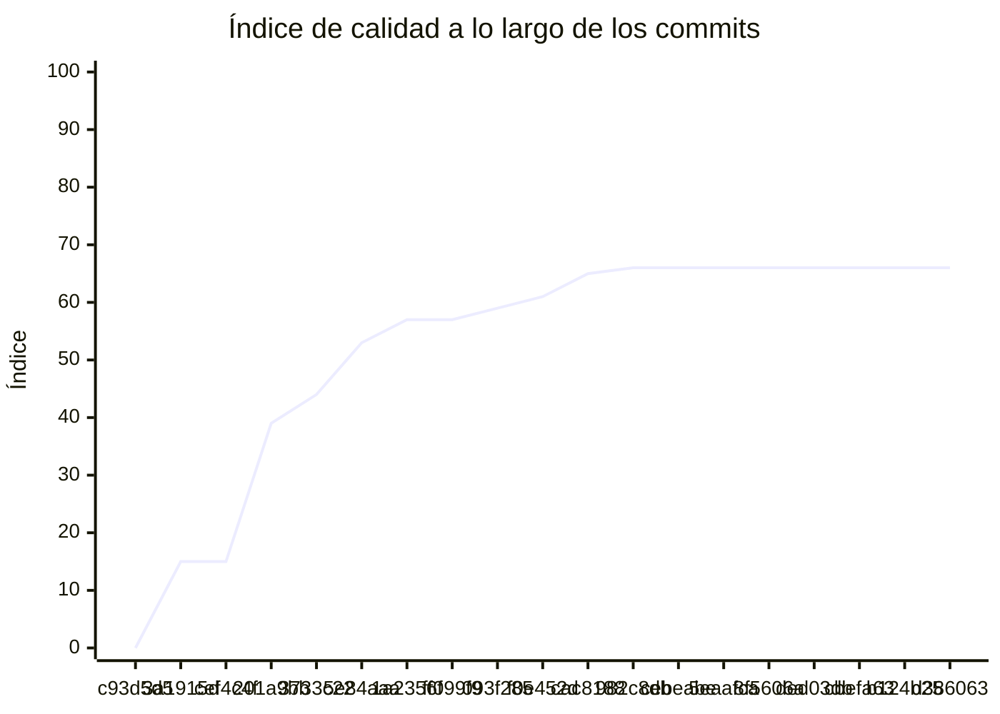

<!-- evaluacion:inicio -->
# Evaluación — prog2-perassiferrara/backend-turnos

> Documento **generado automáticamente** por la cátedra de Programación II (UM): RepoSense + análisis de calidad de **7 dimensiones**. **No editar a mano**: se regenera en cada evaluación.
> Rama evaluada: `main`. Análisis **heurístico** (regex + métricas) + build: es una criba para orientar la revisión, **no una nota**. La **documentación** del repositorio no se evalúa.
> Generado: 2026-11-18.

## 1. Veredicto

| Aspecto | Resultado |
|---|---|
| Índice de calidad | **77/100** |
| Tipo de repositorio | `backend` |
| Build (`mvnw verify` / `gradlew check`) | OK |
| Código (LOC) | 17,986 |
| Archivos de código | 217 |
| Clases | 260 |
| Código dentro de clases (%POO) | 78% |
| Funciones fuera de clases | 0 |
| Duplicación (puerta) | 2.7% |
| Duplicación lógica | 2.8% |
| Duplicación de boilerplate | 2.5% |
| Cobertura | 95% |
| Tope duro aplicado a D1 | `POO_BAJO` → D1 ≤ 60 |

> Este informe **describe** lo que el análisis midió con los criterios ya establecidos de la materia. No es una nota.

## 2. Semáforo de aprobación

Criterios de la cátedra (`CRITERIOS-CALIDAD.md`): **Aprobar** se juega con el perfil `estandar`; **destacar**, con el `exigente` (meta de excelencia).

| Semáforo | Resultado |
|---|---|
| Aprobar (`estandar`) | **no cumple** — 7/11 |
| Destacar (`exigente`) | **no cumple** — 5/11 |

**Para aprobar, falta cumplir:** SOLID

**Para destacar, falta cumplir:** SOLID; POO; Duplicación

## 3. Autoría (RepoSense)

| Autor | Commits | Código (LOC) | Tests (LOC) | Docs (LOC) | Días activos | % del código |
|---|---:|---:|---:|---:|---:|---:|
| Valentino Perassi Ferrara | 47 | 7,927 | 11,512 | 7,856 | 20 | 100% |

> _El LOC de autoría lo calcula RepoSense sobre el historial y puede diferir del LOC de código del análisis (que mira el estado de `main`)._

## 4. Dimensiones evaluadas

Cada dimensión indica **qué mide**, **por qué importa** y **tu resultado**. Cuando el puntaje queda por debajo de la referencia, se agregan preguntas para **investigar la causa** (no hay recetas).

| Dimensión | Peso | Puntaje |
|:--|--:|--:|
| **D1** Diseño OO, SOLID y patrones (20%) | 20% | 2 |
| **D2** Arquitectura hexagonal — backend (15%) | 15% | 100 |
| **D3** Frontend KMP: MVVM y buenas prácticas (10%) | 10% | N/A |
| **D4** Integración y contrato (10%) | 10% | 90 |
| **D5** Seguridad y robustez (10%) | 10% | 100 |
| **D6** Pruebas y cobertura (20%) | 20% | 100 |
| **D7** Proceso y entrega (15%) | 15% | 100 |

### D1. Diseño OO, SOLID y patrones (20%)

- **Qué mide:** Métricas orientadas a objetos (clases, métodos, campos, cohesión, acoplamiento, herencia) y proxies de SOLID, más patrones de diseño.
- **Por qué importa:** El eje de la materia es el buen uso de la POO y su arquitectura: un diseño con clases claras y poco acopladas es más fácil de entender, probar y cambiar.
- **Tu resultado:** **2/100**
- **Para investigar la causa:**
    - ¿Se pensó el modelo de clases antes de codificar o se agrupó después?
    - ¿Qué clases concentran muchas responsabilidades a la vez?
    - ¿Los colaboradores llegan como parámetros o se crean por dentro?

### D2. Arquitectura hexagonal — backend (15%)

- **Qué mide:** Separación en capas (dominio, puertos de entrada/salida, adaptadores) y dirección de las dependencias del backend.
- **Por qué importa:** Aislar el dominio de la infraestructura permite cambiar la base de datos, el framework o el transporte sin tocar las reglas de negocio.
- **Tu resultado:** **100/100**

### D4. Integración y contrato (10%)

- **Qué mide:** Cumplimiento del contrato de integración de la cátedra (formato de errores, paginación, autenticación, endpoints esperados).
- **Por qué importa:** Los servicios deben poder integrarse entre sí y con la app sin sorpresas; el contrato es lo que hacen cumplir las pruebas de integración.
- **Tu resultado:** **90/100**

### D5. Seguridad y robustez (10%)

- **Qué mide:** Credenciales embebidas, consultas SQL por concatenación, y presencia de config de entorno; aislamiento de secretos.
- **Por qué importa:** Un secreto en el repositorio o una consulta construida por concatenación son riesgos concretos, no hipotéticos.
- **Tu resultado:** **100/100**

### D6. Pruebas y cobertura (20%)

- **Qué mide:** Cantidad y resultado de pruebas y cobertura de línea (JaCoCo/Kover, Surefire/Failsafe) cuando hay build.
- **Por qué importa:** Las pruebas son la red de seguridad para refactorizar e integrar; la cobertura acota las zonas sin verificar.
- **Tu resultado:** **100/100**

### D7. Proceso y entrega (15%)

- **Qué mide:** Artefactos verificables de proceso/entrega: `compose`, `.env.example`, CI (`.github/workflows/`), `CODEOWNERS` y wrapper de build (`mvnw`/`gradlew`). **No** puntúa documentación.
- **Por qué importa:** Un proyecto que compila, se levanta y se valida solo es más fácil de revisar y de integrar en equipo.
- **Tu resultado:** **100/100**

## 5. Señales detectadas

El análisis encontró las siguientes señales, con el archivo y la línea donde se originan cuando están disponibles:

**Archivos con más señales**

| Archivo | Señales |
|---|---:|
| `src/main/java/com/prog2/appointment/reservation/domain/model/ReservationProcess.java` | 13 |
| `src/main/java/com/prog2/appointment/reservation/application/usecases/StartReservationUseCaseImpl.java` | 10 |
| `src/main/java/com/prog2/appointment/reservation/infrastructure/messaging/ReservationActionParser.java` | 9 |
| `src/main/java/com/prog2/appointment/reservation/infrastructure/messaging/ReservationKafkaChannel.java` | 9 |
| `src/main/java/com/prog2/appointment/reservation/infrastructure/client/adapter/WebClientAppointmentHoldAdapter.java` | 9 |
| `src/main/java/com/prog2/appointment/reservation/domain/model/PhoneSubmission.java` | 9 |
| `src/main/java/com/prog2/appointment/reservation/infrastructure/persistence/service/TransactionalReservationStore.java` | 8 |
| `src/main/java/com/prog2/appointment/reservation/infrastructure/persistence/adapter/JpaReservationProcessAdapter.java` | 7 |
| `src/main/java/com/prog2/appointment/reservation/application/usecases/RecoverReservationCancellationsUseCaseImpl.java` | 7 |
| `src/main/java/com/prog2/appointment/reservation/infrastructure/client/adapter/WebClientCentralAppointmentAdapter.java` | 6 |

**DIP/concretos** (107)
- clase 'GetAvailabilityUseCaseImpl' muy acoplada (CBO=13) — `src/main/java/com/prog2/appointment/availability/application/usecases/GetAvailabilityUseCaseImpl.java:19`
- clase 'GetAvailabilityUseCaseImpl' instancia 5 concretos (CBO=13) — `src/main/java/com/prog2/appointment/availability/application/usecases/GetAvailabilityUseCaseImpl.java:19`
- clase 'AvailabilityFailure' muy acoplada (CBO=8) — `src/main/java/com/prog2/appointment/availability/domain/enums/AvailabilityFailure.java:4`
- clase 'AppointmentOccupancy' muy acoplada (CBO=8) — `src/main/java/com/prog2/appointment/availability/domain/model/AppointmentOccupancy.java:10`
- clase 'AvailabilityHttpClient' muy acoplada (CBO=16) — `src/main/java/com/prog2/appointment/availability/infrastructure/client/AvailabilityHttpClient.java:16`
- clase 'AvailabilityHttpClient' instancia 5 concretos (CBO=16) — `src/main/java/com/prog2/appointment/availability/infrastructure/client/AvailabilityHttpClient.java:16`
- clase 'WebClientAppointmentOccupanciesAdapter' muy acoplada (CBO=20) — `src/main/java/com/prog2/appointment/availability/infrastructure/client/adapter/WebClientAppointmentOccupanciesAdapter.java:19`
- clase 'WebClientAppointmentOccupanciesAdapter' instancia 6 concretos (CBO=20) — `src/main/java/com/prog2/appointment/availability/infrastructure/client/adapter/WebClientAppointmentOccupanciesAdapter.java:19`
- clase 'WebClientProfessionalAgendaAdapter' muy acoplada (CBO=19) — `src/main/java/com/prog2/appointment/availability/infrastructure/client/adapter/WebClientProfessionalAgendaAdapter.java:20`
- clase 'WebClientProfessionalAgendaAdapter' instancia 7 concretos (CBO=19) — `src/main/java/com/prog2/appointment/availability/infrastructure/client/adapter/WebClientProfessionalAgendaAdapter.java:20`
- clase 'AvailabilityConfiguration' muy acoplada (CBO=25) — `src/main/java/com/prog2/appointment/availability/infrastructure/config/AvailabilityConfiguration.java:28`
- clase 'AvailabilityConfiguration' instancia 5 concretos (CBO=25) — `src/main/java/com/prog2/appointment/availability/infrastructure/config/AvailabilityConfiguration.java:28`
- clase 'AvailabilityProblemHandler' muy acoplada (CBO=23) — `src/main/java/com/prog2/appointment/availability/infrastructure/web/AvailabilityProblemHandler.java:21`
- clase 'AvailabilityController' muy acoplada (CBO=28) — `src/main/java/com/prog2/appointment/availability/infrastructure/web/controller/AvailabilityController.java:26`
- clase 'AvailabilityProperties' muy acoplada (CBO=15) — `src/main/java/com/prog2/appointment/infrastructure/config/AvailabilityProperties.java:10`
- clase 'AvailabilityProperties' instancia 5 concretos (CBO=15) — `src/main/java/com/prog2/appointment/infrastructure/config/AvailabilityProperties.java:10`
- clase 'DatabaseConfiguration' muy acoplada (CBO=14) — `src/main/java/com/prog2/appointment/infrastructure/config/DatabaseConfiguration.java:17`
- clase 'OpenApiConfiguration' muy acoplada (CBO=41) — `src/main/java/com/prog2/appointment/infrastructure/config/OpenApiConfiguration.java:29`
- clase 'OpenApiConfiguration' instancia 23 concretos (CBO=41) — `src/main/java/com/prog2/appointment/infrastructure/config/OpenApiConfiguration.java:29`
- clase 'TechnicalAccessProperties' muy acoplada (CBO=26) — `src/main/java/com/prog2/appointment/infrastructure/config/TechnicalAccessProperties.java:15`
- clase 'TechnicalAccessProperties' instancia 9 concretos (CBO=26) — `src/main/java/com/prog2/appointment/infrastructure/config/TechnicalAccessProperties.java:15`
- clase 'JwtSecurityProperties' muy acoplada (CBO=16) — `src/main/java/com/prog2/appointment/infrastructure/security/config/JwtSecurityProperties.java:20`
- clase 'JwtSecurityProperties' instancia 3 concretos (CBO=16) — `src/main/java/com/prog2/appointment/infrastructure/security/config/JwtSecurityProperties.java:20`
- clase 'SecurityConfiguration' muy acoplada (CBO=44) — `src/main/java/com/prog2/appointment/infrastructure/security/config/SecurityConfiguration.java:37`
- clase 'SecurityConfiguration' instancia 9 concretos (CBO=44) — `src/main/java/com/prog2/appointment/infrastructure/security/config/SecurityConfiguration.java:37`
- clase 'JwtContractValidator' muy acoplada (CBO=16) — `src/main/java/com/prog2/appointment/infrastructure/security/jwt/JwtContractValidator.java:16`
- clase 'ServiceTokenIssuer' muy acoplada (CBO=21) — `src/main/java/com/prog2/appointment/infrastructure/security/jwt/ServiceTokenIssuer.java:18`
- clase 'SecurityProblemHandler' muy acoplada (CBO=27) — `src/main/java/com/prog2/appointment/infrastructure/security/web/SecurityProblemHandler.java:22`
- clase 'TechnicalAccessUseCaseImpl' muy acoplada (CBO=30) — `src/main/java/com/prog2/appointment/integration/application/usecases/TechnicalAccessUseCaseImpl.java:21`
- clase 'TechnicalAccessUseCaseImpl' instancia 7 concretos (CBO=30) — `src/main/java/com/prog2/appointment/integration/application/usecases/TechnicalAccessUseCaseImpl.java:21`
- clase 'AccessFailure' muy acoplada (CBO=8) — `src/main/java/com/prog2/appointment/integration/domain/enums/AccessFailure.java:4`
- clase 'SafeIntegrationHttpClient' muy acoplada (CBO=28) — `src/main/java/com/prog2/appointment/integration/infrastructure/client/adapter/SafeIntegrationHttpClient.java:18`
- clase 'SafeIntegrationHttpClient' instancia 7 concretos (CBO=28) — `src/main/java/com/prog2/appointment/integration/infrastructure/client/adapter/SafeIntegrationHttpClient.java:18`
- clase 'WebClientCatalogTechnicalTokenAdapter' muy acoplada (CBO=13) — `src/main/java/com/prog2/appointment/integration/infrastructure/client/adapter/WebClientCatalogTechnicalTokenAdapter.java:15`
- clase 'WebClientCatalogTechnicalTokenAdapter' instancia 3 concretos (CBO=13) — `src/main/java/com/prog2/appointment/integration/infrastructure/client/adapter/WebClientCatalogTechnicalTokenAdapter.java:15`
- clase 'WebClientCentralIntegrationAdapter' muy acoplada (CBO=10) — `src/main/java/com/prog2/appointment/integration/infrastructure/client/adapter/WebClientCentralIntegrationAdapter.java:13`
- clase 'IntegrationResponse' muy acoplada (CBO=11) — `src/main/java/com/prog2/appointment/integration/infrastructure/client/dto/IntegrationResponse.java:10`
- clase 'IntegrationResponse' instancia 4 concretos (CBO=11) — `src/main/java/com/prog2/appointment/integration/infrastructure/client/dto/IntegrationResponse.java:10`
- clase 'TechnicalIntegrationConfiguration' muy acoplada (CBO=14) — `src/main/java/com/prog2/appointment/integration/infrastructure/config/TechnicalIntegrationConfiguration.java:24`
- clase 'TechnicalIntegrationConfiguration' instancia 5 concretos (CBO=14) — `src/main/java/com/prog2/appointment/integration/infrastructure/config/TechnicalIntegrationConfiguration.java:24`
- clase 'CancelReservationUseCaseImpl' muy acoplada (CBO=8) — `src/main/java/com/prog2/appointment/reservation/application/usecases/CancelReservationUseCaseImpl.java:17`
- clase 'GetReservationProcessUseCaseImpl' muy acoplada (CBO=8) — `src/main/java/com/prog2/appointment/reservation/application/usecases/GetReservationProcessUseCaseImpl.java:16`
- clase 'ListOwnReservationsUseCaseImpl' muy acoplada (CBO=11) — `src/main/java/com/prog2/appointment/reservation/application/usecases/ListOwnReservationsUseCaseImpl.java:18`
- clase 'ListOwnReservationsUseCaseImpl' instancia 3 concretos (CBO=11) — `src/main/java/com/prog2/appointment/reservation/application/usecases/ListOwnReservationsUseCaseImpl.java:18`
- clase 'PublishPendingPhonesUseCaseImpl' muy acoplada (CBO=10) — `src/main/java/com/prog2/appointment/reservation/application/usecases/PublishPendingPhonesUseCaseImpl.java:15`
- clase 'RecoverReservationCancellationsUseCaseImpl' muy acoplada (CBO=34) — `src/main/java/com/prog2/appointment/reservation/application/usecases/RecoverReservationCancellationsUseCaseImpl.java:22`
- clase 'RecoverReservationCancellationsUseCaseImpl' instancia 3 concretos (CBO=34) — `src/main/java/com/prog2/appointment/reservation/application/usecases/RecoverReservationCancellationsUseCaseImpl.java:22`
- clase 'RecoverReservationProcessesUseCaseImpl' muy acoplada (CBO=29) — `src/main/java/com/prog2/appointment/reservation/application/usecases/RecoverReservationProcessesUseCaseImpl.java:23`
- clase 'StartReservationUseCaseImpl' muy acoplada (CBO=41) — `src/main/java/com/prog2/appointment/reservation/application/usecases/StartReservationUseCaseImpl.java:26`
- clase 'StartReservationUseCaseImpl' instancia 7 concretos (CBO=41) — `src/main/java/com/prog2/appointment/reservation/application/usecases/StartReservationUseCaseImpl.java:26`
- clase 'SubmitReservationPhoneUseCaseImpl' muy acoplada (CBO=14) — `src/main/java/com/prog2/appointment/reservation/application/usecases/SubmitReservationPhoneUseCaseImpl.java:18`
- clase 'SubmitReservationPhoneUseCaseImpl' instancia 5 concretos (CBO=14) — `src/main/java/com/prog2/appointment/reservation/application/usecases/SubmitReservationPhoneUseCaseImpl.java:18`
- clase 'ReservationFailure' muy acoplada (CBO=29) — `src/main/java/com/prog2/appointment/reservation/domain/enums/ReservationFailure.java:4`
- clase 'ReservationPhase' muy acoplada (CBO=12) — `src/main/java/com/prog2/appointment/reservation/domain/enums/ReservationPhase.java:4`
- clase 'PhoneSubmission' muy acoplada (CBO=22) — `src/main/java/com/prog2/appointment/reservation/domain/model/PhoneSubmission.java:13`
- clase 'PhoneSubmission' instancia 10 concretos (CBO=22) — `src/main/java/com/prog2/appointment/reservation/domain/model/PhoneSubmission.java:13`
- clase 'ReservationProcess' muy acoplada (CBO=59) — `src/main/java/com/prog2/appointment/reservation/domain/model/ReservationProcess.java:17`
- clase 'ReservationProcess' instancia 6 concretos (CBO=59) — `src/main/java/com/prog2/appointment/reservation/domain/model/ReservationProcess.java:17`
- clase 'AppointmentHoldGateway' muy acoplada (CBO=8) — `src/main/java/com/prog2/appointment/reservation/domain/ports/out/AppointmentHoldGateway.java:12`
- clase 'ReservationProcessRepository' muy acoplada (CBO=31) — `src/main/java/com/prog2/appointment/reservation/domain/ports/out/ReservationProcessRepository.java:19`
- clase 'AvailabilityReservationSlotAdapter' muy acoplada (CBO=11) — `src/main/java/com/prog2/appointment/reservation/infrastructure/availability/adapter/AvailabilityReservationSlotAdapter.java:19`
- clase 'AvailabilityReservationSlotAdapter' instancia 3 concretos (CBO=11) — `src/main/java/com/prog2/appointment/reservation/infrastructure/availability/adapter/AvailabilityReservationSlotAdapter.java:19`
- clase 'WebClientAppointmentHoldAdapter' muy acoplada (CBO=37) — `src/main/java/com/prog2/appointment/reservation/infrastructure/client/adapter/WebClientAppointmentHoldAdapter.java:26`
- clase 'WebClientAppointmentHoldAdapter' instancia 11 concretos (CBO=37) — `src/main/java/com/prog2/appointment/reservation/infrastructure/client/adapter/WebClientAppointmentHoldAdapter.java:26`
- clase 'WebClientCentralAppointmentAdapter' muy acoplada (CBO=23) — `src/main/java/com/prog2/appointment/reservation/infrastructure/client/adapter/WebClientCentralAppointmentAdapter.java:31`
- clase 'WebClientCentralAppointmentAdapter' instancia 4 concretos (CBO=23) — `src/main/java/com/prog2/appointment/reservation/infrastructure/client/adapter/WebClientCentralAppointmentAdapter.java:31`
- clase 'WebClientReservationCancellationAdapter' muy acoplada (CBO=25) — `src/main/java/com/prog2/appointment/reservation/infrastructure/client/adapter/WebClientReservationCancellationAdapter.java:20`
- clase 'WebClientReservationCancellationAdapter' instancia 7 concretos (CBO=25) — `src/main/java/com/prog2/appointment/reservation/infrastructure/client/adapter/WebClientReservationCancellationAdapter.java:20`
- clase 'ReservationConfiguration' muy acoplada (CBO=42) — `src/main/java/com/prog2/appointment/reservation/infrastructure/config/ReservationConfiguration.java:53`
- clase 'ReservationConfiguration' instancia 14 concretos (CBO=42) — `src/main/java/com/prog2/appointment/reservation/infrastructure/config/ReservationConfiguration.java:53`
- clase 'KafkaPhoneSubmissionAdapter' muy acoplada (CBO=37) — `src/main/java/com/prog2/appointment/reservation/infrastructure/messaging/KafkaPhoneSubmissionAdapter.java:30`
- clase 'KafkaPhoneSubmissionAdapter' instancia 3 concretos (CBO=37) — `src/main/java/com/prog2/appointment/reservation/infrastructure/messaging/KafkaPhoneSubmissionAdapter.java:30`
- clase 'ReservationActionParser' muy acoplada (CBO=25) — `src/main/java/com/prog2/appointment/reservation/infrastructure/messaging/ReservationActionParser.java:17`
- clase 'ReservationActionParser' instancia 7 concretos (CBO=25) — `src/main/java/com/prog2/appointment/reservation/infrastructure/messaging/ReservationActionParser.java:17`
- clase 'ReservationKafkaChannel' muy acoplada (CBO=45) — `src/main/java/com/prog2/appointment/reservation/infrastructure/messaging/ReservationKafkaChannel.java:32`
- clase 'ReservationKafkaChannel' instancia 7 concretos (CBO=45) — `src/main/java/com/prog2/appointment/reservation/infrastructure/messaging/ReservationKafkaChannel.java:32`
- clase 'JpaReservationProcessAdapter' muy acoplada (CBO=32) — `src/main/java/com/prog2/appointment/reservation/infrastructure/persistence/adapter/JpaReservationProcessAdapter.java:35`
- clase 'JpaReservationProcessAdapter' instancia 13 concretos (CBO=32) — `src/main/java/com/prog2/appointment/reservation/infrastructure/persistence/adapter/JpaReservationProcessAdapter.java:35`
- clase 'ReservationProcessEntity' muy acoplada (CBO=12) — `src/main/java/com/prog2/appointment/reservation/infrastructure/persistence/entity/ReservationProcessEntity.java:19`
- clase 'ReservationPersistenceMapper' muy acoplada (CBO=12) — `src/main/java/com/prog2/appointment/reservation/infrastructure/persistence/mapper/ReservationPersistenceMapper.java:19`
- clase 'ReservationPersistenceMapper' instancia 5 concretos (CBO=12) — `src/main/java/com/prog2/appointment/reservation/infrastructure/persistence/mapper/ReservationPersistenceMapper.java:19`
- clase 'JpaPhoneSubmissionRepository' muy acoplada (CBO=11) — `src/main/java/com/prog2/appointment/reservation/infrastructure/persistence/repository/JpaPhoneSubmissionRepository.java:15`
- clase 'JpaReservationProcessRepository' muy acoplada (CBO=19) — `src/main/java/com/prog2/appointment/reservation/infrastructure/persistence/repository/JpaReservationProcessRepository.java:15`
- clase 'TransactionalReservationStore' muy acoplada (CBO=58) — `src/main/java/com/prog2/appointment/reservation/infrastructure/persistence/service/TransactionalReservationStore.java:41`
- clase 'TransactionalReservationStore' instancia 12 concretos (CBO=58) — `src/main/java/com/prog2/appointment/reservation/infrastructure/persistence/service/TransactionalReservationStore.java:41`
- clase 'ReservationRecoveryDispatcher' muy acoplada (CBO=9) — `src/main/java/com/prog2/appointment/reservation/infrastructure/scheduling/ReservationRecoveryDispatcher.java:15`
- clase 'UserReservationPatientAdapter' muy acoplada (CBO=9) — `src/main/java/com/prog2/appointment/reservation/infrastructure/user/adapter/UserReservationPatientAdapter.java:18`
- clase 'UserReservationPatientAdapter' instancia 4 concretos (CBO=9) — `src/main/java/com/prog2/appointment/reservation/infrastructure/user/adapter/UserReservationPatientAdapter.java:18`
- clase 'ReservationProblemHandler' muy acoplada (CBO=40) — `src/main/java/com/prog2/appointment/reservation/infrastructure/web/ReservationProblemHandler.java:24`
- clase 'ReservationController' muy acoplada (CBO=72) — `src/main/java/com/prog2/appointment/reservation/infrastructure/web/controller/ReservationController.java:45`
- clase 'ReservationProcessResponse' muy acoplada (CBO=11) — `src/main/java/com/prog2/appointment/reservation/infrastructure/web/dto/ReservationProcessResponse.java:12`
- clase 'ReservationDtoMapper' muy acoplada (CBO=18) — `src/main/java/com/prog2/appointment/reservation/infrastructure/web/mapper/ReservationDtoMapper.java:20`
- clase 'ReservationDtoMapper' instancia 6 concretos (CBO=18) — `src/main/java/com/prog2/appointment/reservation/infrastructure/web/mapper/ReservationDtoMapper.java:20`
- clase 'AuthenticateUserUseCaseImpl' muy acoplada (CBO=8) — `src/main/java/com/prog2/appointment/user/application/usecases/AuthenticateUserUseCaseImpl.java:17`
- clase 'UserAccountRepository' muy acoplada (CBO=8) — `src/main/java/com/prog2/appointment/user/domain/ports/out/UserAccountRepository.java:9`
- clase 'UserConfiguration' muy acoplada (CBO=17) — `src/main/java/com/prog2/appointment/user/infrastructure/config/UserConfiguration.java:18`
- clase 'UserConfiguration' instancia 3 concretos (CBO=17) — `src/main/java/com/prog2/appointment/user/infrastructure/config/UserConfiguration.java:18`
- clase 'JpaUserAccountAdapter' muy acoplada (CBO=13) — `src/main/java/com/prog2/appointment/user/infrastructure/persistence/adapter/JpaUserAccountAdapter.java:20`
- clase 'JpaUserAccountAdapter' instancia 4 concretos (CBO=13) — `src/main/java/com/prog2/appointment/user/infrastructure/persistence/adapter/JpaUserAccountAdapter.java:20`
- clase 'UserAccountEntity' muy acoplada (CBO=9) — `src/main/java/com/prog2/appointment/user/infrastructure/persistence/entity/UserAccountEntity.java:21`
- clase 'TransactionalUserAccountStore' muy acoplada (CBO=10) — `src/main/java/com/prog2/appointment/user/infrastructure/persistence/service/TransactionalUserAccountStore.java:22`
- clase 'NimbusUserTokenIssuerAdapter' muy acoplada (CBO=12) — `src/main/java/com/prog2/appointment/user/infrastructure/security/NimbusUserTokenIssuerAdapter.java:23`
- clase 'SpringPasswordHasherAdapter' muy acoplada (CBO=11) — `src/main/java/com/prog2/appointment/user/infrastructure/security/SpringPasswordHasherAdapter.java:13`
- clase 'SpringPasswordHasherAdapter' instancia 5 concretos (CBO=11) — `src/main/java/com/prog2/appointment/user/infrastructure/security/SpringPasswordHasherAdapter.java:13`
- clase 'UserProblemHandler' muy acoplada (CBO=27) — `src/main/java/com/prog2/appointment/user/infrastructure/web/UserProblemHandler.java:25`
- clase 'AuthenticationController' muy acoplada (CBO=21) — `src/main/java/com/prog2/appointment/user/infrastructure/web/controller/AuthenticationController.java:25`
- clase 'RegistrationController' muy acoplada (CBO=22) — `src/main/java/com/prog2/appointment/user/infrastructure/web/controller/RegistrationController.java:25`

**SRP/responsabilidad** (118)
- método 'Availability.Availability' con 6 parámetros — `src/main/java/com/prog2/appointment/availability/domain/model/Availability.java:9`
- método 'ProfessionalAgenda.ProfessionalAgenda' con 5 parámetros — `src/main/java/com/prog2/appointment/availability/domain/model/ProfessionalAgenda.java:9`
- método 'WeeklySchedule.WeeklySchedule' con 5 parámetros — `src/main/java/com/prog2/appointment/availability/domain/model/WeeklySchedule.java:11`
- método 'AvailabilityHttpClient.get' con 6 parámetros — `src/main/java/com/prog2/appointment/availability/infrastructure/client/AvailabilityHttpClient.java:30`
- método 'ProfessionalAgendaResponse.WeeklyScheduleResponse' con 6 parámetros — `src/main/java/com/prog2/appointment/availability/infrastructure/client/dto/ProfessionalAgendaResponse.java:17`
- método 'WeeklyScheduleResponse.WeeklyScheduleResponse' con 6 parámetros — `src/main/java/com/prog2/appointment/availability/infrastructure/client/dto/ProfessionalAgendaResponse.java:17`
- método 'ProfessionalAgendaResponse.CatalogResponse' con 6 parámetros — `src/main/java/com/prog2/appointment/availability/infrastructure/client/dto/ProfessionalAgendaResponse.java:22`
- método 'CatalogResponse.CatalogResponse' con 6 parámetros — `src/main/java/com/prog2/appointment/availability/infrastructure/client/dto/ProfessionalAgendaResponse.java:22`
- método 'AvailabilityProperties.AvailabilityProperties' de 31 líneas — `src/main/java/com/prog2/appointment/infrastructure/config/AvailabilityProperties.java:10`
- método 'OpenApiConfiguration.appointmentOpenApi' de 30 líneas — `src/main/java/com/prog2/appointment/infrastructure/config/OpenApiConfiguration.java:38`
- método 'ReservationProperties.ReservationProperties' de 43 líneas — `src/main/java/com/prog2/appointment/infrastructure/config/ReservationProperties.java:8`
- método 'ReservationProperties.ReservationProperties' con 7 parámetros — `src/main/java/com/prog2/appointment/infrastructure/config/ReservationProperties.java:8`
- método 'TechnicalAccessProperties.TechnicalAccessProperties' de 62 líneas — `src/main/java/com/prog2/appointment/infrastructure/config/TechnicalAccessProperties.java:15`
- método 'TechnicalAccessProperties.TechnicalAccessProperties' con complejidad 8 — `src/main/java/com/prog2/appointment/infrastructure/config/TechnicalAccessProperties.java:15`
- método 'JwtSecurityProperties.JwtSecurityProperties' de 52 líneas — `src/main/java/com/prog2/appointment/infrastructure/security/config/JwtSecurityProperties.java:20`
- método 'JwtSecurityProperties.JwtSecurityProperties' con complejidad 6 — `src/main/java/com/prog2/appointment/infrastructure/security/config/JwtSecurityProperties.java:20`
- clase 'SecurityConfiguration' grande (LOC=81, métodos=16, campos=0) — `src/main/java/com/prog2/appointment/infrastructure/security/config/SecurityConfiguration.java:37`
- método 'SecurityConfiguration.securityFilterChain' de 38 líneas — `src/main/java/com/prog2/appointment/infrastructure/security/config/SecurityConfiguration.java:71`
- clase 'TechnicalAccessUseCaseImpl' grande (LOC=108, métodos=7, campos=12) — `src/main/java/com/prog2/appointment/integration/application/usecases/TechnicalAccessUseCaseImpl.java:21`
- método 'IntegrationConfiguration.IntegrationConfiguration' con 5 parámetros — `src/main/java/com/prog2/appointment/integration/domain/model/IntegrationConfiguration.java:5`
- clase 'SafeIntegrationHttpClient' con baja cohesión (47%) — `src/main/java/com/prog2/appointment/integration/infrastructure/client/adapter/SafeIntegrationHttpClient.java:18`
- método 'SafeIntegrationHttpClient.classify' con complejidad 6 — `src/main/java/com/prog2/appointment/integration/infrastructure/client/adapter/SafeIntegrationHttpClient.java:71`
- método 'IntegrationResponse.IntegrationResponse' con 6 parámetros — `src/main/java/com/prog2/appointment/integration/infrastructure/client/dto/IntegrationResponse.java:10`
- método 'TechnicalIntegrationConfiguration.technicalAccessUseCase' con 5 parámetros — `src/main/java/com/prog2/appointment/integration/infrastructure/config/TechnicalIntegrationConfiguration.java:41`
- clase 'RecoverReservationCancellationsUseCaseImpl' grande (LOC=102, métodos=9, campos=9) — `src/main/java/com/prog2/appointment/reservation/application/usecases/RecoverReservationCancellationsUseCaseImpl.java:22`
- clase 'RecoverReservationCancellationsUseCaseImpl' con baja cohesión (42%) — `src/main/java/com/prog2/appointment/reservation/application/usecases/RecoverReservationCancellationsUseCaseImpl.java:22`
- método 'RecoverReservationCancellationsUseCaseImpl.RecoverReservationCancellationsUseCaseImpl' con 7 parámetros — `src/main/java/com/prog2/appointment/reservation/application/usecases/RecoverReservationCancellationsUseCaseImpl.java:33`
- método 'RecoverReservationCancellationsUseCaseImpl.execute' de 37 líneas — `src/main/java/com/prog2/appointment/reservation/application/usecases/RecoverReservationCancellationsUseCaseImpl.java:56`
- método 'RecoverReservationCancellationsUseCaseImpl.execute' con complejidad 9 — `src/main/java/com/prog2/appointment/reservation/application/usecases/RecoverReservationCancellationsUseCaseImpl.java:56`
- clase 'RecoverReservationProcessesUseCaseImpl' grande (LOC=73, métodos=4, campos=8) — `src/main/java/com/prog2/appointment/reservation/application/usecases/RecoverReservationProcessesUseCaseImpl.java:23`
- método 'RecoverReservationProcessesUseCaseImpl.recoverDue' con complejidad 6 — `src/main/java/com/prog2/appointment/reservation/application/usecases/RecoverReservationProcessesUseCaseImpl.java:36`
- método 'RecoverReservationProcessesUseCaseImpl.recover' de 35 líneas — `src/main/java/com/prog2/appointment/reservation/application/usecases/RecoverReservationProcessesUseCaseImpl.java:55`
- método 'RecoverReservationProcessesUseCaseImpl.recover' con complejidad 10 — `src/main/java/com/prog2/appointment/reservation/application/usecases/RecoverReservationProcessesUseCaseImpl.java:55`
- clase 'StartReservationUseCaseImpl' grande (LOC=221, métodos=18, campos=8) — `src/main/java/com/prog2/appointment/reservation/application/usecases/StartReservationUseCaseImpl.java:26`
- clase 'StartReservationUseCaseImpl' con baja cohesión (22%) — `src/main/java/com/prog2/appointment/reservation/application/usecases/StartReservationUseCaseImpl.java:26`
- método 'StartReservationUseCaseImpl.StartReservationUseCaseImpl' con 8 parámetros — `src/main/java/com/prog2/appointment/reservation/application/usecases/StartReservationUseCaseImpl.java:38`
- método 'StartReservationUseCaseImpl.start' de 32 líneas — `src/main/java/com/prog2/appointment/reservation/application/usecases/StartReservationUseCaseImpl.java:61`
- método 'StartReservationUseCaseImpl.start' con complejidad 6 — `src/main/java/com/prog2/appointment/reservation/application/usecases/StartReservationUseCaseImpl.java:61`
- método 'StartReservationUseCaseImpl.execute' de 40 líneas — `src/main/java/com/prog2/appointment/reservation/application/usecases/StartReservationUseCaseImpl.java:130`
- método 'StartReservationUseCaseImpl.execute' con complejidad 9 — `src/main/java/com/prog2/appointment/reservation/application/usecases/StartReservationUseCaseImpl.java:130`
- método 'StartReservationUseCaseImpl.createHold' con complejidad 6 — `src/main/java/com/prog2/appointment/reservation/application/usecases/StartReservationUseCaseImpl.java:171`
- método 'SubmitReservationPhoneUseCaseImpl.submit' de 35 líneas — `src/main/java/com/prog2/appointment/reservation/application/usecases/SubmitReservationPhoneUseCaseImpl.java:24`
- método 'CentralAppointment.CentralAppointment' con 6 parámetros — `src/main/java/com/prog2/appointment/reservation/domain/model/CentralAppointment.java:8`
- método 'OwnReservationPage.OwnReservationPage' con 6 parámetros — `src/main/java/com/prog2/appointment/reservation/domain/model/OwnReservationPage.java:6`
- método 'OwnReservations.OwnReservations' con 5 parámetros — `src/main/java/com/prog2/appointment/reservation/domain/model/OwnReservations.java:6`
- clase 'PhoneSubmission' grande (LOC=137, métodos=14, campos=0) — `src/main/java/com/prog2/appointment/reservation/domain/model/PhoneSubmission.java:13`
- método 'PhoneSubmission.PhoneSubmission' de 137 líneas — `src/main/java/com/prog2/appointment/reservation/domain/model/PhoneSubmission.java:13`
- método 'PhoneSubmission.PhoneSubmission' con 9 parámetros — `src/main/java/com/prog2/appointment/reservation/domain/model/PhoneSubmission.java:13`
- método 'PhoneSubmission.PhoneSubmission' con complejidad 12 — `src/main/java/com/prog2/appointment/reservation/domain/model/PhoneSubmission.java:13`
- método 'PhoneSubmission.Event' con 6 parámetros — `src/main/java/com/prog2/appointment/reservation/domain/model/PhoneSubmission.java:37`
- método 'Event.Event' con 6 parámetros — `src/main/java/com/prog2/appointment/reservation/domain/model/PhoneSubmission.java:37`
- método 'PhoneSubmission.create' con 5 parámetros — `src/main/java/com/prog2/appointment/reservation/domain/model/PhoneSubmission.java:80`
- método 'ReservationAction.ReservationAction' con 5 parámetros — `src/main/java/com/prog2/appointment/reservation/domain/model/ReservationAction.java:8`
- clase 'ReservationProcess' grande (LOC=428, métodos=37, campos=0) — `src/main/java/com/prog2/appointment/reservation/domain/model/ReservationProcess.java:17`
- método 'ReservationProcess.ReservationProcess' de 428 líneas — `src/main/java/com/prog2/appointment/reservation/domain/model/ReservationProcess.java:17`
- método 'ReservationProcess.ReservationProcess' con 12 parámetros — `src/main/java/com/prog2/appointment/reservation/domain/model/ReservationProcess.java:17`
- método 'ReservationProcess.ReservationProcess' con complejidad 51 — `src/main/java/com/prog2/appointment/reservation/domain/model/ReservationProcess.java:17`
- método 'ReservationProcess.recordFailure' de 40 líneas — `src/main/java/com/prog2/appointment/reservation/domain/model/ReservationProcess.java:154`
- método 'ReservationProcess.recordFailure' con complejidad 9 — `src/main/java/com/prog2/appointment/reservation/domain/model/ReservationProcess.java:154`
- método 'ReservationProcess.apply' de 59 líneas — `src/main/java/com/prog2/appointment/reservation/domain/model/ReservationProcess.java:200`
- método 'ReservationProcess.apply' con complejidad 13 — `src/main/java/com/prog2/appointment/reservation/domain/model/ReservationProcess.java:200`
- método 'ReservationProcess.reconcileState' de 41 líneas — `src/main/java/com/prog2/appointment/reservation/domain/model/ReservationProcess.java:359`
- método 'ReservationProcess.reconcileState' con complejidad 7 — `src/main/java/com/prog2/appointment/reservation/domain/model/ReservationProcess.java:359`
- método 'ReservationProcess.change' con 6 parámetros — `src/main/java/com/prog2/appointment/reservation/domain/model/ReservationProcess.java:413`
- clase 'WebClientAppointmentHoldAdapter' grande (LOC=227, métodos=48, campos=3) — `src/main/java/com/prog2/appointment/reservation/infrastructure/client/adapter/WebClientAppointmentHoldAdapter.java:26`
- clase 'WebClientAppointmentHoldAdapter' con baja cohesión (9%) — `src/main/java/com/prog2/appointment/reservation/infrastructure/client/adapter/WebClientAppointmentHoldAdapter.java:26`
- método 'WebClientAppointmentHoldAdapter.findOccupancy' de 41 líneas — `src/main/java/com/prog2/appointment/reservation/infrastructure/client/adapter/WebClientAppointmentHoldAdapter.java:77`
- método 'WebClientAppointmentHoldAdapter.post' de 50 líneas — `src/main/java/com/prog2/appointment/reservation/infrastructure/client/adapter/WebClientAppointmentHoldAdapter.java:167`
- método 'WebClientAppointmentHoldAdapter.post' con complejidad 7 — `src/main/java/com/prog2/appointment/reservation/infrastructure/client/adapter/WebClientAppointmentHoldAdapter.java:167`
- método 'WebClientAppointmentHoldAdapter.post' de 30 líneas — `src/main/java/com/prog2/appointment/reservation/infrastructure/client/adapter/WebClientAppointmentHoldAdapter.java:171`
- método 'WebClientAppointmentHoldAdapter.classify' con complejidad 8 — `src/main/java/com/prog2/appointment/reservation/infrastructure/client/adapter/WebClientAppointmentHoldAdapter.java:218`
- clase 'WebClientCentralAppointmentAdapter' grande (LOC=125, métodos=19, campos=3) — `src/main/java/com/prog2/appointment/reservation/infrastructure/client/adapter/WebClientCentralAppointmentAdapter.java:31`
- clase 'WebClientCentralAppointmentAdapter' con baja cohesión (39%) — `src/main/java/com/prog2/appointment/reservation/infrastructure/client/adapter/WebClientCentralAppointmentAdapter.java:31`
- método 'WebClientCentralAppointmentAdapter.find' con complejidad 8 — `src/main/java/com/prog2/appointment/reservation/infrastructure/client/adapter/WebClientCentralAppointmentAdapter.java:37`
- método 'WebClientCentralAppointmentAdapter.collect' con 5 parámetros — `src/main/java/com/prog2/appointment/reservation/infrastructure/client/adapter/WebClientCentralAppointmentAdapter.java:65`
- clase 'WebClientReservationCancellationAdapter' con baja cohesión (10%) — `src/main/java/com/prog2/appointment/reservation/infrastructure/client/adapter/WebClientReservationCancellationAdapter.java:20`
- método 'WebClientReservationCancellationAdapter.cancel' con complejidad 7 — `src/main/java/com/prog2/appointment/reservation/infrastructure/client/adapter/WebClientReservationCancellationAdapter.java:26`
- método 'WebClientReservationCancellationAdapter.classify' con complejidad 6 — `src/main/java/com/prog2/appointment/reservation/infrastructure/client/adapter/WebClientReservationCancellationAdapter.java:61`
- método 'CentralAppointmentResponse.CentralAppointmentResponse' con 9 parámetros — `src/main/java/com/prog2/appointment/reservation/infrastructure/client/dto/CentralAppointmentResponse.java:12`
- clase 'ReservationConfiguration' grande (LOC=134, métodos=14, campos=0) — `src/main/java/com/prog2/appointment/reservation/infrastructure/config/ReservationConfiguration.java:53`
- método 'ReservationConfiguration.recoverReservationCancellationsUseCase' con 6 parámetros — `src/main/java/com/prog2/appointment/reservation/infrastructure/config/ReservationConfiguration.java:55`
- método 'ReservationConfiguration.recoverReservationProcessesUseCase' con 7 parámetros — `src/main/java/com/prog2/appointment/reservation/infrastructure/config/ReservationConfiguration.java:110`
- método 'ReservationConfiguration.startReservationUseCase' con 9 parámetros — `src/main/java/com/prog2/appointment/reservation/infrastructure/config/ReservationConfiguration.java:121`
- clase 'KafkaPhoneSubmissionAdapter' grande (LOC=92, métodos=6, campos=8) — `src/main/java/com/prog2/appointment/reservation/infrastructure/messaging/KafkaPhoneSubmissionAdapter.java:30`
- clase 'KafkaPhoneSubmissionAdapter' con baja cohesión (33%) — `src/main/java/com/prog2/appointment/reservation/infrastructure/messaging/KafkaPhoneSubmissionAdapter.java:30`
- método 'KafkaPhoneSubmissionAdapter.publish' con complejidad 6 — `src/main/java/com/prog2/appointment/reservation/infrastructure/messaging/KafkaPhoneSubmissionAdapter.java:41`
- clase 'ReservationActionParser' grande (LOC=98, métodos=17, campos=2) — `src/main/java/com/prog2/appointment/reservation/infrastructure/messaging/ReservationActionParser.java:17`
- método 'ReservationActionParser.parse' de 38 líneas — `src/main/java/com/prog2/appointment/reservation/infrastructure/messaging/ReservationActionParser.java:24`
- método 'ReservationActionParser.parse' con complejidad 6 — `src/main/java/com/prog2/appointment/reservation/infrastructure/messaging/ReservationActionParser.java:24`
- método 'ReservationActionParser.selection' con complejidad 6 — `src/main/java/com/prog2/appointment/reservation/infrastructure/messaging/ReservationActionParser.java:63`
- método 'ReservationActionParser.type' con complejidad 7 — `src/main/java/com/prog2/appointment/reservation/infrastructure/messaging/ReservationActionParser.java:88`
- método 'ReservationActionParser.ActionDto' con 16 parámetros — `src/main/java/com/prog2/appointment/reservation/infrastructure/messaging/ReservationActionParser.java:101`
- método 'ActionDto.ActionDto' con 16 parámetros — `src/main/java/com/prog2/appointment/reservation/infrastructure/messaging/ReservationActionParser.java:101`
- clase 'ReservationKafkaChannel' grande (LOC=220, métodos=16, campos=13) — `src/main/java/com/prog2/appointment/reservation/infrastructure/messaging/ReservationKafkaChannel.java:32`
- clase 'ReservationKafkaChannel' con baja cohesión (27%) — `src/main/java/com/prog2/appointment/reservation/infrastructure/messaging/ReservationKafkaChannel.java:32`
- método 'ReservationKafkaChannel.prepare' con complejidad 6 — `src/main/java/com/prog2/appointment/reservation/infrastructure/messaging/ReservationKafkaChannel.java:61`
- método 'ReservationKafkaChannel.start' de 51 líneas — `src/main/java/com/prog2/appointment/reservation/infrastructure/messaging/ReservationKafkaChannel.java:120`
- método 'ReservationKafkaChannel.start' con 5 parámetros — `src/main/java/com/prog2/appointment/reservation/infrastructure/messaging/ReservationKafkaChannel.java:120`
- método 'ReservationKafkaChannel.requireReady' con complejidad 6 — `src/main/java/com/prog2/appointment/reservation/infrastructure/messaging/ReservationKafkaChannel.java:173`
- método 'ReservationKafkaChannel.verifyMetadata' de 32 líneas — `src/main/java/com/prog2/appointment/reservation/infrastructure/messaging/ReservationKafkaChannel.java:202`
- método 'PhoneSubmissionEvent.PhoneSubmissionEvent' con 10 parámetros — `src/main/java/com/prog2/appointment/reservation/infrastructure/messaging/dto/PhoneSubmissionEvent.java:9`
- clase 'JpaReservationProcessAdapter' grande (LOC=161, métodos=24, campos=1) — `src/main/java/com/prog2/appointment/reservation/infrastructure/persistence/adapter/JpaReservationProcessAdapter.java:35`
- método 'JpaReservationProcessAdapter.submitPhone' con 5 parámetros — `src/main/java/com/prog2/appointment/reservation/infrastructure/persistence/adapter/JpaReservationProcessAdapter.java:111`
- método 'JpaReservationProcessAdapter.beginPhonePublication' con 5 parámetros — `src/main/java/com/prog2/appointment/reservation/infrastructure/persistence/adapter/JpaReservationProcessAdapter.java:148`
- método 'JpaReservationProcessAdapter.finishCancellationAttempt' con 6 parámetros — `src/main/java/com/prog2/appointment/reservation/infrastructure/persistence/adapter/JpaReservationProcessAdapter.java:178`
- clase 'ReservationProcessEntity' con baja cohesión (33%) — `src/main/java/com/prog2/appointment/reservation/infrastructure/persistence/entity/ReservationProcessEntity.java:19`
- método 'ReservationProcessEntity.apply' con complejidad 8 — `src/main/java/com/prog2/appointment/reservation/infrastructure/persistence/entity/ReservationProcessEntity.java:122`
- clase 'TransactionalReservationStore' grande (LOC=270, métodos=27, campos=6) — `src/main/java/com/prog2/appointment/reservation/infrastructure/persistence/service/TransactionalReservationStore.java:41`
- método 'TransactionalReservationStore.submitPhone' de 37 líneas — `src/main/java/com/prog2/appointment/reservation/infrastructure/persistence/service/TransactionalReservationStore.java:100`
- método 'TransactionalReservationStore.submitPhone' con 5 parámetros — `src/main/java/com/prog2/appointment/reservation/infrastructure/persistence/service/TransactionalReservationStore.java:100`
- método 'TransactionalReservationStore.submitPhone' con complejidad 6 — `src/main/java/com/prog2/appointment/reservation/infrastructure/persistence/service/TransactionalReservationStore.java:100`
- método 'TransactionalReservationStore.beginPhonePublication' con 5 parámetros — `src/main/java/com/prog2/appointment/reservation/infrastructure/persistence/service/TransactionalReservationStore.java:154`
- método 'TransactionalReservationStore.finishCancellationAttempt' con 6 parámetros — `src/main/java/com/prog2/appointment/reservation/infrastructure/persistence/service/TransactionalReservationStore.java:227`
- método 'ReservationProblemHandler.problem' de 41 líneas — `src/main/java/com/prog2/appointment/reservation/infrastructure/web/ReservationProblemHandler.java:67`
- método 'ReservationProblemHandler.problem' con complejidad 7 — `src/main/java/com/prog2/appointment/reservation/infrastructure/web/ReservationProblemHandler.java:67`
- método 'ReservationController.list' con 5 parámetros — `src/main/java/com/prog2/appointment/reservation/infrastructure/web/controller/ReservationController.java:70`
- método 'ReservationHistoryResponse.ReservationHistoryResponse' con 5 parámetros — `src/main/java/com/prog2/appointment/reservation/infrastructure/web/dto/ReservationHistoryResponse.java:6`
- método 'RegistrationData.RegistrationData' con 6 parámetros — `src/main/java/com/prog2/appointment/user/domain/model/RegistrationData.java:6`

**OCP/type-switch** (4)
- clase 'TechnicalAccessProperties' con 1 type-checks — `src/main/java/com/prog2/appointment/infrastructure/config/TechnicalAccessProperties.java:15`
- clase 'JwtContractValidator' con 2 type-checks — `src/main/java/com/prog2/appointment/infrastructure/security/jwt/JwtContractValidator.java:16`
- clase 'JpaReservationProcessAdapter' con 1 type-checks — `src/main/java/com/prog2/appointment/reservation/infrastructure/persistence/adapter/JpaReservationProcessAdapter.java:35`
- clase 'JpaUserAccountAdapter' con 1 type-checks — `src/main/java/com/prog2/appointment/user/infrastructure/persistence/adapter/JpaUserAccountAdapter.java:20`

**duplicación** (6)
- duplicación lógica: 2.7% · boilerplate: 2.5%
- bloque de 8 líneas repetido 3 veces en src/test/java/com/prog2/appointment/reservation/ReservationGatewayTests.java:255, src/test/java/com/prog2/appointment/reservation/ReservationCancellationGatewayTests.java:109, src/test/java/com/prog2/appointment/availability/AvailabilityHttpTests.java:169 — `src/test/java/com/prog2/appointment/reservation/ReservationGatewayTests.java:255`
- bloque de 8 líneas repetido 4 veces en src/test/java/com/prog2/appointment/reservation/ReservationPhoneIntegrationTests.java:115, src/test/java/com/prog2/appointment/reservation/ReservationCancellationIntegrationTests.java:79, src/test/java/com/prog2/appointment/reservation/OwnReservationsIntegrationTests.java:85 — `src/test/java/com/prog2/appointment/reservation/ReservationPhoneIntegrationTests.java:115`
- bloque de 8 líneas repetido 4 veces en src/test/java/com/prog2/appointment/reservation/ReservationPhoneIntegrationTests.java:116, src/test/java/com/prog2/appointment/reservation/ReservationCancellationIntegrationTests.java:80, src/test/java/com/prog2/appointment/reservation/OwnReservationsIntegrationTests.java:86 — `src/test/java/com/prog2/appointment/reservation/ReservationPhoneIntegrationTests.java:116`
- bloque de 8 líneas repetido 6 veces en src/test/java/com/prog2/appointment/security/JwtSecurityPropertiesTests.java:102, src/test/java/com/prog2/appointment/reservation/ReservationGatewayTests.java:254, src/test/java/com/prog2/appointment/reservation/ReservationCancellationGatewayTests.java:107 — `src/test/java/com/prog2/appointment/security/JwtSecurityPropertiesTests.java:102`
- bloque de 8 líneas repetido 3 veces en src/test/java/com/prog2/appointment/user/UserHttpTests.java:183, src/test/java/com/prog2/appointment/user/UserHttpTests.java:184, src/test/java/com/prog2/appointment/user/UserHttpTests.java:185 — `src/test/java/com/prog2/appointment/user/UserHttpTests.java:183`

## 6. Evolución por commit

Métricas calculadas sobre el estado de `main` en **cada commit** (19 commits con trabajo), del primero al último. La calidad usa el perfil `exigente`; el aporte de código lo mide RepoSense. El índice puede **bajar** al crecer el proyecto: se acumulan señales.

| # | Fecha | Commit | Autor | LOC | Índice | %POO | Duplic. | Sueltas |
|---|---|---|---|---:|---:|---:|---:|---:|
| 1 | 2026-09-07 | `c93d5d5` | Valentino Perassi Ferrara | 0 | 0 | 0% | 0.0% | 0 |
| 2 | 2026-09-10 | `3a1915d` | Ing. Daniel Quinteros | 0 | 15 | 0% | 0.0% | 0 |
| 3 | 2026-10-09 | `cef4c4f` | Valentino Perassi Ferrara | 0 | 15 | 0% | 0.0% | 0 |
| 4 | 2026-10-12 | `201a9bb` | Valentino Perassi Ferrara | 207 | 39 | 60% | 0.0% | 0 |
| 5 | 2026-10-13 | `3733c22` | Valentino Perassi Ferrara | 207 | 44 | 60% | 0.0% | 0 |
| 6 | 2026-10-18 | `5e84aaa` | Valentino Perassi Ferrara | 1,948 | 53 | 77% | 0.0% | 0 |
| 7 | 2026-10-23 | `1a2356f` | Valentino Perassi Ferrara | 3,470 | 57 | 72% | 0.0% | 0 |
| 8 | 2026-10-25 | `ff099f9` | Valentino Perassi Ferrara | 3,540 | 57 | 72% | 0.0% | 0 |
| 9 | 2026-10-26 | `093f285` | Valentino Perassi Ferrara | 4,310 | 59 | 72% | 0.0% | 0 |
| 10 | 2026-10-29 | `f0e452d` | Valentino Perassi Ferrara | 6,035 | 61 | 72% | 0.0% | 0 |
| 11 | 2026-10-31 | `cac8188` | Valentino Perassi Ferrara | 10,950 | 65 | 78% | 1.1% | 0 |
| 12 | 2026-11-01 | `982c8db` | Valentino Perassi Ferrara | 14,390 | 66 | 80% | 2.8% | 0 |
| 13 | 2026-11-01 | `cebeabe` | Valentino Perassi Ferrara | 15,965 | 66 | 81% | 2.9% | 0 |
| 14 | 2026-11-02 | `5eaafca` | Valentino Perassi Ferrara | 17,956 | 66 | 81% | 3.0% | 0 |
| 15 | 2026-11-02 | `8f5606a` | Valentino Perassi Ferrara | 19,035 | 66 | 81% | 3.1% | 0 |
| 16 | 2026-11-03 | `ded03db` | Valentino Perassi Ferrara | 17,602 | 66 | 78% | 2.7% | 0 |
| 17 | 2026-11-09 | `cbefa63` | Valentino Perassi Ferrara | 17,710 | 66 | 78% | 2.7% | 0 |
| 18 | 2026-11-11 | `b124b25` | Valentino Perassi Ferrara | 17,968 | 66 | 78% | 2.7% | 0 |
| 19 | 2026-11-17 | `d386063` | Valentino Perassi Ferrara | 17,986 | 66 | 78% | 2.7% | 0 |

---
_Informe generado por la cátedra. Las dimensiones y umbrales corresponden a `calidad.py` (perfil `exigente`); el semáforo, a `CRITERIOS-CALIDAD.md`. La documentación del repositorio no se evalúa. Ante dudas, revisá el archivo señalado._
<!-- evaluacion:fin -->
