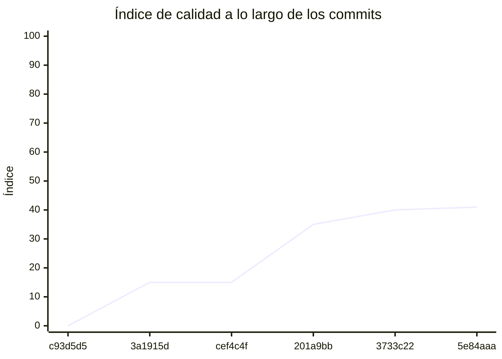

<!-- evaluacion:inicio -->
# Evaluación — prog2-perassiferrara/backend-turnos

> Documento **generado automáticamente** por la cátedra de Programación II (UM): RepoSense + análisis de calidad de **7 dimensiones**. **No editar a mano**: se regenera en cada evaluación.
> Rama evaluada: `main`. Análisis **heurístico** (regex + métricas) + build: es una criba para orientar la revisión, **no una nota**. La **documentación** del repositorio no se evalúa.
> Generado: 2026-10-19.

## 1. Veredicto

| Aspecto | Resultado |
|---|---|
| Índice de calidad | **59/100** |
| Tipo de repositorio | `backend` |
| Build (`mvnw verify` / `gradlew check`) | OK |
| Código (LOC) | 1,948 |
| Archivos de código | 37 |
| Clases | 40 |
| Código dentro de clases (%POO) | 81% |
| Funciones fuera de clases | 0 |
| Duplicación (puerta) | 0.0% |
| Duplicación lógica | 0.0% |
| Duplicación de boilerplate | 0.0% |
| Cobertura | 95% |

> Este informe **describe** lo que el análisis midió con los criterios ya establecidos de la materia. No es una nota.

## 2. Semáforo de aprobación

Criterios de la cátedra (`CRITERIOS-CALIDAD.md`): **Aprobar** se juega con el perfil `estandar`; **destacar**, con el `exigente` (meta de excelencia).

| Semáforo | Resultado |
|---|---|
| Aprobar (`estandar`) | **no cumple** — 6/11 |
| Destacar (`exigente`) | **no cumple** — 6/11 |

**Para aprobar, falta cumplir:** SOLID; SEC

**Para destacar, falta cumplir:** SOLID; SEC

## 3. Autoría (RepoSense)

| Autor | Commits | Código (LOC) | Tests (LOC) | Docs (LOC) | Días activos | % del código |
|---|---:|---:|---:|---:|---:|---:|
| Valentino Perassi Ferrara | 9 | 940 | 1,167 | 2,444 | 8 | 100% |

> _El LOC de autoría lo calcula RepoSense sobre el historial y puede diferir del LOC de código del análisis (que mira el estado de `main`)._

## 4. Dimensiones evaluadas

Cada dimensión indica **qué mide**, **por qué importa** y **tu resultado**. Cuando el puntaje queda por debajo de la referencia, se agregan preguntas para **investigar la causa** (no hay recetas).

| Dimensión | Peso | Puntaje |
|:--|--:|--:|
| **D1** Diseño OO, SOLID y patrones (20%) | 20% | 6 |
| **D2** Arquitectura hexagonal — backend (15%) | 15% | 100 |
| **D3** Frontend KMP: MVVM y buenas prácticas (10%) | 10% | N/A |
| **D4** Integración y contrato (10%) | 10% | 20 |
| **D5** Seguridad y robustez (10%) | 10% | 0 |
| **D6** Pruebas y cobertura (20%) | 20% | 100 |
| **D7** Proceso y entrega (15%) | 15% | 100 |

### D1. Diseño OO, SOLID y patrones (20%)

- **Qué mide:** Métricas orientadas a objetos (clases, métodos, campos, cohesión, acoplamiento, herencia) y proxies de SOLID, más patrones de diseño.
- **Por qué importa:** El eje de la materia es el buen uso de la POO y su arquitectura: un diseño con clases claras y poco acopladas es más fácil de entender, probar y cambiar.
- **Tu resultado:** **6/100**
- **Para investigar la causa:**
    - ¿Se pensó el modelo de clases antes de codificar o se agrupó después?
    - ¿Qué clases concentran muchas responsabilidades a la vez?
    - ¿Los colaboradores llegan como parámetros o se crean por dentro?

### D2. Arquitectura hexagonal — backend (15%)

- **Qué mide:** Separación en capas (dominio, puertos de entrada/salida, adaptadores) y dirección de las dependencias del backend.
- **Por qué importa:** Aislar el dominio de la infraestructura permite cambiar la base de datos, el framework o el transporte sin tocar las reglas de negocio.
- **Tu resultado:** **100/100**

### D4. Integración y contrato (10%)

- **Qué mide:** Cumplimiento del contrato de integración de la cátedra (formato de errores, paginación, autenticación, endpoints esperados).
- **Por qué importa:** Los servicios deben poder integrarse entre sí y con la app sin sorpresas; el contrato es lo que hacen cumplir las pruebas de integración.
- **Tu resultado:** **20/100**
- **Para investigar la causa:**
    - ¿Qué endpoints difieren del contrato acordado?
    - ¿Los errores se devuelven con un formato uniforme?
    - ¿La autenticación es consistente entre servicios?

### D5. Seguridad y robustez (10%)

- **Qué mide:** Credenciales embebidas, consultas SQL por concatenación, y presencia de config de entorno; aislamiento de secretos.
- **Por qué importa:** Un secreto en el repositorio o una consulta construida por concatenación son riesgos concretos, no hipotéticos.
- **Tu resultado:** **0/100**
- **Para investigar la causa:**
    - ¿De dónde salen las credenciales que usa el sistema?
    - ¿Qué consultas se arman con texto en vez de parámetros?
    - ¿Qué pasa si falta una variable de entorno al arrancar?

### D6. Pruebas y cobertura (20%)

- **Qué mide:** Cantidad y resultado de pruebas y cobertura de línea (JaCoCo/Kover, Surefire/Failsafe) cuando hay build.
- **Por qué importa:** Las pruebas son la red de seguridad para refactorizar e integrar; la cobertura acota las zonas sin verificar.
- **Tu resultado:** **100/100**

### D7. Proceso y entrega (15%)

- **Qué mide:** Artefactos verificables de proceso/entrega: `compose`, `.env.example`, CI (`.github/workflows/`), `CODEOWNERS` y wrapper de build (`mvnw`/`gradlew`). **No** puntúa documentación.
- **Por qué importa:** Un proyecto que compila, se levanta y se valida solo es más fácil de revisar y de integrar en equipo.
- **Tu resultado:** **100/100**

## 5. Señales detectadas

El análisis encontró las siguientes señales (archivo, sin número de línea a propósito):

**SRP/responsabilidad** (20)
- clase 'InMemoryTechnicalAccessAdapter' con baja cohesión (43%) — `src/main/java/com/prog2/appointment/integration/infrastructure/persistence/adapter/InMemoryTechnicalAccessAdapter.java`
- método 'SafeIntegrationHttpClient.builder' de 35 líneas — `src/main/java/com/prog2/appointment/integration/infrastructure/client/adapter/SafeIntegrationHttpClient.java`
- método 'SafeIntegrationHttpClient.classify' con complejidad 6 — `src/main/java/com/prog2/appointment/integration/infrastructure/client/adapter/SafeIntegrationHttpClient.java`
- clase 'TechnicalAccessRecoveryAdapter' grande (LOC=99, métodos=5, campos=11) — `src/main/java/com/prog2/appointment/integration/infrastructure/config/TechnicalAccessRecoveryAdapter.java`
- método 'TechnicalAccessRecoveryAdapter.runCycle' con complejidad 7 — `src/main/java/com/prog2/appointment/integration/infrastructure/config/TechnicalAccessRecoveryAdapter.java`
- método 'AcquireTechnicalAccessUseCaseImpl.attemptAcquisition' de 32 líneas — `src/main/java/com/prog2/appointment/integration/application/usecases/AcquireTechnicalAccessUseCaseImpl.java`
- método 'AcquireTechnicalAccessUseCaseImpl.attemptAcquisition' con complejidad 10 — `src/main/java/com/prog2/appointment/integration/application/usecases/AcquireTechnicalAccessUseCaseImpl.java`
- clase 'AppointmentApplicationTests' grande (LOC=126, métodos=15, campos=5) — `src/test/java/com/prog2/appointment/AppointmentApplicationTests.java`
- clase 'AppointmentApplicationTests' con baja cohesión (17%) — `src/test/java/com/prog2/appointment/AppointmentApplicationTests.java`
- clase 'TechnicalAccessHttpTests' grande (LOC=155, métodos=13, campos=5) — `src/test/java/com/prog2/appointment/integration/TechnicalAccessHttpTests.java`
- clase 'TechnicalAccessHttpTests' con baja cohesión (46%) — `src/test/java/com/prog2/appointment/integration/TechnicalAccessHttpTests.java`
- clase 'TechnicalAccessBehaviorTests' grande (LOC=117, métodos=14, campos=2) — `src/test/java/com/prog2/appointment/integration/TechnicalAccessBehaviorTests.java`
- clase 'TechnicalAccessRecoveryTests' grande (LOC=193, métodos=13, campos=6) — `src/test/java/com/prog2/appointment/integration/TechnicalAccessRecoveryTests.java`
- clase 'TechnicalAccessRecoveryTests' con baja cohesión (5%) — `src/test/java/com/prog2/appointment/integration/TechnicalAccessRecoveryTests.java`
- método 'TechnicalAccessRecoveryTests.concurrentForegroundRequestsShareOneCycleAndReturnWithoutWaiting' de 42 líneas — `src/test/java/com/prog2/appointment/integration/TechnicalAccessRecoveryTests.java`
- método 'TechnicalAccessRecoveryTests.concurrentForegroundRequestsShareOneCycleAndReturnWithoutWaiting' con complejidad 6 — `src/test/java/com/prog2/appointment/integration/TechnicalAccessRecoveryTests.java`
- clase 'TechnicalAccessPropertiesTests' grande (LOC=82, métodos=13, campos=1) — `src/test/java/com/prog2/appointment/integration/TechnicalAccessPropertiesTests.java`
- clase 'TestIntegrationSupport' grande (LOC=153, métodos=23, campos=16) — `src/test/java/com/prog2/appointment/integration/TestIntegrationSupport.java`
- clase 'TestIntegrationSupport' con baja cohesión (19%) — `src/test/java/com/prog2/appointment/integration/TestIntegrationSupport.java`
- método 'TechnicalIntegrationLifecycleTests.closingSpringContextInterruptsAndTerminatesOwnedWorker' de 43 líneas — `src/test/java/com/prog2/appointment/integration/infrastructure/config/TechnicalIntegrationLifecycleTests.java`

**DIP/concretos** (30)
- clase 'InMemoryTechnicalAccessAdapter' muy acoplada (CBO=11) — `src/main/java/com/prog2/appointment/integration/infrastructure/persistence/adapter/InMemoryTechnicalAccessAdapter.java`
- clase 'SafeIntegrationHttpClient' muy acoplada (CBO=28) — `src/main/java/com/prog2/appointment/integration/infrastructure/client/adapter/SafeIntegrationHttpClient.java`
- clase 'SafeIntegrationHttpClient' instancia 7 concretos (CBO=28) — `src/main/java/com/prog2/appointment/integration/infrastructure/client/adapter/SafeIntegrationHttpClient.java`
- clase 'WebClientCentralIntegrationAdapter' muy acoplada (CBO=10) — `src/main/java/com/prog2/appointment/integration/infrastructure/client/adapter/WebClientCentralIntegrationAdapter.java`
- clase 'WebClientCatalogTechnicalTokenAdapter' muy acoplada (CBO=13) — `src/main/java/com/prog2/appointment/integration/infrastructure/client/adapter/WebClientCatalogTechnicalTokenAdapter.java`
- clase 'WebClientCatalogTechnicalTokenAdapter' instancia 3 concretos (CBO=13) — `src/main/java/com/prog2/appointment/integration/infrastructure/client/adapter/WebClientCatalogTechnicalTokenAdapter.java`
- clase 'TechnicalIntegrationConfiguration' muy acoplada (CBO=19) — `src/main/java/com/prog2/appointment/integration/infrastructure/config/TechnicalIntegrationConfiguration.java`
- clase 'TechnicalIntegrationConfiguration' instancia 9 concretos (CBO=19) — `src/main/java/com/prog2/appointment/integration/infrastructure/config/TechnicalIntegrationConfiguration.java`
- clase 'TechnicalAccessRecoveryAdapter' muy acoplada (CBO=24) — `src/main/java/com/prog2/appointment/integration/infrastructure/config/TechnicalAccessRecoveryAdapter.java`
- clase 'AcquireTechnicalAccessUseCaseImpl' muy acoplada (CBO=17) — `src/main/java/com/prog2/appointment/integration/application/usecases/AcquireTechnicalAccessUseCaseImpl.java`
- clase 'AccessFailure' muy acoplada (CBO=9) — `src/main/java/com/prog2/appointment/integration/domain/enums/AccessFailure.java`
- clase 'ServiceTokenIssuer' muy acoplada (CBO=21) — `src/main/java/com/prog2/appointment/infrastructure/security/jwt/ServiceTokenIssuer.java`
- clase 'DatabaseConfiguration' muy acoplada (CBO=14) — `src/main/java/com/prog2/appointment/infrastructure/config/DatabaseConfiguration.java`
- clase 'TechnicalAccessProperties' muy acoplada (CBO=25) — `src/main/java/com/prog2/appointment/infrastructure/config/TechnicalAccessProperties.java`
- clase 'TechnicalAccessProperties' instancia 9 concretos (CBO=25) — `src/main/java/com/prog2/appointment/infrastructure/config/TechnicalAccessProperties.java`
- clase 'AppointmentApplicationTests' muy acoplada (CBO=44) — `src/test/java/com/prog2/appointment/AppointmentApplicationTests.java`
- clase 'AppointmentApplicationTests' instancia 5 concretos (CBO=44) — `src/test/java/com/prog2/appointment/AppointmentApplicationTests.java`
- clase 'TechnicalAccessHttpTests' muy acoplada (CBO=41) — `src/test/java/com/prog2/appointment/integration/TechnicalAccessHttpTests.java`
- clase 'TechnicalAccessHttpTests' instancia 22 concretos (CBO=41) — `src/test/java/com/prog2/appointment/integration/TechnicalAccessHttpTests.java`
- clase 'TechnicalAccessBehaviorTests' muy acoplada (CBO=27) — `src/test/java/com/prog2/appointment/integration/TechnicalAccessBehaviorTests.java`
- clase 'TechnicalAccessBehaviorTests' instancia 32 concretos (CBO=27) — `src/test/java/com/prog2/appointment/integration/TechnicalAccessBehaviorTests.java`
- clase 'TechnicalAccessRecoveryTests' muy acoplada (CBO=37) — `src/test/java/com/prog2/appointment/integration/TechnicalAccessRecoveryTests.java`
- clase 'TechnicalAccessRecoveryTests' instancia 27 concretos (CBO=37) — `src/test/java/com/prog2/appointment/integration/TechnicalAccessRecoveryTests.java`
- clase 'Harness' muy acoplada (CBO=17) — `src/test/java/com/prog2/appointment/integration/TechnicalAccessRecoveryTests.java`
- clase 'TechnicalAccessPropertiesTests' muy acoplada (CBO=23) — `src/test/java/com/prog2/appointment/integration/TechnicalAccessPropertiesTests.java`
- clase 'TechnicalAccessPropertiesTests' instancia 5 concretos (CBO=23) — `src/test/java/com/prog2/appointment/integration/TechnicalAccessPropertiesTests.java`
- clase 'TestIntegrationSupport' muy acoplada (CBO=52) — `src/test/java/com/prog2/appointment/integration/TestIntegrationSupport.java`
- clase 'TestIntegrationSupport' instancia 15 concretos (CBO=52) — `src/test/java/com/prog2/appointment/integration/TestIntegrationSupport.java`
- clase 'TechnicalIntegrationLifecycleTests' muy acoplada (CBO=19) — `src/test/java/com/prog2/appointment/integration/infrastructure/config/TechnicalIntegrationLifecycleTests.java`
- clase 'TechnicalIntegrationLifecycleTests' instancia 7 concretos (CBO=19) — `src/test/java/com/prog2/appointment/integration/infrastructure/config/TechnicalIntegrationLifecycleTests.java`

**OCP/type-switch** (1)
- clase 'TechnicalAccessProperties' con 1 type-checks — `src/main/java/com/prog2/appointment/infrastructure/config/TechnicalAccessProperties.java`

**POO** (1)
- clase 'TestIntegrationSupport' con 13 campos públicos (encapsulación) — `src/test/java/com/prog2/appointment/integration/TestIntegrationSupport.java`

**seguridad** (2)
- clave privada embebida (PEM) — `src/main/java/com/prog2/appointment/infrastructure/config/TechnicalAccessProperties.java`
- clave privada embebida (PEM) — `src/main/java/com/prog2/appointment/infrastructure/config/TechnicalAccessProperties.java`

## 6. Evolución por commit

Métricas calculadas sobre el estado de `main` en **cada commit** (6 commits con trabajo), del primero al último. La calidad usa el perfil `exigente`; el aporte de código lo mide RepoSense. El índice puede **bajar** al crecer el proyecto: se acumulan señales.

| # | Fecha | Commit | Autor | LOC | Índice | %POO | Duplic. | Sueltas |
|---|---|---|---|---:|---:|---:|---:|---:|
| 1 | 2026-09-07 | `c93d5d5` | Valentino Perassi Ferrara | 0 | 0 | 0% | 0.0% | 0 |
| 2 | 2026-09-10 | `3a1915d` | Ing. Daniel Quinteros | 0 | 15 | 0% | 0.0% | 0 |
| 3 | 2026-10-09 | `cef4c4f` | Valentino Perassi Ferrara | 0 | 15 | 0% | 0.0% | 0 |
| 4 | 2026-10-12 | `201a9bb` | Valentino Perassi Ferrara | 207 | 35 | 72% | 0.0% | 0 |
| 5 | 2026-10-13 | `3733c22` | Valentino Perassi Ferrara | 207 | 40 | 72% | 0.0% | 0 |
| 6 | 2026-10-18 | `5e84aaa` | Valentino Perassi Ferrara | 1,948 | 41 | 81% | 0.0% | 0 |

---
_Informe generado por la cátedra. Las dimensiones y umbrales corresponden a `calidad.py` (perfil `exigente`); el semáforo, a `CRITERIOS-CALIDAD.md`. La documentación del repositorio no se evalúa. Ante dudas, revisá el archivo señalado._
<!-- evaluacion:fin -->
