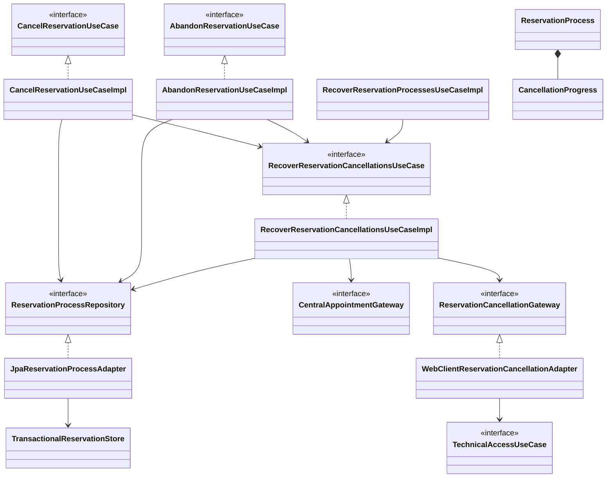
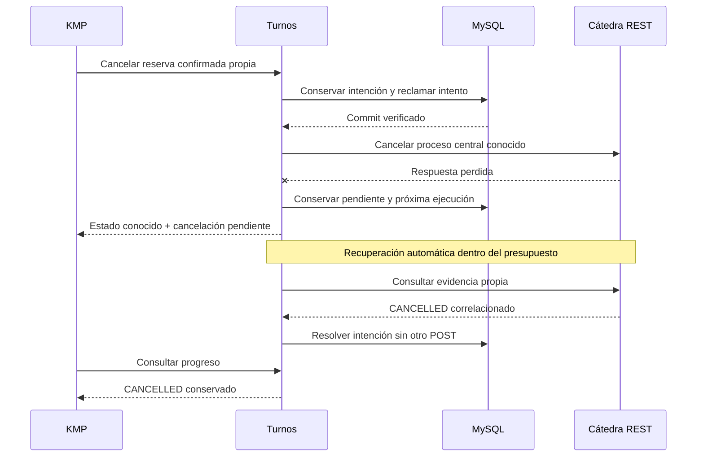

# PLAN: Cancelar reservas y abandonar procesos propios

> **Registro histórico SDD.** Alcance, diagramas y evidencia de su revisión; no describen necesariamente el sistema actual. Consultar [arquitectura vigente](../../ARQUITECTURA.md), [contratos](../../CONTRATOS.md) e [índice histórico](../README.md).

> Cancelación sustituida por la [Etapa 4 de simplificación](../simplificacion-reservas/PLAN.md): intención mínima, sin retryVersion ni presupuesto durable por ciclos.

> Actualización 2026-11-02: la [simplificación de reservas, Etapa 1](../simplificacion-reservas/SPEC.md) sustituye el abandono compensatorio y la certificación central por lectura aquí descritos. Se conserva este documento como antecedente; el contrato vigente está en README y en esa funcionalidad.

**Ajuste posterior aprobado, 2026-11-02:** Simplificación autorizada: el presupuesto de tres intentos cuenta únicamente reclamaciones para POST de cancelación de una reserva confirmada. Las consultas y esperas no consumen ese presupuesto. Un único coordinador recupera procesos y cancelaciones; teléfono mantiene su publicador independiente. Se conservan intención durable, retryVersion explícito, propiedad, reconciliación antes de repetir y cierre seguro del abandono. Confirmado y autorizado a implementar por el usuario en la revisión de simplificación. RF/CA vigentes conservados; se revalidan las transiciones, recuperación, concurrencia y migraciones afectadas.

**SPEC de referencia:** [SPEC.md](SPEC.md)
**Versión de la spec revisada:** 2026-11-02, aprobada explícitamente; D-02 confirmada durante esta planificación.
**Estado:** Aprobado <!-- Borrador | En revisión | Aprobado -->
**Aprobación:** 2026-11-01, explícita del usuario. La autorización y el avance de implementación constan en [TASKS.md](TASKS.md).

## Contexto técnico verificado

<!-- Qué existe hoy y cómo participa en la funcionalidad. -->

Base local `129b665`, rama `13-cu-08-cancelar-reserva-propia-y-reconciliar-restkafka`. El 2026-11-01 se comprobó mediante la API de GitHub que `main` remoto (`cebeabe`) tiene el mismo contenido versionado, tras integrar CU-07. La carpeta documental de esta funcionalidad sigue local y sin seguimiento; no se modificó Git.

Rutas de la tabla relativas a `src/main/java/com/prog2/appointment/`, salvo indicación.

| Componente o archivo existente | Ruta verificada | Responsabilidad y uso previsto |
| --- | --- | --- |
| Proceso y reglas | `reservation/domain/model/ReservationProcess.java` | Agregado inmutable con fase, IDs, `closedAt` y `abandonmentPending`; la versión optimista queda en JPA. Ya acepta cancelación recibida y conserva confirmación concurrente. Falta solicitarla. |
| Persistencia | `reservation/domain/ports/out/ReservationProcessRepository.java`, `reservation/infrastructure/persistence/adapter/JpaReservationProcessAdapter.java`, `reservation/infrastructure/persistence/service/TransactionalReservationStore.java` | Escrituras verificables tras commit, control optimista, inbox y cierre de teléfonos en transacciones locales. Reutilizar, sin HTTP dentro de ellas. |
| Lectura central | `reservation/domain/ports/out/CentralAppointmentGateway.java`, `reservation/infrastructure/client/adapter/WebClientCentralAppointmentAdapter.java` | `find` consulta una página propia por paciente/fecha; ausencia inconclusa. No existe consulta directa de holds. |
| Teléfono y eventos | `reservation/infrastructure/messaging/PhoneSubmissionDispatcher.java`, `ReservationActionParser.java` en el mismo paquete | Outbox, productor y consumidor existentes; falta impedir publicación tras aceptar abandono. El parser ya reconoce `AppointmentCancelled`. |
| API y consultas | `reservation/infrastructure/web/controller/ReservationController.java`, `reservation/application/usecases/GetReservationProcessUseCaseImpl.java`, `ListOwnReservationsUseCaseImpl.java` en el mismo paquete | JWT/propiedad, consultas y DTO comunes. El GET individual hoy omite reconciliar fases finales, incluso una confirmada. |
| Configuración y esquema | `infrastructure/config/ReservationProperties.java`, `reservation/infrastructure/config/ReservationConfiguration.java`; `src/main/resources/db/migration/V3__create_reservation_processes.sql` a `V5__add_reservation_professional_names.sql` | Timeouts/reintentos, wiring y scheduling. `active_owner_id` deriva de cierre/abandono; la tabla de procesos admite ampliar progreso sin otra tabla. |

**Convenciones y patrón de referencia:** skill `hexagonal-arch` y [PLAN de teléfono/progreso](../telefono-progreso-reserva/PLAN.md). Dominio sin framework, puertos propios, adaptadores REST/JPA, DI por constructor y wiring en infraestructura. Se reutiliza el acceso público de `integration` ya acordado, sin otra composición entre slices. Javadoc tradicional en español para contratos y decisiones relevantes; sin Lombok `@Data`.

## Solución propuesta

<!-- Explica el enfoque y sus motivos. Describe las responsabilidades y el
recorrido desde la solicitud, evento o arranque hasta el resultado del servicio.
Usa un diagrama si aporta claridad. -->

Mantener todo en `reservation`. Añadir progreso opcional de cancelación al proceso existente, separado de `ReservationPhase`: una reserva sigue `CONFIRMED` mientras su cancelación está pendiente. No crear otra tabla, otro flujo de teléfono ni otro catálogo.

1. Dos casos de uso conservan las entradas de CU-08 y CU-10. Ambos solicitan al repositorio una aceptación atómica con propietario, modalidad y referencia local; el abandono cierra también la publicación pendiente y mantiene la exclusión del proceso de creación cuando corresponda.
2. Solo una aceptación nueva, o un reintento explícito nuevo, habilita ejecución inmediata. Una repetición devuelve el progreso actual, sin reiniciar presupuesto. Las consultas tampoco inician otro ciclo.
3. El caso de recuperación consulta evidencia para abandonos pendientes y para efectos anteriores; esas lecturas no consumen intentos. Solo después, sobre CONFIRMED, reclama durablemente un intento y ejecuta como máximo un POST fuera de SQL. Antes de repetir un efecto consulta evidencia con los IDs conservados; un `CANCELLED` válido evita otro POST. Una ausencia no prueba cierre: repetir la cancelación del mismo ID se apoya en su idempotencia contractual.
4. Respuesta REST, consulta o evento actualizan la última versión del proceso y resuelven la intención cuando existe evidencia suficiente. Una confirmación durante el abandono mantiene la intención; no requiere una segunda autorización.
5. El coordinador general recupera los pendientes tras cortes/reinicios sin KMP abierto, con un máximo de tres reclamaciones de POST por ciclo. Al agotarlas continúa consultando sin nuevos POST; el propietario puede pedir otro ciclo explícitamente con la versión de reintento observada.

Diagrama de clases centrado en los contratos afectados. Las clases de cancelación son propuestas; los repositorios/adaptadores de lectura ya existen. Se omiten DTO y entidades del diagrama para conservar legibilidad.

La secuencia siguiente aclara el caso de respuesta perdida; el dispatcher y Kafka también pueden resolverlo antes de que el usuario vuelva a consultar.

## Módulos y componentes afectados

<!-- Si el proyecto está modularizado, identifica los módulos afectados, sus
responsabilidades y la dirección de sus dependencias. Respeta los límites
existentes y justifica cualquier módulo o dependencia nueva. Si no está
modularizado, describe las carpetas o componentes afectados sin introducir
modularización fuera del alcance; marca la tabla de módulos como No aplica. -->

| Módulo | Existe / nuevo | Responsabilidad y cambios | Dependencias afectadas |
| --- | --- | --- | --- |
| Módulos de build | No aplica | Un proyecto Maven; se amplía el slice existente `reservation`. | Infraestructura → aplicación → dominio. Otros repositorios sin cambios. |

<!-- Distingue lo que se reutiliza, modifica o crea. Las rutas nuevas son propuestas.
Señala impacto sobre modelos, contratos o componentes compartidos. -->

Rutas propuestas bajo `src/main/java/com/prog2/appointment/reservation/`, excepto migración/configuración.

| Componente o ruta | Acción | Cambio y responsabilidad | Requisito relacionado |
| --- | --- | --- | --- |
| `domain/model/CancellationProgress.java`, `CancellationEvidence.java`; modalidades/estados en `domain/enums/` | Crear | Progreso durable de la intención y evidencia de cancelación, sin tipos HTTP/JPA. | RF-02 a RF-06 |
| `domain/model/ReservationProcess.java` | Modificar | Aceptar intención, impedir nuevos pasos, conservarla al confirmar y resolverla por evidencia válida. No añadir fases de cancelación a la reserva. | RF-03 a RF-06, RF-08 |
| `domain/ports/in/{CancelReservation,AbandonReservation,RecoverReservationCancellations}UseCase.java` y sus implementaciones en `application/usecases/` | Crear | Dos acciones propias y recuperación común; constructor DI. La recuperación ofrece ejecución puntual y lote de pendientes. | RF-01 a RF-08 |
| `domain/ports/out/ReservationCancellationGateway.java`, `infrastructure/client/adapter/WebClientReservationCancellationAdapter.java`, DTO central en `infrastructure/client/dto/` | Crear | Un POST por llamada exclusivamente sobre CONFIRMED y validación de su evidencia con reservationId obligatorio. Consumir `TechnicalAccessUseCase`, sin login propio. | RF-02, RF-03, RF-06, RF-07 |
| `ReservationProcessRepository` y persistencia JPA existentes | Modificar | Aceptar/reintentar, seleccionar pendientes, reclamar intento y aplicar evidencia con commit verificable; integrar inbox/reconciliación con el cierre de intención. | RF-01, RF-04 a RF-08 |
| `StartReservationUseCaseImpl`, publicación de teléfono y transiciones relacionadas | Modificar | Comprobar abandono antes de iniciar otro paso. Cerrar outbox al aceptarlo, respetando el envío que ya estaba en curso. | RF-03, RF-04 |
| `GetReservationProcessUseCaseImpl`, listado, mapper y DTO públicos | Modificar | Incluir cancelación y acciones; permitir reconciliar una confirmada con cancelación pendiente, sin POST desde consultas. | RF-06, RF-08 |
| `ReservationController`, body de reintento en `infrastructure/web/dto/`, errores existentes | Modificar / crear | Dos rutas, propietario desde JWT, reintento explícito versionado y respuestas seguras. | RF-01 a RF-03, RF-05, RF-08 |
| `infrastructure/scheduling/ReservationRecoveryDispatcher.java`, `ReservationConfiguration`, `application.yaml` | Crear / modificar | Worker de recuperación REST y scheduling con dos hilos para que no bloquee la publicación de teléfonos. | RF-04, RF-05, RF-07 |
| `src/main/resources/db/migration/V6__add_reservation_cancellation.sql` | Crear | Columnas e índice de progreso en `reservation_process`; sin modificar migraciones previas. | RF-05, RF-08 |
| Pruebas de cancelación y soporte existente; `README.md` | Crear / modificar | Contrato propio, persistencia, carreras, límites y ejecución verificables. | RF-01 a RF-08 |

## Datos y contratos

**Ajuste autorizado, 2026-11-02:** la consulta central puntual reutiliza el recorrido por paciente del historial, sin filtros opcionales de fecha/estado, hasta tres páginas de 100 con plazo total compartido. Los filtros de fecha documentados devuelven HTTP 500 en el ensayo central. Reconciliar solo tras un recorrido completo y una coincidencia exacta de proceso, paciente y selección; un recorrido parcial o contradictorio conserva incertidumbre. Afecta RF-04/RF-06, CA-06/CA-07/CA-08 y las regresiones de consulta de T-03/T-05/T-06; no cambia endpoints propios, estados ni esquema de datos.

<!-- Completa solo lo aplicable. Si un punto no aplica, indica el motivo. -->

- **Modelos y contratos de entrada y salida:** proponer `POST /api/reservation-processes/{processId}/cancel` para CU-08 y `POST /api/reservation-processes/{processId}/abandon` para CU-10. Primera solicitud sin body ni motivo; un reintento explícito usa la misma ruta con `{"retryVersion": n}`. Responder con `ReservationProcessResponse`, ampliado con `cancellation` nullable: modalidad, estado (`PENDING`, `REJECTED`, `RESOLVED`), fecha de solicitud, último código seguro, `canRetry` y `retryVersion` cuando corresponda. `state` continúa siendo la fase conocida de la reserva. `202` mientras la intención esté pendiente y `200` cuando se comunica un resultado resuelto o rechazado conocido; el body distingue rechazo de cancelación. Las precondiciones inválidas se rechazan antes de aceptar.
- **Identificadores, relaciones y restricciones:** conservar UUID local, propietario e IDs centrales. No exigir otro UUID de KMP: ambas acciones convergen sobre una intención por proceso. `retryVersion` es un contador propio de esa intención, distinto de `@Version` de JPA. Bajo transacción, solo la versión agotada/rechazada observada permite abrir el siguiente ciclo; repetir una versión anterior devuelve el progreso actual y una futura se rechaza. La solicitud original sin versión nunca reinicia intentos. Conservar modalidad original; un cambio de modalidad sobre una intención existente se rechaza sin sustituirla.
- **Origen de los datos consultados y transformaciones:** reutilizar `CentralAppointmentGateway.find`, comprobando paciente, selección e IDs. Nuevo cliente central para `POST /api/appointments/{reservationProcessId}/cancel`, sin `reason`, sin redirects ni retry de transporte. Validar HTTP 200, `status=CANCELLED`, proceso coincidente y fecha válida; `reservationId` es obligatorio, positivo y coincide con el conocido. No inferirlo de ocupaciones. Los campos adicionales compatibles se ignoran; una respuesta insuficiente mantiene incertidumbre.
- **Precisión de expiresAt:** conservar una representación UTC canónica en microsegundos, truncando hacia abajo antes de persistir en TIMESTAMP(6). `HoldDetails` aplica esa representación y compara REST/Kafka con el mismo criterio: una diferencia dentro del microsegundo representable no es otro vencimiento; una diferencia de un microsegundo o mayor sigue siendo incompatible. No ampliar el plazo, modificar el payload del inbox ni agregar columnas o migraciones. Ajuste de integración autorizado explícitamente el 2026-11-02; afecta RF-06, CA-07/CA-08 y las regresiones de inicio/teléfono de T-01/T-03/T-05/T-06.
- **Persistencia, consultas y actualizaciones:** V6 añade modalidad/estado nullable, `requested_at`, versión de reintento, contador de intentos, próxima ejecución y último código seguro, con prefijo `cancellation_` e índice por estado/próxima ejecución. Sin intención, valores nulos/contadores cero. `CancellationProgress` agrupa esos datos en dominio. Añadir al puerto aceptación atómica con propietario/modalidad/versión, consulta de pendientes, reclamación de intento y aplicación de evidencia; reutilizar actualización pura para errores. Ningún método recibe tipos JPA, `Pageable` o clientes HTTP.
- **Convivencia entre datos locales y remotos:** fase y progreso de cancelación permanecen separados. `RESOLVED` significa intención resuelta; el resultado concreto sigue siendo `CANCELLED`, `EXPIRED` o `FAILED` según evidencia. Un `CONFIRMED` recibido durante abandono no resuelve la intención. El listado conserva paginación y nombres históricos; la cancelación de una confirmada sigue en historial sin ocupar el lugar del proceso de creación pendiente.
- **Compatibilidad y migraciones de datos existentes:** V6 es aditiva, sin borrar usuarios/procesos ni modificar V3 a V5. Mantener `active_owner_id`: activar `abandonmentPending` solo al aceptar abandono sobre un proceso de creación todavía pendiente. Si ya estaba confirmado al aceptar la acción, cancelar sin activar esa exclusión ni interferir con otro pendiente. Si se confirma después, conservarla hasta resolver el abandono. Limpiarla también ante fallo central verificado. Los GET/listados añaden el objeto opcional, conservando campos previos.

## Estado, operaciones y errores

<!-- Cómo se implementan los comportamientos aprobados en la spec.
Referencia RF/CA y completa solo los puntos pertinentes al backend. -->

- **Estado del servicio y de las operaciones:** CU-08 exige confirmada o reconoce ya cancelada; CU-10 acepta pendiente con IDs y cubre la confirmación concurrente. Sobre vencido/fallido verificado, CU-10 devuelve el resultado sin nueva intención. Sin IDs conocidos se rechaza la acción, conservando CU-04. El progreso de cancelación no hace pasar `PHONE_PENDING` por una reserva confirmada ni habilita teléfono. El GET individual puede reconciliar intenciones no resueltas, también rechazadas, aunque la fase ya sea `CONFIRMED`; conserva su política de lectura acotada y nunca ejecuta el POST de cancelación.
- **Conservación y restauración del estado:** aceptar abandono y cerrar la respuesta activa de teléfono en una sola transacción. Reutilizar `@Version`, `write_id` y verificación posterior del adapter; sin commit acreditado no hay efecto central nuevo. Cambios de inbox, consulta y cancelación resuelven intención/outbox con el estado del proceso en la misma transacción. Al reiniciar se conserva contador y fecha; el dispatcher no necesita al usuario conectado.
- **Ejecución, concurrencia y cancelación de operaciones:** reclamar cada intento mediante una actualización optimista verificable, antes de HTTP; solo quien acredita la reclamación puede ejecutarlo. Guardar contador, versión de ciclo y próxima fecha antes de salir de SQL. No HTTP bajo locks ni transacciones. Antes de confirmar inicialmente o reclamar una publicación, comprobar el abandono; cerrar outbox no retira un mensaje ya enviado. Los errores/ACK de una ejecución anterior no sobrescriben otro ciclo o un resultado final. Una evidencia `CANCELLED` válida sí puede resolver la intención aunque llegue desde un intento anterior.
- **Errores, reintentos y prevención de duplicados:** D-02 fija tres intentos por ciclo, incluidos los interrumpidos después de reclamar, nunca un bucle abierto. Usar `retryDelay` existente entre intentos y `preparationCooldown` antes del reintento explícito. La reserva confirmada no tiene un TTL que permita reiniciar automáticamente el ciclo; tampoco se corta una cancelación incierta solo por `expiresAt`. Un abandono no confirmado se revisa sin consumir intentos ni acceder al POST; el plazo central permite el cierre local solo en el caso seguro siguiente. Si está HELD, WAITING_FOR_REQUEST o WAITING_FOR_PHONE, no hay ninguna respuesta telefónica registrada y ya venció el plazo central, se cierra localmente como EXPIRED con intención resuelta. Los estados inciertos o con cualquier teléfono registrado requieren lectura/evento; las verificaciones no consumen presupuesto y una ausencia mantiene pendiente. Si aparece CONFIRMED, la intención habilita el POST. Primera ejecución nueva sobre una confirmada puede ir directamente al POST; después de una reclamación previa o de un reintento explícito, consultar primero. Si la lectura falla, conservar pendiente y no emitir ese POST; si resulta inconclusa, el POST idempotente del mismo ID sigue siendo seguro, sin atribuir propiedad por ocupaciones.
- **Rechazos y eventos concurrentes:** `404/RESERVATION_NOT_FOUND`, `403/RESERVATION_OWNER_MISMATCH`, `409/RESERVATION_NOT_CANCELLABLE` y validación central no acreditan liberación; guardar rechazo y detener repetición del mismo efecto sin nueva información. Una confirmación correlacionada permite reclamar el siguiente POST dentro del presupuesto restante; el rechazo de una lectura no modifica ese presupuesto ni desactiva la intención. Agotado el presupuesto, se mantiene el reintento explícito acordado. `HOLD_EXPIRED`/evento de expiración y fallo central válidos resuelven con su propio resultado. No relajar el parser por una supuesta variante de evento de hold: si no puede validarse, conservar el recibo según las reglas actuales y verificar por REST.
- **HTTP y errores propios:** mantener JWT, `problem+json`, `code` seguro y `no-store`; `400` por UUID/body/versión inválidos, `404` indistinto para ausente/ajeno, `409` por fase, IDs, modalidad o reintento no disponible, y `503` si no se acredita persistencia. Un rechazo funcional conservado se expone como `cancellation.status=REJECTED`, nunca como éxito de cancelación. Los rechazos de la identidad técnica no se traducen a un `401` del usuario: invalidar solo el token técnico utilizado y conservar progreso, sin repetir el POST dentro del adapter.
- **Límites de ejecución:** un dispatcher periódico con `retryDelay` y lotes de diez, sin esperas activas. Reutilizar timeout HTTP de cinco segundos por defecto, hasta dos veces ese valor por petición como los clientes actuales. Al reclamar, reservar próxima ejecución antes del POST por el presupuesto HTTP y la separación; al registrar el fallo, ajustar a la próxima fecha permitida. Tras el tercer intento no emitir más POST automáticamente. El coordinador sigue obteniendo evidencia mediante consultas, sin reiniciar ni consumir otro ciclo de efectos.
- **Observabilidad y diagnósticos seguros:** registrar UUID local, operación, ciclo/intento y código clasificado. No imprimir payload, motivo libre, teléfono, JWT, perfil ni configuración técnica. Mantener offset después del commit y deduplicación por `eventId`; no alterar los eventos de teléfono ni prometer ejecución física exactamente una vez.

## Dependencias y configuración

<!-- Librerías, servicios, permisos o configuración afectados. Verifica compatibilidad
con el proyecto y justifica las incorporaciones. No agregues dependencias por defecto. -->

- Sin dependencias Maven, servicios, secretos, permisos, tablas auxiliares ni slices nuevos. Reutilizar MySQL/Flyway, WebClient, seguridad, reloj y acceso técnico existentes. El máximo de tres es específico de D-02; no cambiar el presupuesto global de inicio/teléfono.
- Reutilizar `httpTimeout`, `retryDelay` y `preparationCooldown`; no agregar variables obligatorias. Wiring por constructor en `ReservationConfiguration`; dominio/aplicación no importan configuración o tipos de otros slices.
- Configurar `spring.task.scheduling.pool.size=2` para separar las dos tareas periódicas. La propiedad y su default actual de un hilo se comprobaron en metadata local de Spring Boot 4.1.1. No habilitar virtual threads ni crear un pool por proceso. README documentará ambos POST, reintento y límite; no cambiar Compose ni `.env.example` sin una necesidad detectada.

## Estrategia de validación

<!-- Una fila por criterio de la spec. Selecciona el método capaz de demostrarlo:
test unitario, integración, contrato o prueba manual. No todos requieren todos los métodos.
Identifica tests existentes y separa los nuevos propuestos. Incluye regresiones relevantes.
Una captura aislada no demuestra persistencia ni ausencia de peticiones de red. -->

Suites nuevas propuestas: `ReservationCancellationTests` (transiciones/casos de uso), `ReservationCancellationGatewayTests` (HTTP real contra servidor ficticio) y `ReservationCancellationIntegrationTests` (API, SQL, inbox y recuperación). Reutilizar `ReservationTestSupport`, `CommitFaultDataSource` y convenciones de pruebas existentes; no sustituir SQL o commit por mocks al probar sus garantías.

| Criterio | Método y test existente o propuesto | Entorno y datos necesarios | Evidencia prevista |
| --- | --- | --- | --- |
| CA-01 | Integración nueva de autorización/entrada. | Dos usuarios reales de prueba, JWT inválido, UUID ausente/ajeno y entradas inválidas. | Mismo rechazo para ausente/ajeno, cero llamadas centrales y ningún dato ajeno. |
| CA-02 | Gateway e integración nuevos, con repetición secuencial/concurrente. | Confirmada propia, REST válido, Kafka inaccesible; IDs/estado/respuesta alterados. | Solo evidencia correlacionada produce `CANCELLED`; sin motivo, sin duplicación funcional ni espera de Kafka. |
| CA-03 | Integración nueva y regresión de consultas. | Pendiente con IDs; requests explícitos frente a GET/cierre de cliente. | Intención y espera hasta expiresAt sin POST ni consumo de intentos; cierre por plazo solo en espera estable sin teléfono. Consultar o desconectar no abandona ni renueva plazo. |
| CA-04 | Unitarias/integración con barreras, apoyadas en inbox existente. | Confirmación antes/después de aceptar abandono o antes de recibir un rechazo REST anterior; cancelación y confirmación vieja tardía. | Intención y exclusión conservadas, recuperación dentro del presupuesto intacta y sin retroceso de cancelación. |
| CA-05 | Integración con outbox/productor controlado. | Teléfono en cola, reclamación concurrente y publicación ya iniciada. | Ningún nuevo envío tras aceptación; ACK/resultado en curso no restaura teléfono ni borra intención. |
| CA-06 | Reloj controlado y SQL reales; fallos de commit y reinicio. | Caída antes del POST, respuesta perdida, reclamación interrumpida y tres intentos fallidos. | Contador/fechas durables, sin cuarto intento automático; replay/GET no lo reinician y la misma versión explícita abre un solo ciclo. |
| CA-07 | Inbox/SQL reales e intercalado con REST. | Duplicados, eventos ajenos, error antes del commit y resultados fuera de orden. | Estado único y offset posterior a persistir; ningún error antiguo sustituye un cierre/ciclo posterior. |
| CA-08 | Gateway/unitarias parametrizadas e integración. | 404/403/409, body inválido, ausencia, plazo local vencido y cierre central válido. | Rechazo/incertidumbre/vencimiento distinguibles, sin liberar por ausencia/reloj ni reintentar rechazo sin nueva evidencia. |
| CA-09 | Integración con dependencias retiradas por separado. | Catálogo/Kafka inaccesibles con token utilizable, acceso central caído y commit no acreditado. | Cancelación REST posible o intención pendiente; sin efecto cuando falla conservarla. |
| CA-10 | Migración V5→V6 y consultas reales tras restaurar contexto. | Historial y otro pendiente propios, intención de abandono anterior a confirmación, datos previos sin intención. | Datos conservados, misma paginación, cancelación histórica sin ocupar el pendiente y bloqueo del nuevo inicio mientras abandono incierto. |
| CA-11 | Regresión de CU-04 y precondición nueva. | Creación sin IDs con HELD/CONFIRMED/libre observados. | Ningún POST de cancelación ficticio y política de ocupaciones existente sin cambios. |

**Comprobaciones de regresión:** `ReservationProcessTests`, `StartReservationTests`, `ReservationIntegrationTests`, `ReservationPhoneIntegrationTests`, `GetReservationProcessTests`, `ListOwnReservationsTests` y `OwnReservationsIntegrationTests`, además de la suite completa. Verificar guardas de resultado final, único pendiente, replay de teléfono y compatibilidad de DTO/migraciones. Usar barreras y reloj para carreras, sin sleeps arbitrarios ni reescribir expectativas para imitar la implementación.

**Comandos verificados para compilar y ejecutar tests:** wrapper, Surefire/Testcontainers y README existentes usan `./mvnw -B -ntp clean verify`. Tras crear las suites, el foco previsto es `./mvnw -B -ntp -Dtest=ReservationCancellationTests,ReservationCancellationGatewayTests,ReservationCancellationIntegrationTests verify`. No se ejecutan builds en esta etapa documental; durante implementación revisar además Javadoc y Sonar local CLI/IDE antes de proponer publicación.

**Pruebas operativas del backend:** ejecutar JAR con MySQL temporal y proveedores ficticios para probar aceptación, respuesta perdida, reinicio, tres intentos y reintento explícito con usuario real de prueba. El ensayo real del abandono no requiere cancelar un hold ni publicar teléfono: conserva su expiresAt y verifica que no se solicita el POST mientras está pendiente. La cancelación de una reserva confirmada se valida separadamente cuando exista un fixture propio adecuado; no modificar otros servicios para simularlo.

**Limitaciones del entorno:** distinguir los contratos verificados con proveedores ficticios de las operaciones efectivamente ensayadas contra cátedra. Una consulta o evento central no disponible conserva incertidumbre, sin impedir comprobar localmente las reglas de abandono y cancelación. Los checks y hallazgos remotos posteriores a la publicación del usuario son retroalimentación, no tareas de implementación ni resultados deducidos de pruebas locales.

<!-- Esta sección planifica la validación. Durante la implementación, registra
en TASKS.md o en el informe de validación acordado los resultados y evidencias
reales. Usar el cierre de TASKS.md definido en AGENTS.md: CA/evidencia,
regresión y desviaciones del PLAN. Distingue pruebas ejecutadas, fallidas,
no ejecutadas y bloqueadas.
Compilar o tener tests en verde no sustituye revisar los criterios de la spec. -->

## Orden de implementación

<!-- Etapas y dependencias principales. El desglose ejecutable se escribe en TASKS.md.
Incluye puntos de comprobación para avanzar con cambios pequeños. -->

1. Modelar intención/evidencia y guardas, con transiciones de confirmación/abandono y casos de uso nuevos. Verificar reglas sin infraestructura.
2. Incorporar V6 y operaciones transaccionales de aceptación, reclamación y resolución. Verificar migración, exclusión por usuario, outbox y commit ambiguo con MySQL real temporal.
3. Implementar cliente central y recuperación con presupuesto/fechas persistidos. Verificar respuesta perdida, reconciliación e imposibilidad de un cuarto intento automático.
4. Integrar API, reintento versionado, consultas y dispatcher. Verificar autorización, aislamiento del scheduler y conservación tras reinicio.
5. Ejecutar regresión, validación operativa y calidad local pertinentes; actualizar README/Javadoc y el cierre de TASKS con evidencia y límites reales. No hacer commits, push, merge ni cambios de ramas.

## Riesgos y decisiones pendientes

<!-- Riesgos concretos de esta solución y cómo se resolverán, sin listas genéricas.
Escribe Ninguna en las decisiones pendientes cuando estén resueltas. -->

- **Riesgos y medidas acordadas:** REST y SQL no son atómicos; la intención y reclamación durables preceden el efecto, y el resultado incierto se reconcilia por el mismo proceso. Una cancelación idempotente no justifica repetir confirmación ni crear holds. Cerrar outbox no impide un envío en curso; conservar intención y cancelar su eventual confirmación. Separar las tareas periódicas evita que REST bloquee teléfonos. La exclusión de creación depende de cuándo se aceptó el abandono, no de agregar toda cancelación al pendiente único. El vencimiento solo cierra esperas estables sin respuesta telefónica registrada; los resultados inciertos requieren evidencia, sin interpretar 404/409 como liberación.
- **Decisiones pendientes:** ninguna. D-01 y D-02 confirmadas; máximo tres intentos, después reintento explícito. Contratos, nombres y detalles técnicos de este PLAN aprobados explícitamente por el usuario el 2026-11-01; implementación autorizada al aprobar TASKS. La cancelación central se limita a reservas confirmadas y las esperas estables se distinguen de operaciones inciertas.

<!-- ANTES DE SOLICITAR APROBACIÓN
Comprueba que el plan cubre los requisitos, respeta las exclusiones, reutiliza
componentes verificados y permite demostrar todos los criterios de aceptación.
Resuelve dudas y marcadores pendientes. Si la spec cambió, revisa su impacto.
Tras aprobar el plan, deriva TASKS.md con IDs, dependencias, referencias a RF/CA
y comprobaciones. Antes de implementar, realizar el chequeo de coherencia de
AGENTS.md con esos documentos, sin otro informe ni aprobación adicional.
No marques una tarea terminada sin realizar su validación;
si está bloqueada, registra el motivo.
-->
