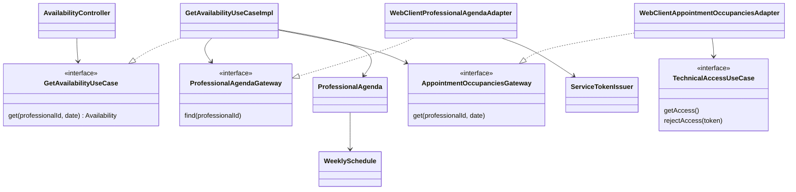

# PLAN: Consultar disponibilidad de turnos

**SPEC de referencia:** [SPEC aprobada](SPEC.md), issue #8/CU-03.
**Versión de la spec revisada:** 2026-10-29, aprobación explícita del usuario; 7 RF y 8 CA.
**Estado:** Aprobado <!-- Borrador | En revisión | Aprobado -->
**Aprobación:** explícita del usuario el 2026-10-29. Autoriza derivar TASKS, no implementar.
**Alcance de esta etapa:** PLAN aprobado; TASKS pendientes de revisión y autorización de implementación.

<!-- PARA LA PERSONA
Copia esta plantilla como PLAN.md junto a la SPEC.md aprobada.
Este documento define la solución técnica. Una vez revisado, el agente puede
derivar TASKS.md con tareas, dependencias y comprobaciones.
-->

<!-- PARA EL AGENTE
- Lee la SPEC.md aprobada, las instrucciones del proyecto y los contratos pertinentes.
  Si falta un documento necesario o la spec no está aprobada, indícalo antes de avanzar.
- Inspecciona el repositorio. Referencia rutas verificadas y distingue las nuevas propuestas.
- Propón una solución proporcional al alcance y coherente con el proyecto.
  Reutiliza lo existente y justifica nuevas dependencias o cambios de arquitectura.
- Distingue hechos, decisiones confirmadas y propuestas. Consulta las decisiones
  no resueltas; haz pocas preguntas por vez y actualiza el plan con las respuestas.
- Referencia los requisitos y criterios por su ID, sin copiar toda la spec.
- Si una decisión cambia el comportamiento o alcance, vuelve a la spec y solicita
  confirmación. No resuelvas una duda de producto mediante una suposición técnica.
- Conserva estos comentarios. No implementes durante la planificación.
- Solicita aprobación antes de marcar el plan como Aprobado. La autorización
  para implementar debe ser explícita; no se deduce del estado de los documentos.
- Para cambios de significado posteriores a la aprobación, registra una nota
  breve de cambio, motivo e impacto según AGENTS.md, sin historial separado.
-->

## Contexto técnico verificado

<!-- Qué existe hoy y cómo participa en la funcionalidad. -->

| Componente o archivo existente | Ruta verificada | Responsabilidad y uso previsto |
| --- | --- | --- |
| Seguridad servlet | `infrastructure/security/config/SecurityConfiguration.java` | Ya exige JWT de usuario y `ROLE_USER` en `/api/**`; no abrir otra ruta pública. |
| Firma de servicio y configuración | `infrastructure/security/jwt/ServiceTokenIssuer.java`, `infrastructure/config/TechnicalAccessProperties.java` | Reutilizar firma, destinos y privada validados; ningún secreto nuevo. |
| Acceso técnico público de #4 | `integration/domain/ports/in/TechnicalAccessUseCase.java` | Entregar/inutilizar el JWT central y solicitar recuperación conforme al contrato existente. |
| Reloj compartido | `infrastructure/config/TechnicalAccessSettingsConfiguration.java` | `Clock` inyectable; no depender de la zona del contenedor. |
| Agenda vigente de Catálogo | [Contrato proveedor](../../../../backend-catalogo/README.md#consultar-profesional-agenda-y-estado) | GET interno con profesional, agendas y vigencia de la misma lectura. |
| Pruebas y build | `pom.xml`, `integration/TestIntegrationSupport.java` y `security/` en tests | MVC, WebClient, validación, JWT real, MySQL temporal y proveedores HTTP ficticios ya disponibles. |

**Convenciones y patrón de referencia:** skill `hexagonal-arch` y estructura acordada del profesor, sin segmento `hexagonal`. Dominio puro Java; aplicación usa sus modelos/puertos; infraestructura adapta HTTP e integración. Constructor DI, campos obligatorios explícitos y Javadoc tradicional en español. No crear una fachada que solo delegue ni persistencia para esta lectura.

## Solución propuesta

<!-- Explica el enfoque y sus motivos. Describe las responsabilidades y el
recorrido desde la solicitud, evento o arranque hasta el resultado del servicio.
Usa un diagrama si aporta claridad. -->

Nuevo slice `com.prog2.appointment.availability`, limitado al cálculo y consulta de CU-03.

1. `AvailabilityController` recibe profesional/fecha; la cadena existente autentica antes de MVC. Convierte la entrada y delega en `GetAvailabilityUseCase`.
2. `GetAvailabilityUseCaseImpl` valida ID/fecha con el reloj y zona de atención. Solicita al puerto `ProfessionalAgendaGateway` una agenda vigente; ausencia y deshabilitación tienen resultados diferenciados.
3. `ProfessionalAgenda` y `WeeklySchedule` contienen las reglas de candidatos: habilitación, día semanal, duración y turnos completos. Unir inicios en orden sin duplicarlos; no agregar un servicio genérico de calendarios.
4. Si hay candidatos, `AppointmentOccupanciesGateway` consulta las ocupaciones del día. Su adaptador usa el puerto público `TechnicalAccessUseCase` para obtener el JWT central; el dominio/aplicación de disponibilidad no reciben tokens ni tipos del otro slice.
5. El caso de uso combina candidatos y ocupaciones. Usa una misma lectura final del reloj para excluir inicios ya alcanzados y evaluar vencimientos; devuelve `Availability`, que el mapper convierte a respuesta HTTP.

La validación de fecha ocurre al admitir la solicitud. El filtrado final vuelve a mirar el reloj después de las consultas, para no ofrecer un horario que comenzó durante la espera; si la consulta admitida cruza medianoche, los inicios ya pasados se eliminan igualmente. No se mantiene estado entre peticiones.



Los dos clientes son **Adapter**: convierten contratos externos a los puertos propios. La inversión de dependencias es un principio; constructor DI es el mecanismo de cableado. No se presenta el cálculo como Strategy ni se agrega una jerarquía de algoritmos sin variación real.

## Módulos y componentes afectados

<!-- Si el proyecto está modularizado, identifica los módulos afectados, sus
responsabilidades y la dirección de sus dependencias. Respeta los límites
existentes y justifica cualquier módulo o dependencia nueva. Si no está
modularizado, describe las carpetas o componentes afectados sin introducir
modularización fuera del alcance; marca la tabla de módulos como No aplica. -->

No aplica una modularización Maven nueva; se conserva el único artefacto existente.

| Módulo | Existe / nuevo | Responsabilidad y cambios | Dependencias afectadas |
| --- | --- | --- | --- |
| `appointment` | Existente | Añadir el slice `availability`. | Mismas dependencias del POM. |

<!-- Distingue lo que se reutiliza, modifica o crea. Las rutas nuevas son propuestas.
Señala impacto sobre modelos, contratos o componentes compartidos. -->

Las rutas siguientes parten de `src/main/java/com/prog2/appointment/`; todas las de `availability` son propuestas.

| Componente o ruta | Acción | Cambio y responsabilidad | Requisito relacionado |
| --- | --- | --- | --- |
| `availability/domain/model/` | Crear | `Availability`, `ProfessionalAgenda`, `WeeklySchedule`, `AppointmentOccupancy`; datos inmutables y reglas pertinentes. | RF-02/RF-03/RF-04/RF-05 |
| `availability/domain/ports/in/GetAvailabilityUseCase` | Crear | Contrato propio de consulta por profesional/fecha. | RF-01/RF-05 |
| `availability/domain/ports/out/` | Crear | `ProfessionalAgendaGateway` y `AppointmentOccupanciesGateway`, con modelos propios. | RF-02/RF-04/RF-07 |
| `availability/domain/enums/` y `domain/exception/` | Crear | Estados de ocupación, motivos tipados y `AvailabilityGatewayException` sin HTTP/Jackson. | RF-04/RF-06 |
| `availability/application/usecases/` y `application/exception/` | Crear | Un caso de uso y `AvailabilityException` para rechazos de aplicación. | RF-01 a RF-07 |
| `availability/infrastructure/client/{adapter,dto}/` | Crear | Dos adaptadores y DTO externos mínimos; validar y traducir en esta frontera. | RF-02/RF-04/RF-06/RF-07 |
| `availability/infrastructure/web/{controller,dto,mapper}/` | Crear | Un GET, respuesta propia y mapper manual. | RF-01/RF-05 |
| `availability/infrastructure/web/AvailabilityProblemHandler` | Crear | Errores limitados al controlador de disponibilidad. | RF-01/RF-06 |
| `availability/infrastructure/config/AvailabilityConfiguration` | Crear | Construir colaboradores, clientes y adaptadores por constructor. | RF-01/RF-06/RF-07 |
| `infrastructure/config/AvailabilityProperties` | Crear | Zona y timeout externos validados; separado de sesión dinámica. | RF-01/RF-06 |
| YAML, Compose, `.env.example`, README y tests | Modificar/crear | Parámetros opcionales, contrato y comprobaciones; conservar configuración existente. | RF-01 a RF-07 |

No modificar clases productivas de `integration` ni `user`; solo consumir sus contratos públicos cuando corresponde. No crear entidades, repositorios, migraciones, caché o scheduler por CU-03.

## Datos y contratos

<!-- Completa solo lo aplicable. Si un punto no aplica, indica el motivo. -->

- **Entrada/salida propias:** propuesta `GET /api/appointment-availability?professionalId=15&date=2026-11-02`, con JWT de usuario y `ROLE_USER`. Un ID positivo `long` y fecha ISO; campos ausentes, incompatibles o fecha anterior a hoy producen 400. Respuesta 200 `application/json`, `Cache-Control: no-store`:

```json
{
  "professionalId": 15,
  "date": "2026-11-02",
  "timeZone": "America/Argentina/Buenos_Aires",
  "availableStartTimes": ["09:00:00", "09:30:00"]
}
```

La lista puede ser `[]`; no devolver datos de pacientes ni ocupaciones. Horas de salida `HH:mm:ss`, sin cambiar el valor local. No se necesita DTO de body para este GET.

- **Modelos/puertos:** `GetAvailabilityUseCase.get(long, LocalDate)` devuelve `Availability`. `ProfessionalAgendaGateway.find(long)` devuelve `Optional<ProfessionalAgenda>`; vacío representa únicamente el 404 contractual del profesional, nunca una caída. `AppointmentOccupanciesGateway.get(long, LocalDate)` devuelve ocupaciones propias. Los puertos declaran fallos tipados; sus Javadoc documentarán ausencia, datos completos y efectos. Ningún modelo incluye JWT, DTO HTTP, entidad JPA ni modelo del slice `integration`.
- **Catálogo:** GET `/api/internal/catalog/professionals/{id}` con un JWT de servicio nuevo de `ServiceTokenIssuer`. Usar la respuesta conjunta, no otro GET de estado ni copia guardada. Validar ID/relaciones/flags y datos necesarios, `CURRENT`, copia disponible, versiones conocidas iguales y metadata de comprobación coherente. La política de 60 s y verificación por ejecución sigue perteneciendo a Catálogo; no duplicarla ni afirmar vigencia futura.
- **Cátedra:** GET `/api/appointment-occupancies` con `professionalId` y `from=to=fecha`, construidos desde entrada ya validada, y JWT central adquirido mediante #4. Comprobar profesional/rango devueltos y fecha de cada ocupación. Ignorar campos adicionales compatibles; colección ausente, campos necesarios nulos o estado desconocido no equivalen a vacío. `CONFIRMED` bloquea; `HELD` necesita `expiresAt` y bloquea solo antes de ese instante. La coincidencia confirmada prevalece aunque otro hold haya vencido.
- **Reglas:** aceptar horas con/sin segundos; generar turnos anclados a la fecha para evitar que una suma de horas dé la vuelta a medianoche. Duración positiva y cierre posterior a apertura; datos necesarios incompatibles implican respuesta no utilizable. Usar los inicios por fecha, sin inferir fin/duración de ocupaciones que el anexo no informa. Diferentes agendas con el mismo inicio producen un único candidato.
- **Persistencia, convivencia y compatibilidad:** sin escrituras ni caché de agenda/ocupaciones. El filtro de hoy y vencimientos usa el mismo instante final. Catálogo y cátedra no forman una transacción; CU-04 volverá a validar antes de reservar. Sin migraciones ni cambios a cuentas, JWT o contratos existentes.

## Estado, operaciones y errores

<!-- Cómo se implementan los comportamientos aprobados en la spec.
Referencia RF/CA y completa solo los puntos pertinentes al backend. -->

- **Estado y restauración:** resultado inmutable por petición; no hay proceso pendiente que recuperar. Sin candidatos ya demostrables con agenda vigente, devolver `[]` sin exigir ocupaciones ni acceso central. Tras reiniciar, la sesión técnica conserva la recuperación de #4.
- **Concurrencia:** colaboradores sin estado mutable por consulta, sin bloqueo global. Dos peticiones pueden ver el mismo horario. Usar constructor DI y no crear colaboradores de negocio dentro del consumidor; la configuración construye los clientes/modelos necesarios.
- **Errores:** `AvailabilityProblemHandler` traduce motivos de aplicación/puertos a `application/problem+json` con `type`, `title`, `status`, `code` e `instance` de ruta sin query; `no-store`. Mantener los 401/403 de `SecurityProblemHandler` sin modificarlos.

| HTTP / code propuesto | Condición |
| --- | --- |
| 400 `INVALID_AVAILABILITY_QUERY` | Entrada ausente, incompatible, ID no positivo o fecha pasada al admitirla. |
| 404 `PROFESSIONAL_NOT_FOUND` | Catálogo devuelve exactamente la ausencia contractual. |
| 400 `PROFESSIONAL_DISABLED` | Profesional existente deshabilitado en una lectura vigente. |
| 503 `CATALOG_NOT_CURRENT` | Catálogo no acredita vigencia, aun si conserva una copia. |
| 503 `CATALOG_UNAVAILABLE` | Fallo, timeout, credencial de servicio rechazada o respuesta no interpretable de Catálogo. |
| 503 `OCCUPANCIES_UNAVAILABLE` | Fallo, timeout o respuesta central no utilizable para calcular ocupaciones. |
| 503 `TECHNICAL_INTEGRATION_UNAVAILABLE` | Falta/vencimiento de sesión central, JWT central rechazado o integración técnica no disponible. |
| 500 `INTERNAL_ERROR` | Fallo propio inesperado, sin mensajes de causas en la respuesta. |

- **Reintentos y rechazo central:** sin reintento HTTP dentro de la consulta. Conservar el ciclo coordinado de #4; no esperar a que termine para resolver una petición sin sesión ni cambiar su presupuesto. Ante 401 central, invalidar únicamente el token utilizado mediante `rejectAccess` y responder indisponibilidad, sin reproducir el GET automáticamente; la próxima demanda inicia recuperación donde corresponda. Un 401/403 de proveedor nunca se traduce en fallo del JWT de usuario. Decidir por HTTP y `code`, admitir ausencia de `code` de seguridad/infraestructura y tratar errores desconocidos de forma segura.
- **Observabilidad:** motivos fijos y datos de operación no sensibles. No registrar JWT, cuerpos remotos, configuración técnica ni mensajes de excepciones de proveedores. No imprimir tokens en `toString` ni exponer metadata de pacientes.

## Dependencias y configuración

<!-- Librerías, servicios, permisos o configuración afectados. Verifica compatibilidad
con el proyecto y justifica las incorporaciones. No agregues dependencias por defecto. -->

- Reutilizar Java 25, Boot 4.1.1, MVC, WebClient/Reactor Netty, Bean Validation y pruebas ya presentes en `pom.xml`; no añadir librerías. `SafeIntegrationHttpClient` tiene clasificación propia de #4 y vive en sus internals: conservarlo sin extraerlo ni modificarlo para esta consulta. Los nuevos adaptadores necesitan interpretar ausencia/vigencia de Catálogo y ocupaciones, contratos diferentes.
- `AvailabilityConfiguration` construye dos clientes con destinos existentes y bearer por petición, sin cabecera de autorización global ni propagación del JWT entrante. Compartir el armado de transporte en la configuración, sin crear un framework HTTP: redirects y reintentos automáticos desactivados; respuesta completa dentro de un límite total.
- Propiedades nuevas en `application.yaml`: `app.availability.time-zone=${AVAILABILITY_TIME_ZONE:America/Argentina/Buenos_Aires}` y `app.availability.http-timeout=${AVAILABILITY_HTTP_TIMEOUT:5s}`. El timeout aplica a conexión/lectura y el total por proveedor es su doble, como en #4; dos proveedores secuenciales tienen como máximo dos presupuestos de diez segundos con los defaults, más procesamiento local. No hay espera de recuperación añadida.
- Validar `ZoneId` y duración positiva/representable al arrancar, con diagnóstico del parámetro sin secretos. `.env.example` documenta valores opcionales y Compose los pasa con default; no modificar `.env` real, claves, puertos ni servicios del usuario. Configuración por arranque, sin recarga dinámica ni externalizar constantes ajenas a #8.
- **D-03, aceptada en la revisión del 2026-10-29:** puerto propio de ocupaciones y adaptador consumidor del puerto público de integración. Ese es el único punto de composición entre slices; no acceder a repositorio/estado interno ni trasladar la gestión JWT al cálculo.
- **D-04, confirmada el 2026-10-29:** postergar OpenAPI/Swagger hasta consolidar las APIs. Este PLAN no agrega esa dependencia ni cambia la política de rutas para documentación.

## Estrategia de validación

<!-- Una fila por criterio de la spec. Selecciona el método capaz de demostrarlo:
test unitario, integración, contrato o prueba manual. No todos requieren todos los métodos.
Identifica tests existentes y separa los nuevos propuestos. Incluye regresiones relevantes.
Una captura aislada no demuestra persistencia ni ausencia de peticiones de red. -->

| Criterio | Método y test existente o propuesto | Entorno y datos necesarios | Evidencia prevista |
| --- | --- | --- | --- |
| CA-01 | `AvailabilityHttpTests` y `GetAvailabilityUseCaseTests` nuevos. | Filtros reales, JWT firmados y contadores de proveedores. | 400/401/403 sin llamadas salientes; usuario libre no sustituye al principal. |
| CA-02 | `AvailabilityClientTests` y caso de uso nuevos. | HTTP ficticio con 200/404/503, flags, IDs y metadata incompatibles. | Ausencia/deshabilitación/vigencia diferenciadas; sin cálculo habilitante desde datos incorrectos. |
| CA-03 | `AvailabilityRulesTests` nuevos y HTTP para horas. | Agendas de varios días, duración 30, límite exacto y remanente 10 min; horas con/sin segundos. | Candidatos completos, sin vuelta de medianoche ni agenda deshabilitada. |
| CA-04 | Reglas y clientes nuevos. | Instante fijo; hold antes/en/después de expirar, confirmación coincidente y duplicados. | Vencimiento exacto, precedencia confirmada y rechazo de estados/vencimientos desconocidos. |
| CA-05 | Caso de uso y HTTP concurrente nuevos. | Dos consultas con IDs/fechas distintos, barrera con espera acotada y proveedores que solo aceptan GET. | Resultados aislados/ordenados, sin duplicados, escrituras ni creación de holds. |
| CA-06 | Clientes nuevos y HTTP completo. | `[]` frente a null/faltantes, JSON roto, error sin code, redirect, corte y cabecera 200 con cuerpo detenido. | Fallos distinguibles del vacío, timeout total y ausencia de reintentos/leaks. |
| CA-07 | Reglas/caso de uso y `AvailabilityPropertiesTests` nuevos. | Clock controlado, zona de atención, entrada ayer/hoy/futura lejana, frontera de inicio y medianoche. | D-01/D-02 exactas, incluso con otra zona del reloj/sistema; zona/duración inválidas impiden arrancar. |
| CA-08 | HTTP completo y regresión técnica existente. | Proveedores ficticios que verifican firma/claims/bearer; sesión faltante/expirada y 401 central. | Identidades correctas, invalidación del token usado y recuperación posterior sin login alternativo. |

Los tests puros ejecutan los modelos/caso de uso reales y sustituyen solo puertos externos. `AvailabilityClientTests` ejecuta HTTP/decodificación reales. `AvailabilityHttpTests` usa Spring Boot en puerto aleatorio y MySQL 8.4.8 temporal, con cuenta ficticia y JWT obtenido por login real; no principal simulado. Las pruebas SQL siguen limitadas a cuentas existentes, sin inventar persistencia de disponibilidad.

Un fixture nuevo de dos proveedores sirve las rutas de #4 y CU-03, con contadores por operación, rechazo de escrituras y claves efímeras. Reutilizar helpers estáticos de `TestIntegrationSupport` cuando aporten valor, sin convertir su fixture exclusivo de #4 en infraestructura genérica. Constructor DI también en tests; `@TestConstructor(autowireMode = ALL)` configura esa entrega por constructor, sin `@Autowired` ni campos inyectados. Relojes/barreras sustituyen esperas arbitrarias.

**Comprobaciones de regresión:** `UserHttpTests`, `SecurityHttpTests`, pruebas técnicas y de arranque existentes; contratos de registro/login, 401/403, health mínimo, configuración externa, adquisición/rechazo/cierre y perfiles JWT conservados. Revisar Javadoc, dependencias entre capas y artefacto sin claves/env/fixtures.

**Comandos verificados para compilar y ejecutar tests:** wrapper y Surefire existentes. Propuesta enfocada: `./mvnw -B -ntp -Dtest=AvailabilityRulesTests,GetAvailabilityUseCaseTests,AvailabilityClientTests,AvailabilityHttpTests,AvailabilityPropertiesTests test`; cierre `./mvnw -B -ntp clean verify`. Son nombres nuevos propuestos, no pruebas ya ejecutadas. Validar `git diff --check`, enlaces y configuración Compose.

**Pruebas operativas del backend:** después de verificar, ejecutar el JAR/Compose de Turnos con proveedores ficticios y MySQL descartable para comprobar contrato, configuración y empaquetado. Una comprobación contra Catálogo/cátedra reales puede complementar esa evidencia si están disponibles; no reconstruir/reiniciar Catálogo ni modificar datos/configuración del entorno del usuario por esta prueba. Registrar en TASKS solamente evidencia técnica del proyecto.

**Limitaciones del entorno:** en este PLAN no se ejecutaron pruebas de CU-03 ni se acreditó consumo Kafka, reservas o vigencia futura. Antes de proponer publicación, revisar Sonar CLI/IDE disponibles, sin reintentar el Vortex 403 conocido ni presentarlo como análisis limpio. Actions/Sonar remoto son feedback posterior a la revisión publicada, sin tareas de espera o publicación. No pedir tokens.

<!-- Esta sección planifica la validación. Durante la implementación, registra
en TASKS.md o en el informe de validación acordado los resultados y evidencias
reales. Usar el cierre de TASKS.md definido en AGENTS.md: CA/evidencia,
regresión y desviaciones del PLAN. Distingue pruebas ejecutadas, fallidas,
no ejecutadas y bloqueadas.
Compilar o tener tests en verde no sustituye revisar los criterios de la spec. -->

## Orden de implementación

<!-- Etapas y dependencias principales. El desglose ejecutable se escribe en TASKS.md.
Incluye puntos de comprobación para avanzar con cambios pequeños. -->

1. Contratos/modelos y reglas puras; verificar CA-03/CA-04/CA-07 antes de añadir HTTP.
2. Adaptadores de Catálogo/ocupaciones y configuración, con datos incompatibles y presupuestos HTTP comprobados; verificar CA-02/CA-06/CA-08.
3. Caso de uso y contrato MVC/errores, consumiendo los adaptadores ya probados; verificar CA-01/CA-02/CA-05/CA-08 con firmas reales.
4. Regresión, ensayo operativo aislado, calidad local, README/Javadoc y cierre por CA con evidencia, regresión y desviaciones. El desglose ejecutable se mantiene en [TASKS](TASKS.md), sin otra matriz o informe.

## Riesgos y decisiones pendientes

<!-- Riesgos concretos de esta solución y cómo se resolverán, sin listas genéricas.
Escribe Ninguna en las decisiones pendientes cuando estén resueltas. -->

- **Riesgos y medidas acordadas:** datos de dos servicios sin atomicidad, disponibilidad informativa y nueva validación en CU-04; identificadores/horas/respuestas validados antes de usarlos. Inicios que pasan durante HTTP y holds vencidos se evalúan con un instante final consistente. Fallos de proveedores o JWT técnico producen indisponibilidad, nunca horarios falsamente libres. Ningún GET crea o extiende un hold. Una fecha futura válida no se rechaza por un horizonte propio inventado; la consulta sigue siendo de un solo día.
- **Decisiones pendientes:** Ninguna. D-01/D-02 están aprobadas en la SPEC; D-03 acepta la composición mediante puerto/adaptador y D-04 posterga Swagger. El usuario aprobó el PLAN completo, incluidos ruta, respuesta, códigos y parámetros. La implementación requiere autorización posterior explícita.

<!-- ANTES DE SOLICITAR APROBACIÓN
Comprueba que el plan cubre los requisitos, respeta las exclusiones, reutiliza
componentes verificados y permite demostrar todos los criterios de aceptación.
Resuelve dudas y marcadores pendientes. Si la spec cambió, revisa su impacto.
Tras aprobar el plan, deriva TASKS.md con IDs, dependencias, referencias a RF/CA
y comprobaciones. Antes de implementar, realizar el chequeo de coherencia de
AGENTS.md con esos documentos, sin otro informe ni aprobación adicional.
No marques una tarea terminada sin realizar su validación;
si está bloqueada, registra el motivo.
-->
