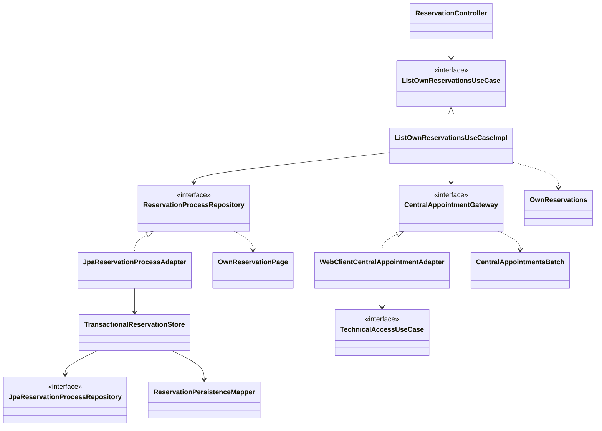

# PLAN: Consultar reservas y procesos propios

**SPEC de referencia:** [SPEC.md](SPEC.md)
**Versión de la spec revisada:** 2026-11-01, D-01 a D-05 confirmadas y aprobación explícita del usuario. Código consultado: `982c8db`.
**Estado:** Aprobado <!-- Borrador | En revisión | Aprobado -->
**Aprobación:** explícita del usuario el 2026-11-01 («apruebo plan. tasks»). Autorizada la preparación de TASKS, sin implementación.

<!-- PARA LA PERSONA
Copia esta plantilla como PLAN.md junto a la SPEC.md aprobada.
Este documento define la solución técnica. Una vez revisado, el agente puede
derivar TASKS.md con tareas, dependencias y comprobaciones.
-->

<!-- PARA EL AGENTE
- Lee la SPEC.md aprobada, las instrucciones del proyecto y los contratos pertinentes.
  Si falta un documento necesario o la spec no está aprobada, indícalo antes de avanzar.
- Inspecciona el repositorio. Referencia rutas verificadas y distingue las nuevas propuestas.
- Propón una solución proporcional al alcance y coherente con el proyecto.
  Reutiliza lo existente y justifica nuevas dependencias o cambios de arquitectura.
- Distingue hechos, decisiones confirmadas y propuestas. Consulta las decisiones
  no resueltas; haz pocas preguntas por vez y actualiza el plan con las respuestas.
- Referencia los requisitos y criterios por su ID, sin copiar toda la spec.
- Si una decisión cambia el comportamiento o alcance, vuelve a la spec y solicita
  confirmación. No resuelvas una duda de producto mediante una suposición técnica.
- Conserva estos comentarios. No implementes durante la planificación.
- Solicita aprobación antes de marcar el plan como Aprobado. La autorización
  para implementar debe ser explícita; no se deduce del estado de los documentos.
- Para cambios de significado posteriores a la aprobación, registra una nota
  breve de cambio, motivo e impacto según AGENTS.md, sin historial separado.
-->

## Contexto técnico verificado

<!-- Qué existe hoy y cómo participa en la funcionalidad. -->

Rutas Java relativas a `src/main/java/com/prog2/appointment/reservation/`.

| Componente o archivo existente | Ruta verificada | Responsabilidad y uso previsto |
| --- | --- | --- |
| Consulta individual y vista pública | `application/usecases/GetReservationProcessUseCaseImpl.java`, `domain/model/ReservationStatus.java` | Conservar consulta puntual y vocabulario de verificación; no ejecutar este caso una vez por fila del listado. |
| Evidencia REST | `domain/ports/out/CentralAppointmentGateway.java`, `infrastructure/client/adapter/WebClientCentralAppointmentAdapter.java` | Hoy consulta una página por paciente/fecha. Ampliar con lectura paginada propia para CU-07, conservando el método puntual. |
| Proceso y persistencia | `domain/model/ReservationProcess.java`, `domain/ports/out/ReservationProcessRepository.java`, `infrastructure/persistence/service/TransactionalReservationStore.java` | Propiedad, pendiente, versiones, reconciliación y cierre de envíos telefónicos ya existen. |
| HTTP y wiring | `infrastructure/web/controller/ReservationController.java`, `infrastructure/web/mapper/ReservationDtoMapper.java`, `infrastructure/config/ReservationConfiguration.java` | Agregar el GET y sus DTO; reutilizar JWT, errores seguros y constructor DI. |
| Esquema | `src/main/resources/db/migration/V3__create_reservation_processes.sql`, `V4__create_reservation_phone_submissions.sql` (desde la raíz del repo) | Índice por propietario y exclusión mediante `active_owner_id`. Faltan nombres del profesional; no crear otra tabla de reservas. |

**Convenciones y patrón de referencia:** continuar el slice `reservation` según `hexagonal-arch`: dominio puro, puertos propios y adaptadores HTTP/JPA. El adaptador central conserva la composición ya aprobada con `TechnicalAccessUseCase`; no hay una nueva dependencia entre slices. Repository y Adapter permiten probar el caso sin Spring ni proveedores reales. No añadir una fachada que solo delegue. Javadoc contractual en español y dependencias por constructor, sin `@Autowired` ni `@Data`.

## Solución propuesta

<!-- Explica el enfoque y sus motivos. Describe las responsabilidades y el
recorrido desde la solicitud, evento o arranque hasta el resultado del servicio.
Usa un diagrama si aporta claridad. -->

1. `GET /api/reservations` obtiene el propietario del JWT y valida exclusivamente la paginación. `ListOwnReservationsUseCaseImpl` lee una página local consistente, el pendiente y su última respuesta telefónica.
2. Consulta cátedra por la identidad derivada del usuario, con páginas y tiempo limitados. No consulta Catálogo ni llama al GET individual por cada registro.
3. Para los procesos de la página y el pendiente, aplica solo coincidencias exactas verificadas mediante el repositorio existente. Conserva el primer nombre histórico válido obtenido. Los registros centrales sin asociación local no se importan.
4. Relee la página, su total y el pendiente en una transacción de lectura: una confirmación concurrente puede trasladar el pendiente al historial. Construye la respuesta desde esa última lectura, sin duplicarlo ni devolver la copia anterior a Kafka.
5. Señala la verificación de cada registro y cualquier limitación de la consulta central. Ante fallo externo conserva el resultado local; ante fallo de lectura local devuelve indisponibilidad.

Relaciones relevantes; `ListOwnReservationsUseCase` y su implementación son nuevos, el resto se amplía o reutiliza:

## Módulos y componentes afectados

<!-- Si el proyecto está modularizado, identifica los módulos afectados, sus
responsabilidades y la dirección de sus dependencias. Respeta los límites
existentes y justifica cualquier módulo o dependencia nueva. Si no está
modularizado, describe las carpetas o componentes afectados sin introducir
modularización fuera del alcance; marca la tabla de módulos como No aplica. -->

| Módulo | Existe / nuevo | Responsabilidad y cambios | Dependencias afectadas |
| --- | --- | --- | --- |
| Módulos de build | No aplica | Un proyecto Maven; sin modularización nueva. | Ninguna. |
| Slice `reservation` | Existente | Listado, nombres históricos y reconciliación de lo mostrado. | Infraestructura → aplicación → dominio; integración pública existente. |

<!-- Distingue lo que se reutiliza, modifica o crea. Las rutas nuevas son propuestas.
Señala impacto sobre modelos, contratos o componentes compartidos. -->

Nombres nuevos propuestos; rutas Java relativas al slice:

| Componente o ruta | Acción | Cambio y responsabilidad | Requisito relacionado |
| --- | --- | --- | --- |
| `domain/ports/in/ListOwnReservationsUseCase.java`, `application/usecases/ListOwnReservationsUseCaseImpl.java` | Crear | Coordinar lectura, evidencia y respuesta propia. | RF-01/RF-02/RF-05/RF-08 |
| `domain/model/OwnReservationPage.java`, `OwnReservations.java` | Crear | Lectura local consistente y resultado del caso, con página/total propios y pendiente separado. Sin `Page`/`Pageable` de Spring. | RF-03/RF-06/RF-07 |
| `domain/model/ProfessionalName.java`, `CentralAppointmentsBatch.java` | Crear | Nombre opcional del profesional y evidencia central con su alcance verificable. | RF-02/RF-04/RF-05 |
| `ReservationProcess`, `CentralAppointment` | Ampliar | Nombre histórico opcional, correlación y enriquecimiento sin reabrir cierres. | RF-02/RF-04/RF-08 |
| `ReservationProcessRepository`, adaptador JPA, escritor, mapper y repositorio Spring Data | Ampliar | Lectura propia paginada y persistencia de nombres con las reglas de reconciliación existentes. | RF-01 a RF-08 |
| `CentralAppointmentGateway`, adaptador y `CentralAppointmentResponse` | Ampliar | Lectura central acotada; interpretar nombres y metadata de paginación. Conservar consulta puntual. | RF-02/RF-04/RF-05 |
| Controlador, mapper y `ReservationProcessResponse`; nuevos `OwnReservationsResponse` y `ReservationHistoryResponse` en `infrastructure/web/dto/` | Ampliar/crear | Envelope estable, dos nombres opcionales por registro y errores de paginación. | RF-01/RF-03/RF-06/RF-07 |
| `src/main/resources/db/migration/V5__add_reservation_professional_names.sql` (raíz) | Crear | Dos columnas opcionales en la tabla existente. | RF-04 |
| `ReservationConfiguration`, `ReservationProblemHandler`, `ReservationFailure` y README | Modificar | Wiring, error de paginación y contrato documentado. Sin cambiar otras operaciones. | RF-01/RF-05/RF-07 |

## Datos y contratos

<!-- Completa solo lo aplicable. Si un punto no aplica, indica el motivo. -->

- **Modelos y contratos de entrada y salida:** `GET /api/reservations?page=0&size=20`, protegido con `ROLE_USER`, respuesta 200 y `Cache-Control: no-store`. `page` entero desde cero, `size` entre 1 y 100; validar también que el desplazamiento sea representable por la consulta SQL. Sin filtros ni orden configurable. No aceptar selección de propietario/paciente desde parámetros.
- **Respuesta:** `{pending, history: {content, page, size, totalElements, totalPages}, verificationStatus, verifiedAt, warningCode}`. `pending` es un objeto o null; `content` usa `ReservationProcessResponse`, ampliado con `professionalFirstName` y `professionalLastName` opcionales. Conservar el resto del contrato público existente, UUID local, estados y horas `HH:mm:ss`; no exponer IDs centrales, pacientes ajenos ni teléfono. El nombre puede ser null también en endpoints anteriores.
- **Identificadores, relaciones y restricciones:** derivar `user-<ownerId>` como hoy. Antes de aplicar evidencia comprobar propietario local, proceso central, paciente, profesional, fecha/hora y reserva si ya tiene ID conocido. No asociar por coincidencia de horario únicamente. Descartar registros ajenos/no asociados y no sumar sus totales.
- **Origen de los datos consultados y transformaciones:** los procesos locales definen el conjunto; cátedra verifica/enriquece coincidencias. Aceptar horas centrales `HH:mm` y `HH:mm:ss`. Nombres ausentes o no utilizables no invalidan evidencia de estado que sí cumple su contrato; mantenerlos como desconocidos. No agregar hora de finalización ni llamadas a Catálogo.
- **Persistencia, consultas y actualizaciones:** `ReservationProcessRepository.readOwn(ownerId, page, size)` devuelve `OwnReservationPage`: pendiente, última respuesta telefónica de ese pendiente, historial y total. En infraestructura, una transacción corta `REPEATABLE_READ`, de solo lectura, consulta pendiente con `active_owner_id` y el historial con `owner_id` propio y `active_owner_id IS NULL`. Fecha y hora descendentes, UUID ascendente para desempatar. Aplicar paginación en SQL; contar solo historial. Reutilizar el índice por propietario; no cargar todo el historial en memoria.
- **Convivencia entre datos locales y remotos:** la consulta central no define páginas ni totales públicos. Reconciliar coincidencias de la página inicial y el pendiente, como máximo 101 procesos. Tras releer, un registro que recién apareció en la página queda local/inconcluso si no se obtuvo evidencia para él; no iniciar otro ciclo para perseguir cambios concurrentes.
- **Compatibilidad y migraciones de datos existentes:** V5 añade nombres opcionales, sin borrar ni reconstruir procesos, inbox, usuarios o envíos. Agregar `ProfessionalName` opcional al agregado y conservarlo en todas sus transiciones/mappers. Capturar el primer nombre válido completo tras verificar la asociación; no borrarlo por omisiones posteriores. Permitir enriquecer un proceso finalizado sin cambiar su cierre. No poblarlo con datos inventados ni modificar V3/V4.

## Estado, operaciones y errores

<!-- Cómo se implementan los comportamientos aprobados en la spec.
Referencia RF/CA y completa solo los puntos pertinentes al backend. -->

- **Estado del servicio y de las operaciones:** no agregar fases. Reutilizar `ReservationStatus` y `VerificationStatus`. Cada registro muestra VERIFIED solo por evidencia compatible obtenida en esta consulta; sin evidencia conserva LOCAL o señala incertidumbre/indisponibilidad según corresponda. No inventar solicitud telefónica por PHONE_PENDING ni confirmar por ACK.
- **Conservación y restauración del estado:** nombres y progreso se conservan en la base. `verifiedAt` corresponde a evidencia de la consulta actual; tras un respaldo local no inventar una nueva fecha. Ausencia central nunca elimina registros ni prueba cierre. Una lectura central completa tampoco declara sincronizado todo el historial fuera de la página mostrada.
- **Ejecución, concurrencia y cancelación de operaciones:** HTTP fuera de transacciones. Reutilizar `reconcile` y su lectura de la versión actual, control optimista y cierre atómico de envíos; incorporar nombres en esa misma actualización. Una evidencia incompatible con un cierre más reciente queda inconclusa. Releer pendiente, página y total juntos después de las actualizaciones. Sin locks globales, cache, tareas periódicas nuevas ni acciones de cancelación.
- **Lectura central acotada:** ampliar el gateway con lectura por paciente, sin estado/fechas: páginas secuenciales de 100, máximo tres peticiones y presupuesto total `2 × httpTimeout` (10 s por defecto) para todo el recorrido. No multiplicar ese presupuesto por página ni repetir fallos. Interpretar `X-Total-Count`/`Link`, construir siempre las URLs sobre el destino configurado y no seguir URLs arbitrarias de cabeceras. Metadata ausente/contradictoria o límite alcanzado sin demostrar final implica INCONCLUSIVE. Conservar evidencia válida de páginas recibidas, deduplicar correlaciones y no aplicar duplicados contradictorios.
- **Errores, reintentos y prevención de duplicados:** 400 `INVALID_RESERVATION_PAGE` para página/tamaño inválidos; 401/403 existentes. Cátedra/sesión técnica no disponibles o timeout devuelven 200 con respaldo local y aviso `APPOINTMENT_STATUS_UNAVAILABLE`; parcialidad/discrepancia usa `APPOINTMENT_STATUS_INCONCLUSIVE`. Un 401 central invalida el token por el puerto público existente, sin otro login en esta consulta. Fallo local de lectura/escritura no verificable: 503 `STORAGE_UNAVAILABLE`, nunca vacío exitoso. Mantener problem+json/code/no-store y 500 seguro para errores inesperados.
- **Alcance de la verificación:** el envelope resume exclusivamente la respuesta: UNAVAILABLE si falló la lectura central, INCONCLUSIVE por recorrido incompleto o evidencia insuficiente/contradictoria para un registro mostrado con IDs centrales; VERIFIED cuando esa comprobación se completa sin esas limitaciones. Los procesos puramente locales conservan su verificación individual LOCAL. Un recorrido parcial no se anuncia como completo aunque haya coincidencias verificadas. `verifiedAt` del envelope solo se informa para VERIFIED; los registros comprobados pueden conservar su propia fecha en una respuesta parcial.
- **Observabilidad y diagnósticos seguros:** reutilizar códigos y UUID locales. No registrar nombres, JWT, teléfono ni cuerpos externos. No crear métricas, endpoints técnicos o estados globales nuevos para el listado.

## Dependencias y configuración

<!-- Librerías, servicios, permisos o configuración afectados. Verifica compatibilidad
con el proyecto y justifica las incorporaciones. No agregues dependencias por defecto. -->

- Sin dependencias, secretos ni variables nuevas: WebClient, JPA, Flyway, validación, JWT y Testcontainers ya están en `pom.xml`. Reutilizar `ReservationProperties.httpTimeout`, transporte sin redirects/retry y acceso técnico existentes.
- Wiring en `ReservationConfiguration` por constructor. La regla de seguridad `/api/**` ya exige `ROLE_USER`; no abrir permisos ni modificar otros slices o repositorios. El listado no depende de readiness Kafka.
- Contrato externo: [anexo, sección 11](../../../../INTEGRATION_REFERENCE-v2.md). Sin Swagger/OpenAPI, SSE ni implementación KMP en este issue.

## Estrategia de validación

<!-- Una fila por criterio de la spec. Selecciona el método capaz de demostrarlo:
test unitario, integración, contrato o prueba manual. No todos requieren todos los métodos.
Identifica tests existentes y separa los nuevos propuestos. Incluye regresiones relevantes.
Una captura aislada no demuestra persistencia ni ausencia de peticiones de red. -->

Nuevas suites propuestas `ListOwnReservationsTests` y `OwnReservationsIntegrationTests`; ampliar `CentralAppointmentGatewayTests` y `ReservationProcessTests`. Reutilizar `ReservationTestSupport`, JWT/HTTP reales y MySQL temporal. Dobles solo para controlar proveedores, reloj y fallos; SQL real para aislamiento, orden, conteo, migraciones y concurrencia.

| Criterio | Método y test existente o propuesto | Entorno y datos necesarios | Evidencia prevista |
| --- | --- | --- | --- |
| CA-01 | HTTP nuevo y gateway ampliado. | Dos propietarios, anónimo, token sin permiso y central que ignora el filtro. | 401/403; ninguna fila/referencia/conteo ajeno ni identidad elegida por parámetros. |
| CA-02 | Caso nuevo y SQL/HTTP integrado. | Coincidencia doble, reserva central con paciente propio sin fila local y pendiente ausente de cátedra. | Un registro por proceso; no importar ni contar huérfanos; pendiente fuera del total. |
| CA-03 | Caso/agregado y serialización reales. | Distintos cierres locales, hold, PHONE_PENDING, solicitud/ACK telefónico. | Naturaleza y estados conservados; ninguna confirmación o acción inventada. |
| CA-04 | SQL/migración y reinicio de contexto. | V4 poblada, nombre central válido/ausente y luego proveedores inaccesibles. | V5 conserva registros; nombre durable tras reiniciar, sin hora final ni dependencia de Catálogo. |
| CA-05 | Gateway con HTTP real y fallos SQL controlados. | Cátedra caída, sesión no utilizable, cuerpo interrumpido, historial vacío/no vacío y DB inaccesible. | Respaldo 200 con aviso o 503 local; nunca acreditar una verificación nueva por fallo. |
| CA-06 | SQL/HTTP nuevo. | Historial con fechas pasadas/futuras y distintos estados; repetir con central caído. | Mismo conjunto local consultable sin filtros, respetando las páginas. |
| CA-07 | MySQL/HTTP con resultados conocidos. | Más de 20 filas, empates, otro propietario, tamaño omitido/100/0/101, página negativa/no numérica/excesiva y fuera de resultados. | Orden determinista, total propio sin pendiente, 400 de entrada y página válida vacía. |
| CA-08 | Gateway y caso nuevos/ampliados. | Varias páginas, corte intermedio, metadata incompatible, duplicados, ausencia y tres páginas agotadas. | No borrar/cerrar; conservar evidencia válida con advertencia, máximo tres GET y presupuesto global. |
| CA-09 | SQL/HTTP y barreras deterministas. | Cancelación durante GET central, cierre que mueve el pendiente al historial y lecturas repetidas. | Versión más reciente, página/total/pendiente coherentes; ningún POST central, envío, renovación o reapertura. |

**Comprobaciones de regresión:** consulta puntual conserva una petición y sus condiciones actuales; CU-04, teléfono/inbox, exclusión de pendiente y todos los cambios de fase conservan los nombres. Registro/login, JWT, acceso técnico y disponibilidad mantienen sus contratos. Validar estas diferencias con pruebas existentes, sin duplicar sus recorridos. Pruebas Spring con DI por constructor según la convención actual; `@TestConstructor(autowireMode = ALL)` habilita la entrega al constructor, no inyección por campos.

**Comandos verificados para compilar y ejecutar tests:** wrapper y Surefire existentes: `./mvnw -B -ntp clean verify`. Foco propuesto tras crear las suites: `./mvnw -B -ntp -Dtest=ListOwnReservationsTests,OwnReservationsIntegrationTests,CentralAppointmentGatewayTests,ReservationProcessTests,GetReservationProcessTests test`. Diseñar casos con resultados independientes y barreras/Clock, sin sleeps arbitrarios. Estos comandos no se ejecutaron durante el PLAN.

**Pruebas operativas del backend:** artefacto real con MySQL temporal y proveedor ficticio: registro/login, listado paginado, respaldo y reinicio con nombres conservados. Para este GET no hacen falta efectos centrales reales; Kafka temporal solo si el escenario integrado necesita mensajes auténticos. No tocar Compose ni datos personales sin autorización.

**Limitaciones del entorno:** fuentes y contratos inspeccionados; aún no hay implementación ni pruebas ejecutadas de CU-07. Antes de proponer publicación, comprobar disponibilidad/vinculación de Sonar CLI/IDE y revisar lo posible sin configurar credenciales ni hooks. Actions/SonarCloud serán feedback remoto tras publicación del usuario, no tareas de implementación ni evidencia local. Si alguna herramienta no está disponible, registrar ese límite y mantener separadas las evidencias.

<!-- Esta sección planifica la validación. Durante la implementación, registra
en TASKS.md o en el informe de validación acordado los resultados y evidencias
reales. Usar el cierre de TASKS.md definido en AGENTS.md: CA/evidencia,
regresión y desviaciones del PLAN. Distingue pruebas ejecutadas, fallidas,
no ejecutadas y bloqueadas.
Compilar o tener tests en verde no sustituye revisar los criterios de la spec. -->

## Orden de implementación

<!-- Etapas y dependencias principales. El desglose ejecutable se escribe en TASKS.md.
Incluye puntos de comprobación para avanzar con cambios pequeños. -->

1. Contratos y caso de listado: aislamiento, paginación y resumen de verificación con pruebas de comportamiento.
2. V5, nombres y lectura SQL consistente: comprobar migración poblada, orden/conteos y transición del pendiente.
3. Ampliar lectura central y reconciliación existente: comprobar correlación, páginas, presupuesto, faltantes y cierres concurrentes.
4. Integrar HTTP/wiring/README; regresión completa, revisión local, ensayo pertinente y cierre de CA/evidencia/regresión/desviaciones en TASKS. Requiere aprobación del PLAN, TASKS y autorización posterior de implementación.

## Riesgos y decisiones pendientes

<!-- Riesgos concretos de esta solución y cómo se resolverán, sin listas genéricas.
Escribe Ninguna en las decisiones pendientes cuando estén resueltas. -->

- **Riesgos y medidas propuestas:** cátedra no ofrece una instantánea atómica del listado, por eso la evidencia no prueba ausencia ni habilita borrar. El límite de tres páginas puede dejar historial antiguo sin comprobar en esa consulta: se devuelve local con aviso. La segunda lectura SQL evita duplicar el pendiente ante un cierre concurrente; no promete inmovilidad entre distintas peticiones de paginación. Una fila local perdida mantiene excluida su reserva central hasta recuperar la asociación, conforme D-05; este issue no reconstruye ese vínculo.
- **Decisiones pendientes:** ninguna. Diseño, contratos y límites aprobados explícitamente el 2026-11-01, incluida V5 para conservar los nombres históricos. La aprobación autoriza derivar TASKS; implementar requiere autorización posterior.

<!-- ANTES DE SOLICITAR APROBACIÓN
Comprueba que el plan cubre los requisitos, respeta las exclusiones, reutiliza
componentes verificados y permite demostrar todos los criterios de aceptación.
Resuelve dudas y marcadores pendientes. Si la spec cambió, revisa su impacto.
Tras aprobar el plan, deriva TASKS.md con IDs, dependencias, referencias a RF/CA
y comprobaciones. Antes de implementar, realizar el chequeo de coherencia de
AGENTS.md con esos documentos, sin otro informe ni aprobación adicional.
No marques una tarea terminada sin realizar su validación;
si está bloqueada, registra el motivo.
-->
