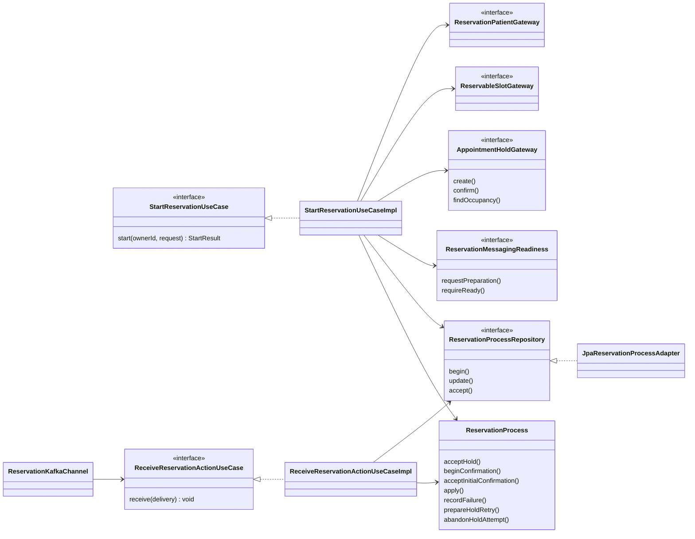

# PLAN: Iniciar reserva con hold y confirmación inicial

**SPEC de referencia:** [SPEC.md aprobada](SPEC.md).
**Versión de la spec revisada:** aprobación explícita del 2026-10-29, nueve RF/diez CA; código base f0e452d.
**Estado:** Aprobado <!-- Borrador | En revisión | Aprobado -->
**Aprobación:** explícita del usuario el 2026-10-29. Autoriza derivar TASKS, no implementar.

**Concreción durante implementación (2026-10-30):** autorización explícita posterior registrada en TASKS. `start` devuelve `StartResult(process, replayed)` para distinguir 202/200 sin una consulta adicional susceptible a carreras. El repositorio concreta las transiciones con `update` y la recepción con `accept`; `ReservationKafkaChannel` reúne contenedor, listener y preparación. Son ajustes internos de nombres/retorno, sin cambiar RF/CA ni contrato HTTP. La integración SQL/HTTP/Kafka se concentra en `ReservationIntegrationTests`, con suites específicas de agregado, caso de uso, gateways, parser y composición pública.

**Ajuste autorizado, 2026-10-30:** el registro incorpora únicamente el mínimo de dos caracteres por nombre/apellido, conservando su máximo de 50, mediante la validación del DTO de user indicada en [su PLAN](../registro-autenticacion/PLAN.md). RF-01/CA-01 mantienen la defensa de reservas para perfiles existentes incompatibles; la integración prepara esos perfiles directamente en la base temporal y comprueba el inicio con un perfil nuevo mínimo válido. Sin cambios al modelo de paciente central ni a las tablas.

**Ajuste autorizado, 2026-10-30, creación incierta:** extender `AppointmentHoldGateway` con consulta de la ocupación seleccionada y modelos/DTO propios, sin internals de otros slices. Aplicación guarda incertidumbre, consulta y solo permite repetir creación tras posición libre, con `RESERVATION_ATTEMPTS` (3 por defecto, total) y revalidación de agenda/canal/reloj. Conserva una única ejecución original por requestId; los replays no ejecutan POST. HELD/CONFIRMED, consulta fallida o presupuesto agotado archivan sin IDs como `HOLD_ATTEMPT_ABANDONED`, liberando únicamente exclusión local; `recheckAt` opcional en el problema HTTP identifica el instante central para volver a consultar una posición HELD, nunca un vencimiento propio. Confirmación REST no se reintenta. Se entrega Clock con zona de atención y presupuesto por constructor (siete dependencias), sin políticas/clases de ejecución adicionales ni migraciones. RF-03/RF-04/RF-07/RF-08 y CA-03/CA-06/CA-07/CA-09; casos antes/depués de expiresAt, libre→409, falta de consulta y reinicio de intento abandonado. Autorización directa del usuario tras la respuesta docente, sin nueva ronda de aprobación.

<!-- PARA LA PERSONA
Copia esta plantilla como PLAN.md junto a la SPEC.md aprobada.
Este documento define la solución técnica. Una vez revisado, el agente puede
derivar TASKS.md con tareas, dependencias y comprobaciones.
-->

<!-- PARA EL AGENTE
- Lee la SPEC.md aprobada, las instrucciones del proyecto y los contratos pertinentes.
  Si falta un documento necesario o la spec no está aprobada, indícalo antes de avanzar.
- Inspecciona el repositorio. Referencia rutas verificadas y distingue las nuevas propuestas.
- Propón una solución proporcional al alcance y coherente con el proyecto.
  Reutiliza lo existente y justifica nuevas dependencias o cambios de arquitectura.
- Distingue hechos, decisiones confirmadas y propuestas. Consulta las decisiones
  no resueltas; haz pocas preguntas por vez y actualiza el plan con las respuestas.
- Referencia los requisitos y criterios por su ID, sin copiar toda la spec.
- Si una decisión cambia el comportamiento o alcance, vuelve a la spec y solicita
  confirmación. No resuelvas una duda de producto mediante una suposición técnica.
- Conserva estos comentarios. No implementes durante la planificación.
- Solicita aprobación antes de marcar el plan como Aprobado. La autorización
  para implementar debe ser explícita; no se deduce del estado de los documentos.
- Para cambios de significado posteriores a la aprobación, registra una nota
  breve de cambio, motivo e impacto según AGENTS.md, sin historial separado.
-->

## Contexto técnico verificado

<!-- Qué existe hoy y cómo participa en la funcionalidad. -->

| Componente o archivo existente | Ruta verificada | Responsabilidad y uso previsto |
| --- | --- | --- |
| Disponibilidad | [GetAvailabilityUseCase](../../../src/main/java/com/prog2/appointment/availability/domain/ports/in/GetAvailabilityUseCase.java) | Recalcula agenda vigente y ocupaciones sin holds; reutilización confirmada en D-02. |
| Cuenta local | [UserAccountRepository](../../../src/main/java/com/prog2/appointment/user/domain/ports/out/UserAccountRepository.java), [UserAccountEntity](../../../src/main/java/com/prog2/appointment/user/infrastructure/persistence/entity/UserAccountEntity.java) | No existe lectura pública del perfil por ID; el modelo de autenticación no contiene nombres. Ampliar user con una lectura mínima. |
| Transacciones | [TransactionalUserAccountStore](../../../src/main/java/com/prog2/appointment/user/infrastructure/persistence/service/TransactionalUserAccountStore.java) | Bean separado con @Transactional; el adaptador captura también errores de commit. Conservar ese enfoque. |
| Integración | [TechnicalAccessUseCase](../../../src/main/java/com/prog2/appointment/integration/domain/ports/in/TechnicalAccessUseCase.java), [IntegrationConfiguration](../../../src/main/java/com/prog2/appointment/integration/domain/model/IntegrationConfiguration.java) | JWT, bootstrap, topics y grupo asignados. Turnos aún no consume acciones Kafka. |
| Seguridad/tiempo | [SecurityConfiguration](../../../src/main/java/com/prog2/appointment/infrastructure/security/config/SecurityConfiguration.java), [AvailabilityProperties](../../../src/main/java/com/prog2/appointment/infrastructure/config/AvailabilityProperties.java) | /api/** exige usuario/ROLE_USER; existen Clock y zona de atención; el caso de inicio recibe un Clock con esa zona. |
| Stack | [pom.xml](../../../pom.xml), [V2](../../../src/main/resources/db/migration/V2__create_users.sql) | Java 25/Boot 4.1.1, JPA/MySQL 8.4.8, Flyway y Testcontainers; sin dependencia Kafka en Turnos. |

**Convenciones y patrón de referencia:** arquitectura hexagonal con slices, estructura existente y [material de clase](../../../../MATERIA_REFERENCE.md). Dominio puro, puertos propios y adaptadores separados. Constructor DI, sin @Autowired ni @Data; Javadoc tradicional en español. Las clases nuevas son propuestas, no componentes implementados.

## Solución propuesta

<!-- Explica el enfoque y sus motivos. Describe las responsabilidades y el
recorrido desde la solicitud, evento o arranque hasta el resultado del servicio.
Usa un diagrama si aporta claridad. -->

Crear el slice `reservation`. `ReservationProcess` concentra las reglas del proceso durable y sus transiciones; dos entradas, `StartReservationUseCase` y `ReceiveReservationActionUseCase`, coordinan HTTP y eventos. Sin fachada adicional ni una clase State por estado.

La composición confirmada en **D-02** usa contratos propios: `ReservationPatientGateway`, `ReservableSlotGateway`, `AppointmentHoldGateway`, `ReservationProcessRepository` y `ReservationMessagingReadiness`. Sus adaptadores consumen los puertos públicos de otros slices; dominio/aplicación no importan sus modelos ni internals.

1. Obtener ownerId del sub validado y reconocer reintentos propios mediante D-03. Devolver un proceso existente sin repetir efectos; rechazar otra selección con la misma clave. Solicitar preparación asíncrona del consumidor si hace falta, sin condicionar esa respuesta local a un proveedor.
2. Comprobar perfil, pendiente existente y selección. Reejecutar CU-03 mediante el adaptador propuesto, sin confiar en disponibilidad anterior de KMP.
3. Exigir acceso técnico y canal Kafka preparado. Registrar el proceso en MySQL antes del primer POST; su restricción única resuelve la carrera por usuario.
4. Crear el hold con un POST por intento; tras respuesta incierta sin IDs, consultar ocupaciones y repetir únicamente si está libre dentro del presupuesto. Conservar IDs/vencimiento y registrar la intención de confirmar antes del segundo POST. Ninguna transacción abarca HTTP.
5. Aplicar eventos y deduplicación atómicamente; combinar REST con la última versión del proceso sin retroceso. Devolver progreso o incertidumbre propios; no encolar un replay automático de ambos POST.

Los adaptadores concretan Ports & Adapters; el repositorio expresa Repository. El agregado protege transiciones sin seleccionar comportamientos por instanceof. DI/JPA/Kafka son mecanismos, no patrones adicionales. No hace falta Outbox sin publicación del teléfono.

## Módulos y componentes afectados

<!-- Si el proyecto está modularizado, identifica los módulos afectados, sus
responsabilidades y la dirección de sus dependencias. Respeta los límites
existentes y justifica cualquier módulo o dependencia nueva. Si no está
modularizado, describe las carpetas o componentes afectados sin introducir
modularización fuera del alcance; marca la tabla de módulos como No aplica. -->

| Módulo | Existe / nuevo | Responsabilidad y cambios | Dependencias afectadas |
| --- | --- | --- | --- |
| No aplica | Único módulo Maven | Nuevo slice funcional; sin dividir el build. | Kafka y sus pruebas. |

<!-- Distingue lo que se reutiliza, modifica o crea. Las rutas nuevas son propuestas.
Señala impacto sobre modelos, contratos o componentes compartidos. -->

Rutas Java relativas a `src/main/java/com/prog2/appointment/`:

| Componente o ruta | Acción | Cambio y responsabilidad | Requisito relacionado |
| --- | --- | --- | --- |
| reservation/domain/model, enums, exception y ports/in/out | Crear | Proceso, selección, paciente, acciones y contratos propios. | RF-01 a RF-09 |
| reservation/application/usecases y exception | Crear | Inicio/aplicación de eventos, sin HTTP/JPA ni tipos ajenos. | RF-03 a RF-08 |
| reservation/infrastructure/user/adapter y availability/adapter | Crear, D-02 confirmada | Adaptar perfil público y CU-03. | RF-01/RF-02 |
| user/domain/model/UserProfile, ports/in/GetUserProfileUseCase y lectura propia | Crear/ampliar, D-02 confirmada | ID/nombres/activación sin hash; ampliar repositorio/mapper propios, sin cambiar login ni agregar endpoint HTTP; mínimo de nombres ajustado en el DTO de registro. | RF-01 |
| reservation/infrastructure/client/adapter y dto | Crear | POST centrales, validación de respuesta y composición del acceso técnico público. | RF-04/RF-05/RF-07 |
| reservation/infrastructure/persistence | Crear | Dos entidades/repositorios y mappers; TransactionalReservationStore separado de JpaReservationProcessAdapter. | RF-03/RF-04/RF-06/RF-08 |
| reservation/infrastructure/messaging | Crear | Contenedor, listener, decodificación, readiness y cierre; sin productor funcional. | RF-06/RF-09 |
| reservation/infrastructure/web y config | Crear | Controlador/DTO/mapper/advice y wiring específicos. | RF-01/RF-05/RF-07 |
| infrastructure/config/ReservationProperties | Crear | Parámetros compartidos, sin estado dinámico ni wiring. | RF-07/RF-09 |
| src/main/resources/db/migration/V3__create_reservation_processes.sql | Crear | Procesos/inbox, índices y restricciones. | RF-03/RF-04/RF-06/RF-08 |
| pom.xml, YAML, .env.example, Compose y README | Modificar | Dependencias, defaults opcionales, contrato y ejecución; sin cambiar secretos ni servicios de Catálogo. | RF-01 a RF-09 |

## Datos y contratos

<!-- Completa solo lo aplicable. Si un punto no aplica, indica el motivo. -->

- **Modelos y contratos de entrada y salida:** propuesta `POST /api/reservation-processes`, JWT de usuario/ROLE_USER. Cuerpo: requestId UUID (D-03), professionalId long positivo, date ISO y startTime HH:mm[:ss]. Controlador con DTO validado y ownerId del JWT. Respuesta: processId local, selección, state, expiresAt conocido y reasonCode cuando corresponda, sin credenciales ni datos ajenos. Inicio aceptado: 202; repetición propia: 200 con progreso actual y sin repetir efectos de reserva. no-store; sin GET de CU-06 ni teléfono de CU-05.
- **Identificadores, relaciones y restricciones:** processId=requestId local, diferente del reservationProcessId central. externalPatientId=`user-` más ownerId, estable y dentro de 100 caracteres. Misma clave/propietario/selección normalizada reconoce repetición; HH:mm y HH:mm:ss equivalentes no son otra selección. Otra selección da conflicto y una clave ajena no expone su proceso. Capturar nombres validados de la cuenta para ambos pasos; campos adicionales del cliente nunca sustituyen identidad/nombres. Proceso, selección y paciente son modelos propios; las entidades JPA y DTO no salen de infraestructura.
- **Origen de los datos consultados y transformaciones:** bajo D-02, GetUserProfileUseCase retorna perfil propio mínimo y activación. ReservableSlotGateway consume GetAvailabilityUseCase y exige el inicio en su lista. Traducir solo fallos publicados por el puerto, sin importar AvailabilityException interno: rechazo/ausencia de horario a entrada/conflicto propios, fallo de proveedor a indisponibilidad. Reutilizar CU-03 implica consultar también ocupaciones; el POST central sigue arbitrando la asignación.
- **Persistencia, consultas y actualizaciones:** reservation_process guarda propietario, selección/paciente, fase, IDs/vencimiento, solicitud recibida, motivo seguro, versión y marcas UTC/closed_at. Señal de abandono pendiente para respetar la exclusión, sin endpoint de abandono aquí. Columna generada active_owner_id=owner_id si closed_at es NULL o hay abandono pendiente; NULL al cerrar sin intención pendiente. UNIQUE evita dos pendientes sin otra tabla de bloqueos. FK escalar al usuario, sin navegación JPA ni cascada; unicidad de hold_id/central_process_id conocidos. begin distingue inserción propia confirmada de proceso existente: solo la primera permite ejecutar el POST inicial, después de verificar su escritura.
- **Persistencia de eventos:** reservation_inbox conserva tópico/partición/offset, eventId reconocido, tipo, correlación, hash de campos relevantes/contenido acotado y resultado. Unicidad de entrega y eventId válido; un rechazado sin ID se identifica por su origen. Recibo/cambio de proceso se confirman juntos. Redelivery con igual eventId no repite efectos; contenido esencial diferente se conserva como inconsistencia, sin modificar el resultado anterior.
- **Convivencia entre datos locales y remotos:** el proceso conserva evidencia, no extiende TTL ni sustituye la reserva central. Solo infraestructura consume TechnicalAccessUseCase para bearer/invalidez. Validar 201/202, IDs y vencimiento; un 202 no sustituye la solicitud Kafka ni autoriza inventar requestEventId.
- **Compatibilidad y migraciones de datos existentes:** V3 aditiva sobre V2 poblada; no reescribir cuentas/migraciones. La lectura de perfil es interna Java y no cambia registro/login. Sin catálogo ni ocupaciones replicados.

## Estado, operaciones y errores

<!-- Cómo se implementan los comportamientos aprobados en la spec.
Referencia RF/CA y completa solo los puntos pertinentes al backend. -->

- **Estado del servicio y de las operaciones:** agregado con fases explícitas; no almacenar una copia antigua sobre un evento más avanzado. Health sigue siendo técnico mínimo.

| Fase propuesta | Significado |
| --- | --- |
| CREATING_HOLD / HOLD_UNCERTAIN | Intención antes de cada POST / resultado desconocido; consulta de ocupaciones antes de preparar otro intento acotado. |
| HOLD_ATTEMPT_ABANDONED | Cierre local del intento sin IDs; no acredita cancelación ni expiración central. Otra acción exige validación/ocupaciones nuevas. |
| HELD | IDs/vencimiento guardados, sin confirmación inicial acreditada. |
| CONFIRMING / CONFIRMATION_UNCERTAIN | Intención previa al segundo POST / resultado desconocido. |
| WAITING_FOR_REQUEST | 202 aceptado, sin solicitud Kafka recibida. |
| WAITING_FOR_PHONE | Solicitud correlacionada conservada, incluso anterior al 202. |
| RECONCILIATION_REQUIRED | Inconsistencia/rechazo posterior al hold sin cierre acreditado. |
| REJECTED / EXPIRED | Rechazo sin efecto pendiente o vencimiento central verificado. |
| CONFIRMED / CANCELLED | Evidencia terminal recibida que bloquea regresiones; no implementa envío de teléfono ni cancelación. |

El receptor valida v1, key/proceso, hold y groupId cuando exista. Aplica solicitud/vencimiento; AppointmentProcessInvalid exige reconciliación. Una evidencia terminal válida conserva estado/reservationId y no se reabre; otros mensajes quedan conservados para su tratamiento, sin sustituir CU-05 completo. Abandono pendiente mantiene la exclusión incluso con resultado central conocido.

- **Conservación y restauración del estado:** TransactionalReservationStore con REQUIRES_NEW/timeout 10 s; adaptador externo captura commit. Cambios con versión e identificador de escritura: ante commit ambiguo, un reread fresco verifica el recibo propio antes de continuar. Si no se verifica, indisponibilidad sin siguiente POST. Tras reiniciar, fases intermedias/inbox permanecen; no recrear por perder memoria ni prometer CU-09 completo.
- **Ejecución, concurrencia y cancelación de operaciones:** flujo HTTP síncrono como CU-03, intención durable antes de cada efecto y sin transacción durante red. UNIQUE protege usuario; @Version protege carrera REST/Kafka. Ante conflicto local, releer/aplicar transición monotónica hasta tres veces, sin repetir HTTP. Un commit ambiguo no concede ejecución: verificar su marca. Releer Clock inmediatamente antes de los POST: no enviar una nueva creación para un inicio ya pasado ni confirmar fuera de expiresAt; conservar cualquier efecto previo no resuelto. La repetición propia devuelve progreso sin depender de proveedores; reconocerla antes de volver a exigir una fecha futura evita rechazar un histórico por el paso del tiempo. Sin cancelación al desconectar KMP ni abandono implícito.
- **Errores, reintentos y prevención de duplicados:** un intento por llamada del gateway, sin redirects/reintentos del transporte; aplicación limita las nuevas creaciones tras consulta de ocupación libre. El gateway distingue fallo previo a invocar HTTP de resultado incierto tras intentarlo, sin atribuir ausencia de efectos a cualquier excepción. Clasificar HTTP/code: rechazo documentado al crear puede cerrar sin hold; timeout, 5xx o respuesta no verificable de creación se guardan inciertos antes de reconsultar; HELD/CONFIRMED, fallo de consulta o presupuesto agotado archivan el intento no identificable. No atribuir la ocupación al usuario. Una confirmación incierta conserva el hold y la exclusión. Rechazo al confirmar no libera hold; RESERVATION_PROCESS_ALREADY_CONFIRMED exige reconciliación. Un 401 invalida ese JWT y conserva #4, sin replay. HOLD_EXPIRED acredita vencimiento; HOLD_NOT_FOUND no resuelve una confirmación anterior incierta.
- **Observabilidad y diagnósticos seguros:** motivos estables y referencia propia; sin cuerpos, nombres, JWT o configuración completa en logs. Advice solo del controlador: 400 entrada/perfil inválidos; 409 pendiente/horario/clave reutilizada; 503 proveedores/Kafka/almacenamiento; 500 inesperado. Conservar filtros 401/403. Tras iniciar, error con referencia propia conocida y señal de incertidumbre, sin datos ajenos.

### Recepción Kafka y preparación del canal

Spring Kafka con contenedor programático al obtener integración, porque bootstrap/topic/group llegan en ejecución. Preparación al arrancar y por demanda: tres intentos, pausa 5 s, exclusión de arranques simultáneos y enfriamiento de 30 s tras agotarlos. requestPreparation solo solicita ese trabajo asíncrono; también puede solicitarlo un reintento propio cuyo resultado local se devuelve sin esperar al broker. Consumir puede continuar con la configuración adquirida aunque venza el JWT REST; el listener no hace login central ni programa ciclos ilimitados de #4.

La referencia al contenedor y su configuración se protegen con el monitor de `ReservationKafkaChannel`; readiness obtiene ambos bajo el mismo bloqueo y una sola lectura de las particiones asignadas. Las consultas de metadata y la parada del contenedor ocurren fuera de ese monitor.

Readiness exige contenedor activo, asignación del topic esperado y metadata del broker verificable en plazo acotado. Un topic vacío puede estar listo; eso no prueba publicación futura. Si no se prepara, registro/login/health siguen activos y nuevos inicios fallan antes del hold. Una demanda posterior puede volver a prepararlo respetando límites; es un criterio local conservador, sin garantía de disponibilidad futura.

StringDeserializer y Jackson sin tipos Java del mensaje; enable.auto.commit=false, auto.offset.reset=earliest, allow.auto.create.topics=false, un hilo y ACK manual síncrono después del commit MySQL. No declarar NewTopic ni modificar topics centrales. Ante almacenamiento fallido, tres intentos acotados y luego detener consumo sin confirmar ese registro, sin descarte predeterminado: handler con ackAfterHandle=false y commitRecovered=false, a comprobar con broker temporal. Inválidos/ajenos/desconocidos se conservan clasificados antes de avanzar. Fallo del ACK redelivera un recibo ya durable sin repetir efectos. Cerrar contenedor, Admin y ejecutor propios.

## Dependencias y configuración

<!-- Librerías, servicios, permisos o configuración afectados. Verifica compatibilidad
con el proyecto y justifica las incorporaciones. No agregues dependencias por defecto. -->

- Agregar spring-boot-starter-kafka y testcontainers-kafka de test, sin versiones manuales. BOM local Boot 4.1.1 verificado: Spring Kafka 4.1.1, kafka-clients 4.2.1, Testcontainers 2.0.5. Sin motor de sagas, Spring Retry, Redis ni otra base.
- Reutilizar WebClient, JPA/Flyway, Clock, zona, claves y URLs. No modificar internals o políticas de #4/CU-03.
- ReservationProperties/YAML con sobrescritura por entorno y defaults propuestos: HTTP 5 s (total 10 s por POST), metadata Kafka 5 s, preparación/errores Kafka y creación condicionada por ocupaciones, 3 intentos totales; pausa Kafka de 5 s, enfriamiento de preparación 30 s. Validar rangos al arrancar. Estado dinámico fuera de properties.
- Sin broker central nuevo en Compose/CI; las pruebas administran Kafka/MySQL temporales. README: contrato/idempotencia, fases, variables y ejecución. OpenAPI continúa postergado.
- Referencias: [contenedores Spring Kafka](https://docs.spring.io/spring-kafka/reference/kafka/receiving-messages/message-listener-container.html), contrastar APIs con fuentes locales 4.1.1; [columnas generadas MySQL 8.4](https://dev.mysql.com/doc/refman/8.4/en/create-table-generated-columns.html). Restricción y offsets se prueban con servicios temporales; leer documentación no los acredita.

## Estrategia de validación

<!-- Una fila por criterio de la spec. Selecciona el método capaz de demostrarlo:
test unitario, integración, contrato o prueba manual. No todos requieren todos los métodos.
Identifica tests existentes y separa los nuevos propuestos. Incluye regresiones relevantes.
Una captura aislada no demuestra persistencia ni ausencia de peticiones de red. -->

Tests nuevos propuestos en `src/test/java/com/prog2/appointment/reservation/`: agregado/casos reales con Clock y barreras; HTTP ficticio, MySQL/Kafka temporales donde importan commits/restricciones/offsets. No mockear el comportamiento bajo prueba ni usar sleeps para ordenar carreras.

| Criterio | Método y test existente o propuesto | Entorno y datos necesarios | Evidencia prevista |
| --- | --- | --- | --- |
| CA-01 | ReservationHttpTests, lectura de perfil y StartReservationTests. | Login real, dos cuentas, nombres de uno/dos caracteres. | Rechazos sin hold; paciente propio y sin filtración por clave ajena. |
| CA-02 | ReservationGatewayTests y caso real. | Agenda/ocupaciones ficticias y reloj límite. | Sin POST con agenda no vigente o inicio no ofrecido; revalidación efectiva. |
| CA-03 | ReservationPersistenceTests/ReservationConcurrencyTests. | MySQL, instancias independientes, solicitudes solapadas y reintento de clave tras cerrar. | Un pendiente/POST; misma clave devuelve histórico sin hold, otra selección da conflicto y abandono conserva exclusión. |
| CA-04 | ReservationHttpTests/ReservationGatewayTests. | Dos POST observables y lecturas frescas. | Propietario/IDs confirmados antes del siguiente efecto; mismo paciente, progreso pendiente. |
| CA-05 | ReservationProcessTests/ReservationKafkaTests. | Kafka y MySQL; evento antes de liberar 202, retrasado/repetido/tras cierre. | WAITING_FOR_PHONE no retrocede; eventId una vez, sin correlación inventada ni mezcla. |
| CA-06 | Gateways/persistencia y orquestación. | Cortes, ocupaciones HELD/CONFIRMED/libre, consulta fallida, presupuesto agotado, carrera 409 y fallos de commit. | Intención antes de cada creación condicionada; sin replay de confirmación ni recuperación ficticia de IDs. |
| CA-07 | Agregado/caso con reloj. | Antes/en/después del plazo y vencimiento central. | Sin renovación, confirmación tardía ni reapertura de vencido. |
| CA-08 | Concurrencia HTTP de dos usuarios. | Mismo horario, central ficticia que arbitra; confirmación rechazada. | Conflicto aislado; rechazo no borra/libera el hold. |
| CA-09 | Reinicio de contexto/consumidor. | Misma DB; interrupción con intención/IDs y después del commit antes del ACK. | Datos/límite durables; retoma/deduplicación sin recreación automática. |
| CA-10 | Kafka y endpoint real. | Topic vacío, broker/topic inaccesible, consumidor parado y fallo de DB. | Vacío no bloquea; indisponibilidad evita hold; offset no avanza antes de guardar. |

**Comprobaciones de regresión:** registro/login, JWT/CORS, acceso técnico y CU-03 existentes; V2 poblada más V3; rollback/commit ambiguo, recursos, Javadoc/artefacto/secretos. @TestConstructor(autowireMode = ALL) entrega dependencias al constructor de pruebas Spring, sin @Autowired ni campos inyectados.

**Comandos verificados para compilar y ejecutar tests:** wrapper/POM existentes, `./mvnw -B -ntp clean verify`. Enfoque futuro: `./mvnw -B -ntp -Dtest=ReservationProcessTests,StartReservationTests test` y clases de integración propuestas. Nada ejecutado para CU-04 en PLAN. Consultar Sonar CLI/IDE antes de proponer publicación; Actions/Sonar remotos son feedback posterior, sin tarea de espera.

**Pruebas operativas del backend:** JAR/Compose de Turnos con DB/broker descartables y HTTP ficticio, sin .env/servicios reales; dos POST, evento anticipado y reinicio/offset. Crear holds reales tiene efectos centrales: requiere autorización separada, datos ficticios e identificación/cierre del proceso; no reiniciar/reconstruir Catálogo por ese ensayo.

**Limitaciones del entorno:** conectividad, REST y recepción Kafka se acreditan por separado. Sin solicitud central auténtica no afirmar flujo completo ni fabricar eventos para simular evidencia real. La creación perdida sin IDs sigue sin poder recuperar los IDs centrales, pero dispone del criterio docente de abandono/ocupaciones/reintentos limitados. No confundir ese criterio con consulta del hold por propietario ni con recuperación de confirmaciones inciertas.

<!-- Esta sección planifica la validación. Durante la implementación, registra
en TASKS.md o en el informe de validación acordado los resultados y evidencias
reales. Usar el cierre de TASKS.md definido en AGENTS.md: CA/evidencia,
regresión y desviaciones del PLAN. Distingue pruebas ejecutadas, fallidas,
no ejecutadas y bloqueadas.
Compilar o tener tests en verde no sustituye revisar los criterios de la spec. -->

## Orden de implementación

<!-- Etapas y dependencias principales. El desglose ejecutable se escribe en TASKS.md.
Incluye puntos de comprobación para avanzar con cambios pequeños. -->

1. Definir modelos/puertos/transiciones con D-02/D-03 confirmadas; comprobar monotonicidad, vencimiento e identidad.
2. Perfil público y adaptador de selección; comprobar límites sin internals ni cambios de registro/login.
3. V3/persistencia; verificar exclusión, commits y deduplicación con MySQL antes de efectos remotos.
4. POST/Kafka/readiness; verificar credenciales, cortes, commit antes de ACK y cierre con proveedores locales.
5. Orquestación/controlador, carreras y regresión; README/Javadoc y cierre CA/evidencia/desviaciones en TASKS durante implementación.

## Riesgos y decisiones pendientes

<!-- Riesgos concretos de esta solución y cómo se resolverán, sin listas genéricas.
Escribe Ninguna en las decisiones pendientes cuando estén resueltas. -->

- **Riesgos y medidas acordadas:** no hay transacción distribuida; guardar intención/resultado y no repetir efectos ciegamente. UNIQUE protege la carrera que una comprobación previa no evita. Reread de versión/recibo protege commits/respuestas perdidos; probar intercalados. Readiness no garantiza publicación futura. Resultado central conocido no libera abandono pendiente. Sin IDs aplicar ocupaciones según la aclaración: no inventar IDs, propiedad ni un plazo local de liberación.
- **D-02, confirmada por el usuario el 2026-10-29:** composición por puertos públicos hacia user/availability/integration, con modelos propios de reservas. La lectura de perfil es una interfaz Java interna, no un endpoint; reutilizar CU-03 incluye su consulta de ocupaciones.
- **D-03, confirmada por el usuario el 2026-10-29:** requestId UUID por acción lógica, reutilizado por KMP, como identidad/idempotencia local. La ejecución original puede realizar creaciones internas limitadas y condicionadas por ocupaciones; los replays HTTP no ejecutan POST. Usa la clave del proceso sin otra tabla/servicio: permite reconocer la misma acción incluso después de cerrar el pendiente. No agrega idempotencia a cátedra ni recupera IDs centrales perdidos.
- **Decisiones pendientes:** ninguna entre las opciones consultadas. El límite contractual de la SPEC se conserva; no se promete recuperación central completa.
- **Aprobación del PLAN completo:** explícita del usuario el 2026-10-29; la implementación requiere autorización posterior.

<!-- ANTES DE SOLICITAR APROBACIÓN
Comprueba que el plan cubre los requisitos, respeta las exclusiones, reutiliza
componentes verificados y permite demostrar todos los criterios de aceptación.
Resuelve dudas y marcadores pendientes. Si la spec cambió, revisa su impacto.
Tras aprobar el plan, deriva TASKS.md con IDs, dependencias, referencias a RF/CA
y comprobaciones. Antes de implementar, realizar el chequeo de coherencia de
AGENTS.md con esos documentos, sin otro informe ni aprobación adicional.
No marques una tarea terminada sin realizar su validación;
si está bloqueada, registra el motivo.
-->
