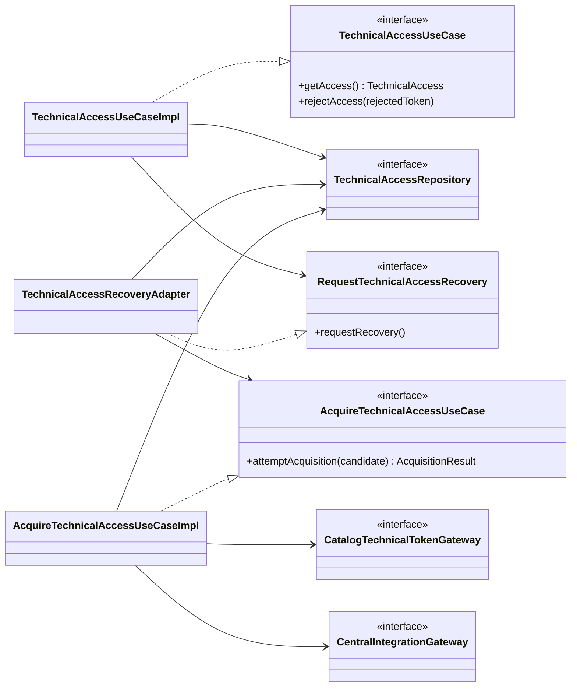

# PLAN: Acceso técnico y configuración de cátedra para Turnos

**SPEC de referencia:** [SPEC.md](SPEC.md), aprobada el 2026-10-17, con D-01 = 1B y D-02 = 2A.
**Versión de la spec revisada:** aprobación explícita del usuario el 2026-10-17.
**Estado:** Aprobado <!-- Borrador | En revisión | Aprobado -->
**Aprobación:** confirmada explícitamente por el usuario el 2026-10-17, tras aclarar el flujo entre clases. Permitió derivar TASKS; la autorización posterior de implementación y sus evidencias se registran en [TASKS.md](TASKS.md).

<!-- PARA LA PERSONA
Este documento contiene la solución técnica revisada; su ejecución se deriva en TASKS.
Su aprobación no autoriza por sí sola a implementar.
-->

<!-- PARA EL AGENTE
- Leer SPEC aprobada, instrucciones y contratos; Mobile Guidelines no corresponde.
- Conservar las decisiones funcionales; señalar propuestas técnicas sin aprobarlas por inferencia.
- Aplicar hexagonal-arch y test-design-first, con componentes necesarios y pruebas de comportamiento.
- Mantener Javadoc en español y DI por constructor, sin @Autowired ni Lombok @Data.
- Implementar solo tras autorización explícita; no modificar otros repositorios ni ejecutar operaciones Git mutables.
-->

## Contexto técnico verificado

<!-- Archivos existentes y límites de esta revisión. -->

| Existente | Ruta | Uso |
| --- | --- | --- |
| Build | `pom.xml` | Java 25, Boot 4.1.1, MVC, JPA/Flyway, Testcontainers, JaCoCo y Sonar. |
| Arranque y MySQL | `AppointmentApplication`, `infrastructure/config/DatabaseConfiguration` | Conservar validación temprana y health mínimo. |
| Configuración | `application.yaml`, `.env.example`, `compose.yaml` | Incorporar acceso externo y montaje de clave; no leer `.env`. |
| Regresión | `AppointmentApplicationTests` | Diez escenarios existentes; conservar el cambio local a DI por constructor. |
| Contratos | [Anexo](../../../../INTEGRATION_REFERENCE-v2.md), secciones 2 a 6 y 13; [entrega protegida](../../../../backend-catalogo/docs/features/seguridad-jwt/PLAN.md#entrega-http-confirmada) | Consumir contratos existentes, sin copiar su implementación. |

Convención: skill `hexagonal-arch` y acuerdos compartidos. Un slice `integration` bajo `com.prog2.appointment`, sin segmento `hexagonal`, módulos Maven nuevos, tablas ni controladores propios. Configuración compartida fuera de slices; estado dinámico y wiring específico conservan su responsabilidad. No se crea infraestructura Kafka/Redis vacía.

## Solución propuesta

<!-- Recorrido concreto y responsabilidades; no anticipar casos de reserva. -->

1. Al arrancar, validar URLs, integración esperada y privada RSA externa. Un adaptador de ciclo de vida solicita una adquisición en segundo plano.
2. Un intento obtiene de Catálogo el JWT central usando un JWT propio de servicio recién firmado. Consulta luego `GET /api/student/integration` de cátedra con el JWT central y valida el conjunto antes de publicarlo.
3. El acceso local entrega una sesión utilizable sin consultar Catálogo en cada lectura. Si falta o fue invalidada, solicita una recuperación coordinada; solo existe un ciclo a la vez.
4. **Comportamiento aprobado:** la consulta sin sesión utilizable informa indisponibilidad mientras la recuperación corre en segundo plano. No bloquea la solicitud hasta terminar el ciclo, no encola operaciones de negocio ni las reproduce. Una consulta posterior obtiene acceso si ya se recuperó. No se crea un endpoint HTTP en #4; su traducción HTTP corresponde a futuros consumidores.
5. La caída de Catálogo no elimina por sí sola la sesión central utilizable. Un vencimiento o rechazo central sí impide seguir utilizándola; la recuperación a demanda conserva los límites aprobados en SPEC.

### Responsabilidades principales

El diagrama resume contratos y orquestación, no todas las clases de configuración/DTO. Los puertos están en dominio, los casos de uso en aplicación y los adaptadores en infraestructura. El coordinador técnico solo ejecuta el ciclo finito y regula concurrencia/frecuencia; la aceptación de una sesión y clasificación funcional pertenecen a aplicación/dominio.

Patrones previstos: **Adapter**, en los clientes HTTP que implementan los puertos salientes; **Repository**, para consultar/reemplazar la sesión sin acoplar aplicación al almacenamiento en memoria. La dirección de dependencias aplica DIP; executor, filtros HTTP y codificación JWT son mecanismos de infraestructura, no patrones de negocio añadidos.

## Módulos y componentes afectados

<!-- No hay modularización nueva. Estado de implementación y verificación en TASKS. -->

| Módulo | Existe / nuevo | Responsabilidad y cambios | Dependencias afectadas |
| --- | --- | --- | --- |
| Aplicación Maven `appointment` | Existe | Nuevo slice de acceso técnico y configuración externa. | WebClient y codificación JWT; servidor MVC conservado. |

| Componente o ruta propuesta | Acción | Responsabilidad | RF |
| --- | --- | --- | --- |
| `integration/domain/model`, `domain/enums`, `domain/exception` | Crear | Sesión/configuración propias, resultado de intento y errores de puertos, sin Spring/Jackson. | 02, 03, 07 |
| `integration/domain/ports/in` | Crear | Acceso e invalidación de sesión; un intento de adquisición. | 01 a 07 |
| `integration/domain/ports/out` | Crear | Obtener token de Catálogo, consultar integración central, almacenar sesión y solicitar recuperación. | 01 a 07 |
| `integration/application/usecases`, `application/exception` | Crear | `TechnicalAccessUseCaseImpl`, `AcquireTechnicalAccessUseCaseImpl` e indisponibilidad de aplicación. | 01 a 07 |
| `integration/infrastructure/client/adapter`, `client/dto` | Crear | Dos clientes HTTP y DTO externos mínimos, sin filtrar WebClient/JSON al dominio. | 01, 02, 07 |
| `integration/infrastructure/persistence/adapter` | Crear | Sesión completa en memoria con lectura/reemplazo/invalidación atómicos. | 03, 05, 06 |
| `integration/infrastructure/config` | Crear | Wiring, arranque/cierre y `TechnicalAccessRecoveryAdapter` con executor de un hilo. | 06 |
| `infrastructure/config`, `infrastructure/security/jwt` | Crear lo necesario | Parámetros compartidos, reloj UTC y firma del JWT de servicio; privada fuera del repositorio. | 01, 05 |
| POM, YAML, Compose, `.env.example`, README | Modificar | Dependencias, entorno, montaje y ejecución reproducible. | 05, 08 |
| Tests de integración y regresión existentes | Crear/adaptar | Verificación de CA-01 a CA-08, sin servicios reales. | 01 a 08 |

Las firmas propuestas de entrada son internas, no APIs de KMP. No resolver aquí composición con slices de negocio futuros. El firmante de servicio será consumido por el adaptador HTTP, mediante constructor, sin introducir criptografía en aplicación/dominio ni anticipar emisión de JWT de usuarios de #5/#7.

## Datos y contratos

<!-- Origen y propiedades del estado, sin bases compartidas ni nuevas migraciones. -->

- **Modelos y entradas/salidas:** `TechnicalAccess` agrupa JWT central, vencimiento conocido y configuración mínima de Turnos. `AcquisitionResult` distingue éxito, fallo recuperable y terminal, con motivo seguro. Un candidato de adquisición se pasa entre intentos del mismo ciclo si aún falta completar aprovisionamiento; no se publica como sesión utilizable. El repositorio conserva huellas SHA-256 de los tokens rechazados durante el proceso, sin copias adicionales de esos bearer. Conservar las huellas anteriores impide rehabilitar un token rechazado cuando llega después otro rechazo tardío.
- **Identidad y restricciones:** validar `groupId` esperado, estado contractual, datos Kafka requeridos y token utilizable. Los campos Redis/topic de catálogo adicionales no son obligatorios para Turnos ni habilitan sus consumidores. No normalizar silenciosamente una identidad recibida distinta de la configurada.
- **Transformación:** JSON mínimo `{idToken}` desde Catálogo; objeto sin envoltorio desde cátedra. DTO ignoran campos adicionales compatibles y no conservan datos ajenos al uso. Ningún `toString`, excepción ni log reproduce tokens, privada o cuerpos remotos completos.
- **JWT propio:** usar `JwtEncoder`/`NimbusJwtEncoder`, RS256 y claims del contrato referenciado en SPEC; `iat` obtenido del reloj UTC, `exp = iat + 300 s`. Privada RSA externa PKCS#8, al menos 2048 bits, validada al arranque. No crear un endpoint de emisión ni una sesión de usuario. [API oficial](https://docs.spring.io/spring-security/reference/api/java/org/springframework/security/oauth2/jwt/NimbusJwtEncoder.html).
- **JWT central:** leer `exp` si existe, comprobar vencimiento exacto sin aplicar la tolerancia del JWT propio y atender siempre el 401 de cátedra. Si falta `exp`, depender del rechazo central sin inventar fecha. Leer claims no verifica firma; no se conocen claves de cátedra. El token proviene del proveedor protegido y su uso central se valida por cátedra.
- **Persistencia:** memoria únicamente; publicar JWT/configuración como unidad completa tras validarlos. La invalidación compara el token que falló con el actual: un 401 tardío de una sesión anterior no borra una más nueva. Reconocer el token central rechazado evita readquirirlo del proveedor sin cambios y declararlo válido. El estado se descarta al reiniciar.
- **Convivencia:** sesión utilizable no equivale a catálogo vigente ni a Kafka conectado. No hacer llamadas de salud contra Catálogo para entregar acceso central local ya utilizable. Un fallo temporal de una operación central tampoco demuestra que el token sea inválido.
- **Compatibilidad:** sin entidades, tablas ni migraciones nuevas. El proveedor y KMP no se modifican; la privada no se entrega al proveedor ni a KMP. Rotación manual de claves coordinada por entorno, fuera de esta implementación automática.

## Estado, operaciones y errores

<!-- Recuperación según D-01/D-02; interfaz/dispositivo no aplica. -->

- **Estado observable:** acceso utilizable o indisponible para consumidores internos; adquisición en curso y próxima recuperación admisible son estado técnico del coordinador. Health conserva su significado técnico. Una integración incompleta nunca se publica parcialmente.
- **Restauración:** nuevo ciclo inicial al reiniciar. Con sesión válida, servir acceso aunque Catálogo caiga; sin sesión, solo recuperar al arrancar o ante demanda, no por sondeo periódico. Si Catálogo aún no recuperó su propio login, Turnos permanece indisponible y no hace un login alternativo.
- **Concurrencia/cierre:** `ApplicationReadyEvent` solicita recuperación sin bloquear el listener. Un `ExecutorService` de un hilo y una reserva atómica de ciclo antes de encolarlo evitan múltiples tareas pendientes; la consulta de acceso no espera futuros. El ciclo aplica `Thread.sleep` solo en ese hilo entre intentos, como referencia de clase. Cerrar el contexto interrumpe la tarea, termina el executor y prohíbe publicaciones o nuevas solicitudes posteriores al cierre. No sostener locks durante HTTP/esperas. Revalidar contra invalidaciones concurrentes antes de publicar.

**Parámetros aprobados con este PLAN:**

| Parámetro | Valor | Fundamento |
| --- | --- | --- |
| Intentos por ciclo | 3 totales, incluido el inicial | Base de Catálogo; no tres reintentos adicionales. |
| Espera dentro del ciclo | 5 s entre intentos recuperables | Misma base; sin espera después del último. |
| HTTP | 5 s conexión y lectura; 10 s de límite total por petición | Base finita, incluyendo una cota total; no bloquear solicitudes del backend. |
| Espera entre ciclos fallidos | 30 s desde finalizar el anterior | D-01: permitir recuperación sin saturar al proveedor. Una demanda durante la espera no la extiende ni encola otro ciclo. |

Valores fijos por ahora, suministrables a las pruebas para controlar el tiempo sin esperar segundos reales. Ninguna espera programa por sí sola otro ciclo: una demanda posterior debe dispararlo. La clasificación terminal detiene el ciclo actual; solicitudes posteriores siguen sujetas a la misma espera y no corrigen por sí solas configuración/permisos inválidos.

| Situación | Decisión del intento/ciclo |
| --- | --- |
| Error temporal de red, timeout, HTTP 500/503 o `PENDING` central | Recuperable dentro del límite. |
| 401/403 del proveedor | Detener ciclo con diagnóstico de autenticación/permisos del servicio; no confundirlo con token central inválido. |
| 400, integración inexistente/diferente, `FAILED`/`REVOKED` o respuesta contractual inválida | Detener ciclo; no publicar acceso. |
| JWT central vencido, previamente rechazado o GET central 401 | Descartar candidato, sin login independiente; finalizar ciclo, recuperar a demanda cuando el proveedor pueda dar acceso utilizable. |
| JWT central obtenido y configuración `PENDING` | Consultar configuración con el mismo candidato en los intentos restantes del ciclo. No volver a pedir JWT por cada sondeo de aprovisionamiento. |
| Fallo sin token recibido | Siguiente intento limitado solicita nuevamente el token al proveedor, con credencial de servicio nueva. |

Clasificar por HTTP y `code` cuando exista; admitir respuestas sin código. Sin `.retry()` adicional ni reintento TCP oculto en Reactor Netty. Nunca repetir aquí una operación de reserva, confirmación o cancelación; los consumidores futuros deben reconciliar efectos inciertos según sus CU.

## Dependencias y configuración

<!-- Reutilizar las versiones del BOM; solo dependencias para el alcance presente. -->

- Conservar Java 25, Boot 4.1.1 y Maven Wrapper. Agregar `spring-boot-starter-webflux` para WebClient y `spring-security-oauth2-jose` para firma, con versiones del BOM. No añadir el starter Resource Server ni una cadena de seguridad HTTP propia en #4. Verificar que los módulos añadidos no alteren MVC, health ni exposición de endpoints.
- WebClient síncrono mediante `.block()` únicamente dentro del hilo dedicado, con límites finitos; `Mono`/`Flux` no aparecen en puertos ni dominio. Dos clientes separados evitan reenviar el JWT central a Catálogo o el JWT propio a cátedra. Sin seguir redirecciones que puedan divulgar bearer. [Uso síncrono oficial](https://docs.spring.io/spring-framework/reference/web/webflux-webclient/client-synchronous.html).
- Proponer `CATALOG_BASE_URL`, `CATEDRA_BASE_URL`, `CATEDRA_GROUP_ID` y `JWT_PRIVATE_KEY_PATH`. Validar formatos y archivo de clave legible antes de conectar; diagnósticos sin valores sensibles. No usar `CATEDRA_USERNAME`/`CATEDRA_PASSWORD` en Turnos.
- Propiedades compartidas de acceso externo y `Clock` fuera de slices, en `infrastructure/config`, cableadas por `TechnicalAccessSettingsConfiguration`; firma de servicio en `infrastructure/security/jwt`. El wiring específico y executor quedan dentro de `integration`. No mover estado de sesión a config por contener un JWT.
- Compose monta una privada externa de solo lectura, sin copiarla a la imagen/JAR ni generar claves al arrancar. `.env.example` solo muestra rutas/secretos vacíos y datos ficticios. Ajuste de ejecución solicitado posteriormente por el usuario: conservar ambos Compose individuales, conectar sus aplicaciones a la red externa `prog2-services` y mantener cada MySQL solo en su red propia. La red se crea una vez; `up` conecta las aplicaciones automáticamente. Turnos recibe en Compose `CATALOG_BASE_URL=http://catalog:8080`; para Java local se conserva la URL externa configurada. El comando inicial y el orden de arranque se documentan en ambos README.
- HTTPS para proteger bearer fuera del entorno de desarrollo controlado; no desactivar validación TLS. La prueba local utiliza endpoints y claves ficticios. No leer archivos privados existentes ni imprimir credenciales.
- La configuración Kafka se recibe y valida, pero no se abre un consumidor/productor en #4. La corrección informada por cátedra no sustituye una prueba propia de conectividad en su funcionalidad.

## Estrategia de validación

<!-- Tests según test-design-first; son propuestas, no ejecuciones. -->

| CA | Comprobación propuesta | Datos/entorno | Defecto que debe detectar |
| --- | --- | --- | --- |
| 01 | Cliente HTTP real hacia proveedor ficticio que verifica firma y claims; segunda solicitud tras vencer credencial de servicio. | `HttpServer` del JDK, par RSA efímero y reloj controlado. | Usar JWT central/usuario como credencial de servicio; expiración o destinatario incorrectos; depender de KMP; llamar a login/registro central. |
| 02 | GET central real con bearer recibido y objeto sin envoltorio; campos adicionales/Redis ausente. | Respuestas ficticias de ambos proveedores. | Interpretar envoltorio incorrecto o exigir réplica/Redis a Turnos. |
| 03 | Estados, configuración incompleta, `groupId` diferente y candidatos vencidos. | Casos de uso/almacenamiento reales. | Publicar token antes de validar toda la sesión. |
| 04 | Arranque con privada ausente, inválida, pública en lugar de privada o RSA débil; captura de logs/DTO. | Archivos ficticios bajo `target`, claves efímeras en memoria. | Filtrar secretos, aceptar configuración inválida o persistir JWT. |
| 05 | Ciclos reales con tiempo controlado, demandas concurrentes, frontera exacta de espera, cierre e interrupción. | `Clock`, ejecutor/espera controlables, `CountDownLatch`/`Future`, sin sleeps arbitrarios. | Más de tres intentos, varias tareas en cola, posponer indefinidamente la siguiente recuperación o sondeo permanente sin demanda. |
| 06 | HTTP 401/403/503 con/sin `code`, cambios de `detail`, timeout y corte de conexión. | Clientes HTTP y clasificación reales. | Confundir autenticación propia/central, decidir por texto o repetir operaciones con efectos. |
| 07 | Caída de Catálogo con sesión vigente, expiración exacta, 401 tardío y candidato rechazado repetido por proveedor. | Reloj y repositorio reales, servidores ficticios. | Borrar sesión válida por una caída, borrar sesión nueva por 401 anterior o rehabilitar token central rechazado. |
| 08 | README y ejecución aislada en Java local/Compose, con proveedor protegido y cátedra ficticios. | MySQL Testcontainers o temporal propio, sin `.env` ni servicios reales. | URL inválida desde Docker, privada empaquetada o montaje con escritura; confundir evidencia ficticia con integración real. |

Regresión: conservar las diez pruebas de setup y su DI por constructor con `@TestConstructor`, sin desactivar globalmente el arranque que se pretende comprobar. Incorporar proveedores y claves ficticios al contexto de test; no agregar defaults productivos para hacer pasar pruebas. Javadoc tradicional en español para responsabilidades/contratos; no generar `toString` con secretos.

Comandos: `./mvnw -B -ntp clean verify`, `docker compose up --build -d` y health. Los resultados ejecutados para #4 y las comprobaciones pendientes se registran en TASKS, sin confundirlos con las verificaciones anteriores de setup/CI.

Antes de proponer commit/push: pruebas pertinentes, escaneo de secretos, `git diff --check` y Sonar CLI tras verificar autenticación/vinculación/compatibilidad. IDE puede complementar, sin presentar un fallo de CLI/IDE como análisis exitoso. Consultar después del push del usuario Actions/logs, cobertura importada, hallazgos y Gate, asociados al commit; no sustituirlos por cobertura local. No configurar hooks, tokens ni remediación automática.

Limitaciones: no dispositivos móviles ni pruebas Kafka en #4; ninguna prueba ficticia demuestra conectividad real con cátedra. La prueba real entre backends se hará con el contrato proveedor disponible y claves suministradas externamente, sin registrar valores secretos. No modificar Catálogo para simular éxito. Las comprobaciones remotas dependen de publicación por el usuario.

<!-- Registrar evidencias reales al implementar, sin marcar los escenarios futuros como superados. -->

## Orden de implementación

<!-- Derivar TASKS solo después de la revisión/aprobación del PLAN. -->

1. PLAN aprobado y tareas derivadas en [TASKS.md](TASKS.md); implementar solo ante autorización explícita posterior.
2. Atender en un commit coherente separado las dos correcciones de Sonar ya acordadas (constructor de configuración y recurso sin nombre), preservando los cambios locales de DI y validando arranque/pruebas.
3. Implementar contratos/modelos, firma y clientes externos con pruebas CA-01 a CA-04/06, sin otras funcionalidades de seguridad.
4. Agregar memoria, invalidación, coordinador y arranque/cierre; comprobar CA-05/07, incluyendo carreras y ausencia de sondeo permanente.
5. Integrar configuración, Compose/local y documentación; validar regresión/CA-08 y calidad. El usuario prepara commits/PR; revisión remota posterior.

## Riesgos y decisiones pendientes

<!-- No reabrir D-01/D-02 ni aprobar esta propuesta por la aprobación de SPEC. -->

- Un token propio válido no demuestra que la sesión central esté disponible; un JWT central aún no vencido tampoco autoriza ignorar un rechazo real. Comparar la sesión afectada antes de invalidar/publicar y conservar solo motivos seguros.
- El cambio de JWT tras reiniciar el proveedor se recoge en la siguiente adquisición necesaria; no se agrega un monitor periódico. No interpretar una sesión antigua todavía utilizable como catálogo vigente ni hacer login independiente.
- **Decisiones pendientes:** ninguna para el alcance planificado. El usuario aprobó los parámetros de la tabla, los 30 s entre ciclos fallidos y la recuperación en segundo plano con indisponibilidad inmediata para la consulta sin sesión. La aprobación es propia de este PLAN; no se deduce de la SPEC.
- La distribución manual de la pública correspondiente y las URLs alcanzables desde Docker deben documentarse/verificarse; no se presuponen archivos secretos o servicios reales disponibles. La incorporación de otros slices no se resuelve anticipadamente.

<!-- ANTES DE SOLICITAR APROBACIÓN
Revisar propuestas, trazabilidad RF/CA, referencias y diagramas.
Solo después de aprobar el PLAN derivar TASKS; no implementar por inferencia.
-->
