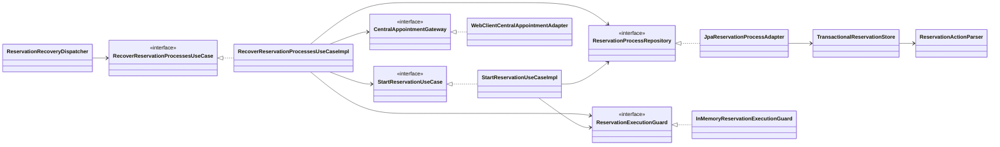
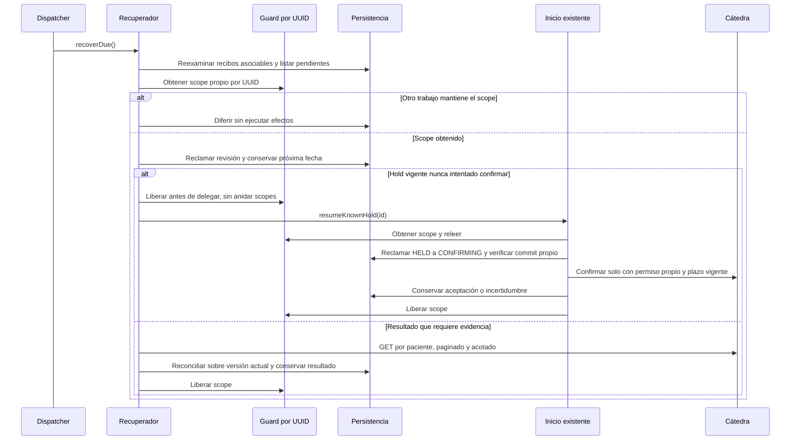

# PLAN: Recuperar procesos pendientes y resultados inciertos (CU-09)

**SPEC de referencia:** [SPEC.md](SPEC.md)
**Versión de la spec revisada:** aprobada explícitamente el 2026-11-02; base de código `5eaafca` (merge de #29, mismo árbol que `0deefd3`), issue #14.
**Estado:** Aprobado <!-- Borrador | En revisión | Aprobado -->
**Aprobación:** 2026-11-02, explícita del usuario. Desglose en [TASKS.md](TASKS.md); implementación autorizada explícitamente el 2026-11-02.

<!-- PARA LA PERSONA
Copia esta plantilla como PLAN.md junto a la SPEC.md aprobada.
Este documento define la solución técnica. Una vez revisado, el agente puede
derivar TASKS.md con tareas, dependencias y comprobaciones.
-->

<!-- PARA EL AGENTE
- Lee la SPEC.md aprobada, las instrucciones del proyecto y los contratos pertinentes.
  Si falta un documento necesario o la spec no está aprobada, indícalo antes de avanzar.
- Inspecciona el repositorio. Referencia rutas verificadas y distingue las nuevas propuestas.
- Propón una solución proporcional al alcance y coherente con el proyecto.
  Reutiliza lo existente y justifica nuevas dependencias o cambios de arquitectura.
- Distingue hechos, decisiones confirmadas y propuestas. Consulta las decisiones
  no resueltas; haz pocas preguntas por vez y actualiza el plan con las respuestas.
- Referencia los requisitos y criterios por su ID, sin copiar toda la spec.
- Si una decisión cambia el comportamiento o alcance, vuelve a la spec y solicita
  confirmación. No resuelvas una duda de producto mediante una suposición técnica.
- Conserva estos comentarios. No implementes durante la planificación.
- Solicita aprobación antes de marcar el plan como Aprobado. La autorización
  para implementar debe ser explícita; no se deduce del estado de los documentos.
- Para cambios de significado posteriores a la aprobación, registra una nota
  breve de cambio, motivo e impacto según AGENTS.md, sin historial separado.
-->

## Contexto técnico verificado

<!-- Qué existe hoy y cómo participa en la funcionalidad. -->

| Componente o archivo existente | Ruta verificada | Responsabilidad y uso previsto |
| --- | --- | --- |
| Inicio y progreso | `src/main/java/com/prog2/appointment/reservation/application/usecases/` | El inicio conserva intención/IDs antes de confirmar; la consulta reconcilia. Falta continuación autónoma general. |
| Agregado y contratos | `reservation/domain/model/ReservationProcess.java`, `reservation/domain/ports/out/ReservationProcessRepository.java` (bajo el mismo paquete base) | Reglas de fases, propietario, abandono, progreso y escrituras verificables. |
| Persistencia | `reservation/infrastructure/persistence/adapter/JpaReservationProcessAdapter.java`, `reservation/infrastructure/persistence/service/TransactionalReservationStore.java`, `reservation/infrastructure/persistence/repository/JpaReservationInboxRepository.java` | Transacciones cortas, versión optimista, writeId, recibos DEFERRED y contenido original. No existe reproceso de esos recibos. |
| Lectura central | `reservation/infrastructure/client/adapter/WebClientCentralAppointmentAdapter.java` | Paciente propio, hasta tres páginas de 100, plazo compartido y coincidencia exacta. Reutilizar sin fechas/estado. |
| Recuperaciones existentes | `reservation/application/usecases/PublishPendingPhonesUseCaseImpl.java`, `RecoverReservationCancellationsUseCaseImpl.java` | Ya recuperan teléfonos y cancelaciones con sus presupuestos. Mantener su autoridad sobre esos efectos. |
| Wiring y parámetros | `reservation/infrastructure/config/ReservationConfiguration.java`, `infrastructure/config/ReservationProperties.java`, `src/main/resources/application.yaml` | DI por constructor, scheduling, defaults de 3 intentos, 5 s entre intentos y pausa de 30 s. Las rutas Java abreviadas parten de `src/main/java/com/prog2/appointment/`. |

**Convenciones y patrón de referencia:** skill `hexagonal-arch` y estructura existente. Un único slice `reservation`, dominio/puertos sin framework, casos de uso en aplicación y adaptadores en infraestructura. Ports & Adapters y los adaptadores actuales; inbox/outbox existentes para mensajería. No agregar patrones, módulos ni abstracciones generales por esta recuperación. Javadoc tradicional en español, contratos en puertos y DI por constructor, sin `@Autowired` ni Lombok `@Data`.

## Solución propuesta

<!-- Explica el enfoque y sus motivos. Describe las responsabilidades y el
recorrido desde la solicitud, evento o arranque hasta el resultado del servicio.
Usa un diagrama si aporta claridad. -->

Un nuevo `RecoverReservationProcessesUseCase` coordina lotes pequeños al arrancar y periódicamente, sin HTTP de KMP. El evento de aplicación lista habilita la tarea periódica; no ejecutar HTTP en el hilo de arranque. Primero reexamina recibos soportados asociables; después reclama trabajo vencido para recuperación. Los teléfonos y cancelaciones conservan sus workers y presupuestos; este coordinador verifica resultados y no los reemplaza.

La continuación del hold conocido se reutiliza desde `StartReservationUseCase.resumeKnownHold`, ampliación interna del puerto existente, sin endpoint nuevo. El inicio y el recuperador comparten una exclusión temporal por UUID durante el trabajo activo. Un scope propio y liberado en `finally` evita archivar una solicitud que sigue ejecutándose. Esta coordinación corresponde al despliegue actual de una instancia de Turnos; la fase y el writeId conservados siguen decidiendo el permiso para el POST.

**Corrección necesaria de concurrencia:** hoy `update(beginConfirmation)` puede devolver CONFIRMING aunque otra ejecución haya realizado la transición. No basta leer esa fase. Una reclamación específica devuelve permiso solo a quien acreditó su propia escritura HELD→CONFIRMING. El inicio y la recuperación releen después de obtener su scope y usan esa misma reclamación.

Son nuevas las dos clases de recuperación, el dispatcher y el puerto/adaptador del guard. Los demás elementos existen; los repositorios JPA y entidades permanecen detrás del adaptador. El diagrama muestra solo dependencias afectadas.

El guard no mantiene transacciones SQL abiertas durante HTTP. La secuencia de lectura se sustituye por cierre local únicamente en los casos seguros ya aprobados; no crea un hold para recuperar un registro.

## Módulos y componentes afectados

<!-- Si el proyecto está modularizado, identifica los módulos afectados, sus
responsabilidades y la dirección de sus dependencias. Respeta los límites
existentes y justifica cualquier módulo o dependencia nueva. Si no está
modularizado, describe las carpetas o componentes afectados sin introducir
modularización fuera del alcance; marca la tabla de módulos como No aplica. -->

| Módulo | Existe / nuevo | Responsabilidad y cambios | Dependencias afectadas |
| --- | --- | --- | --- |
| Slice `reservation` | Existente | Completar recuperación y continuación segura, manteniendo sus puertos y adaptadores. No se agrega un módulo Maven. | Sin nuevos accesos a internals de otros slices; infraestructura sigue usando el puerto público de acceso técnico existente. |

<!-- Distingue lo que se reutiliza, modifica o crea. Las rutas nuevas son propuestas.
Señala impacto sobre modelos, contratos o componentes compartidos. -->

| Componente o ruta | Acción | Cambio y responsabilidad | Requisito relacionado |
| --- | --- | --- | --- |
| `domain/ports/in/RecoverReservationProcessesUseCase.java`, `application/usecases/RecoverReservationProcessesUseCaseImpl.java` | Crear, propuestos | Coordinar revisión automática y decisiones por progreso, sin recibir entidades ni tipos Spring. | RF-01/RF-02/RF-03/RF-06/RF-08 |
| `domain/ports/out/ReservationExecutionGuard.java`, `infrastructure/concurrency/InMemoryReservationExecutionGuard.java` | Crear, propuestos | Scope exclusivo por UUID; registro solo mientras hay ejecución, con token propio para liberar sin retirar otro scope. | RF-02/RF-07 |
| `infrastructure/scheduling/ReservationRecoveryDispatcher.java` | Crear, propuesto | Disparo al estar lista la aplicación y periódico; solo delega al puerto de entrada. | RF-01/RF-06 |
| `domain/ports/in/StartReservationUseCase.java`, `application/usecases/StartReservationUseCaseImpl.java` | Modificar | Releer bajo scope, reclamar confirmación propia y ofrecer continuación interna del hold conocido; no repetir una confirmación incierta. | RF-02/RF-03/RF-07 |
| `domain/model/ReservationProcess.java`, `domain/ports/out/ReservationProcessRepository.java` | Modificar | Cierre seguro del hold sin intento y contratos de selección/reclamación/reproceso. Reutilizar las demás transiciones. | RF-02/RF-05/RF-06/RF-07 |
| `infrastructure/persistence/adapter/JpaReservationProcessAdapter.java`, `service/TransactionalReservationStore.java`, entidades/repositorios existentes | Modificar | Presupuesto de revisión, claim verificable, transición actual y reproceso atómico del mismo recibo. | RF-01/RF-05/RF-07 |
| `src/main/resources/db/migration/V7__reservation_recovery.sql` | Crear, propuesta | Dos columnas de planificación e índices, sin tablas nuevas. Las otras rutas de esta tabla parten de `reservation/`. | RF-01/RF-06 |
| `infrastructure/config/ReservationConfiguration.java`, `src/main/resources/application.yaml` | Modificar | Compartir guard/parser, construir nuevos componentes y disponer de tres hilos de scheduling para las tres tareas periódicas. | RF-01/RF-04 |
| Clientes, consultas, teléfono y cancelación existentes | Reutilizar; ajustes puntuales solo si la integración los exige | Sus contratos y presupuestos no se sustituyen. README/Javadoc explicarán la recuperación final. | RF-03/RF-04/RF-08 |

## Datos y contratos

**Detalle de implementación, 2026-11-02 (RF-06/CA-09/T-01):** si expiresAt se alcanza después de reclamar pero antes de invocar el transporte, el ejecutor que conserva su writeId puede acreditar que no emitió el POST y cerrar localmente. Esto no permite inferir lo mismo de CONFIRMING después de un reinicio. No cambia el alcance, los estados ni las decisiones D-01/D-02.

<!-- Completa solo lo aplicable. Si un punto no aplica, indica el motivo. -->

- **Modelos y contratos de entrada y salida:** sin endpoints ni campos HTTP nuevos. Reutilizar `ReservationStatus` y los DTO existentes. Ampliar el puerto de inicio con `resumeKnownHold(UUID)`; el de persistencia con selección/reclamación de recuperación, reclamación propia de confirmación y reproceso de recibos. Todas las firmas hacia aplicación usan modelos/IDs de dominio.
- **Identificadores, relaciones y restricciones:** conservar UUID local, propietario, IDs centrales y correlaciones; no generar otra intención al recuperar. `ReservationExecutionGuard.tryAcquire(UUID)` devuelve un scope opcional propio, sin reentrancia. Su adaptador usa registro concurrente y libera por token exacto, sin acumular IDs históricos. La unicidad persistida y el claim por fase/writeId siguen siendo obligatorios.
- **Origen de los datos consultados y transformaciones:** SQL propio, eventos originales y `CentralAppointmentGateway.find`. Reutilizar la consulta sin fechas y su comprobación exacta. Reparsear un recibo con el mismo `ReservationActionParser`, grupo y origen conservados; verificar fingerprint/correlación. No convertir FAILED en EXPIRED ni derivar requestEventId de PHONE_PENDING.
- **Persistencia, consultas y actualizaciones:** V7 agrega `recovery_attempts` (entero no negativo, default 0) y `recovery_next_attempt_at` (TIMESTAMP(6), nullable) a `reservation_process`, con índice de próxima revisión/ID. La fecha inicial se deriva de updated_at y una pausa prudente para registros aún sin programación. Claim optimista corto incrementa el ciclo y reserva la próxima fecha antes de salir a HTTP; no cambia fase ni writeId de negocio por una mera reprogramación. No incorporar estos metadatos técnicos al agregado. Filtrar/ordenar pendientes y consultar lotes de diez para no escanear todo el historial.
- **Convivencia entre datos locales y remotos:** aplicar evidencia sobre la última versión, nunca guardar la copia previa al HTTP. La confirmación solo se emite después del commit propio HELD→CONFIRMING y de releer abandono/plazo; ante permiso no acreditado no hay POST. Un resultado local que avanzó por Kafka conserva prioridad según las reglas existentes. La planificación de revisión no acredita permiso para efectos.
- **Compatibilidad y migraciones de datos existentes:** no editar V1–V6, borrar datos ni modificar active_owner_id. Los registros anteriores quedan elegibles mediante la regla inicial; contadores de teléfono/cancelación no se reinician. Agregar índice del inbox por outcome/rejection/message_key para encontrar DEFERRED/UNKNOWN_PROCESS con asociación local. Bloquear solo el recibo que se reprocesa durante su transacción, sin una columna de versión o tabla adicional.

## Estado, operaciones y errores

<!-- Cómo se implementan los comportamientos aprobados en la spec.
Referencia RF/CA y completa solo los puntos pertinentes al backend. -->

- **Estado del servicio y de las operaciones:** usar las fases actuales, sin un nuevo estado global de salud o sincronización. CREATING_HOLD/HOLD_UNCERTAIN sin IDs y ya sin ejecución activa se archivan con la alternativa existente, sin nuevo hold. HELD conocido sigue si está vigente, no hay abandono y el canal requerido está preparado; si no, conserva el progreso. CONFIRMING/CONFIRMATION_UNCERTAIN nunca se reconfirman. Esperas y resultados inciertos se verifican por REST; PHONE_PENDING solo conserva espera. Un HELD vencido, sin intento y acreditado como tal, pasa a EXPIRED y resuelve su intención cuando corresponda; no se infiere ese caso de una ausencia.

| Progreso recuperado | Acción del coordinador |
| --- | --- |
| CREATING_HOLD/HOLD_UNCERTAIN sin IDs, sin ejecución activa | Archivar el intento según CU-04; no crear otro hold. |
| HELD conocido | Delegar continuidad segura si está vigente y preparada; vencido sin intento, EXPIRED local. |
| CONFIRMING/CONFIRMATION_UNCERTAIN/RECONCILIATION_REQUIRED | Verificar por REST, sin repetir confirmación. |
| WAITING_FOR_REQUEST/WAITING_FOR_PHONE | Reexaminar recibos y verificar con la demora existente; no generar solicitud ni teléfono. |
| PHONE_QUEUED/WAITING_FOR_RESULT | Mantener worker telefónico; verificar si hay incertidumbre, plazo vencido o ACK sin resultado tras el intervalo existente. |
| Intención de cancelación pendiente | Su worker conserva los efectos; tras agotar el presupuesto, permitir solo verificación. |
| Otros finales | No revisar históricos cerrados ni reabrirlos. |

- **Conservación y restauración del estado:** el guard evita competir con una petición activa en esta instancia; después de reiniciar se reconstruye vacío y SQL conserva todo el progreso. Un recibo DEFERRED/UNKNOWN_PROCESS se selecciona solo si su key ya corresponde a un proceso local; parser y transición existentes deben aceptar grupo, hold y selección. Releer/bloquear el recibo, aplicar sobre proceso actual y actualizar ese mismo recibo en una transacción. No llamar al accept ordinario, que lo consideraría ya recibido; no insertar otro recibo ni confirmar otra vez el offset. Rechazados y UNHANDLED_ACTION quedan fuera.
- **Ejecución, concurrencia y cancelación de operaciones:** scopes no anidados, adquiridos antes de actuar y liberados aun con error. Para delegar el hold, el recuperador libera el suyo; el inicio adquiere otro y relee, por lo que esa cesión no concede un permiso obsoleto. El claim persistido de confirmación retorna permiso únicamente para la escritura propia acreditada, también ante commit ambiguo. No mantener locks SQL durante REST. Guard ocupado se difiere sin gastar intentos de negocio. Abandono y eventos pueden avanzar por sus transacciones actuales; antes del efecto se respeta el estado más reciente.
- **Errores, reintentos y prevención de duplicados:** una revisión por registro y pasada; reutilizar attempts/retryDelay/preparationCooldown (defaults 3, 5 s, 30 s) para ciclos de lectura, con próxima fecha durable. Tras el tercer intento de revisión, pausar y abrir otro ciclo de consultas, también después de expiresAt, sin renovar presupuestos de efectos. Si una cancelación pendiente aún tiene presupuesto, su worker sigue siendo responsable; agotado ese presupuesto puede verificarse por lectura sin emitir otro POST. Un teléfono queda en su worker, sin duplicar publicación. SQL inaccesible impide reclamar/emitir; REST inaccesible mantiene el progreso. Ausencia o lectura parcial siguen inconclusas.
- **Observabilidad y diagnósticos seguros:** UUID local, fase, operación y código clasificado en logs; sin perfil, teléfono, JWT, payload ni configuración. Las consultas existentes siguen mostrando estado propio y verificación de su lectura; el trabajo automático no convierte una lectura posterior LOCAL en VERIFIED ni extiende expiresAt. Para fases inciertas se mantiene la comprobación y advertencia HTTP actuales.

## Dependencias y configuración

<!-- Librerías, servicios, permisos o configuración afectados. Verifica compatibilidad
con el proyecto y justifica las incorporaciones. No agregues dependencias por defecto. -->

- Sin dependencias Maven, servicios, secretos o permisos nuevos. Reutilizar Spring scheduling/WebClient/JPA, Flyway/MySQL, acceso técnico y reloj existentes.
- Wiring por constructor; parser como bean compartido por recepción y reconstitución de recibos, sin crear colaboradores de negocio desde los casos de uso. Campos obligatorios final.
- Reutilizar parámetros de reserva vigentes; no agregar variables obligatorias. Elevar `spring.task.scheduling.pool.size` de 2 a 3 para las tareas de teléfono, cancelación y recuperación general; ningún pool por proceso.
- Ajuste aprobado el 2026-11-02: agrupar presupuesto y plazos en el valor inmutable `ReservationRecoveryPolicy`, construido en el wiring con los parámetros existentes. Conserva el comportamiento y los RF/CA; afecta al constructor de recuperación, su configuración y sus pruebas.
- El despliegue de referencia conserva una aplicación Turnos. El guard local no se presenta como exclusión distribuida; escalar instancias requiere revisar esa coordinación.

## Estrategia de validación

<!-- Una fila por criterio de la spec. Selecciona el método capaz de demostrarlo:
test unitario, integración, contrato o prueba manual. No todos requieren todos los métodos.
Identifica tests existentes y separa los nuevos propuestos. Incluye regresiones relevantes.
Una captura aislada no demuestra persistencia ni ausencia de peticiones de red. -->

| Criterio | Método y test existente o propuesto | Entorno y datos necesarios | Evidencia prevista |
| --- | --- | --- | --- |
| CA-01 | Nueva ReservationRecoveryIntegrationTests: reinicio sin consultas del cliente. | MySQL temporal, proveedor HTTP ficticio y progreso real conservado. | Detección autónoma, misma identidad/propietario y consulta propia coherente. |
| CA-02 | Nuevas unitarias de recuperación y carrera en integración de inicio. | Barreras entre petición original/recuperador y commit ambiguo; hold vigente. | Un solo POST; ninguno por permiso ajeno, abandono o escritura no acreditada. |
| CA-03 | Integración de creación huérfana y regresión de StartReservationTests. | CREATING_HOLD/HOLD_UNCERTAIN sin IDs; ejecución activa y luego reinicio. | No archivar trabajo activo ni crear otro hold automáticamente; CU-04 conservado. |
| CA-04 | Regresión de CentralAppointmentGatewayTests y nueva recuperación. | Evidencia exacta/ajena/parcial/contradictoria y PHONE_PENDING sin evento. | Convergencia verificable sin POST ni solicitud inventada; FAILED sigue siendo FAILED. |
| CA-05 | Regresión de ReservationPhoneIntegrationTests y recuperación concurrente. | Teléfono conservado, ACK perdido, reinicio y cierre concurrente. | Mismo evento y contenido, plazo/presupuesto conservados, sin reapertura. |
| CA-06 | Regresión de ReservationCancellationTests/IntegrationTests. | Cancelación agotada, abandono en espera y nueva evidencia. | Solo lecturas tras agotamiento; sin otro ciclo de efectos ni cancelar pendientes. |
| CA-07 | Nueva integración de inbox y carreras con consumidor. | Recibo válido antes de asociación, duplicado, rollback y reinicio. | Reprocesar el mismo recibo una vez; recepción durable antes del offset y efecto atómico. |
| CA-08 | Nueva recuperación con Clock controlado y HTTP real ficticio. | Tres revisiones/pausa, restart y cátedra caída más allá del plazo; luego FAILED/CONFIRMED. | Próximas fechas durables, sin bucle ni efectos; convergencia posterior sin KMP. |
| CA-09 | Nueva unidad de transición e integración MySQL. | HELD vencido sin intento frente a CONFIRMING/incierto; borde de expiresAt. | Solo el caso seguro cierra EXPIRED/libera pendiente, sin POST ni ampliar plazo. |
| CA-10 | Nueva integración de concurrencia y regresión de autorización. | Eventos/solicitudes/revisión, fallo local y consulta ajena. | No reabrir finales ni exponer datos; liberar scope tras error sin duplicar efectos. |

**Comprobaciones de regresión:** preservar los casos de inicio sin IDs, teléfono/inbox, consultas, historial y cancelación/abandono. Las pruebas nuevas deben detectar claim de otro ejecutor, reproceso mediante accept que no aplica nada, reinicio que resetea contadores, cierre de CONFIRMING por reloj y publicación/confirmación después del plazo. No debilitar aserciones por fallos de infraestructura.

**Comandos verificados para compilar y ejecutar tests:** `./mvnw -B -ntp clean verify` y selección Surefire `-Dtest=...`, según README/POM. Tras crear las suites propuestas, usar `./mvnw -B -ntp -Dtest=ReservationRecoveryTests,ReservationRecoveryIntegrationTests verify` para el foco; estos nombres todavía no existen. Testcontainers administra MySQL/Kafka temporales sin .env ni servicios reales. Revisar Sonar CLI/IDE según disponibilidad; Actions/SonarCloud posteriores son feedback, no tareas ni resultados locales deducidos.

**Pruebas operativas del backend:** JAR con MySQL temporal y proveedores ficticios: reiniciar esperando solicitud, con confirmación incierta y con datos de teléfono/cancelación existentes; comprobar recuperación sin GET del usuario, sin nuevos holds, sin repetir confirmación y sin perder presupuestos. Una consulta real de un proceso propio existente puede comprobar la lectura central; no crear reservas adicionales ni enviar teléfonos ficticios a cátedra para sustituir un evento auténtico ausente.

**Limitaciones del entorno:** los reportes de eventos ausentes, FAILED sin evento de expiración y ocupaciones durante PHONE_PENDING siguen sin respuesta docente. El error de fechas está reproducido y se evita con la variante válida ya implementada. HTTP y transiciones controladas permiten verificar CU-09 sin esperar; el recorrido auténtico Kafka y la exclusión central durante PHONE_PENDING no se acreditan con esos dobles. No atribuir la causa de FAILED ni compensar la ocupación mediante estados inventados o una réplica local.

<!-- Esta sección planifica la validación. Durante la implementación, registra
en TASKS.md o en el informe de validación acordado los resultados y evidencias
reales. Usar el cierre de TASKS.md definido en AGENTS.md: CA/evidencia,
regresión y desviaciones del PLAN. Distingue pruebas ejecutadas, fallidas,
no ejecutadas y bloqueadas.
Compilar o tener tests en verde no sustituye revisar los criterios de la spec. -->

## Orden de implementación

<!-- Etapas y dependencias principales. El desglose ejecutable se escribe en TASKS.md.
Incluye puntos de comprobación para avanzar con cambios pequeños. -->

1. Incorporar transición segura, guard y reclamación propia de confirmación; demostrar la carrera con el inicio antes de habilitar continuación automática.
2. Agregar V7 y planificación durable, verificando base existente y permisos ante commit incierto.
3. Reprocesar recibos asociables con parser/transición existentes; demostrar rollback, duplicados y no reapertura.
4. Completar coordinación periódica y delegación al inicio; preservar workers de teléfono/cancelación y límites después del plazo.
5. Verificar CA/regresión y reinicios del JAR; actualizar README/Javadoc y cierre breve de TASKS cuando se autorice implementar.

## Riesgos y decisiones pendientes

<!-- Riesgos concretos de esta solución y cómo se resolverán, sin listas genéricas.
Escribe Ninguna en las decisiones pendientes cuando estén resueltas. -->

- **Riesgos y medidas acordadas:** SQL y REST no son atómicos: comprobar escritura propia antes del efecto y reconciliar lo incierto sin reenviarlo. El guard protege trabajo vivo en esta instancia, no sustituye SQL ni permite inferir que CONFIRMING nunca se envió. Los metadatos de revisión no reinician contadores de negocio. Un resultado Kafka puede avanzar durante HTTP; siempre aplicar sobre versión actual. No usar la ausencia de ocupación para resolver un proceso con IDs conocidos; la alternativa sin IDs conserva el criterio ya aprobado de CU-04. Las incidencias centrales pendientes no se convierten en cambios de contrato.
- **Decisiones confirmadas:** D-01, lecturas espaciadas aun después de vencer; D-02, EXPIRED local solo con hold conocido cuya confirmación nunca se intentó. Parámetros y coordinación de la propuesta se revisan con este PLAN, sin cambiar esas decisiones.
- **Decisiones pendientes:** Ninguna. PLAN, TASKS e implementación aprobados explícitamente el 2026-11-02; resultados y límites en TASKS.

<!-- ANTES DE SOLICITAR APROBACIÓN
Comprueba que el plan cubre los requisitos, respeta las exclusiones, reutiliza
componentes verificados y permite demostrar todos los criterios de aceptación.
Resuelve dudas y marcadores pendientes. Si la spec cambió, revisa su impacto.
Tras aprobar el plan, deriva TASKS.md con IDs, dependencias, referencias a RF/CA
y comprobaciones. Antes de implementar, realizar el chequeo de coherencia de
AGENTS.md con esos documentos, sin otro informe ni aprobación adicional.
No marques una tarea terminada sin realizar su validación;
si está bloqueada, registra el motivo.
-->
