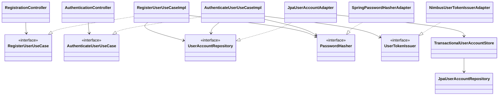
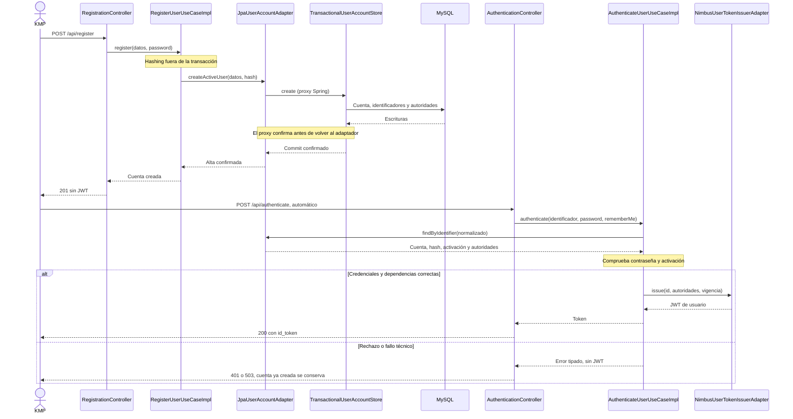

# PLAN: Registro y autenticación de usuarios

**SPEC de referencia:** [SPEC.md](SPEC.md), aprobada el 2026-10-20 con ajuste de contraseña confirmado el 2026-10-23.
**Versión de la spec revisada:** archivo local aprobado, 10 RF y 12 CA; contraseña de mínimo 6 caracteres y máximo 72 bytes UTF-8.
**Estado:** Aprobado <!-- Borrador | En revisión | Aprobado -->
**Aprobación:** explícita del usuario el 2026-10-23 («apruebo plan»), con la aclaración de retroalimentación remota indicada en validación.
**Alcance:** CU-01/#6 y CU-02/#5 en la rama actual y un PR. P-01/P-02 confirmadas el 2026-10-23; [TASKS.md](TASKS.md) aprobado e implementación autorizada explícitamente el mismo día.

<!-- PARA LA PERSONA
Este PLAN desarrolla la solución técnica de la SPEC aprobada. Su aprobación
es independiente; después se derivan TASKS y se solicita implementar.
-->

<!-- PARA EL AGENTE
- Conservar decisiones de SPEC y distinguir propuestas técnicas de acuerdos.
- Seguir hexagonal-arch y las reglas SDD de AGENTS.md, sin capas vacías.
- Referenciar RF/CA sin repetirlos. Consultar cambios de comportamiento.
- Conservar comentarios. No aprobar ni implementar por inferencia.
- Para cambios sustanciales posteriores a aprobación: nota breve de fecha,
  cambio, motivo e impacto; revisar la confirmación afectada, sin otro historial.
-->

## Contexto técnico verificado

<!-- Archivos existentes consultados; las rutas nuevas se identifican más adelante. -->

| Componente | Ruta existente | Uso previsto |
| --- | --- | --- |
| Build | `pom.xml` | Java 25, Boot 4.1.1, MVC, JPA/Flyway, MySQL y OAuth2 JOSE; conservar CI/JaCoCo. |
| Configuración | `src/main/resources/application.yaml` | Base propia, `ddl-auto=validate`, `open-in-view=false` y health mínimo. |
| Privada y reloj compartidos | `infrastructure/config/TechnicalAccessProperties.java`, `TechnicalAccessSettingsConfiguration.java` | Reutilizar la privada RSA externa y `Clock` UTC por constructor/wiring. |
| JWT de servicio | `infrastructure/security/jwt/ServiceTokenIssuer.java` | Conservar perfil y cinco minutos; no convertirlo en token de usuario. |
| Regresión de arranque | `src/test/java/com/prog2/appointment/AppointmentApplicationTests.java` | MySQL temporal, proveedores ficticios y health; conservar sus escenarios. |
| Migración de prueba | `src/test/resources/db/migration/V1__setup_probe.sql` | Es exclusiva de pruebas; no reutilizar V1 para la nueva migración productiva. |
| Confianza de Catálogo | [PLAN JWT proveedor](../../../../backend-catalogo/docs/features/seguridad-jwt/PLAN.md#jwt-propios-propuesta-de-contrato-para-coordinar-con-turnos) | RS256, emisor/perfiles, audiencia y tolerancia temporal ya acordados; Catálogo solo se consulta. |

Rutas Java relativas a `src/main/java/com/prog2/appointment/`. Al elaborar el PLAN no existían usuarios, entidades productivas, registro/login ni filtros propios de seguridad. API local comprobada con `javap`: Spring Security Crypto/JOSE 7.1.1; BOM local: Hibernate 7.4.5.Final y Jakarta Validation 3.1.1. No se ejecutó build durante la planificación; la evidencia de implementación posterior consta en TASKS.

**Convenciones y referencia:** un slice `user`, con dominio sin framework, puertos, casos de uso y adaptadores; excepciones de aplicación y fallos de puertos separados por responsabilidad. DTO y entidad no salen de infraestructura. Constructor DI, sin `@Autowired`/`@Data`; Javadoc español en responsabilidades, contratos y garantías de transacción/concurrencia. Se consultaron las secciones pertinentes de JPA, transacciones y hexagonal del material compartido. `@Transactional`, el proxy, `PasswordEncoder` y Nimbus son mecanismos del framework, no patrones propios.

## Solución propuesta

<!-- Recorrido concreto, responsabilidades y motivos. -->

**P-01, confirmada por el usuario el 2026-10-23:** KMP envía el registro y, tras su 201 confirmado, llama automáticamente al login con las mismas credenciales y la elección de «recordarme». Son dos solicitudes sin otra acción de la persona. La primera confirma la cuenta; la segunda obtiene el JWT. Si esta falla, KMP conoce que la cuenta existe y puede ofrecer CU-02 sin repetir el alta. Este repo documenta y prueba la secuencia HTTP; no implementa KMP.

Los dos casos de uso permanecen separados: `RegisterUserUseCaseImpl` crea una cuenta activa común mediante repositorio y hashing; `AuthenticateUserUseCaseImpl` comprueba credenciales/activación y emite el JWT. Ambos usan el mismo repositorio y `PasswordHasher`. No hay un segundo autenticador ni servicio fachada que solo delegue.

Para la coincidencia login/email, una colección de identificadores pertenece a cada cuenta: contiene sus dos valores normalizados, o uno si coinciden. Una clave única global en MySQL impide que dos cuentas reclamen el mismo valor, también en concurrencia. Cuenta, identificadores y autoridades se guardan en una sola transacción. No hace falta serializar todos los registros ni depender de un lock en memoria.

**Patrones efectivos:** los adaptadores JPA, hashing y JWT implementan puertos del dominio (Adapter); `UserAccountRepository` expresa persistencia sin JPA (Repository). La dependencia de aplicación sobre esas interfaces aplica DIP. No introducir Strategy, Factory o servicios adicionales solo para nombrar patrones.

### Diagrama de clases esencial

Modelos, DTO, mappers y configuración se detallan en tablas para mantener legibilidad.

### Secuencia del registro y login automático (P-01)

## Módulos y componentes afectados

<!-- Sin módulos Maven nuevos; las rutas propuestas no existen todavía. -->

| Módulo | Existe / nuevo | Responsabilidad | Dependencias |
| --- | --- | --- | --- |
| Maven | Existente, sin módulos adicionales | Conservar un backend desplegable. | No aplica modularización nueva. |
| Slice `user` | Propuesto | Registro y autenticación, sin reservas ni usuarios de Catálogo. | Infraestructura → aplicación → dominio; wiring usa configuración raíz existente. |

| Componente/ruta propuesta | Acción y responsabilidad | RF |
| --- | --- | --- |
| `user/domain/model` | `RegistrationData` (perfil sin contraseña), `UserAccount` (identidad y datos de autenticación) y `UserToken` (valor/vencimiento). Sin `toString` que exponga hash/token. | 01, 03, 08-10 |
| `user/domain/ports/in` | `RegisterUserUseCase.register(datos, password)` y `AuthenticateUserUseCase.authenticate(identificador, password, rememberMe)`. | 01-10 |
| `user/domain/ports/out` | `UserAccountRepository.createActiveUser/findByIdentifier`, `PasswordHasher.encode/matches`, `UserTokenIssuer.issue`. Contratos puros y fallos seguros definidos en dominio. | 02-10 |
| `user/application/usecases` | Dos implementaciones; validan decisiones de cuenta/permisos, invocan puertos y aplican las vigencias acordadas. | 03-10 |
| `user/application/exception`, `user/domain/exception` | Rechazo de credenciales en aplicación; conflicto/persistencia y fallos técnicos de puertos en dominio. Sin causas que filtren secretos a respuestas/logs. | 02, 05, 07-09 |
| `user/infrastructure/persistence/entity|repository|mapper` | `UserAccountEntity`, `JpaUserAccountRepository` y mapper manual. Colecciones JPA de identificadores y autoridades, sin crear entidades/slices adicionales. | 02, 03, 06 |
| `user/infrastructure/persistence/adapter|service` | `JpaUserAccountAdapter` traduce fallos, incluido commit; `TransactionalUserAccountStore` ejecuta escritura y lectura/mapeo dentro del proxy. | 02, 03, 06, 07 |
| `user/infrastructure/security` | `SpringPasswordHasherAdapter` con BCrypt acordado en P-02 y `NimbusUserTokenIssuerAdapter`. | 03, 08-10 |
| `user/infrastructure/web/controller|dto|mapper|validation` | Dos controladores, entradas específicas, `AuthenticationResponse` con `id_token`, mapper manual y restricción compartida de longitud UTF-8. Sin campos internos asignables. | 01, 04, 05, 07-10 |
| `user/infrastructure/web` y `user/infrastructure/config` | Handler de errores limitado a esos controladores y `UserConfiguration` para wiring, encoder y parámetros fijos de esta entrega. | 07-10 |
| `src/main/resources/db/migration/V2__create_users.sql` | Crear tablas propias. No modificar V1 de prueba ni migraciones de Catálogo. | 02, 03, 06 |
| `pom.xml`, README y pruebas | Añadir validación de entradas, declarar Crypto y documentar API/ejecución; ampliar pruebas manteniendo las existentes. | Todos |

No crear `application/service`, paquetes vacíos, CRUD administrativo, puerto entre slices ni dependencia hacia internals de `integration`. El wiring pasa la privada y el reloj raíz a los adaptadores; dominio/aplicación no importan `TechnicalAccessProperties`.

## Datos y contratos

<!-- Detalles técnicos propuestos sin alterar los comportamientos de SPEC. -->

### Contrato HTTP propuesto (P-01)

| Operación | Entrada | Éxito | Fallos identificables |
| --- | --- | --- | --- |
| `POST /api/register` | Campos de RF-01, sin identidad/activación/autoridades/auditoría asignables. | 201 sin cuerpo/JWT, solo después del commit. | 400 `VALIDATION_ERROR` o `USER_IDENTIFIER_ALREADY_USED`; 503 `USER_REGISTRATION_UNAVAILABLE`. |
| `POST /api/authenticate` | `username` (login o email), `password`, `rememberMe` opcional y falso por defecto. | 200 con `{"id_token":"..."}` y cabecera `Authorization: Bearer ...`. | 400 entrada inválida; 401 `INVALID_CREDENTIALS` (incluye inexistente/inactiva); 503 `AUTHENTICATION_UNAVAILABLE`. |

Éxitos y errores evitan caché HTTP (`Cache-Control: no-store`). Errores `application/problem+json` con `status`, `title`, `code` e `instance`; validación informa nombres/códigos de campos, nunca valores rechazados. Las entradas no contienen campos internos y descartan los desconocidos expresamente, sin enlazar JSON a entidades. Un cliente que envíe `activated=false` o `ROLE_ADMIN` no controla el alta. No registrar cuerpos ni cabeceras bearer.

Se conservan rutas/campos, 201 vacío de registro, `id_token` y respuesta de autenticación del [registro JHipster](https://github.com/jhipster/jhipster-sample-app/blob/main/src/main/java/io/github/jhipster/sample/web/rest/AccountResource.java) y su [autenticación](https://github.com/jhipster/jhipster-sample-app/blob/main/src/main/java/io/github/jhipster/sample/web/rest/AuthenticateController.java). Por compatibilidad, duplicados dan 400, no se cambia silenciosamente a 409. Activación inmediata, perfil obligatorio, mínimo de contraseña de la SPEC y códigos propios son las reglas de este proyecto. No añadir `/api/account`, activación por email o administración sin sus requisitos.

En ambos DTO, validar el mínimo de 6 caracteres y el máximo de 72 bytes UTF-8 antes de invocar casos de uso. Compartir una restricción Bean Validation para el máximo en bytes: `@Size` por sí sola no lo garantiza. El exceso devuelve 400 `VALIDATION_ERROR`, sin alta ni JWT; nunca recortar la contraseña para hacerla caber. Comunicar esta regla en el contrato para KMP.

### Persistencia, identidad y normalización

- `app_user`: ID `BIGINT` autogenerado; login 50, email 254, nombres 50, imagen opcional 256, idioma 10, hash hasta 255, activación y auditoría UTC. Altas siempre activas, autoridad `ROLE_USER`, auditoría asignada por backend; sin cuentas/contraseñas iniciales de demostración.
- `user_identifier`: identificador normalizado de hasta 254 caracteres como clave primaria global y FK a la cuenta. `UserAccountEntity` lo administra como colección de valores (`@ElementCollection`), con un conjunto `{login, email}` que elimina coincidencia propia. `user_authority` contiene el conjunto de autoridades con clave `(user_id, authority)`. No necesita clases `IdentifierEntity`/`AuthorityEntity`.
- Normalizar login/email con `Locale.ROOT` a minúsculas, también al autenticar; comprobar límites después de normalizar. Usar comparación binaria sin plegar acentos (`utf8mb4_0900_bin`) para que la unicidad corresponda a esa regla y no añada equivalencias ajenas a SPEC. No recortar ni normalizar contraseñas. Validación Bean Validation en DTO; idioma omitido → `es`, imagen vacía → ausencia, nombres no blancos. Conservar el patrón de login referenciado en SPEC.
- La clave única de identificador es la garantía final, no un `exists` seguido de `insert`. Cuenta, conjunto de identificadores y `ROLE_USER` se insertan juntos; conflicto en cualquier inserción revierte todo. También se conservan índices únicos de login/email. Una futura edición de esos campos tendrá que actualizar el conjunto en la misma transacción, pero no se implementa ahora.
- `TransactionalUserAccountStore.create` público, `@Transactional(REQUIRES_NEW, timeout=10)`, llamado desde el adaptador a través del proxy. La confirmación ocurre antes de volver al adaptador: este puede traducir errores de escritura y commit. Un método propio o un `new` no sustituye ese proxy. Hashing y firma quedan fuera de la transacción.
- Lectura `@Transactional(readOnly=true)`, con consulta por identificador y carga de autoridades antes de mapear a dominio; sin entidades LAZY después de cerrar la transacción. Mantener `open-in-view=false`.
- La migración V2 convive con V1 exclusiva de pruebas. Mantener MySQL/Flyway y `ddl-auto=validate`. No hay cuentas finales existentes que convertir ni acceso a tablas ajenas.

La transacción declarativa y los límites del proxy siguen la [semántica de Spring](https://docs.spring.io/spring-framework/reference/data-access/transaction/declarative/annotations.html); la unicidad final la impone [MySQL](https://dev.mysql.com/doc/refman/8.4/en/create-index.html). Una comprobación de tipos de excepciones SQL/JPA en esta frontera traduce fallos técnicos; no selecciona comportamiento de recursos de negocio por `instanceof`.

### Contraseña y JWT

**P-02, revisada y confirmada por el usuario el 2026-10-23:** `BCryptPasswordEncoder` de Spring Security, como el [ejemplo oficial de JHipster](https://github.com/jhipster/jhipster-sample-app/blob/main/src/main/java/io/github/jhipster/sample/config/SecurityConfiguration.java). Costo inicial 10, igual al constructor predeterminado del ejemplo; medir su costo al implementar, sin reducirlo para acelerar pruebas. El encoder genera la sal y produce el formato BCrypt nativo con versión, costo y sal incluidos; cabe en la columna prevista de 255 caracteres. Sin texto plano, prehash propio ni secreto adicional obligatorio.

[Spring documenta el encoder](https://docs.spring.io/spring-security/reference/features/authentication/password-storage.html). Su [implementación 7.1.1](https://github.com/spring-projects/spring-security/blob/7.1.1/crypto/src/main/java/org/springframework/security/crypto/bcrypt/BCrypt.java) rechaza el hashing de entradas de más de 72 bytes UTF-8. Aplicar explícitamente el límite también al login, antes de `matches`, y no depender de truncamientos ni comportamientos de verificación heredados. El puerto `PasswordHasher` conserva la verificación del valor completo y no normaliza contraseñas.

**Ajuste de P-02, 2026-10-23:** sustituye la elección anterior de PBKDF2 por BCrypt y el máximo de 100 caracteres por 72 bytes UTF-8, con aceptación explícita del usuario. Impacta RF-01/RF-03/RF-09, CA-02/CA-04, validación de ambos DTO, adaptador de hashing y sus pruebas. Se conserva el mínimo de 6 caracteres; no cambia la respuesta HTTP de registro/login ni aprueba el PLAN completo.

`NimbusUserTokenIssuerAdapter` recibe encoder RSA y reloj por constructor. El wiring crea su encoder con la privada externa existente; no cambia el firmante técnico ni inventa otra cuenta. El puerto recibe ID/autoridades verificados y duración elegida por el caso de uso; no datos de identidad de KMP.

| Campo JWT | Valor |
| --- | --- |
| `alg`, `iss` | `RS256`, `backend-turnos` |
| `sub` | ID estable de la cuenta convertido a texto, no el login/email modificable. |
| `aud` | `catalog` y `turnos`. |
| `token_use`, `auth` | `user`; autoridades controladas por backend, inicialmente `ROLE_USER`, separadas por espacios. |
| `iat`, `exp` | Instante UTC actual y +24 horas o +30 días según `rememberMe`; sin refresco ni extensión por actividad. |

Conservar los 30 s de tolerancia del validador de Catálogo; no aplicarlos a la sesión central de #4. Solo se entrega el JWT final; ningún hash, privada, JWT de servicio o de cátedra. No crear revocación/refresh, cookies de autenticación, sesiones HTTP ni almacenamiento de credenciales del cliente. #7 aplicará la validación JWT a las futuras APIs protegidas de Turnos.

## Estado, operaciones y errores

<!-- Resultados, concurrencia y recuperación propios del backend. -->

- **Estado:** la cuenta queda confirmada independientemente del login posterior. Login no modifica perfil/activación/autoridades. No se persiste un estado artificial de «registro a medias» ni tokens de sesión.
- **Concurrencia:** la restricción única cubre los dos sentidos login/email entre instancias. Verificar con transacciones independientes y barreras. Deadlock/timeout no permite duplicar cuentas ni emitir un JWT por omisión; distinguir conflicto único real de otros errores de integridad.
- **Fallos/resultado incierto:** no reintentar escrituras automáticamente. Un 503 por pérdida de conexión al confirmar no demuestra que no hubo commit; el cliente puede intentar login con sus credenciales, no autenticarse por mera coincidencia. Un duplicado posterior no devuelve un JWT. P-01 permite distinguir 201 confirmado de un fallo posterior de autenticación.
- **Errores:** traducir conflicto único MySQL a error de identificador, indisponibilidad a fallo seguro de puerto y rechazo de credenciales a excepción de aplicación. No clasificar por texto de mensajes SQL, ni devolver stack traces, parámetros o causas externas. Fallo al firmar/hash inválido almacenado no se disfraza como autenticación correcta.
- **Independencia externa:** estos casos de uso no llaman Catálogo/cátedra; el arranque técnico existente sí puede hacerlo. Pruebas de independencia separan esas llamadas de arranque de cualquier llamada del flujo de usuario.
- **Superficie HTTP:** las dos operaciones nuevas son públicas por requisito; no se añaden rutas de reservas ni se da por completada la política de #7. Usar Crypto/JOSE sin instalar por conveniencia un login de formulario, Basic, Resource Server o una contraseña predeterminada. Health mínimo y las rutas inexistentes actuales se conservan.
- **Diagnóstico:** errores estables y logs sin DTO, hashes ni bearer; no habilitar trazas de parámetros SQL ni request logging que exponga credenciales. No requiere navegación/ciclo de vida mobile.

## Dependencias y configuración

<!-- Propuestas acotadas; no se modificó el build. -->

**Corrección autorizada tras revisión remota, 2026-10-23:** PR #21 señaló dos problemas del regex y nueve ajustes de pruebas. Se conserva el lenguaje de logins de JHipster, agrupando alternativas/anclas y haciendo posesiva la repetición final de etiquetas de dominio; validar formatos admitidos y entradas inválidas mediante HTTP/MySQL. Preparar argumentos fuera de lambdas que verifican excepciones, usar aserciones de mapa directas y retirar un `throws` innecesario. El estado de inyección de fallos se declara infraestructura de pruebas. Maven ignora repositorios introducidos por dependencias transitivas para evitar consultas a feeds privados de Flyway; sin cambios de versiones ni credenciales. No cambia RF/CA, límites ni contratos; evidencia y regresión en TASKS.

- Añadir `spring-boot-starter-validation` para validación de DTO y declarar `spring-security-crypto` usado por el adaptador; versiones del BOM existente. JOSE/Nimbus, JPA/Flyway y Testcontainers ya están. BCrypt no requiere agregar Bouncy Castle; no introducir JHipster, Lombok ni bibliotecas criptográficas manuales.
- Usar la clave PKCS8 y el reloj ya cargados por configuración raíz; no leer `.env`/PEM privados durante trabajo del agente ni copiarlos a imagen/JAR. Sin nuevos secretos ni variables para las duraciones fijas acordadas.
- Conservar Compose individuales, red `prog2-services`, bases propias y health. HTTP solo en desarrollo local/red privada, HTTPS fuera de ese entorno según lo acordado; no instalar proxy/certificados en estos issues.
- **Corrección operativa autorizada, 2026-10-23:** la primera migración del Compose de desarrollo agotó la espera de lectura de 10 s, dejando tablas vacías sin historial confirmado. Flyway usa su conexión nativa a la misma base, con `user`/`password` explícitos desde `DB_USER`/`DB_PASSWORD` y `socketTimeout=60000`; el pool de aplicación conserva 10 s, conexión 5 s y ausencia de reintentos de Flyway. Sin nuevos secretos, cambio de RF/CA ni recuperación automática destructiva. Regresión: una espera real de MySQL superior a 10 s debe completarse por la conexión de migración y fallar por la normal; repetir arranque/health y flujo de usuario en Compose. El usuario autorizó excepcionalmente esta validación real y requiere consulta antes de corregir cualquier fallo adicional. La necesidad de credenciales explícitas se detectó en la primera regresión y su corrección recibió confirmación antes de continuar; resultados en TASKS.
- Contratos y flujo para KMP en README. Swagger/OpenAPI no es necesario para probar/documentar estas dos rutas; no añadir esa dependencia sin una necesidad acordada. CORS de navegadores y protección transversal se coordinan con #7; Android nativo no requiere habilitar un origen web.

## Estrategia de validación

<!-- Una fila por CA: pruebas propuestas, no evidencia de que ya pasaron. -->

| CA | Prueba/método propuesto | Entorno/datos | Defecto que debe detectar/evidencia |
| --- | --- | --- | --- |
| CA-01 | `UserHttpTests`: registro seguido de login automático P-01. | HTTP real, MySQL temporal, RSA efímera. | Cuenta inactiva, respuesta antes de commit o ausencia de JWT final. |
| CA-02 | Validación HTTP de registro/login: nulos/blancos, formatos, password ASCII de 5/6/72/73 caracteres y Unicode de hasta 72 y más de 72 bytes con menos de 72 caracteres; demás campos de SPEC, imagen/idioma omitidos. | DTO/validación reales; datos ficticios. | Contar caracteres en vez de bytes UTF-8, truncar, omitir el límite en login o crear cuenta/JWT pese a entrada inválida; default ausente. |
| CA-03 | `UserHttpTests`, escenarios de persistencia: duplicados y cruces en ambos sentidos/capitalización; colisión propia; dos altas simultáneas. | MySQL 8.4.8 y transacciones independientes, sin rollback global del test. | Dos cuentas con el mismo identificador o cuenta/autoridad huérfana tras conflicto. |
| CA-04 | `PasswordHasherTests` con BCrypt real: sal distinta, coincidencia exacta y rechazo al alterar el final de una contraseña válida de 72 bytes, también Unicode. HTTP rechaza agregar un sufijo a esos 72 bytes; inspeccionar logs/BD/salidas. | P-02 real, sin sustituir su resultado por mocks. | Texto plano, verificación parcial del prefijo, truncamiento y secretos expuestos. |
| CA-05 | Enviar ID, activación, autoridades y auditoría manipulados al registro. | HTTP/JPA reales. | Mass assignment: cuenta con ID/rol/estado/auditoría elegidos por cliente. |
| CA-06 | Alta confirmada, fallo controlado únicamente del puerto firmante y login posterior al restaurarlo. | Cuenta/MySQL reales; falla en la frontera de firma. | Rollback del alta por el login o JWT emitido pese al fallo; recuperación demostrada. |
| CA-07 | Cortar proveedores ficticios externos tras arranque; registrar/autenticar; recrear contexto contra el mismo MySQL temporal. | Contadores de proveedores, datos ficticios. | Dependencia remota del login o pérdida de cuenta tras reinicio. |
| CA-08 | Rollback antes de commit y conexión de prueba que confirme en MySQL pero falle al responder al cliente; repetir registro e intentar login. | Decorador de conexión limitado al ensayo y verificación desde otra conexión. | Falsa afirmación de rollback, repetición con efectos o JWT por mera existencia. |
| CA-09 | `UserJwtTests`: firma/claims y tokens cruzados; ensayo con validador/proveedor protegido del artefacto existente de Catálogo. | Pública/privada efímeras, Catálogo sin cambios y central ficticia. | Firma/identidad incompatible o acceso de usuario a entrega técnica; health alterado. |
| CA-10 | Login con usuario/email y variaciones de mayúsculas. | Cuentas reales, mismo hash/ID. | Resolver otra cuenta, recrearla o cambiar sus permisos/perfil. |
| CA-11 | Contraseña errónea, inexistente/inactiva, repositorio inaccesible y firma fallida. | Casos de uso y fronteras HTTP reales con fallos controlados. | JWT sin verificar o error técnico confundido con éxito/rechazo ordinario. |
| CA-12 | Reloj controlado, `rememberMe` omitido/falso/verdadero; leer/verificar JWT y fronteras temporales en Catálogo. | RSA/decoder reales; sin sleeps ni cambios de reloj del sistema. | Duración incorrecta, confusión con token técnico o extensión por actividad. |

**Regresión:** mantener `AppointmentApplicationTests` y las pruebas de acceso técnico, incluido cierre del ejecutor. Añadir checks de ausencia de cookies/sesión HTTP y claves en artefactos. No agregar pruebas que solo reflejen getters/mappers; comprobar transacción, SQL, seguridad y contratos.

**Comandos existentes:** `./mvnw -B -ntp clean verify` (suite y JaCoCo) y `git diff --check` (lectura). No se ejecutaron durante la planificación; las ejecuciones posteriores y las pruebas enfocadas constan en TASKS.

**Prueba operativa futura:** JAR/Compose de Turnos contra MySQL temporal; registro/login, reinicio conservando cuenta y health mínimo. Contraste con artefacto Catálogo sin modificar su repo, claves efímeras y central ficticia. No usar `.env`, datos ni servicios centrales reales para automatizadas.

**Calidad local:** Sonar CLI/IDE antes de proponer publicación; comprobar conexión y registrar bloqueos (Vortex 403 observado anteriormente no demuestra análisis). La app Android y su orquestación no se prueban como implementadas desde este backend.

**Aclaración del usuario, 2026-10-23:** los resultados de GitHub Actions y Sonar remoto son retroalimentación que aporta el usuario, no una etapa ni tarea propia del proceso. Cuando la aporte, contrastar la revisión evaluada y distinguirla de la evidencia local; si muestra un defecto, abordar la corrección pertinente. No dejar una tarea de espera de publicación/merge ni condicionar el cierre local a recibir esa retroalimentación. No cambia RF/CA ni la CI existente.

TASKS registra el chequeo previo RF→CA→PLAN/TASKS en una línea. Su cierre contendrá cada CA con evidencia/estado, regresión realmente ejecutada y desviaciones justificadas; no otro informe duplicado.

## Orden de implementación

<!-- Orden aprobado y desglosado en TASKS, que registra la autorización de implementación. -->

1. Derivar TASKS de este PLAN aprobado y comprobar coherencia antes de implementar, sin aprobación adicional para ese chequeo. Implementación solo ante autorización explícita.
2. Definir dominio, puertos y hashing acordado; agregar migración/repositorio y comprobar atomicidad, concurrencia y lectura reales en MySQL.
3. Completar ambos casos de uso y JWT; comprobar permisos, duraciones y fallos sin exponer secretos. No publicar stubs o autenticación provisional.
4. Añadir DTO/controladores/errores y validar los dos flujos HTTP, incluido registro confirmado seguido de login fallido.
5. Documentar contrato para KMP y ejecución, completar suite/Compose/contraste con Catálogo y calidad local. Cerrar cada CA con su evidencia, sin una tarea de espera de resultados remotos.

Commits coherentes, sin imponer uno por función: ajuste SDD/documentación y funcionalidad pueden separarse; registro/autenticación solo se separarán si cada entrega compila y pasa sus pruebas sin código incompleto. El usuario maneja Git y el PR con `Closes #6`/`Closes #5`.

## Riesgos y decisiones pendientes

<!-- Riesgos propios de esta solución, sin modificar acuerdos funcionales. -->

- **Concurrencia:** índices separados de login/email no alcanzan para cruces; el identificador global y la misma transacción son necesarios. Verificar la garantía en MySQL, no solo con mocks ni locks de una JVM.
- **Commit incierto:** no prometer ausencia de efectos ni repetir automáticamente; probar el fallo posterior a commit y conservar la alternativa de login.
- **Compatibilidad:** no reutilizar `idToken` del proveedor técnico como `id_token` de usuario, ni copiar activación por correo. La SPEC local vigente fija mínimo 6; no restaurar el mínimo histórico de 4 por copiar el ejemplo.
- **P-01, confirmada el 2026-10-23:** dos llamadas automáticas, registro seguido de autenticación, sin otra acción de la persona.
- **P-02, revisada y confirmada el 2026-10-23:** BCrypt de Spring Security y máximo de 72 bytes UTF-8 en registro/login, sin truncar; mínimo 6 caracteres conservado. Sustituye la elección anterior de PBKDF2 y el máximo de 100 caracteres.

No quedan decisiones pendientes. PLAN y TASKS aprobados; implementación autorizada explícitamente el 2026-10-23.

<!-- ANTES DE SOLICITAR APROBACIÓN
Comprobar los 12 CA, exclusiones y contratos; P-01/P-02 confirmadas.
No marcar PLAN aprobado por la aprobación de SPEC. Derivar TASKS después de
aprobación propia, con IDs/dependencias/RF/CA y una verificación proporcional.
-->
