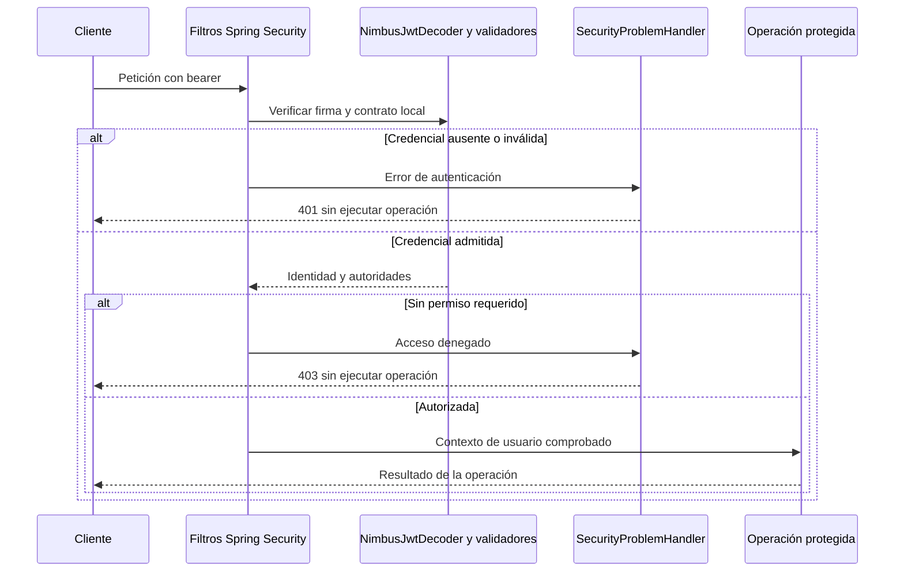

# PLAN: Protección JWT de las APIs de Turnos

**SPEC de referencia:** [SPEC.md](SPEC.md), aprobada explícitamente el 2026-10-26.
**Versión de la spec revisada:** revisión 2026-10-26, 8 RF y 8 CA; código base `ff099f9`.
**Estado:** Aprobado <!-- Borrador | En revisión | Aprobado -->
**Aprobación:** explícita del usuario el 2026-10-26 («apruebo plan»). Habilita derivar TASKS; no autoriza implementar.

<!-- PARA LA PERSONA
Copia esta plantilla como PLAN.md junto a la SPEC.md aprobada.
Este documento define la solución técnica. Una vez revisado, el agente puede
derivar TASKS.md con tareas, dependencias y comprobaciones.
-->

<!-- PARA EL AGENTE
- Lee la SPEC.md aprobada, las instrucciones del proyecto y los contratos pertinentes.
  Si falta un documento necesario o la spec no está aprobada, indícalo antes de avanzar.
- Inspecciona el repositorio. Referencia rutas verificadas y distingue las nuevas propuestas.
- Propón una solución proporcional al alcance y coherente con el proyecto.
  Reutiliza lo existente y justifica nuevas dependencias o cambios de arquitectura.
- Distingue hechos, decisiones confirmadas y propuestas. Consulta las decisiones
  no resueltas; haz pocas preguntas por vez y actualiza el plan con las respuestas.
- Referencia los requisitos y criterios por su ID, sin copiar toda la spec.
- Si una decisión cambia el comportamiento o alcance, vuelve a la spec y solicita
  confirmación. No resuelvas una duda de producto mediante una suposición técnica.
- Conserva estos comentarios. No implementes durante la planificación.
- Solicita aprobación antes de marcar el plan como Aprobado. La autorización
  para implementar debe ser explícita; no se deduce del estado de los documentos.
- Para cambios de significado posteriores a la aprobación, registra una nota
  breve de cambio, motivo e impacto según AGENTS.md, sin historial separado.
-->

## Contexto técnico verificado

<!-- Qué existe hoy y cómo participa en la funcionalidad. -->

Rutas Java relativas a `src/main/java/com/prog2/appointment/`.

| Componente o archivo existente | Ruta verificada | Responsabilidad y uso previsto |
| --- | --- | --- |
| Build | `pom.xml` | Java 25, Boot 4.1.1, Spring MVC, Crypto/JOSE, JPA/MySQL y pruebas; aún sin Resource Server. |
| Clave y reloj | `infrastructure/config/TechnicalAccessProperties.java`, `TechnicalAccessSettingsConfiguration.java` | Privada RSA externa validada y `Clock` UTC; reutilizarlos sin otra clave ni configuración remota. |
| Firma de usuario | `user/infrastructure/config/UserConfiguration.java`, `user/infrastructure/security/NimbusUserTokenIssuerAdapter.java` | Emite el perfil de usuario acordado; conservar sus claims y vigencias. |
| Firma y adquisición técnica | `infrastructure/security/jwt/ServiceTokenIssuer.java`, `integration/infrastructure/client/adapter/WebClientCatalogTechnicalTokenAdapter.java` | JWT de servicio saliente y consumidor protegido de Catálogo; sin cambios a su contrato. |
| Contratos públicos | `user/infrastructure/web/controller/`, `user/infrastructure/web/UserProblemHandler.java` | Registro/login, DTO y errores existentes. |
| Ejecución y regresión | `.env.example`, `compose.yaml`, `src/test/java/com/prog2/appointment/` | Configuración propia y pruebas HTTP/MySQL con claves y proveedores ficticios. |

**Convenciones y patrón de referencia:** seguir `hexagonal-arch` y la [seguridad existente de Catálogo](../../../../backend-catalogo/docs/features/seguridad-jwt/PLAN.md), adaptando audiencia, identidad y clave disponible. La seguridad transversal queda en infraestructura raíz, según la aclaración de cátedra sobre componentes compartidos. No requiere un slice, tablas ni puertos nuevos. Inyección por constructor; Javadoc tradicional en español para responsabilidades y contratos, sin `@Autowired` ni Lombok `@Data`.

## Solución propuesta

<!-- Explica el enfoque y sus motivos. Describe las responsabilidades y el
recorrido desde la solicitud, evento o arranque hasta el resultado del servicio.
Usa un diagrama si aporta claridad. -->

KMP envía el bearer. Los filtros de Spring Security extraen y autentican la credencial antes de MVC. `NimbusJwtDecoder` comprueba RS256 con la pública derivada de la privada local; validadores de emisor, audiencia y tiempo se complementan con `JwtContractValidator`. Después se convierten las autoridades de `auth` y se aplica la autorización de la ruta. Solo entonces se alcanza el controlador.

La identidad queda en el `JwtAuthenticationToken` de la petición, con `sub` como nombre del principal. Los futuros adaptadores HTTP podrán extraer ese ID comprobado y pasarlo a su caso de uso sin llevar tipos Spring al dominio. Ahora no se crea un resolver, modelo de actor ni puerto especulativo. El framework mantiene el contexto por petición; no se guarda el usuario en un singleton propio.

La comprobación de la credencial no consulta cuentas por petición ni servicios remotos. La activación se verifica en el login existente; no se incorpora un mecanismo adicional de revocación o administración de cuentas. La propiedad de procesos/reservas sigue a cargo de los CU que los implementen.

Se utiliza [Resource Server JWT de Spring Security](https://docs.spring.io/spring-security/reference/servlet/oauth2/resource-server/jwt.html), sin servidor OAuth adicional ni filtro JWT manual. La [cadena de filtros](https://docs.spring.io/spring-security/reference/servlet/architecture.html), el decoder y el contexto son mecanismos del framework que configuramos. Los emisores y adaptadores existentes conservan sus responsabilidades; no se introducen patrones de negocio nuevos.

En #7, la operación protegida del diagrama se prueba mediante un controlador exclusivo de tests. No se publica una operación ficticia para demostrar la seguridad.

## Módulos y componentes afectados

<!-- Si el proyecto está modularizado, identifica los módulos afectados, sus
responsabilidades y la dirección de sus dependencias. Respeta los límites
existentes y justifica cualquier módulo o dependencia nueva. Si no está
modularizado, describe las carpetas o componentes afectados sin introducir
modularización fuera del alcance; marca la tabla de módulos como No aplica. -->

| Módulo | Existe / nuevo | Responsabilidad y cambios | Dependencias afectadas |
| --- | --- | --- | --- |
| Maven único | Existe; no aplica modularización nueva | Configurar protección servlet transversal. | Infraestructura utiliza configuración raíz y Spring; no introduce dependencias de dominio/aplicación hacia seguridad. |

<!-- Distingue lo que se reutiliza, modifica o crea. Las rutas nuevas son propuestas.
Señala impacto sobre modelos, contratos o componentes compartidos. -->

| Componente o ruta | Acción | Cambio y responsabilidad | Requisito relacionado |
| --- | --- | --- | --- |
| `infrastructure/security/config/JwtSecurityProperties.java` | Crear | Pública derivada de la privada ya validada y lista inmutable de orígenes CORS; diagnósticos saneados. | RF-01/08 |
| `infrastructure/security/config/SecurityConfiguration.java` | Crear | Wiring de decoder, validadores, conversión de autoridades, cadena HTTP y CORS. | RF-01/02/03/04/08 |
| `infrastructure/security/jwt/JwtContractValidator.java` | Crear | Contrato de usuario y tiempos coherentes, sin decidir propiedad ni consultar cuentas. | RF-01/04/05 |
| `infrastructure/security/web/SecurityProblemHandler.java` | Crear | Respuestas 401/403 desde los filtros, anteriores al manejo MVC. | RF-07 |
| `user` y acceso técnico existente | Reutilizar | Mantener Argon2id, alta/login, firma y adquisición técnica; sin cambios de negocio. | RF-03/05/06 |
| `pom.xml`, `.env.example`, `compose.yaml`, README | Modificar | Starter, variable CORS opcional y documentación de confianza, acceso y límites. | RF-06/07/08 |
| `src/test/java/com/prog2/appointment/security/` | Crear | Pruebas de seguridad, configuración y firmas con fixtures de test. | RF-01 a RF-08 |
| Pruebas HTTP existentes | Ampliar/adaptar | Conservar registro/login/health y comprobar la nueva denegación de rutas no expuestas. | RF-03/06/07/08 |

## Datos y contratos

<!-- Completa solo lo aplicable. Si un punto no aplica, indica el motivo. -->

- **Modelos y contratos de entrada y salida:** bearer solo en `Authorization`; no aceptar tokens de query o formulario ni autenticar mediante cookies. Mantener respuestas públicas y JWT emitidos. El principal usa el ID decimal positivo de cuenta, compatible con `BIGINT`/`long`; no login, email ni `groupId`.
- **Identificadores, relaciones y restricciones:** comprobar `sub` no vacío y con formato de ID válido; `token_use=user`; `auth` como cadena de autoridades `ROLE_*` separadas por un espacio. Una cadena vacía es admitida como identidad sin permisos y obtiene 403 en APIs de usuario; un formato incompatible es 401. No aceptar JWT de servicio como usuario, aunque se lo firme con la misma clave y se cambie su audiencia.
- **Origen de los datos consultados y transformaciones:** pública local desde la privada RSA CRT ya validada, usando JDK; `iss=backend-turnos`, audiencia que incluye `turnos`, RS256 explícito. `JwtGrantedAuthoritiesConverter` lee `auth` con prefijo vacío para conservar `ROLE_USER`. No usar identidad o autoridades de valores adicionales enviados por KMP.
- **Persistencia, consultas y actualizaciones:** no nuevas tablas, migraciones, consultas de cuenta por petición ni persistencia del contexto de seguridad. El hash y las autoridades guardadas mantienen su contrato.
- **Convivencia entre datos locales y remotos:** validar localmente no exige que el catálogo esté vigente. Conservar #4 y referenciar el [contrato proveedor en revisión](../../../../backend-catalogo/docs/features/consulta-agenda-estado/SPEC.md) para nuevos clientes, sin fijar aquí credenciales/rutas todavía pendientes ni reenviar automáticamente un bearer entrante.
- **Compatibilidad y migraciones de datos existentes:** no cambiar JWT de usuario de 24 h/30 días ni JWT saliente de servicio de cinco minutos. Emisión/vencimiento obligatorios, `exp > iat`; tolerancia 30 s, emisión futura fuera de tolerancia rechazada y `nbf` comprobado si existe. No aplicar al usuario el límite de cinco minutos ni trasladar tolerancia al JWT central.

### Política HTTP y errores

Orden de autorización propuesto:

1. Permitir el despacho interno `DispatcherType.ERROR`, sin abrir una llamada externa a `/error`.
2. Permitir `POST /api/register`, `POST /api/authenticate` y `GET /actuator/health` sin credencial.
3. Denegar `/api/internal/**`; Turnos no ofrece un contrato interno entrante en este alcance.
4. Exigir el perfil de usuario admitido y `ROLE_USER` para `/api/**`.
5. Denegar las demás rutas. Los futuros CU deberán incorporar sus permisos y controles de propiedad antes de exponerse.

Una ruta pública permite omitir el bearer. Si el cliente envía expresamente uno inválido o vencido, se mantiene el procesamiento estándar de Spring y se responde 401 antes de MVC. KMP debe omitir la cabecera de autenticación en registro/login. No se introduce una excepción que ignore credenciales inválidas.

| Rechazo | Respuesta propuesta |
| --- | --- |
| Autenticación ausente/inválida en una petición protegida, o bearer inválido presentado | `401`, `WWW-Authenticate: Bearer`, `code=AUTHENTICATION_REQUIRED` |
| Identidad admitida sin permiso de acceso | `403`, `code=ACCESS_DENIED` |
| Credenciales de login incorrectas, sin bearer añadido | Conservar `401 INVALID_CREDENTIALS` del contrato actual |

`SecurityProblemHandler` implementará `AuthenticationEntryPoint` y `AccessDeniedHandler`: `application/problem+json`, `type=about:blank`, título/estado y código estable, `Cache-Control: no-store` y `Pragma: no-cache`. No copiar excepciones, tokens ni claims sensibles. Reutilizar el enfoque de serialización `ProblemDetail` de Catálogo, verificando su mixin de Jackson 3; no ampliar `UserProblemHandler` para errores producidos antes del controlador.

## Estado, operaciones y errores

<!-- Cómo se implementan los comportamientos aprobados en la spec.
Referencia RF/CA y completa solo los puntos pertinentes al backend. -->

- **Estado del servicio y de las operaciones:** registrar la cadena únicamente en un contexto web servlet, como en Catálogo, conservando los arranques no web de pruebas. `STATELESS`, sin form login, HTTP Basic, logout de sesión ni request cache. Desactivar CSRF para este contrato de bearer explícito, sin credenciales automáticas en cookies; revisarlo si cambia ese contrato.
- **Conservación y restauración del estado:** el reinicio carga la misma confianza externa y verifica vigencia actual; no restaura sesiones HTTP. No cambia la recuperación técnica de #4.
- **Ejecución, concurrencia y cancelación de operaciones:** no crear ejecutores ni estado de usuario compartido. El contexto pertenece a la petición y los futuros CU reciben un ID comprobado; #7 no añade operaciones cancelables ni lógica de propiedad ficticia.
- **Errores, reintentos y prevención de duplicados:** 401/403 antes del controlador y sin reintentar login, firma ni llamadas externas. No duplicar altas o modificar la semántica de resultados inciertos del registro.
- **Observabilidad y diagnósticos seguros:** no registrar cuerpos ni bearer; fallos de configuración muestran el nombre de la propiedad sin material RSA, valores ni causa original sensible. Mantener health mínimo.

## Dependencias y configuración

<!-- Librerías, servicios, permisos o configuración afectados. Verifica compatibilidad
con el proyecto y justifica las incorporaciones. No agregues dependencias por defecto. -->

- Incorporar `spring-boot-starter-security-oauth2-resource-server` y su starter de test `spring-boot-starter-security-oauth2-resource-server-test`, gestionados por Boot 4.1.1, siguiendo Catálogo. Los POM 4.1.1 están disponibles y fueron consultados localmente; el de test aporta la integración de seguridad para pruebas MVC. Mantener Crypto/JOSE usados directamente, Bouncy Castle y el stack actuales; sin otra biblioteca JWT ni versiones nuevas de Spring.
- `JwtSecurityProperties` recibe `TechnicalAccessProperties` y `Environment`: deriva únicamente la pública mediante `RSAPublicKeySpec`/`KeyFactory` y valida los orígenes. Reutiliza la validación de privada existente. No introduce `JWT_PUBLIC_KEY_PATH` en Turnos, otro montaje, JWKS, descubrimiento remoto ni claves elegidas por el token.
- `CORS_ALLOWED_ORIGINS` opcional y vacío por defecto, con el mismo nombre/formato de Catálogo: lista de orígenes HTTP(S) explícitos separados por comas, sin comodines, credenciales, ruta, query, fragmento ni puerto inválido. Una lista configurada inválida impide arrancar; configuración ausente mantiene CORS cerrado.
- Procesar [CORS antes de autenticación](https://docs.spring.io/spring-security/reference/servlet/integrations/cors.html). Permitir inicialmente `GET`, `POST`, `OPTIONS` y cabeceras `Authorization`/`Content-Type` para orígenes admitidos, sin cookies. Preflight no ejecuta negocio; la petición efectiva sigue necesitando sus permisos. Ampliar métodos solo con los CU que los incorporen.
- Agregar la variable opcional a `.env.example` y pasarla en Compose sin valor real predefinido. Mantener los montajes de solo lectura y la red existentes; no leer ni modificar `.env`, claves o contenedores del usuario durante implementación/pruebas aisladas.
- Conservar HTTP local/red privada de Compose y documentar HTTPS fuera de ese entorno, sin instalar proxy/certificados en #7. No hay cambios a credenciales de cátedra ni rotación automática.

## Estrategia de validación

<!-- Una fila por criterio de la spec. Selecciona el método capaz de demostrarlo:
test unitario, integración, contrato o prueba manual. No todos requieren todos los métodos.
Identifica tests existentes y separa los nuevos propuestos. Incluye regresiones relevantes.
Una captura aislada no demuestra persistencia ni ausencia de peticiones de red. -->

Proponer `security/SecurityHttpTests` con `@WebMvcTest`, configuración real, decoder real y cabeceras bearer firmadas con pares RSA efímeros, siguiendo el enfoque verificado de Catálogo. Controlador de observación registrado explícitamente solo en tests: informa ID/autoridades e indica si la operación se ejecutó. No sustituir autenticación por `@WithMockUser` ni por un JWT ya autenticado.

Un fixture `security/JwtTestTokens` prepara firmas/claims independientes por caso; `security/JwtSecurityPropertiesTests` comprueba pública derivada y CORS inválido/vacío. Reutilizar utilidades existentes cuando eviten duplicación real. Constructor DI con `@TestConstructor(autowireMode = ALL)`, que configura la entrega de dependencias por constructor sin `@Autowired` ni inyección por campos.

La implementación añade `CorsDefaultHttpTests` para verificar el cierre por defecto en un contexto independiente. Spring Security 7 incorpora también una autoridad técnica `FACTOR_BEARER`; las pruebas comprueban los roles de negocio y la ausencia de contaminación entre usuarios, sin confundir esa marca del framework con un permiso administrado por la aplicación.

| Criterio | Método y test existente o propuesto | Entorno y datos necesarios | Evidencia prevista |
| --- | --- | --- | --- |
| CA-01 | `SecurityHttpTests`: ausencia, formato, otra clave, algoritmo ajeno, emisor/audiencia, sujeto/perfil y tiempos inválidos; casos válidos en fronteras de tolerancia. | Filtros y firma reales, reloj fijo; sin MySQL para este slice de pruebas. | 401 y operación no ejecutada; detecta omitir firma, audiencia o validadores temporales. |
| CA-02 | Identidad válida con/sin `ROLE_USER`; incluir autoridades vacías y rutas internas/no habilitadas. | Mismo decoder real; contador de ejecución exclusivo de test. | Éxito o 403 según permiso; detecta sustituir autorización por mera autenticación. |
| CA-03 | Regresión real de `UserHttpTests` y `AppointmentApplicationTests`; añadir bearer inválido en rutas públicas y protección del despacho de errores. | MySQL temporal y proveedores ficticios existentes, sin `.env`. | Registro/login/health conservados y errores sin acceso alternativo. |
| CA-04 | Peticiones alternadas y concurrentes de dos sujetos, con IDs/roles libres distintos en parámetros/cabeceras/cuerpo; una petición anónima posterior sigue rechazada. | Probes de test, firmas distintas y barreras/esperas acotadas, sin sleeps. | Cada respuesta corresponde a su principal; detecta copiar identidad libre o compartirla globalmente. No acredita propiedad de reservas futuras. |
| CA-05 | Presentar perfiles de servicio/cátedra ante Turnos, incluida firma local con audiencia `turnos` pero perfil de servicio; conservar `TechnicalAccessHttpTests` existentes. | Claves y proveedor técnico ficticios. | Sin confusión de perfiles, cambios al consumidor de #4 ni credenciales técnicas en respuestas de usuario. |
| CA-06 | Inspeccionar 401/403, cabecera bearer y serialización de extensiones; capturar diagnósticos y comprobar que la operación no se ejecutó. | Marcadores sensibles ficticios, nunca secretos reales. | Códigos estables sin token/cause ni efectos; detecta errores emitidos como HTML, redirects o ProblemDetail sin código. |
| CA-07 | Cadena real de seguridad sin clientes remotos; regresión del login ante caída externa en `UserHttpTests`. Comprobar ausencia de `Set-Cookie` y sesión de autenticación. | Configuración y claves locales; proveedores de regresión controlados. | Validación independiente, sin sesiones ni llamadas externas por verificar JWT. |
| CA-08 | Origen permitido/denegado, preflight, petición efectiva sin permisos, lista vacía/ausente y valores inválidos. | `JwtSecurityPropertiesTests` y contexto MVC con orígenes ficticios. | CORS cerrado por defecto, sin acceso concedido por preflight; configuración inválida rechazada. |

**Comprobaciones de regresión:** mantener las pruebas de Argon2id, JWT emitidos, MySQL, transacciones y acceso técnico. En `AppointmentApplicationTests.exposesHealthWithoutInternalDetails`, `/actuator/env` y `/actuator` estaban en 404 por falta de exposición; con denegación transversal la solicitud anónima debe recibir 401. Ajustar esa expectativa por la política aprobada, sin habilitar los endpoints ni perder la comprobación de health mínimo.

**Comandos verificados para compilar y ejecutar tests:** el wrapper/POM existentes usan `./mvnw -B -ntp clean verify` y generan JaCoCo. Tras implementar, ejecutar primero `./mvnw -B -ntp -Dtest=SecurityHttpTests,JwtSecurityPropertiesTests test` y luego la regresión completa. Los dos nombres nuevos son propuestos, no clases ya disponibles. `git diff --check` es de lectura. Ninguno de esos tests/build se ejecutó durante este PLAN.

**Pruebas operativas del backend:** las pruebas HTTP completas usan el servidor real de Turnos y MySQL temporal. Revisar el artefacto producido para comprobar que no contiene claves, `.env` ni probes de tests. La variable CORS se documenta para Java/Compose; no repetir un ensayo sobre el entorno real del usuario ni modificar sus contenedores. Si surge una duda de empaquetado/configuración no cubierta por la regresión, comprobarla con JAR/Compose aislado y recursos ficticios.

**Limitaciones del entorno:** Catálogo/Kafka centrales siguen indisponibles; no se acredita su integración real ni se agrega una tarea de espera. Antes de proponer publicación, usar Sonar CLI/IDE disponibles junto con las pruebas, comprobando acceso/vinculación. No repetir el análisis Vortex 403 conocido sin cambio de acceso ni presentarlo como exitoso. Actions/Sonar remoto son feedback posterior del usuario, separado de la evidencia local y sin tareas de publicación/espera.

<!-- Esta sección planifica la validación. Durante la implementación, registra
en TASKS.md o en el informe de validación acordado los resultados y evidencias
reales. Usar el cierre de TASKS.md definido en AGENTS.md: CA/evidencia,
regresión y desviaciones del PLAN. Distingue pruebas ejecutadas, fallidas,
no ejecutadas y bloqueadas.
Compilar o tener tests en verde no sustituye revisar los criterios de la spec. -->

## Orden de implementación

<!-- Etapas y dependencias principales. El desglose ejecutable se escribe en TASKS.md.
Incluye puntos de comprobación para avanzar con cambios pequeños. -->

1. Revisar/aprobar este PLAN; derivar TASKS y comprobar RF→CA→PLAN/TASKS antes de implementar, sin otro informe. La implementación requiere autorización explícita.
2. Incorporar soporte Resource Server y configuración de confianza/CORS; validar pública derivada y rechazos de configuración sin alterar los emisores.
3. Configurar decoder, contrato de usuario, autorización y errores; comprobar firma, contexto aislado y rechazos sin ejecutar operaciones mediante probes de test.
4. Conservar contratos públicos, errores y acceso técnico en la regresión HTTP completa; documentar configuración, identidad y límites para los CU posteriores.
5. Ejecutar suite/calidad local y cerrar TASKS con CA, evidencia, regresión y desviaciones. El usuario administra Git y aporta feedback remoto; no hay etapa de push/merge.

## Riesgos y decisiones pendientes

<!-- Riesgos concretos de esta solución y cómo se resolverán, sin listas genéricas.
Escribe Ninguna en las decisiones pendientes cuando estén resueltas. -->

- **Riesgos y medidas acordadas:** la clave sirve para dos perfiles, por lo que validar solo la firma sería insuficiente; exigir audiencia de Turnos, sujeto de cuenta y perfil de usuario. Configurar el mapper de errores fuera de MVC y verificar sus códigos. Evitar que un preflight, una ruta pública mal delimitada o el despacho de errores habiliten operaciones. Las pruebas de identidad cubren la base transversal; las de propiedad se agregarán con cada CU real, sin confundir ambos alcances.
- **Decisiones pendientes:** Ninguna. El usuario aprobó este PLAN y después TASKS el 2026-10-26, incluido el procesamiento estándar de un bearer inválido en rutas públicas; autorizó explícitamente implementar. TASKS conserva la evidencia y el estado de ejecución.

<!-- ANTES DE SOLICITAR APROBACIÓN
Comprueba que el plan cubre los requisitos, respeta las exclusiones, reutiliza
componentes verificados y permite demostrar todos los criterios de aceptación.
Resuelve dudas y marcadores pendientes. Si la spec cambió, revisa su impacto.
Tras aprobar el plan, deriva TASKS.md con IDs, dependencias, referencias a RF/CA
y comprobaciones. Antes de implementar, realizar el chequeo de coherencia de
AGENTS.md con esos documentos, sin otro informe ni aprobación adicional.
No marques una tarea terminada sin realizar su validación;
si está bloqueada, registra el motivo.
-->
