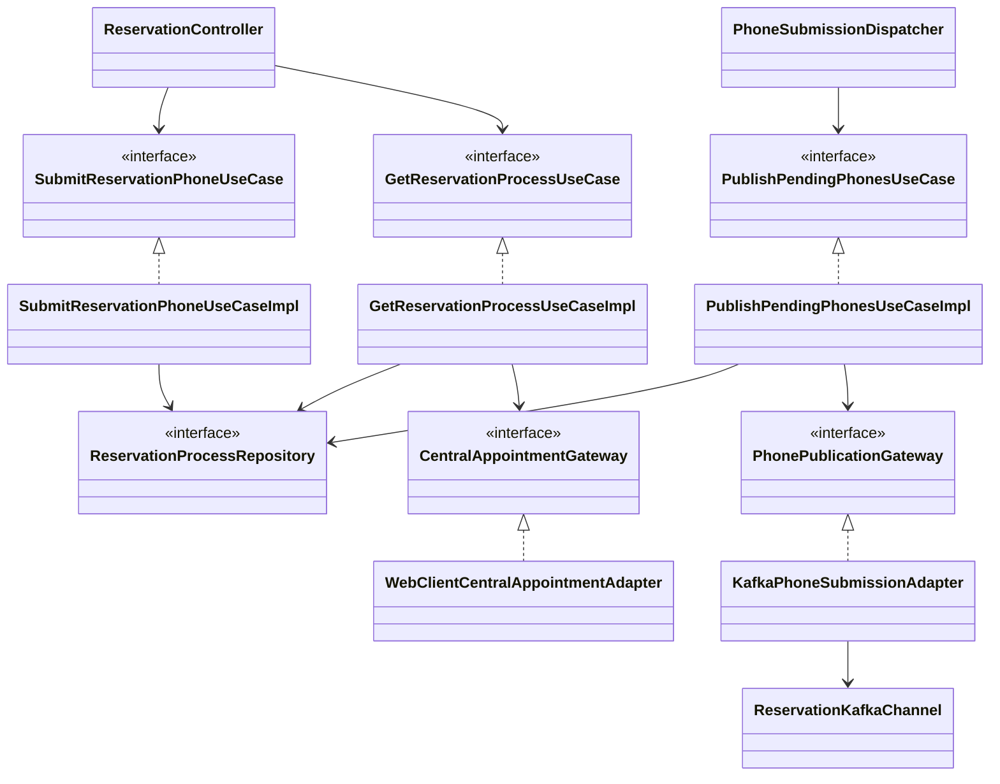

# PLAN: Completar teléfono y consultar progreso de reserva

**SPEC de referencia:** [SPEC aprobada](SPEC.md), #10/CU-05 y #11/CU-06.
**Versión de la spec revisada:** aprobada explícitamente el 2026-10-31; D-01 a D-03 confirmadas y D-04 de recuperación automática confirmada durante PLAN. Base verificada `cac8188`, con PR #26 integrado.
**Estado:** Aprobado <!-- Borrador | En revisión | Aprobado -->
**Aprobación:** explícita del usuario el 2026-10-31. TASKS y autorización explícita de implementación confirmadas el 2026-10-31; avance y evidencia en TASKS.

<!-- PARA LA PERSONA
Copia esta plantilla como PLAN.md junto a la SPEC.md aprobada.
Este documento define la solución técnica. Una vez revisado, el agente puede
derivar TASKS.md con tareas, dependencias y comprobaciones.
-->

<!-- PARA EL AGENTE
- Lee la SPEC.md aprobada, las instrucciones del proyecto y los contratos pertinentes.
  Si falta un documento necesario o la spec no está aprobada, indícalo antes de avanzar.
- Inspecciona el repositorio. Referencia rutas verificadas y distingue las nuevas propuestas.
- Propón una solución proporcional al alcance y coherente con el proyecto.
  Reutiliza lo existente y justifica nuevas dependencias o cambios de arquitectura.
- Distingue hechos, decisiones confirmadas y propuestas. Consulta las decisiones
  no resueltas; haz pocas preguntas por vez y actualiza el plan con las respuestas.
- Referencia los requisitos y criterios por su ID, sin copiar toda la spec.
- Si una decisión cambia el comportamiento o alcance, vuelve a la spec y solicita
  confirmación. No resuelvas una duda de producto mediante una suposición técnica.
- Conserva estos comentarios. No implementes durante la planificación.
- Solicita aprobación antes de marcar el plan como Aprobado. La autorización
  para implementar debe ser explícita; no se deduce del estado de los documentos.
- Para cambios de significado posteriores a la aprobación, registra una nota
  breve de cambio, motivo e impacto según AGENTS.md, sin historial separado.
-->

## Contexto técnico verificado

<!-- Qué existe hoy y cómo participa en la funcionalidad. -->

| Componente existente | Ruta verificada | Uso previsto |
| --- | --- | --- |
| Agregado y puerto de persistencia | [ReservationProcess](../../../src/main/java/com/prog2/appointment/reservation/domain/model/ReservationProcess.java), [ReservationProcessRepository](../../../src/main/java/com/prog2/appointment/reservation/domain/ports/out/ReservationProcessRepository.java) | Propiedad, progreso, exclusión, transiciones e idempotencia existentes. |
| Escritor e inbox | [TransactionalReservationStore](../../../src/main/java/com/prog2/appointment/reservation/infrastructure/persistence/service/TransactionalReservationStore.java), [V3](../../../src/main/resources/db/migration/V3__create_reservation_processes.sql) | Transacciones cortas, versiones y recibo anterior al ACK. |
| Kafka y parser | [ReservationKafkaChannel](../../../src/main/java/com/prog2/appointment/reservation/infrastructure/messaging/ReservationKafkaChannel.java), [ReservationActionParser](../../../src/main/java/com/prog2/appointment/reservation/infrastructure/messaging/ReservationActionParser.java) | Configuración asignada y resultados; rechazo telefónico aún se clasifica como OTHER. |
| Seguridad | [SecurityConfiguration](../../../src/main/java/com/prog2/appointment/infrastructure/security/config/SecurityConfiguration.java) | `/api/**` ya exige ROLE_USER; conservar filtros y comprobar propietario en el caso de uso. |
| HTTP propio | [ReservationController](../../../src/main/java/com/prog2/appointment/reservation/infrastructure/web/controller/ReservationController.java), [ReservationProcessResponse](../../../src/main/java/com/prog2/appointment/reservation/infrastructure/web/dto/ReservationProcessResponse.java) | Extender controlador/DTO/mapper/advice existentes. |
| Wiring y parámetros | [ReservationConfiguration](../../../src/main/java/com/prog2/appointment/reservation/infrastructure/config/ReservationConfiguration.java), [ReservationProperties](../../../src/main/java/com/prog2/appointment/infrastructure/config/ReservationProperties.java) | Conservar constructor DI, Clock, URLs y tiempos existentes. |

**Convenciones y patrón de referencia:** skill `hexagonal-arch`, estructura acordada del profesor y Javadoc español. Dominio/aplicación sin Spring, JPA, Kafka/Jackson ni internals ajenos; infraestructura compone puertos. Material Kafka de clase usa `KafkaTemplate`; se conserva ese enfoque. No nuevo slice, fachada de delegación ni framework genérico de colas.

## Solución propuesta

<!-- Explica el enfoque y sus motivos. Describe las responsabilidades y el
recorrido desde la solicitud, evento o arranque hasta el resultado del servicio.
Usa un diagrama si aporta claridad. -->

Una tabla de respuestas telefónicas actúa como **Transactional Outbox** e historial de idempotencia: guardar proceso y envío juntos evita aceptar datos que se pierdan al caer Kafka. No intenta una transacción distribuida MySQL/Kafka. La identidad estable permite duplicados físicos sin duplicar el efecto central, conforme a la aclaración docente. Guardar solo el último envío perdería los UUID anteriores cuando el usuario corrige.

1. `SubmitReservationPhoneUseCaseImpl` autoriza y normaliza. Busca primero el UUID histórico; si coincide devuelve el envío existente, aun tras cierre. Un envío nuevo exige solicitud/vigencia y ningún envío activo; confirma proceso y respuesta juntos antes del 202.
2. `PhoneSubmissionDispatcher` invoca periódicamente `PublishPendingPhonesUseCase`. Obtiene hasta diez envíos listos para intento, registra el intento/próxima fecha antes de publicar y usa `PhonePublicationGateway`. Ni HTTP ni Kafka quedan dentro de la transacción.
3. ACK confirmado cambia a espera de resultado solo si ese envío sigue activo. Fallo/timeout conserva incertidumbre e identidad. Tres fallos forman un ciclo; pausa y recuperación automática hasta el vencimiento, según D-04.
4. El receptor existente aplica resultados y cierra el envío activo en la misma transacción del inbox. Rechazo permite una corrección con otro UUID; un ACK tardío del envío anterior no modifica el nuevo.
5. `GetReservationProcessUseCaseImpl` devuelve estado propio y, cuando necesita verificar incertidumbre/plazo, realiza una lectura central acotada. No crea solicitudes Kafka, publica teléfonos ni cancela. KMP consulta por HTTP; no se implementa KMP aquí.

Relaciones principales, propuestas salvo los componentes existentes indicados arriba:

No se agregan leases, líderes distribuidos ni otra tabla de claves. Se conserva un publicador periódico por instancia; UUID y restricciones SQL protegen duplicados/concurrencia sin prometer entrega física exactamente una vez.

## Módulos y componentes afectados

<!-- Si el proyecto está modularizado, identifica los módulos afectados, sus
responsabilidades y la dirección de sus dependencias. Respeta los límites
existentes y justifica cualquier módulo o dependencia nueva. Si no está
modularizado, describe las carpetas o componentes afectados sin introducir
modularización fuera del alcance; marca la tabla de módulos como No aplica. -->

| Módulo | Existe / nuevo | Responsabilidad y cambios | Dependencias afectadas |
| --- | --- | --- | --- |
| `reservation` | Existente | Teléfono, consulta, publicación y resultados. | Puertos propios; infraestructura conserva integración pública existente. |
| `infrastructure/config` | Existente | Parámetros externos del servicio. | Solo wiring consume esos valores. |
| Otros módulos/repositorios | Sin cambios funcionales | Conservar autenticación, disponibilidad y Catálogo. | No leer sus tablas ni crear otro contrato de perfil. |

<!-- Distingue lo que se reutiliza, modifica o crea. Las rutas nuevas son propuestas.
Señala impacto sobre modelos, contratos o componentes compartidos. -->

Rutas relativas al slice; nombres nuevos propuestos:

| Componente o ruta | Acción | Cambio y responsabilidad | RF |
| --- | --- | --- | --- |
| `domain/model/PhoneSubmission`, `SubmitPhoneRequest`, `ReservationStatus`, `CentralAppointment` | Crear | Respuesta durable, comando, consulta y evidencia REST propias. Enums necesarios en `domain/enums`. | RF-03/RF-04/RF-07/RF-08 |
| `domain/ports/in/` y `application/usecases/` | Crear | SubmitReservationPhone, GetReservationProcess y PublishPendingPhones, cada puerto con su implementación. | RF-01 a RF-09 |
| `domain/ports/out/` | Ampliar/crear | Ampliar ReservationProcessRepository; crear PhonePublicationGateway y CentralAppointmentGateway. | RF-04/RF-06/RF-08 |
| `domain/model/ReservationProcess`, enums y parser | Modificar | Cola, espera de resultado, rechazo corregible y reconciliación; conservar guards de cierre. | RF-02/RF-05/RF-06 |
| Escritor, adaptador y mapper de persistencia | Modificar | Operaciones atómicas de proceso, inbox y teléfono; misma traducción de errores. | RF-04/RF-06/RF-08 |
| `infrastructure/persistence/entity/PhoneSubmissionEntity`, `repository/JpaPhoneSubmissionRepository`, V4 | Crear | Una tabla adicional; mapper existente ampliado. | RF-04/RF-08 |
| `infrastructure/messaging/KafkaPhoneSubmissionAdapter`, `dto/PhoneSubmissionEvent`, `PhoneSubmissionDispatcher` | Crear | Productor tipado por puerto, JSON contractual y disparador sin reglas de negocio. | RF-04/RF-08 |
| `infrastructure/client/adapter/WebClientCentralAppointmentAdapter` y DTO propio | Crear | Lectura REST puntual, sin implementar CU-07. | RF-07/RF-08 |
| Controlador/DTO/mapper/advice y configuración existentes | Modificar | Dos operaciones HTTP, body de teléfono, wiring, parámetros y README. | RF-01/RF-03/RF-07/RF-09 |

## Datos y contratos

<!-- Completa solo lo aplicable. Si un punto no aplica, indica el motivo. -->

- **Modelos y contratos de entrada y salida:** `POST /api/reservation-processes/{processId}/phone`, body `{requestId: UUID, phoneNumber: string}`. 202 tras inserción confirmada, también con Kafka caído; 200 por repetición propia normalizada. Identidad del paciente/grupo/correlación nunca procede del body. Comprobar propiedad antes de buscar una clave ajena.
- **Consulta:** `GET /api/reservation-processes/{processId}` devuelve 200 para el propietario. Extender los campos actuales con `phoneRequestId`, `requiredField`, `canSubmitPhone`, `verificationStatus` (LOCAL/VERIFIED/UNAVAILABLE/INCONCLUSIVE), `verifiedAt` y `warningCode`, opcionales cuando corresponda. Conservar nombres/estados existentes y `Cache-Control: no-store`. La consulta de históricos y el replay no publican.
- **Identificadores, relaciones y restricciones:** UUID del envío como `eventId` saliente, globalmente único en la tabla; otro proceso/contenido con esa clave genera conflicto seguro. Misma clave/teléfono normalizado devuelve el registro original antes de revalidar un plazo ya pasado. Una corrección tras rechazo requiere UUID nuevo; no requiere cambiar obligatoriamente el valor.
- **Origen de los datos consultados y transformaciones:** quitar únicamente espacios, guiones, paréntesis y puntos; validar `^\+?[0-9]{7,15}$`. Centralizar en el modelo propio, sin clase adicional para una sola cadena ni agregar país. DTO solo comprueba presencia/formato UUID.
- **Evento:** todos los campos de `AdditionalInformationSubmitted` v1; key centralProcessId, `requestEventId` auténtico e `information.phoneNumber` normalizado. Persistir los valores inmutables, incluido groupId/occurredAt, antes de publicar; serializar desde la fila confirmada para conservar contenido y precisión tras reinicios. No exponer teléfono completo o IDs técnicos en la consulta.
- **Persistencia, consultas y actualizaciones:** V4 aditiva, `reservation_phone_submission`: UUID PK, secuencia interna de historial (desempata timestamps iguales), process_id FK, copia inmutable del evento/vencimiento, published_at/closed_at opcionales, contador del ciclo, next_attempt_at, último motivo seguro y versión optimista. Una columna generada nullable por process_id cuando closed_at es NULL impone un único envío activo. Índice de pendientes por próxima ejecución. Históricos permiten responder UUID anteriores; no tabla adicional de idempotencia.
- **Atomicidad:** aceptación cambia proceso e inserta envío juntos; resultado central cambia proceso, envío activo e inbox juntos. Usar escritor/proxy existentes y transacciones cortas; conflictos optimistas con relectura acotada. El UUID permite verificar una aceptación con commit incierto sin otra marca propia del envío. Si no se puede verificar, 503 no demuestra que no se guardó; KMP conserva el UUID.
- **Convivencia entre datos locales y remotos:** GET central `/api/appointments` con paciente derivado del propietario y fecha exacta, página 0/size 100 y orden predeterminado del anexo. Buscar coincidencia exacta de proceso/paciente/selección y validar respuesta. Una página sin coincidencia es inconclusa, nunca prueba cierre; no ampliar a listado general. CONFIRMED/CANCELLED/FAILED verificables convergen mediante transacción, sin sobrescribir un resultado más avanzado recibido durante HTTP. PHONE_PENDING no fabrica solicitud ni habilita teléfono sin su evento.
- **Compatibilidad y migraciones de datos existentes:** conservar V2/V3, cuentas, procesos, UUID, límite por propietario e inbox. No reprocesar automáticamente el histórico diferido de CU-09. Mantener fingerprints de eventos ya soportados y comprobar redelivery de V3 al ampliar el parser.

## Estado, operaciones y errores

<!-- Cómo se implementan los comportamientos aprobados en la spec.
Referencia RF/CA y completa solo los puntos pertinentes al backend. -->

- **Estado del servicio y de las operaciones:** conservar los existentes; añadir PHONE_QUEUED (guardado, ACK aún no verificado), WAITING_FOR_RESULT (ACK conocido) y FAILED (fallo central verificado por REST). Rechazo telefónico vuelve a WAITING_FOR_PHONE con reasonCode PHONE_REJECTED y mismo expiresAt. No clase por estado ni motor de workflow. `canSubmitPhone` requiere solicitud, fase compatible, plazo y ausencia de envío activo.
- **Guardas:** ampliar acceptInitialConfirmation/recordFailure/phoneRequested para que respuestas REST o solicitudes duplicadas no retrocedan los nuevos estados. AppointmentConfirmed adelantado prevalece sobre publicación/ACK; cancelación verificada sigue prevaleciendo sobre confirmación tardía. Rechazo/invalidez/final cierran el envío correlacionado; invalidez conserva necesidad de reconciliación.
- **Conservación y restauración del estado:** al arrancar, el disparador recupera filas pendientes. Registrar intento y próxima fecha antes de Kafka limita recuperación tras caída; actualizar ACK/fallo solo sobre ese UUID, comprobando cierre y versión. Un callback viejo no altera otra corrección. No cancelar publicaciones ambiguas como si el broker no hubiera recibido.
- **Ejecución, concurrencia y cancelación de operaciones:** `KafkaTemplate<String,String>` y DefaultKafkaProducerFactory dentro del adaptador, reutilizados y cerrados por su ciclo de vida (physicalCloseTimeout de la fábrica acotado, sin espera indefinida). JSON con JsonMapper y StringSerializer, sin cabeceras de clases. Reutilizar configuración asignada conservada por ReservationKafkaChannel bajo su monitor, ampliada con destino telefónico; no pedir otro JWT por envío. Validar destino asignado/metadata sin crear topics; reconstruir el productor solo si cambia el destino y cerrar el anterior de forma acotada.
- **Límites:** `@Scheduled`/un hilo con fixedDelay igual a retryDelay (5 s por defecto), lote máximo diez. Tres intentos por ciclo; separar por retryDelay y, al agotar, esperar preparationCooldown (30 s) antes de otro ciclo. Guardar contador/fecha para respetarlos tras reinicio. Nunca repetir después de expiresAt ni de un cierre; al llegar al plazo, detener esa publicación y conservar incertidumbre para consultar resultado central. La ventana temporal limita todos los ciclos.
- **Timeout Kafka:** nuevo phone-publish-timeout 5 s; acks=all, retries=0 y enable.idempotence=false: la idempotencia funcional es la del evento. Acotar metadata (describe sin autocreación) y max.block.ms a la mitad del presupuesto cada uno, request.timeout.ms/delivery.timeout.ms y espera del future al presupuesto completo; linger.ms=0; acotar el total de bloqueo de send más espera del future a 10 s por defecto. Revisar Clock justo antes de send; una operación iniciada antes del límite puede quedar incierta, sin declarar liberación central. El envío no bloquea el request HTTP.
- **Consulta central:** estado normal/histórico se lee localmente. Reconciliar incertidumbre, plazo alcanzado o espera de resultado sin novedad tras 30 s; máximo una petición sin retry por consulta, con timeout HTTP existente. Una ausencia, respuesta contradictoria o caída retorna estado local con aviso. No cache/mapeo de locks nuevo ni temporizador central por cada proceso. La actualización de evidencia relee la versión actual para conservar eventos concurrentes.
- **Errores, reintentos y prevención de duplicados:** 400 entrada/UUID/teléfono inválidos, 404 indistinto para proceso ausente/ajeno, 409 UUID reutilizado o fase/envío activo/plazo incompatible, 503 persistencia no verificable. Kafka caído no rechaza una respuesta ya conservada; cátedra caída no impide el GET local. Conservar 401/403/500, problem+json/code y no-store; agregar manejo de conversión del UUID sin convertirlo en 500.
- **Observabilidad y diagnósticos seguros:** UUID/proceso local, etapa, intento/ciclo y motivo; no teléfono, JWT, payload o configuración completa en logs/toString. Sustituir el LoggingProducerListener predeterminado por registro seguro y evitar el volcado INFO de ProducerConfig. Sin publicación después del cierre del dispatcher; cancelar su tarea antes de cerrar productor. Redes/esperas fuera del monitor de coordinación y transacciones.

**Concreción de implementación (2026-10-31):** metadata de ambos topics verificada sin autocreación; el productor comparte el primer presupuesto entre describe y bloqueo de send para conservar el total previsto. Historial con secuencia interna para desempatar timestamps. Detalles de T-02/T-03/T-08, sin cambios de RF/CA ni contrato público.

## Dependencias y configuración

<!-- Librerías, servicios, permisos o configuración afectados. Verifica compatibilidad
con el proyecto y justifica las incorporaciones. No agregues dependencias por defecto. -->

- Sin librerías nuevas: Spring Kafka 4.1.1, kafka-clients 4.2.1, Jackson, WebClient, JPA/Flyway y Testcontainers ya están en el POM. `KafkaTemplate.send`, cierre de fábrica y API se contrastaron con sus fuentes locales; compatibilidad operativa se verifica al implementar.
- Activar scheduling en ReservationConfiguration y construir colaboradores por constructor, sin @Autowired ni @Data. Usar parámetros @Bean solo para wiring. Un dispatcher de publicación, separado del ejecutor de preparación existente, gestionado por Spring.
- Reutilizar attempts/retryDelay/preparationCooldown/httpTimeout/metadataTimeout. Añadir solo `RESERVATION_PHONE_PUBLISH_TIMEOUT=5s` y `RESERVATION_RESULT_VERIFICATION_DELAY=30s`, opcionales, validados y documentados en YAML/Compose/.env.example/README. No nuevos secretos, bootstrap fijo o broker en Compose/CI.
- KMP: contrato HTTP nuevo y consultas sin superposición cada 3 s mientras espera, al volver y tras enviar; detener el polling al salir o finalizar. Es pauta de integración, no implementación de KMP ni obligación de una tarea en segundo plano. No SSE.
- Referencias contractuales de SPEC y [productores Spring Kafka](https://docs.spring.io/spring-kafka/reference/kafka/sending-messages.html). La clase del curso no sustituye persistencia/ACK/idempotencia del proyecto.

## Estrategia de validación

<!-- Una fila por criterio de la spec. Selecciona el método capaz de demostrarlo:
test unitario, integración, contrato o prueba manual. No todos requieren todos los métodos.
Identifica tests existentes y separa los nuevos propuestos. Incluye regresiones relevantes.
Una captura aislada no demuestra persistencia ni ausencia de peticiones de red. -->

| CA | Método y test existente o propuesto | Entorno/datos | Evidencia prevista |
| --- | --- | --- | --- |
| CA-01 | Nueva ReservationPhoneIntegrationTests, reutilizando soporte existente. | JWT real, dos propietarios y UUID ajeno. | GET/POST sin filtración, eventos ni acceso central ajeno. |
| CA-02 | Parser/agregado y SQL existentes ampliados. | Solicitud válida/ajena/ausente, REST PHONE_PENDING. | Solo evento auténtico habilita; campo adicional compatible no cambia el hecho. |
| CA-03 | Nuevo SubmitReservationPhoneTests y gateways existentes. | Formatos, 6/7/15/16 dígitos y signo/caracteres. | Normalización contractual y cero eventos por entrada inválida. |
| CA-04 | Integración con ambos topics temporales. | DB/Kafka reales y productor propio. | Evento/key correctos y fila confirmada antes de publicar; ACK no confirma reserva. |
| CA-05 | Barreras SQL/HTTP, integrado. | UUID repetido/contenido equivalente/distinto, dos UUID simultáneos. | Una aceptación activa e históricos repetibles; conflicto sin suplantación. |
| CA-06 | Agregado, parser e integración ampliados. | Rechazo, corrección y ACK viejo retenido. | UUID nuevo/misma solicitud; callback anterior no altera la corrección. |
| CA-07 | Clock controlado y publisher real con gateway controlado. | Antes/en/después del plazo, expiración/confirmación demoradas. | No send fuera del plazo, no cierre ficticio, no reapertura. |
| CA-08 | Integración y StartReservationTests ampliados. | Confirmación antes de ACK; fallo REST inicial después de encolar; invalidez/cancelación. | No duplicar ni retroceder proceso/envío. |
| CA-09 | Integración de los dos endpoints. | Pendiente/histórico y consultas repetidas. | Campos/acciones coherentes, no-store, sin POST central/publicación por consultar. |
| CA-10 | Nuevo GetReservationProcessTests y gateways HTTP. | REST ajeno/vacío/fallido/contradictorio y evento concurrente. | Estado local con aviso; un GET acotado, sin cierre por ausencia. |
| CA-11 | Nuevo PublishPendingPhonesTests y CommitFaultDataSource/integración. | Caída antes de publicar y después del ACK antes de commit, reinicio, ciclos/cooldown y Kafka recuperado. | Mismo ID/contenido; límites persistidos, recuperación automática antes del plazo y una confirmación funcional. |
| CA-12 | Suites de parser/inbox existentes ampliadas. | Rollback real, offsets, V3 poblada y redelivery, extras/duplicados. | Persistir antes de ACK; sin falsos conflictos por ampliar el parser ni cambios ajenos. |

**Comprobaciones de regresión:** mantener las pruebas de inicio en ReservationIntegrationTests y concentrar el nuevo recorrido en ReservationPhoneIntegrationTests, reutilizando ReservationTestSupport/CommitFaultDataSource sin una jerarquía nueva de fixtures. Conservar registro/login, JWT/CORS, acceso técnico, disponibilidad y CU-04. Probar V4 sobre datos V3 poblados, proceso/solicitud previos y exclusión única; no borrar cuentas ni ampliar CU-09. Constructor DI en pruebas Spring con TestConstructor(autowireMode=ALL), que entrega dependencias al constructor sin inyección por campos.

**Comandos verificados para compilar y ejecutar tests:** `./mvnw -B -ntp clean verify`; focos `-Dtest=ReservationProcessTests,ReservationActionParserTests,ReservationGatewayTests,ReservationIntegrationTests test`, más ReservationPhoneIntegrationTests y las tres suites unitarias nuevas propuestas. Pruebas por comportamiento, sin sleeps arbitrarios ni duplicar el algoritmo; Clock, barreras y esperas acotadas.

**Pruebas operativas del backend:** JAR aislado con MySQL/Kafka descartables y proveedores ficticios, dos topics, cuenta y proceso reales del artefacto: guardar con broker caído, reiniciar, recuperar publicación, aplicar resultado y consultar. Configuración Compose con entorno ficticio, sin tocar servicios personales.

**Limitaciones del entorno:** Sonar CLI/IDE disponibles, Javadoc, artefacto, secretos y diff; no repetir Vortex 403 ni afirmar análisis remoto. Actions y Sonar aportan feedback tras publicación del usuario. Sin solicitud/resultado central auténticos no se acredita flujo real; no publicar teléfonos a cátedra sin autorización separada. Resultados ejecutados, cobertura, límites y cierre en TASKS; esta sección conserva la estrategia aprobada.

<!-- Esta sección planifica la validación. Durante la implementación, registra
en TASKS.md o en el informe de validación acordado los resultados y evidencias
reales. Usar el cierre de TASKS.md definido en AGENTS.md: CA/evidencia,
regresión y desviaciones del PLAN. Distingue pruebas ejecutadas, fallidas,
no ejecutadas y bloqueadas.
Compilar o tener tests en verde no sustituye revisar los criterios de la spec. -->

## Orden de implementación

<!-- Etapas y dependencias principales. El desglose ejecutable se escribe en TASKS.md.
Incluye puntos de comprobación para avanzar con cambios pequeños. -->

1. Modelos/puertos y HTTP definidos: pruebas de normalización, autorización, plazo e idempotencia antes de extender infraestructura.
2. V4, mapper y escritor existentes: aceptación/resultado atómicos, versiones y unicidad, verificados con MySQL temporal.
3. Productor/dispatcher y ciclos: comprobar ambos topics, publicaciones inciertas y restauración con identidad estable.
4. Ampliar parser/agregado/inbox y añadir consulta/reconciliación: verificar carreras con REST/ACK, corrección y resultados finales.
5. Integrar controlador/configuración/documentación, regresión completa, ensayo aislado y cierre CA/evidencia/regresión/desviaciones. El desglose ejecutable se desarrolla en TASKS; el código requiere autorización posterior.

## Riesgos y decisiones pendientes

<!-- Riesgos concretos de esta solución y cómo se resolverán, sin listas genéricas.
Escribe Ninguna en las decisiones pendientes cuando estén resueltas. -->

- **Riesgos y medidas:** MySQL/Kafka no son atómicos, por eso outbox y deduplicación central; un ACK perdido puede duplicar el mensaje físico. El resultado no referencia el UUID de envío, por eso una sola respuesta activa por solicitud y cierre atómico antes de corregir. REST no tiene consulta directa por proceso: una página sin coincidencia sigue inconclusa. Mantener fingerprints/redelivery y guards al añadir estados evita regresiones de CU-04. El presupuesto final es expiresAt, nunca el reloj de KMP.
- **Decisiones pendientes:** ninguna funcional. D-04 fue confirmada por el usuario: recuperación automática por ciclos hasta vencer. Defaults, nombres y contratos técnicos de este documento quedaron aprobados el 2026-10-31. Si la implementación revela que hacen falta cambios sustanciales, se vuelve a revisar el punto afectado; no añadir mecanismos especulativos. Implementación autorizada explícitamente el 2026-10-31.

<!-- ANTES DE SOLICITAR APROBACIÓN
Comprueba que el plan cubre los requisitos, respeta las exclusiones, reutiliza
componentes verificados y permite demostrar todos los criterios de aceptación.
Resuelve dudas y marcadores pendientes. Si la spec cambió, revisa su impacto.
Tras aprobar el plan, deriva TASKS.md con IDs, dependencias, referencias a RF/CA
y comprobaciones. Antes de implementar, realizar el chequeo de coherencia de
AGENTS.md con esos documentos, sin otro informe ni aprobación adicional.
No marques una tarea terminada sin realizar su validación;
si está bloqueada, registra el motivo.
-->
